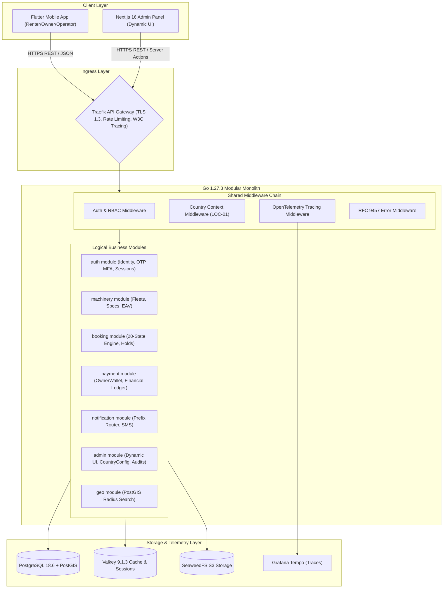

# Architecture Blueprint — Dink Machinery

**Target Architecture (Generated at Bootstrap):** Feature-Based Modular Monolith in Go 1.27.3, Flutter 3.47.9 Mobile, Next.js 16 Admin.  
**Canonical Source:** `docs/source/Architecture_Design_Document.md`

---

## 1. System Containers (C4 Level 2)

---

## 2. Core Architectural Invariants

### 1. In-Transaction Financial Atomicity (`BK-17-BE`)
State machine transitions that alter financial standing execute status updates, `FinancialLedgerEntry` writes, and `OwnerWalletTransaction` debits within a single `pgx.Tx` transaction protected by optimistic locking (`version` column). Financial mutations must never rely on asynchronous events.

### 2. Multi-Country Parameterization (`LOC-01-BE`, `ADR-015`)
Incoming requests resolve an active `country_code` via the `X-Country-Code` header or user context. Dialing codes, currency symbols, minor units, tax rates, and regulatory retention periods are dynamically resolved from `country_configs`.

### 3. Server-Driven Admin UI (`AD-06-BE`)
The Next.js administrative dashboard renders navigation hierarchies, table columns, filter rules, and action triggers dynamically from metadata fetched from `/api/v1/admin/ui-config`.

---

## 3. Subsystem Architectural Details

Detailed component designs are maintained in:
- Backend Architecture: `docs/shared/architecture/04-backend-architecture-go.md`
- Mobile Architecture: `docs/shared/architecture/05-flutter-mobile-app-architecture.md`
- Admin Web Architecture: `docs/shared/architecture/06-nextjs-admin-panel-architecture.md`
- Database Design: `docs/shared/architecture/07-database-design.md`
- Security Architecture: `docs/shared/architecture/09-security-architecture.md`