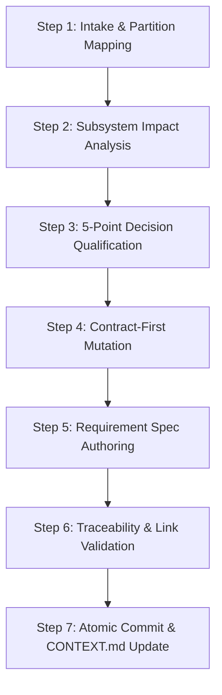

# Task Protocol 02: New Requirement Ingestion & Specification Lifecycle — Dink Machinery

**Protocol ID:** `PROTO-02-NEW-REQUIREMENT`  
**Target:** AI Agents, System Architects & Product Engineers  
**Scope:** Standardized end-to-end procedure for ingesting, scoping, drafting, and qualifying new functional or non-functional requirements.  
**Governing Documents:** `AGENTS.md`, `CONTEXT.md`, `TECH_STACK.md`, `CODE_STANDARDS.md`, `API_CONVENTIONS.md`, `ERROR_CATALOG.md`

---

## 1. Objective & Invariant Principles

Every new feature, regulatory mandate, or architectural change introduced to **Dink Machinery** must follow this deterministic ingestion protocol. Direct code implementation without an approved requirement specification and API contract mutation is prohibited.

### Non-Negotiable Ingestion Rules
1. **Source of Truth Precedence:** Canonical requirements reside in `docs/source/`. Any partition-specific view in `docs/shared/requirements/` must remain synchronized with zero drift.
2. **Contract-First Mandate:** Any requirement altering or exposing network interactions must update `contracts/openapi.yaml` and pass Spectral linting before application scaffolding begins.
3. **The 5-Point Decision Qualification Test:** Every design trade-off introduced by the requirement must be evaluated against the 5-point test to determine if an L1 ADR or L2 Partition Decision is required.
4. **Mandatory Invariants Assertion:** Every requirement specification must explicitly affirm compliance with:
   - **Integer Minor-Unit Money:** Zero floating-point monetary attributes.
   - **Multi-Country Parameterization (`LOC-01-BE`):** No hardcoded geographic or regulatory constants.
   - **Optimistic Concurrency Control:** Inclusion of `version` attributes on stateful records.
   - **RFC 9457 Problem Details:** Complete mapping to `ERROR_CATALOG.md`.
   - **Zero-PII Logging (ASVS Level 3):** No exposure of identity or financial credentials.

---

## 2. Requirement Ingestion & Specification Lifecycle



---

### Step 1: Intake, Partition Mapping & Unique ID Allocation

1. **Locate Target Partition:** Map the incoming requirement to an existing requirement partition (`05-01` through `05-10`) or establish a new partition if it constitutes a distinct bounded context.
2. **Assign Requirement Identifier:** Format the ID using canonical syntax:
   ```text
   REQ-<partition_id>-<subsystem_or_topic>-<sequence_number>
   ```
   *Examples:*
   - `REQ-05-04-CAT-01` (Machinery category taxonomy navigation)
   - `REQ-05-06-LED-03` (Immutable double-entry balance check)
   - `REQ-05-07-INS-02` (Operating hours meter regression rejection)

---

### Step 2: Cross-Subsystem Impact & Boundary Analysis

Document the impact across all architectural tiers:

| Subsystem | Impact Assessment Criteria | Required Artifacts |
|---|---|---|
| **Contracts** | New endpoints, schema mutations, query parameters, or RFC 9457 error codes. | `contracts/openapi.yaml` |
| **Go Backend** | Domain entities, application commands/queries, `sqlc` queries, migrations. | `backend/internal/modules/...` |
| **Flutter Mobile** | BLoC events/states, Dio interceptors, Isar schemas, dynamic fonts, UI screens. | `mobile/lib/features/...` |
| **Next.js Admin** | Dynamic UI schemas (`/admin/ui-config`), Server Actions, TanStack tables. | `admin/src/...` |
| **PostgreSQL / PostGIS** | New tables, spatial GIST indices, version columns, soft-delete triggers. | `migrations/YYYYMMDDHHMMSS_*.sql` |
| **Security / ASVS L3** | Masking requirements, RBAC scopes, encryption at rest, rate limits. | `ERROR_CATALOG.md`, Semgrep rules |

---

### Step 3: Architectural Decision Evaluation (5-Point Qualification)

Run the proposed implementation approach through the **5-Point Qualification Test**:

1. **Alternative Test:** Did you evaluate two or more technically viable options with distinct trade-offs?
2. **Surprise Test:** Would a competent engineer be surprised by or question this choice 6 months from now?
3. **Constraint Test:** Is this choice dictated by hard non-functional constraints (security ASVS L3, PostGIS spatial latency, regulatory compliance)?
4. **Irreversibility Test:** Would reversing this decision require $>1$ engineer-day of refactoring or alter a published schema/API?
5. **Scope Test:** Does this choice span multiple requirement partitions or subsystems?

#### Decision Routing Matrix
- **Satisfies 0 or 1 Test:** Tactical choice. Document inline within the requirement specification; no separate decision record required.
- **Satisfies $\ge 2$ Tests (Localized Scope):** Level 2 Partition Decision. Scaffold record in `docs/decisions/partitions/<partition-id>.md` using:
  ```bash
  bash scripts/scaffold-decisions.sh partition <partition-id> <decision-slug> "<Decision Title>"
  ```
- **Satisfies $\ge 2$ Tests (Cross-Cutting / Platform Scope):** Level 1 System ADR. Scaffold record in `docs/decisions/ADR-NNN-<slug>.md` using:
  ```bash
  bash scripts/scaffold-decisions.sh adr <slug> "<Decision Title>"
  ```

---

### Step 4: Contract-First Mutation (`contracts/openapi.yaml`)

Prior to writing functional specs, update the canonical OpenAPI contract:

1. **Define Operations & Schemas:**
   - Add paths, operation IDs, tags, and request bodies.
   - Enforce the universal Success Envelope or RFC 9457 Error Envelope.
   - Model all currency fields using the `MoneyAmount` composite schema (`amountMinor` int64 + `currency` string).
   - Annotate mutating actions with the `Idempotency-Key` header parameter.
2. **Validate Contract Locally:**
   ```bash
   npx @stoplight/spectral-cli lint contracts/openapi.yaml --ruleset .spectral.yaml
   ```
3. **Register New Domain Errors:**
   - If new error codes are introduced, append them to `ERROR_CATALOG.md` with HTTP status, RFC 9457 type URI, and retryability semantics.

---

### Step 5: Requirement Specification Authoring

Author or amend the partition document within `docs/source/requirements/<partition-id>.md`. The specification must follow this structure:

```markdown
# Partition Specification: [Partition Title] (`[partition-id]`)

## 1. Bounded Context & Objective
<!-- High-level domain responsibility and business goals. -->

## 2. Functional Requirements Inventory
### REQ-[partition-id]-[topic]-[number]: [Requirement Name]
- **User Persona:** [Renter | Owner | Operator | Admin | System]
- **Description:** [Precise behavioral statement using RFC 2119 keywords: MUST, SHALL, SHOULD]
- **API Contract Mapping:** `[HTTP_METHOD] /api/v1/...` (`operationId`)
- **Database Invariants:**
  - Table: `[table_name]`
  - OCC Versioning: `version INT NOT NULL DEFAULT 1`
  - Soft-Delete: Filtered by `deleted_at IS NULL`
  - Financials: Stored as `BIGINT` minor units

## 3. Non-Functional & Security Constraints (ASVS L3)
- **Data Protection:** [Masking rules for PII]
- **Concurrency & Locking:** [Distributed Valkey locks or PostgreSQL pessimistic row locks]
- **Idempotency Window:** [24-hour cache TTL on Idempotency-Key]

## 4. Architectural Decision Tracing
- **Governing L1 ADRs:** `[ADR-NNN]`
- **Partition Decisions:** `[D-XX-YY-ZZZ]`

## 5. Verification & Acceptance Test Matrix (ISO/IEC/IEEE 29119)
| Test ID | Test Type | Scenario Description | Expected Outcome |
|---|---|---|---|
| `TC-[partition-id]-01` | Unit | Domain invariant validation | Error returned on negative minor unit |
| `TC-[partition-id]-02` | Integration | Concurrency version mismatch | 409 Conflict with RFC 9457 body |
| `TC-[partition-id]-03` | Contract | OpenAPI schema conformance | Spectral & DTO deserialization pass |
```

---

### Step 6: Traceability Verification & Link Validation

Verify reciprocal links and structural conformance using automated repository scripts:

```bash
# 1. Audit decision template compliance
bash scripts/validate-decision-template.sh

# 2. Audit bidirectional decision links
bash scripts/validate-decision-links.sh

# 3. Synchronize canonical docs/source/ to docs/shared/
if [ -f "scripts/sync-docs.sh" ]; then
  bash scripts/sync-docs.sh
fi
```

---

### Step 7: Atomic Commit & Context Tracking Handover

Update tracking documents and commit the new requirement specification atomically:

1. **Update `OPEN_QUESTIONS.md`:** If the requirement introduces unresolved dependencies or integration ambiguities, record an `OQ-NNN` entry.
2. **Update `CONTEXT.md`:** Add the newly defined requirement and active partition status under **Current Progress Snapshot** and **Next Immediate Tasks**.
3. **Execute Atomic Git Commit:**
   ```bash
   git add contracts/ docs/ CONTEXT.md ERROR_CATALOG.md
   git commit -m "[REQ-<partition-id>] docs(spec): define specification for <feature-title>

   Authored functional requirements, OpenAPI schema additions, and decision mappings
   for REQ-<partition-id>-XX. Verified Spectral contract linting and bidirectional links.

   Tests: Spectral passed (0 errors), validate-decision-links passed.
   Docs: docs/source/requirements/<partition-id>.md, CONTEXT.md
   Refs: #<issue-or-pr-id>"
   ```