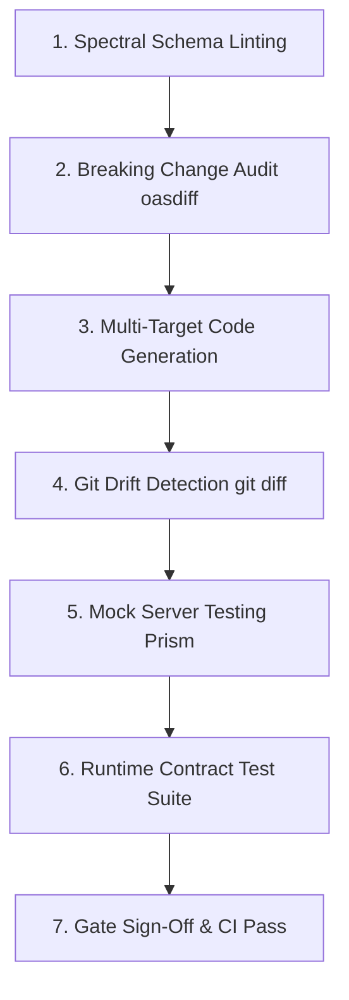

# Task Protocol 03: Contract Verification & Schema Conformance — Dink Machinery

**Protocol ID:** `PROTO-03-CONTRACT-VERIFICATION`  
**Target:** AI Agents, System Architects, Quality Engineers & CI/CD Pipelines  
**Scope:** Automated validation, drift detection, code generation, and runtime conformance testing against the canonical API specification.  
**Governing Documents:** `contracts/README.md`, `contracts/openapi.yaml`, `API_CONVENTIONS.md`, `ERROR_CATALOG.md`, `CODE_STANDARDS.md`

---

## 1. Objective & Non-Negotiable Contract Invariants

In **Dink Machinery**, `contracts/openapi.yaml` is the immutable single source of truth for all wire formats, endpoints, data types, and error structures. The backend, mobile app, and admin web console must strictly conform to this contract. Manual divergence or uncoordinated modifications are prohibited.

### Platform Wire Invariants
1. **Universal Envelopes Mandatory:** Every response payload must resolve to either the platform Success Envelope (`success: true`) or the RFC 9457 Problem Details Error Envelope (`success: false`). Raw domain models or flat arrays are banned.
2. **Integer Minor-Unit Currency:** All financial fields must use the `MoneyAmount` composite schema (`amountMinor: int64` + `currency: string`). Floating-point types (`float`, `double`, or untyped JSON numbers) trigger immediate CI failure.
3. **Mandatory Ingress Headers:**
   - `Idempotency-Key`: Mandatory on all mutating booking, payment, and asset state transition operations (`POST`, `PUT`, `PATCH`).
   - `X-Country-Code`: Injected dynamically to parameterize multi-country logic (`LOC-01-BE`).
   - `traceparent`: Propagated for distributed tracing (W3C Trace Context).
4. **RFC 9457 Error Alignment:** Error codes must match entries registered in `ERROR_CATALOG.md`. Internal runtime exceptions must emit `SYS_INTERNAL_ERROR` without exposing database details or stack traces.
5. **Zero PII Exposure (OWASP ASVS L3):** Telephone numbers, National IDs, TINs, and financial accounts must never appear in URI segments, query parameters, or client error payloads.

---

## 2. Contract Verification Lifecycle



---

## 3. Spectral Contract Linting (`.spectral.yaml`)

Every change touching `contracts/openapi.yaml` must pass the custom Spectral linting ruleset before code generation or review.

### Custom Rule Invariants Checked by Spectral
- `oas3-schema`: Asserts OpenAPI 3.1.0 structural validity.
- `operation-operationId`: Asserts every endpoint defines a camelCase `operationId`.
- `no-floating-point-money`: Scans all schemas containing `amount`, `price`, `cost`, or `balance` to verify they resolve to integer minor units.
- `rfc9457-error-envelope`: Asserts that `4xx` and `5xx` responses reference `#/components/schemas/ErrorEnvelope`.
- `idempotency-header-required`: Asserts that state-mutating operations define `IdempotencyKeyHeader`.
- `kebab-case-paths`: Enforces kebab-case for URI segments.

### Running Spectral Locally
```bash
# Run Spectral against canonical contract
pnpm dlx @stoplight/spectral-cli lint contracts/openapi.yaml --ruleset .spectral.yaml
```
*Zero errors and zero warnings are required to pass.*

---

## 4. Multi-Target Code Generation & Drift Detection

Whenever `contracts/openapi.yaml` is modified, code generators must be executed across all three application tiers. A CI check verifies that generated artifacts match the committed contract with zero uncommitted drift.

### 4.1. Code Generation Execution

#### A. Go Modular Monolith Backend (`oapi-codegen`)
Generates strict request/response DTOs, parameter decoders, and Chi HTTP routing interfaces:
```bash
cd backend
oapi-codegen -generate types,chi-server,spec \
  -package generated \
  -o internal/transport/http/generated/api.gen.go \
  ../contracts/openapi.yaml
cd ..
```

#### B. Next.js 16 Admin Web Console (`openapi-typescript`)
Generates TypeScript interfaces and type definitions for React Server Components and Server Actions:
```bash
cd admin
pnpm dlx openapi-typescript ../contracts/openapi.yaml -o src/types/api.generated.ts
cd ..
```

#### C. Flutter 3.47.9 Mobile Client (`openapi-generator-cli`)
Generates Dart client models, serialization adapters, and Dio API interfaces:
```bash
cd mobile
pnpm dlx @openapitools/openapi-generator-cli generate \
  -i ../contracts/openapi.yaml \
  -g dart-dio \
  -o packages/dink_api_client \
  --additional-properties=pubName=dink_api_client,nullSafety=true
cd ..
```

### 4.2. Automated Drift Detection Drill
In CI, runners regenerate all artifacts and execute Git drift detection:
```bash
# Regenerate all targets
bash scripts/generate-contracts.sh

# Assert zero git drift
if ! git diff --exit-code backend/ internal/ admin/src/types/ mobile/packages/; then
  echo "ERROR: Contract drift detected! Committed code does not match contracts/openapi.yaml."
  echo "Run 'bash scripts/generate-contracts.sh' locally and commit the generated changes."
  exit 1
fi
echo "Contract synchronization asserted. Zero drift detected."
```

---

## 5. Breaking Change Detection & Semantic Versioning

Any modification to `contracts/openapi.yaml` is evaluated against the `main` branch baseline using `oasdiff` to detect accidental breaking changes.

### 5.1. Breaking Change Audit Command
```bash
# Download and execute oasdiff comparison against main branch
oasdiff changelog origin/main:contracts/openapi.yaml contracts/openapi.yaml --format text
oasdiff breaking origin/main:contracts/openapi.yaml contracts/openapi.yaml
```

### 5.2. Permitted vs. Breaking Modifications

| Change Classification | Allowed in Minor PR | Architectural Requirements |
|---|---|---|
| **Additive (Non-Breaking)** | Yes | Requires valid documentation in `docs/source/`. Examples: Adding an optional query parameter, adding a new endpoint, adding a non-required request field, adding a new optional response property. |
| **Breaking Change** | **No** (Direct PR blocked) | Requires an approved **L1 ADR** (`docs/decisions/ADR-NNN-<slug>.md`), a major version increment (`/api/v2`), and a minimum 90-day deprecation notice with RFC 8594 `Deprecation` and `Sunset` headers. |

#### Examples of Breaking Changes
- Renaming or removing an existing endpoint path.
- Renaming or deleting an existing JSON property.
- Changing an integer minor-unit field to a string or float.
- Adding a new mandatory (`required: true`) field to an existing request body.
- Altering the status code of a successful response (e.g., `200` to `204`).
- Modifying allowable enum values on an existing request property.

---

## 6. Mocking & Dynamic Integration Contract Testing

To decouple subsystem development, mock servers and schema validation test suites validate HTTP traffic against `contracts/openapi.yaml`.

### 6.1. Running Local Mock Server (Stoplight Prism)
Prism acts as a live, schema-validating HTTP mock server that simulates backend behavior for mobile and admin engineers:
```bash
# Start local mock server on port 4010
pnpm dlx @stoplight/prism-cli mock contracts/openapi.yaml -p 4010 --errors
```
- When `--errors` is active, Prism returns a `422 Unprocessable Entity` if the calling client sends a request payload that violates the contract.
- Mobile and admin integration tests can point directly to `http://localhost:4010`.

### 6.2. Backend Wire Conformance Tests (Go 1.27.3)
Integration tests in `backend/internal/transport/http/` validate that live HTTP responses emitted by Chi handlers conform to the canonical OpenAPI schemas using the `kin-openapi` validation router:

```go
package http_test

import (
	"context"
	"net/http"
	"net/http/httptest"
	"testing"

	"[github.com/getkin/kin-openapi/openapi3filter](https://github.com/getkin/kin-openapi/openapi3filter)"
	"[github.com/getkin/kin-openapi/routers/gorillamux](https://github.com/getkin/kin-openapi/routers/gorillamux)"
	"[github.com/stretchr/testify/require](https://github.com/stretchr/testify/require)"
)

func AssertResponseSchema(t *testing.T, req *http.Request, resp *httptest.ResponseRecorder) {
	t.Helper()
	loader := openapi3filter.NewLoader()
	doc, err := loader.LoadFromFile("../../../../contracts/openapi.yaml")
	require.NoError(t, err)

	router, err := gorillamux.NewRouter(doc)
	require.NoError(t, err)

	route, pathParams, err := router.FindRoute(req)
	require.NoError(t, err, "Requested route must exist in openapi.yaml")

	requestValidationInput := &openapi3filter.RequestValidationInput{
		Request:    req,
		PathParams: pathParams,
		Route:      route,
	}

	responseValidationInput := &openapi3filter.ResponseValidationInput{
		RequestValidationInput: requestValidationInput,
		Status:                 resp.Code,
		Header:                 resp.Header(),
		Body:                   resp.Body.Bytes(),
	}

	err = openapi3filter.ValidateResponse(context.Background(), responseValidationInput)
	require.NoError(t, err, "Response body and status must strictly match openapi.yaml schema")
}
```

---

## 7. Verification Checklist & Gate Sign-Off Criteria

Before merging any pull request that modifies or introduces API endpoints, verify:

- [ ] **Spectral Validation:** `pnpm dlx @stoplight/spectral-cli lint contracts/openapi.yaml --ruleset .spectral.yaml` passes with zero errors and zero warnings.
- [ ] **No Floating-Point Money:** All monetary values use `MoneyAmount` (`amountMinor: int64` + `currency: string`).
- [ ] **Universal Response Envelopes:** All 2xx responses reference `SuccessResponse` wrappers; all 4xx/5xx responses reference `ErrorEnvelope` with RFC 9457 fields.
- [ ] **Idempotency Annotations:** Mutating operations (`POST`, `PUT`, `PATCH`) declare the `Idempotency-Key` header parameter.
- [ ] **Multi-Country Support:** Endpoints parameterized for jurisdiction include the `X-Country-Code` parameter.
- [ ] **Error Catalog Registry:** Any new error code returned in `error.code` is registered in `ERROR_CATALOG.md`.
- [ ] **Code Generation & Drift Check:** Code generators executed; `git diff --exit-code` confirms zero uncommitted drift across `backend/`, `admin/`, and `mobile/`.
- [ ] **Zero Breaking Changes:** `oasdiff breaking` reports zero unapproved breaking alterations against `origin/main`.
- [ ] **Zero PII Exposure (ASVS L3):** Telephone numbers, National IDs, TINs, and credentials omitted from paths, query parameters, and error envelopes.