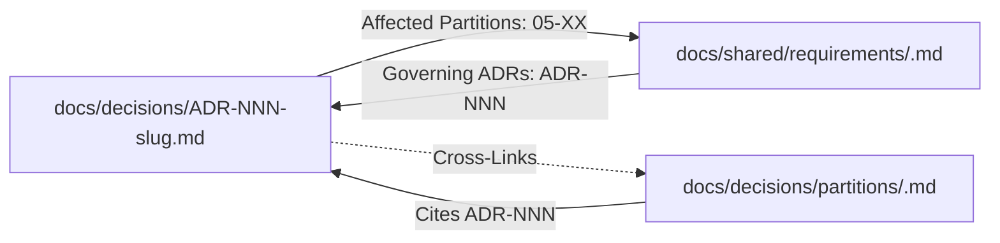

# Task Protocol 04: Architectural Decision Record (ADR) Lifecycle & Governance — Dink Machinery

**Protocol ID:** `PROTO-04-NEW-ADR`  
**Target:** AI Agents, System Architects & Principal Engineers  
**Scope:** Standardized evaluation, authoring, validation, bidirectional linking, and lifecycle transitions for Level 1 System ADRs and Level 2 Partition Decisions.  
**Governing Documents:** `AGENTS.md § 7`, `CONTEXT.md`, `TECH_STACK.md`, `CODE_STANDARDS.md`, `scripts/scaffold-decisions.sh`, `scripts/validate-decision-template.sh`, `scripts/validate-decision-links.sh`

---

## 1. Objective & Decision Hierarchy

In **Dink Machinery**, architectural decisions are formal, immutable engineering contracts recorded in version control. They document architectural trade-offs, enforce system invariants, and prevent future regression or debate.

The repository establishes a strict two-tier hierarchy of architectural decisions:

```
                                [Proposed Decision]
                                         │
                         ┌───────────────┴───────────────┐
                         ▼                               ▼
                 [Passes 5-Point]                 [Fails 5-Point]
                         │                               │
            ┌────────────┴────────────┐                  ▼
            ▼                         ▼            [Tactical Choice]
       [Cross-Cutting]           [Localized]      (Document inline in
            │                         │            code or spec; no record)
            ▼                         ▼
      [Level 1 ADR]           [Level 2 Decision]
docs/decisions/ADR-NNN-*.md   docs/decisions/partitions/<id>.md
```

### Level 1 (L1) System-Wide Architecture Decision Records
- **Location:** `docs/decisions/ADR-NNN-<slug>.md`
- **Scope:** Cross-cutting decisions impacting multiple requirement partitions, foundational runtimes, persistent data models, security baselines (OWASP ASVS L3), or public API contracts.
- **Numbering:** Global, zero-padded 3-digit sequential integers (`ADR-001`, `ADR-002`, etc.).

### Level 2 (L2) Partition-Specific Decisions
- **Location:** `docs/decisions/partitions/<partition-id>.md`
- **Scope:** Localized technical choices confined entirely within a single bounded context or requirement partition (e.g., choice between two internal caching strategies within `05-04` machinery catalog).
- **Numbering:** Partition-scoped sequential identifier: `D-<partition-id>-<seq>` (e.g., `D-05-05-001`).

---

## 2. The 5-Point Qualification Evaluation Gate

Before authoring an ADR or partition decision, the proposed choice must be rigorously evaluated against the **5-Point Qualification Test**.

| # | Test Name | Evaluation Question | Qualifying Indicator |
|---|---|---|---|
| **1** | **Alternative Test** | Were two or more technically viable options evaluated with real architectural trade-offs? | Yes, at least two options are technically viable; choice is not a predetermined triviality. |
| **2** | **Surprise Test** | Would an experienced engineer new to the codebase find this design choice non-obvious or counterintuitive without context? | Yes, alternative industry defaults exist that were intentionally rejected. |
| **3** | **Constraint Test** | Is this choice dictated by strict non-functional constraints (OWASP ASVS L3 security, PostGIS spatial latency, zero-connectivity offline operations)? | Yes, failure to implement this specific design directly violates a platform invariant. |
| **4** | **Irreversibility Test** | Would reversing or replacing this decision require $>1$ engineer-day of refactoring, a database migration, or an external API breaking change? | Yes, high switching cost and high architectural blast radius. |
| **5** | **Scope Test** | Does this design decision span multiple requirement partitions, runtime subsystems, or database boundaries? | Yes, affects two or more of `[backend, mobile, admin, database, contracts]`. |

### Decision Routing Rule
- **Satisfies 0 or 1 test:** **Tactical Choice.** Do not write a decision record. Document the choice inline in code comments or the requirement specification.
- **Satisfies $\ge 2$ tests AND Scope Test = NO:** **Level 2 Partition Decision.** Scaffold in `docs/decisions/partitions/<partition-id>.md`.
- **Satisfies $\ge 2$ tests AND Scope Test = YES:** **Level 1 System ADR.** Scaffold in `docs/decisions/ADR-NNN-<slug>.md`.

---

## 3. Scaffolding & Structural Conformance

All decision records must be scaffolded using `scripts/scaffold-decisions.sh` and must pass automated validation by `scripts/validate-decision-template.sh`. Hand-crafted records with non-standard layouts trigger CI failures.

### 3.1. Scaffolding Commands

```bash
# To scaffold a Level 1 System ADR:
# Usage: bash scripts/scaffold-decisions.sh adr <slug> "[Title]"
bash scripts/scaffold-decisions.sh adr dynamic-font-delivery "Dynamic Ethiopic and Arabic Font Delivery via S3"

# To scaffold a Level 2 Partition Decision:
# Usage: bash scripts/scaffold-decisions.sh partition <partition-id> <slug> "[Title]"
bash scripts/scaffold-decisions.sh partition 05-05 booking-hold-atomicity "In-Transaction Booking Hold and Ledger Atomicity"
```

### 3.2. Mandatory Sections Specification

#### Level 1 ADR Structural Requirements (8 Mandatory Sections)
1. **Metadata Header:**
   ```markdown
   # ADR-NNN: [Title]
   - **Status:** [Proposed | Accepted | Superseded | Deprecated]
   - **Date:** YYYY-MM-DD
   - **Decision Owner:** [Team or Lead Architect]
   - **Affected Partitions:** [Partition IDs, e.g., 05-01, 05-06]
   - **Related Requirements:** [REQ-XX-YY]
   ```
2. `## 1. Context & Problem Statement`
3. `## 2. The 5-Point Qualification Evaluation` (All 5 boxes explicitly checked or marked)
4. `## 3. Considered Options` (**Minimum 2 options required**, formatted as `### Option 1:` and `### Option 2:`)
5. `## 4. Chosen Solution & Architectural Rationale`
6. `## 5. Rejected Alternatives & Technical Justification`
7. `## 6. Consequences & Operational Trade-offs` (Positive, Negative/Debt, Observability)
8. `## 7. Verification Strategy & Invariant Tests` (Exact test files and assertions enforcing this decision)
9. `## 8. Revisit Conditions` (Concrete operational metrics or business shifts that trigger re-evaluation)

#### Level 2 Partition Decision Structural Requirements (7 Mandatory Sections)
1. **Header & Metadata:**
   ```markdown
   ## D-<partition-id>-<NNN>: [Title]
   - **Status:** [Accepted | Superseded | Deprecated]
   - **Date:** YYYY-MM-DD
   - **Requirement Target:** [REQ-<partition-id>-XX]
   - **Subsystem:** [backend | mobile | admin | database]
   ```
2. `### 1. Problem Statement & Context`
3. `### 2. Considered Alternatives` (**Minimum 2 alternatives required**, numbered: `1. **Option A:**`, `2. **Option B:**`)
4. `### 3. Chosen Solution & Technical Rationale`
5. `### 4. Rejected Alternatives`
6. `### 5. Consequences & Invariants`
7. `### 6. Verification`
8. `### 7. Revisit Trigger`

*Note: Raw HTML comment placeholders (`<!-- ... -->`) are prohibited in merged decision records.*

---

## 4. Bidirectional Traceability & Linking Rules

Every decision record must establish unbroken reciprocal links with requirement specifications. Dangling decision IDs or unreferenced ADRs cause `scripts/validate-decision-links.sh` to fail in pre-commit and CI.



### Linking Rules
1. If an ADR lists `05-05` in its **Affected Partitions**, the specification at `docs/shared/requirements/05-05.md` or partition decisions at `docs/decisions/partitions/05-05.md` **must cite that ADR ID** (e.g., `ADR-008`).
2. If a requirement references an architectural decision (e.g., `ADR-012` or `D-05-01-002`), that exact file and anchor **must exist** in the repository.
3. Every mutating ADR must be cross-referenced in the pull request description template.

---

## 5. Decision Lifecycle & State Transitions

Architectural decisions follow an explicit state machine:

```
[Proposed] ──► [Accepted] ──► [Superseded by ADR-MMM]
                   │
                   └──► [Deprecated]
```

### Status Definitions
- **`Proposed`:** Draft under active engineering review. Permitted only in feature branches; cannot be merged to `main` without team sign-off.
- **`Accepted`:** Approved, canonical architectural contract governing active implementation.
- **`Superseded`:** Replaced by a newer decision. **Invariant:** The metadata header must be updated to `- **Status:** Superseded by ADR-MMM`, and Section 8 must explain the transition rationale.
- **`Deprecated`:** Retired without direct replacement due to sunsetting of a capability or requirement.

---

## 6. Verification Strategy & Invariant Tests

An architectural decision is only as durable as the automated tests preventing its regression. Every ADR must specify concrete verification mechanisms under Section 7:

```markdown
## 7. Verification Strategy & Invariant Tests

- **Static Linter / Spectral Rule:** `.spectral.yaml` rule `no-floating-point-money` prevents float types in OpenAPI schemas.
- **Architecture Unit Test:** `backend/internal/modules/booking/domain/invariants_test.go::TestBookingHoldAtomicity` asserts rollback of ledger entry upon state machine failure.
- **Benchmark / Concurrency Test:** `backend/internal/modules/payment/infrastructure/ledger_concurrency_test.go` verifies zero double-spending under 500 concurrent goroutine attempts.
```

---

## 7. Step-by-Step Execution Workflow

### Step 1: Evaluate & Qualify
Run the 5-point qualification test. Determine whether an L1 ADR or L2 Partition Decision is warranted.

### Step 2: Scaffold Decision File
Execute the scaffolding script:
```bash
bash scripts/scaffold-decisions.sh adr <slug> "<Title>"
# or
bash scripts/scaffold-decisions.sh partition <partition-id> <slug> "<Title>"
```

### Step 3: Author Decision Content
- Fully complete all mandatory sections.
- Document at least two viable options with objective pros and cons.
- Detail the chosen technical rationale and explicit rejection reasons.
- Remove all boilerplate comments and placeholders.

### Step 4: Link to Requirements
Add references to the newly created decision ID inside:
1. `docs/source/requirements/<partition-id>.md` (and synchronized `docs/shared/`)
2. `contracts/openapi.yaml` (if endpoint behavior or schema is affected)
3. `CONTEXT.md` (under Current Progress / Decisions)

### Step 5: Run Automated Verification Scripts
```bash
# 1. Audit template structure and content completeness
bash scripts/validate-decision-template.sh

# 2. Audit bidirectional reference links across repository
bash scripts/validate-decision-links.sh
```
*Both scripts must return `SUCCESS`.*

### Step 6: Atomic Commit
Commit the new decision record, updated requirement references, and `CONTEXT.md` together:
```bash
git add docs/ contracts/ CONTEXT.md
git commit -m "[DECISION] docs(adr): record ADR-NNN <decision-slug>

Authored architectural decision evaluating <topic>. Evaluated 2 alternatives,
verified bidirectional linkage with partition <partition-id>, and defined
automated invariant tests.

Tests: validate-decision-template passed, validate-decision-links passed.
Docs: docs/decisions/ADR-NNN-<slug>.md, CONTEXT.md
Refs: #<issue-id>"
```

---

## 8. Quality Gate & PR Review Checklist

Before approving any pull request containing an architectural decision:

- [ ] **5-Point Test Satisfied:** Clear evidence of satisfying $\ge 2$ qualification criteria.
- [ ] **Template Complete:** All mandatory sections present; zero remaining HTML comment placeholders.
- [ ] **Minimum 2 Alternatives:** At least two distinct, viable technical alternatives evaluated.
- [ ] **Bidirectional Links Valid:** `bash scripts/validate-decision-links.sh` passes without warnings.
- [ ] **Concrete Test Strategy:** Section 7 lists specific test files, linter rules, or benchmarks enforcing the decision.
- [ ] **Revisit Triggers Defined:** Specific scale limits, performance thresholds, or business triggers documented.
- [ ] **Atomic Context Update:** `CONTEXT.md` updated and staged in the commit.