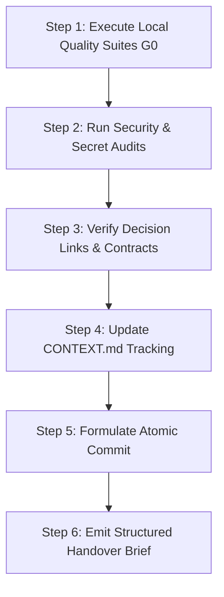

# Task Protocol 06: Session Conclusion & Context Checkpointing — Dink Machinery

**Protocol ID:** `PROTO-06-SESSION-END`  
**Target:** AI Agents & Engineering Workstations  
**Scope:** Deterministic wrap-up, quality ratchet enforcement, atomic context updating, test verification, and clean state handover at the end of any work session.  
**Governing Documents:** `AGENTS.md § 3`, `CONTEXT.md`, `CODE_STANDARDS.md`, `.github/commitlint.config.js`, `.github/pull_request_template.md`

---

## 1. Executive Summary & Invariant Handover Rules

At the end of any engineering turn or AI development session on **Dink Machinery**, work must not be abandoned in a dirty, broken, or undocumented state. Every session must conclude with a deterministic wrap-up sequence that guarantees continuity for the next engineer or autonomous agent.

### Mandatory Handover Invariants
1. **The Atomic Doc-Commit Rule:** Code changes and the operational tracking document `CONTEXT.md` must be updated and staged within the exact same commit. Staging code without updating `CONTEXT.md` causes local `lefthook` hooks and CI pipelines to reject the commit.
2. **Quality Ratchet Non-Regression:** The test suite must pass with zero errors, zero warnings, and non-decreasing code coverage ($\ge 80\%$ line coverage overall; $\ge 95\%$ on financial/auth paths).
3. **Decision & Link Integrity:** If architectural trade-offs were made, ensure corresponding L1 ADRs or L2 Partition Decisions were scaffolded, fully completed, and verified via `scripts/validate-decision-links.sh`.
4. **Zero Untracked Secrets or PII:** Working trees must be scanned with `gitleaks` and static regex audits to ensure no live credentials or unmasked customer PII enter the Git tree.
5. **Standardized Handover Brief:** The turn must conclude with an unambiguous status brief summarizing what was completed, what invariants were verified, and the exact next command for the incoming session.

---

## 2. The 6-Step Session Conclusion Runbook



---

### Step 1: Execute Local Quality Suites (Gate G0)

Run the fast local test suites across all modified subsystems. Every check must succeed without warnings or race condition faults.

```bash
# ------------------------------------------------------------------------------
# Backend: Go 1.27.3 Static Analysis, Formatting & Race-Condition Tests
# ------------------------------------------------------------------------------
cd backend
golangci-lint run ./...
go test -v -race -cover ./...
cd ..

# ------------------------------------------------------------------------------
# Mobile: Flutter 3.47.9 Analyzer & Unit/Widget Suites
# ------------------------------------------------------------------------------
cd mobile
fvm flutter analyze
fvm flutter test
cd ..

# ------------------------------------------------------------------------------
# Admin: Next.js 16 Typecheck & Linter
# ------------------------------------------------------------------------------
cd admin
pnpm run lint
pnpm run build
cd ..
```

---

### Step 2: Run Security & Zero-PII Audits

Verify that no unmasked sensitive attributes or secrets were committed to working buffers.

```bash
# 1. Audit secret leaks
gitleaks detect --source . --verbose

# 2. Assert Zero-PII logging patterns
grep -rnEi 'logger\.(Info|Debug|Warn|Error)\(.*(password|pin|tin|national_id|account_number)' backend/ admin/ mobile/ && {
  echo "CRITICAL: Potential unmasked PII logging detected!"
  exit 1
} || echo "Zero-PII logging assertion passed."
```

---

### Step 3: Verify Decision Links & API Contracts

Audit structural compliance across architectural decisions and API contracts:

```bash
# 1. Lint canonical OpenAPI 3.1.0 contract
pnpm dlx @stoplight/spectral-cli lint contracts/openapi.yaml --ruleset .spectral.yaml

# 2. Validate architectural decision templates (no unpopulated HTML placeholders)
bash scripts/validate-decision-template.sh

# 3. Validate bidirectional links between ADRs and requirement partitions
bash scripts/validate-decision-links.sh
```

---

### Step 4: Update `CONTEXT.md` Checkpoint

Update `CONTEXT.md` at repository root. The update must reflect:
- **Current Progress Snapshot:** Mark completed task items with `[x]` and update partition progress percentage.
- **Active Context:** Update current operational state, active feature branch, and recent implementation decisions.
- **Next Immediate Tasks:** Clearly identify the next 1–3 prioritized actions for the subsequent session.
- **Recent Invariant Assertions:** Document the latest automated tests and compliance runs executed.

---

### Step 5: Formulate the Atomic Commit

Stage all modified code files along with `CONTEXT.md`. Formulate a conventional commit message complying with `.github/commitlint.config.js`:

```text
[<TICKET-OR-REQ-ID>] <type>(<scope>): <subject>

<detailed problem statement, implementation details, and architectural rationale>

Tests: <exact test commands executed and results>
Docs: CONTEXT.md, <other updated docs>
Refs: #<issue-or-pr-number>
```

#### Commit Execution Example
```bash
git add backend/ mobile/ admin/ contracts/ docs/ CONTEXT.md

git commit -m "[REQ-05-05-01] feat(booking): implement in-transaction hold atomicity

Integrated optimistic locking assertion on booking state transitions and
guaranteed simultaneous ledger hold creation inside a single pgx.Tx transaction.
Maintained double-entry zero-sum invariants.

Tests: go test -race -cover ./internal/modules/booking/... (96.4% coverage)
Docs: CONTEXT.md, docs/decisions/partitions/05-05.md
Refs: #0042"
```

---

### Step 6: Emit Structured Handover Brief

Every AI agent turn or engineering shift must conclude with this structured brief printed directly in output:

```markdown
### 🏁 Session Concluded & Context Checkpointed

- **Completed Task / Requirement:** `[REQ-XX-YY / Task ID]`
- **Active Partition:** `[Partition ID & Name]`
- **Working Branch:** `[Branch Name]`
- **Commit SHA:** `[7-character git rev-parse HEAD]`
- **Invariants Verified:**
  - [x] RFC 9457 Problem Details errors maintained
  - [x] Integer minor-unit money strictly enforced (zero floats)
  - [x] Optimistic concurrency control (`version` increment) verified
  - [x] Zero-PII logging verified (no phone/TIN/bank data leaked)
  - [x] Spectral contract linting passed (0 errors)
  - [x] Bidirectional decision links intact
- **CONTEXT.md Status:** Synchronized and committed atomically.
- **Next Immediate Action:** `[Exact file, command, or requirement to execute next]`
```

---

## 3. Session End Troubleshooting & Recovery

| Issue Detected | Root Cause | Mandatory Resolution |
|---|---|---|
| `lefthook` rejects commit with "CONTEXT.md must be updated" | Attempted commit without staging `CONTEXT.md`. | Review changes, update `CONTEXT.md`, stage it with `git add CONTEXT.md`, and re-commit. |
| `validate-decision-links.sh` fails | ADR cited a partition that does not reference it back, or a decision ID was misspelled. | Add the reciprocal reference in `docs/shared/requirements/<partition-id>.md` or correct the ID typo. |
| `commitlint` rejects commit header | Missing ticket bracket `[REQ-XX-YY]` or invalid type. | Amend commit with compliant format: `[REQ-05-01-01] feat(auth): add OTP challenge endpoint`. |
| Uncommitted files remain at session wrap-up | Incomplete task or stray test output files. | Stash with a descriptive message (`git stash push -m "WIP: partition 05-05"`) or complete the edits before final checkpoint. |