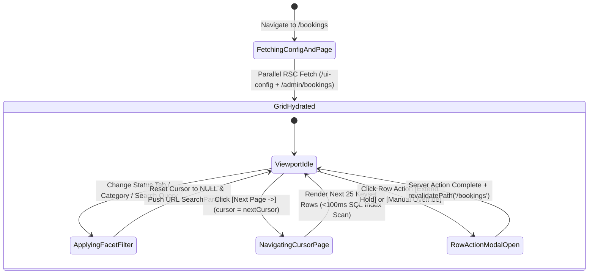
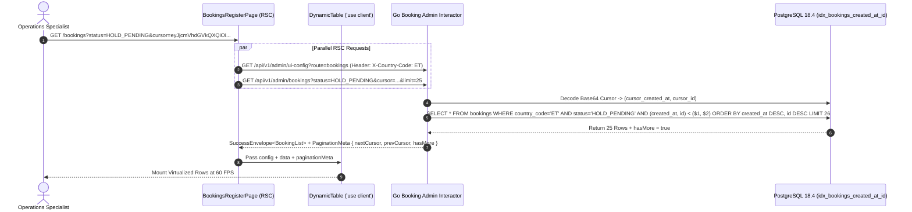

# Master Booking Operations Grid & Keyset Paginated Console
## Admin Subsystem Specification — `docs/admin/booking-operations/01-booking-operations-console.md`

**Document Identifier:** `SPEC-ADM-BKG-01`  
**Classification:** Canonical Subsystem UI/UX & Technical Behavior Specification  
**Governing Documents:** `Dink_Machinery_UI_UX_Design_Brief.md`, `SRS-DINK-CORE-V7.0`, `docs/components/admin/DESIGN.md`, `contracts/openapi.yaml`  
**Target Subsystem:** Next.js 16 Web Admin Console (`admin/src/app/(dashboard)/bookings/page.tsx`)  
**Primary Persona / Actor:** `OPS_SUPPORT`, `FINANCE_CONTROLLER`, `DISPUTE_ARBITRATOR`, `SUPER_ADMIN`  
**Associated Requirements:** `AD-06`, `BK-01`..`BK-17`, `REQ-05-05`, `REQ-08`  
**Associated Interaction Flows:** `FLOW-05` (End-to-End Booking Reservation, Valkey Hold & Dual Settlement), `FLOW-12`  
**Associated ADRs:** `ADR-006` (20-State Booking Lifecycle & OCC Versioning), `ADR-008` (Server-Driven Dynamic UI Metadata)  
**Status:** Approved Technical Design Baseline

---

## 1. Domain Context, Business Rules & Architectural Invariants

The **Master Booking Operations Grid & Keyset Paginated Console** (`SPEC-ADM-BKG-01`) is the primary operational register (`src/app/(dashboard)/bookings/page.tsx`) providing real-time visibility across every machinery lease and linked lowboy transport sub-booking in the marketplace (`BK-01`..`BK-17`).

### 1.1 Core Business Rules & Architectural Invariants
1. **Server-Driven Headless Virtualized Grid (`AD-06-BE`):**
   - Column definitions, sortable keys, status badge variants, faceted filter schemas, and RBAC-gated row actions are fetched dynamically from `GET /api/v1/admin/ui-config?route=bookings` and rendered via `<DynamicTable/>` (`@tanstack/react-table` + `@tanstack/react-virtual` with a `48px` row height and `10-row` overscan for 60 FPS scrolling).
2. **Strict Deterministic Keyset Cursor Pagination:**
   - Per `AGENTS.md` API Standards, `OFFSET / LIMIT` pagination is strictly prohibited on operational and financial tables. The booking register paginates exclusively via opaque base64-encoded composite cursors (`(created_at DESC, id DESC)`) returned in `meta.pagination` (`nextCursor`, `prevCursor`, `hasMore`).
3. **Full 20-State Lifecycle Coverage (`ADR-006`):**
   - Supports multi-facet filtering across all 20 canonical booking states: `DRAFT`, `HOLD_PENDING`, `HOLD_EXPIRED`, `CANCELLED_BY_RENTER`, `PAYMENT_EVIDENCE_UPLOADED`, `PAYMENT_PROCESSING`, `PAYMENT_FAILED`, `PAYMENT_DECLINED`, `DISPUTE_OPENED`, `CONFIRMED`, `AWAITING_FLEET_READINESS`, `PENDING_ADDITIONAL_PAYMENT`, `READY_FOR_PICKUP`, `DISPUTED_HOUR_METER`, `ACTIVE`, `EXTENSION_REQUESTED`, `RETURN_INITIATED`, `DAMAGE_PARTIAL_RESOLVED`, `PENDING_FINAL_PAYMENT`, `COMPLETED`, `RATED`, `CLOSED`, `CANCELLED`.
4. **Integer Minor-Unit Totals & Live Hold Timer Pills:**
   - Total rental cost (`totalCost.amountMinor`), platform commission (`commissionFee.amountMinor`), and informational deposit figures are rendered in monospace minor-unit format (`formatMinorUnits`). Rows in `HOLD_PENDING` render a live countdown badge computed against `holdExpiresAt`.

---

## 2. Screen Anatomy, Layout & Component Hierarchy

### 2.1 Master Booking Operations Virtualized Grid Wireframe (`1920x1080` Desktop)

```text
+------------------------------------------------------------------------------------------------------------------------------------------+
| Bookings & Logistics > Master Booking Operations Register (`AD-06-WEB`)                   [Jurisdiction: ET (ETB)] [Row Density: 48dp v] |
+------------------------------------------------------------------------------------------------------------------------------------------+
| QUICK STATE TABS: *[All (1,482)] [⏳ Hold Pending (19)] [🧾 Slip Uploaded (11)] [🚛 Mobilizing (14)] [🟢 Active (142)] [⚖ Disputed (5)]   |
+------------------------------------------------------------------------------------------------------------------------------------------+
| DYNAMIC FILTER BAR (`DynamicFilterBar.tsx`):                                                                                             |
| [🔍 Search #BK-ID, Plate, Renter/Owner...] [Category: All v] [Settlement: All (Manual/Gateway) v] [Date: 2026-10-01 -> 2026-11-30 📅]    |
+------------------------------------------------------------------------------------------------------------------------------------------+
| VIRTUALIZED TANSTACK TABLE VIEWPORT (`DynamicTable.tsx` — `height: calc(100vh - 280px)`, `@tanstack/react-virtual`)                      |
| +--------------------------------------------------------------------------------------------------------------------------------------+ |
| | Booking Ref | Fleet Asset (Plate)    | Renter -> Owner         | Lease Dates       | Lifecycle Status          | Total (ETB)   | Act | |
| |=============+========================+=========================+===================+===========================+===============+=====| |
| | #BK-9108    | CAT 320D3 (`AA-3-9823`)| Afro-Tsion -> Mesfin PLC| Nov 01 -> Nov 07  | [⏳ HOLD_PENDING (41:18)] | 127,650.00 ETB| [⋯] | |
| | #BK-9104    | Komatsu D85EX (`ET-99`)| Sunshine -> Abyssinia   | Oct 30 -> Nov 14  | [🧾 PAYMENT_EVIDENCE_UPL] | 483,000.00 ETB| [⋯] | |
| | #BK-9098 🔗 | Lowboy 40T (`AA-3-112`)| Mesfin PLC -> EthioHaul | Oct 31 -> Nov 01  | [🟢 CONFIRMED (Parent#99)]|  28,000.00 ETB| [⋯] | |
| | #BK-9091    | XCMG QY50K (`AA-3-774`)| Ovid Constr -> Nile Crane| Oct 25 -> Nov 05 | [🟢 ACTIVE (GPS: 14s ago)]| 345,000.00 ETB| [⋯] | |
| | #BK-9085    | JCB 3CX (`AA-3-55210`) | Ayat SC -> Habesha Fleet| Oct 28 -> Nov 02  | [🟠 AWAITING_READINESS]   |  69,000.00 ETB| [⋯] | |
| | #BK-9042    | CAT 320D3 (`AA-3-6102`)| Tekleberhan -> Mesfin   | Oct 12 -> Oct 18  | [🟣 DISPUTED_HOUR_METER]  | 110,400.00 ETB| [⋯] | |
| | #BK-9019    | Dynapac CA250 (`ET-12`)| Sur Constr -> RiftValley| Oct 10 -> Oct 24  | [✓ COMPLETED]             | 193,200.00 ETB| [⋯] | |
| +--------------------------------------------------------------------------------------------------------------------------------------+ |
| STICKY FOOTER: [<- Prev Page (`prevCursor: null`)] [Next Page (`nextCursor: ZXhhbX...`) ->] | Showing 25 rows | `req_01J8BKG019923`      |
+------------------------------------------------------------------------------------------------------------------------------------------+
```

---

## 3. W3C DTCG Design Token Mapping Table

| Booking Grid Element | W3C Token Path (`design-tokens.json`) | Resolved Value | Behavioral & Accessibility Constraint |
|---|---|---|---|
| **Table Header Bar** | `component.table.headerHeight` + `color.brand.slate.100` | `48dp` height, `#F1F5F9` (`#1E293B` Dark) | Sticky `top-0 z-20` with `aria-sort="ascending\|descending\|none"` on sortable columns. |
| **Virtualized Data Row** | `component.table.rowHeightNormal` / `rowHeightDense` | `56dp` (Normal) / `40dp` (Dense) | Alternating zebra tint (`color.brand.slate.50`) and keyboard row focus ring. |
| **Total Cost & Fee Cell** | `typography.fontFamily.mono` + `semantic.light.text.numericLedger` | `Space Mono`, `14sp`, `#020617` right-aligned | Formatted strictly from `MoneyAmount` (`amountMinor` + `currency`). |
| **State Pill: `HOLD_PENDING`** | `component.countdown.holdNormalBg` / `holdNormalText` | `#FFFBEB` fill / `#78350F` text | Transitions to `holdUrgentBg` (`#FFF7ED`) $<20\text{m}$ and `holdCriticalBg` (`#FEF2F2`) $<5\text{m}$. |
| **State Pill: `ACTIVE`** | `color.feedback.emerald.100` + `color.feedback.emerald.700` | `#D1FAE5` fill / `#047857` text | Includes live telemetry indicator dot when 30s GPS WebSocket heartbeats are active. |
| **State Pill: `DISPUTED_*`** | `color.feedback.purple.100` + `color.feedback.purple.900` | `#F3E8FF` fill / `#581C87` text | Clicking badge links directly to `/disputes/[disputeId]`. |

---

## 4. Interactive State Machine & Sequence Choreography

### 4.1 Server-Driven Booking Grid & Keyset Cursor Navigation State Machine



### 4.2 Keyset Cursor Query & Dynamic UI Config Hydration Sequence



---

## 5. Concrete Next.js 16 Implementation Blueprint

### 5.1 `/api/v1/admin/ui-config?route=bookings` Metadata Schema

```json
{
  "tableId": "admin_bookings_register",
  "title": "Master Booking Operations Register",
  "description": "Keyset-paginated register across all 20 booking lifecycle states with linked transport sub-booking indicators.",
  "defaultSortField": "createdAt",
  "defaultSortDirection": "desc",
  "pageSize": 25,
  "columns": [
    { "id": "referenceCode", "header": "Booking Ref", "accessorKey": "referenceCode", "dataType": "text", "isSortable": false, "isFilterable": true },
    { "id": "fleetLabel", "header": "Fleet Asset (Plate)", "accessorKey": "fleetSummary", "dataType": "text", "isSortable": true, "isFilterable": true },
    { "id": "partiesLabel", "header": "Renter → Owner", "accessorKey": "partiesSummary", "dataType": "text", "isSortable": false, "isFilterable": true },
    { "id": "dateWindow", "header": "Lease Window", "accessorKey": "dateWindowLabel", "dataType": "text", "isSortable": true, "isFilterable": false },
    { "id": "status", "header": "Lifecycle Status", "accessorKey": "status", "dataType": "badge", "isSortable": true, "isFilterable": true,
      "badgeVariants": {
        "HOLD_PENDING": "warning",
        "PAYMENT_EVIDENCE_UPLOADED": "default",
        "CONFIRMED": "success",
        "AWAITING_FLEET_READINESS": "warning",
        "ACTIVE": "success",
        "DISPUTE_OPENED": "destructive",
        "DISPUTED_HOUR_METER": "destructive",
        "COMPLETED": "outline",
        "CANCELLED": "destructive"
      }
    },
    { "id": "totalCost", "header": "Total Value", "accessorKey": "totalCost", "dataType": "money", "isSortable": true, "isFilterable": false, "align": "right" }
  ],
  "facets": [
    {
      "id": "status",
      "label": "Lifecycle State",
      "type": "select",
      "options": [
        { "label": "Hold Pending (60m Lock)", "value": "HOLD_PENDING" },
        { "label": "Payment Evidence Uploaded", "value": "PAYMENT_EVIDENCE_UPLOADED" },
        { "label": "Confirmed", "value": "CONFIRMED" },
        { "label": "Awaiting Fleet Readiness", "value": "AWAITING_FLEET_READINESS" },
        { "label": "Active On-Site Operation", "value": "ACTIVE" },
        { "label": "Dispute Opened / Meter Conflict", "value": "DISPUTE_OPENED" },
        { "label": "Completed", "value": "COMPLETED" },
        { "label": "Cancelled", "value": "CANCELLED" }
      ]
    },
    {
      "id": "settlementModel",
      "label": "Settlement Rail",
      "type": "select",
      "options": [
        { "label": "Manual Direct Bank Transfer", "value": "MANUAL_TRANSFER" },
        { "label": "Online Gateway (Telebirr / M-Pesa)", "value": "GATEWAY" }
      ]
    }
  ],
  "rowActions": [
    {
      "id": "inspect_timeline",
      "label": "Inspect Lifecycle Timeline",
      "variant": "outline",
      "requiredPermission": "booking:read",
      "endpoint": "/bookings/{id}",
      "method": "POST"
    },
    {
      "id": "extend_hold_15m",
      "label": "Extend Valkey Hold (+15m)",
      "variant": "secondary",
      "requiredPermission": "booking:hold:extend",
      "endpoint": "/api/v1/admin/bookings/{id}:extend-hold",
      "method": "POST",
      "confirmationPrompt": {
        "title": "Extend 60-Minute Reservation Hold?",
        "description": "Adds 15 minutes (900s) to the active Valkey lock and booking hold_expires_at timestamp.",
        "confirmText": "Extend Hold (+15m)"
      }
    }
  ],
  "bulkActions": []
}
```

### 5.2 Booking Register RSC Page (`src/app/(dashboard)/bookings/page.tsx`)

```tsx
// src/app/(dashboard)/bookings/page.tsx
import React from 'react';
import { cookies } from 'next/headers';
import Link from 'next/link';
import { DynamicTable } from '@/components/dynamic/DynamicTable';
import { extendBookingHoldAction } from './actions';

export default async function BookingsRegisterPage({
  searchParams,
}: {
  searchParams: Promise<{ cursor?: string; status?: string; q?: string }>;
}) {
  const params = await searchParams;
  const cookieStore = await cookies();
  const sessionToken = cookieStore.get('dink_admin_session')?.value;
  const countryCode = cookieStore.get('dink_admin_country')?.value ?? 'ET';

  const query = new URLSearchParams();
  if (params.cursor) query.set('cursor', params.cursor);
  if (params.status) query.set('status', params.status);
  if (params.q) query.set('q', params.q);
  query.set('limit', '25');

  const [configRes, dataRes] = await Promise.all([
    fetch(`${process.env.INTERNAL_BACKEND_URL}/api/v1/admin/ui-config?route=bookings`, {
      headers: { Authorization: `Bearer ${sessionToken}`, 'X-Country-Code': countryCode },
      cache: 'no-store',
    }),
    fetch(`${process.env.INTERNAL_BACKEND_URL}/api/v1/admin/bookings?${query.toString()}`, {
      headers: { Authorization: `Bearer ${sessionToken}`, 'X-Country-Code': countryCode },
      cache: 'no-store',
    }),
  ]);

  const configPayload = await configRes.json();
  const bookingsPayload = await dataRes.json();
  const pagination = bookingsPayload.meta?.pagination;

  return (
    <div className="space-y-4">
      <header className="flex items-center justify-between">
        <div>
          <h1 className="text-xl font-bold text-slate-900 dark:text-white">
            {configPayload.data.title}
          </h1>
          <p className="text-xs text-slate-500">{configPayload.data.description}</p>
        </div>
      </header>

      <DynamicTable
        config={configPayload.data}
        data={bookingsPayload.data ?? []}
        onActionTrigger={async (actionId, row) => {
          'use server';
          if (actionId === 'extend_hold_15m') {
            await extendBookingHoldAction(row.id, row.version);
          }
        }}
      />

      {/* Deterministic Cursor Pagination Footer */}
      <footer className="flex items-center justify-between rounded-lg border border-slate-200 bg-white px-4 py-2.5 text-xs dark:border-slate-700 dark:bg-slate-800">
        <div className="flex items-center gap-2">
          {pagination?.prevCursor ? (
            <Link
              href={`/bookings?cursor=${encodeURIComponent(pagination.prevCursor)}${params.status ? `&status=${params.status}` : ''}`}
              className="rounded border border-slate-300 px-3 py-1 font-medium hover:bg-slate-50"
            >
              ← Previous Page
            </Link>
          ) : (
            <span className="cursor-not-allowed rounded border border-slate-200 px-3 py-1 text-slate-400">
              ← Previous Page
            </span>
          )}

          {pagination?.nextCursor && pagination?.hasMore ? (
            <Link
              href={`/bookings?cursor=${encodeURIComponent(pagination.nextCursor)}${params.status ? `&status=${params.status}` : ''}`}
              className="rounded border border-slate-300 px-3 py-1 font-medium hover:bg-slate-50"
            >
              Next Page →
            </Link>
          ) : (
            <span className="cursor-not-allowed rounded border border-slate-200 px-3 py-1 text-slate-400">
              Next Page →
            </span>
          )}
        </div>
        <span className="font-mono text-slate-500">
          Request ID: {bookingsPayload.meta?.requestId}
        </span>
      </footer>
    </div>
  );
}
```

### 5.3 Server Action: Extend Valkey Hold (`src/app/(dashboard)/bookings/actions.ts`)

```typescript
// src/app/(dashboard)/bookings/actions.ts
'use server';

import { cookies } from 'next/headers';
import { revalidatePath } from 'next/cache';
import { z } from 'zod';
import { ProblemDetails } from '@/types/dynamic-ui';

const ExtendHoldSchema = z.object({
  bookingId: z.string().uuid(),
  version: z.number().int().positive(),
  extensionMinutes: z.number().int().min(5).max(30).default(15),
});

export async function extendBookingHoldAction(
  bookingId: string,
  version: number
): Promise<{ success: boolean; problem?: ProblemDetails }> {
  const parsed = ExtendHoldSchema.safeParse({ bookingId, version, extensionMinutes: 15 });
  if (!parsed.success) {
    return {
      success: false,
      problem: {
        type: 'https://api.dinkmachinery.com/errors/request-validation-failed',
        title: 'Invalid Hold Extension Parameters',
        status: 400,
        detail: 'Booking ID and optimistic lock version are required.',
        code: 'REQ_VALIDATION_FAILED',
      },
    };
  }

  const cookieStore = await cookies();
  const sessionToken = cookieStore.get('dink_admin_session')?.value;
  const countryCode = cookieStore.get('dink_admin_country')?.value ?? 'ET';

  const res = await fetch(
    `${process.env.INTERNAL_BACKEND_URL}/api/v1/admin/bookings/${parsed.data.bookingId}:extend-hold`,
    {
      method: 'POST',
      headers: {
        'Content-Type': 'application/json',
        'Authorization': `Bearer ${sessionToken}`,
        'Idempotency-Key': crypto.randomUUID(),
        'X-Country-Code': countryCode,
      },
      body: JSON.stringify(parsed.data),
    }
  );

  const payload = await res.json();
  if (!res.ok) {
    return { success: false, problem: payload.error as ProblemDetails };
  }

  revalidatePath('/bookings');
  return { success: true };
}
```

---

## 6. OpenAPI 3.1.0 Contract Bindings & RFC 9457 Error Matrix

| HTTP Method & Route | Operation ID | Required Headers | Success Envelope | RFC 9457 Error Codes & Trigger Conditions |
|---|---|---|---|---|
| `GET /api/v1/admin/bookings` | `listAdminBookings` | `Authorization`, `X-Country-Code` | `200 OK` (`BookingListSuccessResponse` with `meta.pagination`) | `400 REQ_VALIDATION_FAILED` (Malformed base64 cursor)<br>`401 AUTH_INVALID_TOKEN`<br>`403 AUTH_INSUFFICIENT_PERMISSIONS` |
| `POST /api/v1/admin/bookings/{id}:extend-hold` | `extendBookingHold` | `Authorization`, `Idempotency-Key`, `X-Country-Code` | `200 OK` (`BookingDetailSuccessResponse`) | `409 BOOKING_HOLD_EXPIRED` (Hold already elapsed before extension)<br>`409 BOOKING_INVALID_STATE_TRANSITION` (Status is not `HOLD_PENDING`)<br>`409 BOOKING_CONCURRENCY_CONFLICT` (`version` mismatch) |

---

## 7. Verification & Acceptance Criteria

1. **Keyset Cursor Determinism (Playwright E2E):**
   - Clicking `Next Page →` passes `?cursor=<nextCursor>` in the URL without any `offset` or `page` number parameters, and renders the next batch in $<100\text{ ms}$.
2. **Server-Driven Column Rendering:**
   - All columns (`referenceCode`, `fleetSummary`, `status`, `totalCost`) are dynamically constructed from `/api/v1/admin/ui-config?route=bookings`.

---
*Canonical specification entry for Dink Machinery platform development. Changes require an explicit design review.*
