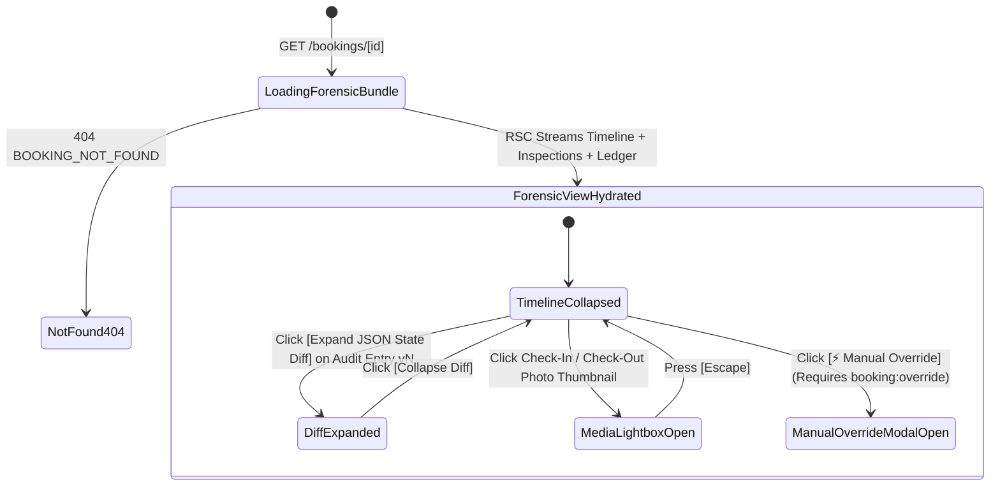
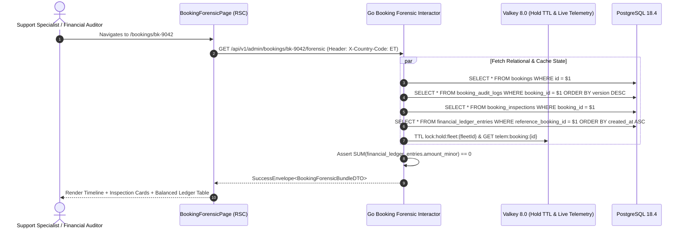

# Forensic Booking Lifecycle Timeline, Inspection Cards & Ledger Journal View
## Admin Subsystem Specification — `docs/admin/booking-operations/02-booking-lifecycle-timeline.md`

**Document Identifier:** `SPEC-ADM-BKG-02`  
**Classification:** Canonical Subsystem UI/UX & Technical Behavior Specification  
**Governing Documents:** `Dink_Machinery_UI_UX_Design_Brief.md`, `SRS-DINK-CORE-V7.0`, `docs/components/admin/DESIGN.md`, `contracts/openapi.yaml`  
**Target Subsystem:** Next.js 16 Web Admin Console (`admin/src/app/(dashboard)/bookings/[id]/page.tsx`)  
**Primary Persona / Actor:** `OPS_SUPPORT`, `FINANCE_CONTROLLER`, `DISPUTE_ARBITRATOR`, `SUPER_ADMIN`  
**Associated Requirements:** `AD-07`, `AD-09-WEB`, `BK-01`..`BK-17`, `REQ-08`  
**Associated Interaction Flows:** `FLOW-05` (Booking Settlement), `FLOW-06` (20-State Lifecycle), `FLOW-07` (Handover Inspection), `FLOW-10` (Ledger Accounting)  
**Associated ADRs:** `ADR-005` (Double-Entry Ledger), `ADR-006` (20-State Booking Machine & OCC), `ADR-008` (Server-Driven UI)  
**Status:** Approved Technical Design Baseline

---

## 1. Domain Context, Business Rules & Architectural Invariants

The **Forensic Booking Lifecycle Timeline, Inspection Cards & Ledger Journal View** (`SPEC-ADM-BKG-02`) is the canonical single-booking forensic inspection screen (`src/app/(dashboard)/bookings/[id]/page.tsx`). When operations staff, financial auditors, or dispute arbitrators open a reservation, this view consolidates four immutable data streams:
1. **The Immutable State Transition Audit Trail (`booking_audit_logs`, `AD-07`, `AD-09-WEB`):** Every state transition across the 20-state machine (`from_state` -> `to_state`), the exact actor (`RENTER`, `OWNER`, `OPERATOR`, `ADMIN`, `SYSTEM_CRON`), optimistic concurrency `version` increment, IP/request correlation ID (`req_...`), and expandable JSONB state diff.
2. **Valkey 8.0 Mutex Hold & GPS Telematics Health Card:** Live TTL of `lock:hold:fleet:{fleetId}` during `HOLD_PENDING`, or the latest 30-second WebSocket GPS coordinate ping (`fleet_location_histories`) and PostGIS geofence status (`INSIDE_APPROVED_RADIUS` vs `GEOFENCE_BREACH`) during `ACTIVE` operation.
3. **Joint Pre-Rental (`CHECK_IN`) & Post-Rental (`CHECK_OUT`) Inspection Cards:** Monotonic engine hour meter readings (`1,450.50 Hrs` -> `1,498.50 Hrs`), computed billable hours vs agreed allowance, fuel percentages, ClamAV-verified 4-angle photo thumbnails, and glass signature attestations.
4. **Balanced Double-Entry Financial Ledger Journal (`financial_ledger_entries`, `BK-17-BE`):** Displays every debit and credit leg bound to `booking_id` in integer minor units (e.g., Cash Clearing `+35,000,000` Santims, Owner Payable `-31,500,000` Santims, Platform Commission `-3,500,000` Santims) with an automated **Zero-Sum Balance Verification Badge (`SUM == 0 Santims`)**.

---

## 2. Screen Anatomy, Layout & Component Hierarchy

### 2.1 Forensic Booking Detail & Immutable Timeline Wireframe (`1920x1080` Desktop)

```text
+------------------------------------------------------------------------------------------------------------------------------------------+
| Bookings > #BK-9042 (CAT 320D3 Crawler Excavator — Plate `AA-3-98234`)             [State: ACTIVE] [OCC Version: v6] [⚡ Manual Override]|
+------------------------------------------------------------------------------------------------------------------------------------------+
| RENTER: Afro-Tsion Construction SC (`+251911****21`) | OWNER: Mesfin Industrial PLC (`+251911****88`) | SITE: Kilinto Ind. Park (GPS OK) |
+-------------------------------------------------------------------+----------------------------------------------------------------------+
| LEFT PANE: IMMUTABLE 20-STATE AUDIT TIMELINE (48% Width)          | RIGHT PANE: INSPECTIONS, TELEMATICS & LEDGER JOURNAL (52% Width)     |
| +---------------------------------------------------------------+ | +------------------------------------------------------------------+ |
| | ● [v6] `READY_FOR_PICKUP` -> `ACTIVE`                         | | | JOINT HANDOVER INSPECTION SUMMARY (`booking_inspections`)        | |
| | │ 2026-10-26 08:14:22 UTC | Actor: Operator (`usr_01HP8551`)  | | | +------------------------------+ +-----------------------------+ | |
| | │ Req: `req_01J8HND8821`  | Glass Signature: `/s/ Dawit W.`   | | | | PRE-RENTAL (`CHECK_IN`)      | | POST-RENTAL (`CHECK_OUT`)   | | |
| | │ [v] Expand JSON State Diff (`started_at`, `meter: 1450.5`)  | | | | Timestamp: Oct 26 08:14 UTC  | | Status: Awaiting Return     | | |
| | │                                                             | | | | Hour Meter: `1,450.50 Hrs`   | | Agreed Cap: 48.00 Hrs (6d)  | | |
| | ● [v5] `AWAITING_FLEET_READINESS` -> `READY_FOR_PICKUP`       | | | | Fuel Level: `85%`            | | Current GPS: `9.032, 38.742`| | |
| | │ 2026-10-25 17:40:10 UTC | Actor: Owner (`usr_01HP9102`)     | | | | Photos: 4 Angles + Meter [✓] | | Geofence: INSIDE (410m/1km) | | |
| | │ Lowboy Sub-Booking `#BK-9098` Delivered Machine to Site     | | | +------------------------------+ +-----------------------------+ | |
| | │                                                             | | +------------------------------------------------------------------+ |
| | ● [v4] `CONFIRMED` -> `AWAITING_FLEET_READINESS`              | | | DOUBLE-ENTRY FINANCIAL LEDGER (`financial_ledger_entries`)       | |
| | │ 2026-10-25 09:00:05 UTC | Actor: Owner (`usr_01HP9102`)     | | | [✓ ZERO-SUM INVARIANT VERIFIED: Net Sum = `0` Santims]           | |
| | │                                                             | | | +--------------------------------------------------------------+ | |
| | ● [v3] `PAYMENT_EVIDENCE_UPLOADED` -> `CONFIRMED`             | | | | Leg ID   | Account Code            | Dir | Amount (ETB)      | | |
| | │ 2026-10-24 14:32:19 UTC | Actor: Owner (`usr_01HP9102`)     | | | |----------+-------------------------+-----+-------------------| | |
| | │ Atomic Tx: Debited `3,500,000` Santims from `OwnerWallet`   | | | | #LGR-801 | 1010_DIRECT_CLEARING    | DR  | +350,000.00 ETB   | | |
| | │                                                             | | | | #LGR-802 | 2010_OWNER_DIRECT_RETAIN| CR  | -315,000.00 ETB   | | |
| | ● [v2] `HOLD_PENDING` -> `PAYMENT_EVIDENCE_UPLOADED`          | | | | #LGR-803 | 3010_PLATFORM_COMMISSION| CR  |  -35,000.00 ETB   | | |
| | │ 2026-10-24 14:11:02 UTC | Actor: Renter (`usr_01HP4412`)    | | | +--------------------------------------------------------------+ | |
| | │ Bank Slip Uploaded (`CBE Ref: FT262971120` | ClamAV: CLEAN) | | | Owner Wallet Commission Debit (`owner_wallet_transactions`):     | |
| | │                                                             | | | • Tx `#WLT-4410`: `-3,500,000` Santims (`-35,000.00 ETB`) [SETTLED]| |
| | ● [v1] `DRAFT` -> `HOLD_PENDING` (Valkey Lock TTL: 3600s)     | | | • Linked Transport Sub-Booking: `#BK-9098` (Lowboy 40T) [View ->]| |
| +---------------------------------------------------------------+ | +------------------------------------------------------------------+ |
+-------------------------------------------------------------------+----------------------------------------------------------------------+
```

---

## 3. W3C DTCG Design Token Mapping Table

| Timeline / Ledger Element | W3C Token Path (`design-tokens.json`) | Resolved Value | Behavioral & Accessibility Constraint |
|---|---|---|---|
| **Timeline Vertical Spine** | `color.brand.slate.300` / `color.brand.amber.500` | `#CBD5E1` spine, `#F59E0B` latest node | Ordered `<ol aria-label="Booking state transition history">` with semantic `<time>` tags. |
| **JSON Audit Diff Drawer** | `color.brand.slate.900` + `typography.fontFamily.mono` | `#0F172A` surface, `Space Mono` `12sp` | Syntax-highlighted before/after JSON diff (`AD-09-WEB`) with redacted PII fields. |
| **Ledger DR / CR Figures** | `typography.fontFamily.mono` + `semantic.light.text.numericLedger` | `Space Mono`, `14sp`, `#020617` | Displays both formatted `ETB`/`KES` string and raw integer `amountMinor` on hover. |
| **Zero-Sum Balance Verification Pill** | `color.feedback.emerald.100` + `color.feedback.emerald.700` | `#D1FAE5` fill / `#047857` text | Switches to flashing `color.feedback.crimson.600` if `SUM(amountMinor) !== 0n`. |

---

## 4. Interactive State Machine & Sequence Choreography

### 4.1 Forensic Booking Detail & Audit Diff Inspection State Machine



### 4.2 Forensic Bundle Aggregation Sequence



---

## 5. Concrete Next.js 16 Implementation Blueprint

### 5.1 Forensic Booking Detail RSC (`src/app/(dashboard)/bookings/[id]/page.tsx`)

```tsx
// src/app/(dashboard)/bookings/[id]/page.tsx
import React from 'react';
import { cookies } from 'next/headers';
import { notFound } from 'next/navigation';
import { formatMinorUnits } from '@/lib/currency';

interface AuditLogEntry {
  id: string;
  version: number;
  fromState: string | null;
  toState: string;
  actorRole: string;
  actorMaskedId: string;
  requestId: string;
  createdAt: string;
  stateDiffJson: Record<string, { before: unknown; after: unknown }>;
}

interface LedgerJournalLeg {
  id: string;
  accountCode: string;
  direction: 'DEBIT' | 'CREDIT';
  amountMinor: number;
  currency: string;
  createdAt: string;
}

export default async function BookingForensicDetailPage({
  params,
}: {
  params: Promise<{ id: string }>;
}) {
  const { id } = await params;
  const cookieStore = await cookies();
  const sessionToken = cookieStore.get('dink_admin_session')?.value;
  const countryCode = cookieStore.get('dink_admin_country')?.value ?? 'ET';

  const res = await fetch(
    `${process.env.INTERNAL_BACKEND_URL}/api/v1/admin/bookings/${encodeURIComponent(id)}/forensic`,
    {
      headers: {
        Authorization: `Bearer ${sessionToken}`,
        'X-Country-Code': countryCode,
      },
      cache: 'no-store',
    }
  );

  if (res.status === 404) {
    notFound();
  }

  const envelope = await res.json();
  const bundle = envelope.data;
  const auditLogs: AuditLogEntry[] = bundle.auditLogs ?? [];
  const ledgerLegs: LedgerJournalLeg[] = bundle.ledgerEntries ?? [];

  // Deterministic BigInt zero-sum verification on the server
  const netBalanceMinor = ledgerLegs.reduce(
    (acc, leg) => acc + BigInt(leg.amountMinor),
    0n
  );

  return (
    <div className="grid grid-cols-1 gap-6 xl:grid-cols-12">
      {/* Left Pane: Immutable 20-State Audit Timeline */}
      <section
        aria-label="Immutable Booking State Transition Timeline"
        className="rounded-lg border border-slate-200 bg-white p-5 shadow-sm xl:col-span-6 dark:border-slate-700 dark:bg-slate-800"
      >
        <h2 className="text-base font-bold text-slate-900 dark:text-white">
          Immutable State Transition Audit Trail ({auditLogs.length} Transitions)
        </h2>
        <ol className="relative mt-4 border-l-2 border-slate-300 pl-6 space-y-6 dark:border-slate-600">
          {auditLogs.map((log) => (
            <li key={log.id} className="relative">
              <span className="absolute -left-[31px] top-1 h-3.5 w-3.5 rounded-full border-2 border-white bg-amber-500" />
              <div className="flex flex-wrap items-center justify-between gap-2">
                <span className="font-mono text-xs font-bold text-slate-900 dark:text-white">
                  [v{log.version}] {log.fromState ?? 'INIT'} → {log.toState}
                </span>
                <time className="font-mono text-xs text-slate-500">{log.createdAt}</time>
              </div>
              <p className="mt-1 text-xs text-slate-600 dark:text-slate-400">
                Actor: {log.actorRole} ({log.actorMaskedId}) • Req: <code className="font-mono">{log.requestId}</code>
              </p>
              <details className="mt-2 rounded bg-slate-900 p-2.5 text-xs text-slate-100">
                <summary className="cursor-pointer font-mono text-[11px] text-amber-400">
                  Inspect JSONB State Diff (AD-09-WEB)
                </summary>
                <pre className="mt-2 overflow-x-auto font-mono text-[11px]">
                  {JSON.stringify(log.stateDiffJson, null, 2)}
                </pre>
              </details>
            </li>
          ))}
        </ol>
      </section>

      {/* Right Pane: Inspections & Double-Entry Financial Ledger */}
      <section
        aria-label="Double-Entry Financial Ledger Journal"
        className="space-y-6 xl:col-span-6"
      >
        <div className="rounded-lg border border-slate-200 bg-white p-5 shadow-sm dark:border-slate-700 dark:bg-slate-800">
          <div className="flex items-center justify-between">
            <h2 className="text-base font-bold text-slate-900 dark:text-white">
              Double-Entry Financial Ledger Legs
            </h2>
            <span
              className={`rounded px-2.5 py-1 font-mono text-xs font-semibold ${
                netBalanceMinor === 0n
                  ? 'bg-emerald-100 text-emerald-800'
                  : 'bg-red-100 text-red-800'
              }`}
            >
              {netBalanceMinor === 0n
                ? '✓ ZERO-SUM VERIFIED (0 Minor Units)'
                : `⚠ IMBALANCE: ${netBalanceMinor.toString()} Minor Units`}
            </span>
          </div>

          <table className="mt-4 w-full border-collapse text-left text-xs">
            <thead>
              <tr className="border-b border-slate-200 text-slate-500">
                <th className="py-2">Account Code</th>
                <th className="py-2">Direction</th>
                <th className="py-2 text-right">Amount</th>
                <th className="py-2 text-right">Minor Units</th>
              </tr>
            </thead>
            <tbody className="divide-y divide-slate-200 font-mono">
              {ledgerLegs.map((leg) => (
                <tr key={leg.id}>
                  <td className="py-2 font-semibold">{leg.accountCode}</td>
                  <td className="py-2">{leg.direction}</td>
                  <td className="py-2 text-right">
                    {formatMinorUnits(leg.amountMinor, leg.currency)}
                  </td>
                  <td className="py-2 text-right text-slate-500">{leg.amountMinor}</td>
                </tr>
              ))}
            </tbody>
          </table>
        </div>
      </section>
    </div>
  );
}
```

---

## 6. OpenAPI 3.1.0 Contract Bindings & RFC 9457 Error Matrix

| HTTP Method & Route | Operation ID | Required Headers | Success Envelope | RFC 9457 Error Codes & Trigger Conditions |
|---|---|---|---|---|
| `GET /api/v1/admin/bookings/{id}/forensic` | `getBookingForensicBundle` | `Authorization`, `X-Country-Code` | `200 OK` (`BookingForensicBundleSuccessResponse`) | `401 AUTH_INVALID_TOKEN`<br>`403 AUTH_INSUFFICIENT_PERMISSIONS`<br>`404 BOOKING_NOT_FOUND`<br>`500 LEDGER_DOUBLE_ENTRY_IMBALANCE` |

---

## 7. Verification & Acceptance Criteria

1. **Zero-Sum Ledger Verification (Vitest + Playwright):**
   - The ledger journal table computes `SUM(amountMinor)` using `BigInt` and displays `✓ ZERO-SUM VERIFIED (0 Minor Units)` when debits and credits balance.
2. **Audit Diff Expansion (`AD-09-WEB`):**
   - Expanding any `<details>` row in the timeline displays the structured `before`/`after` JSONB state diff with zero unmasked PII fields.

---
*Canonical specification entry for Dink Machinery platform development. Changes require an explicit design review.*
