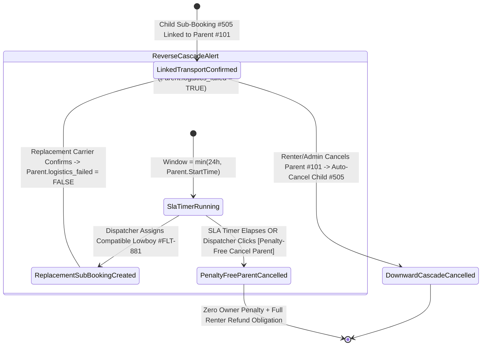
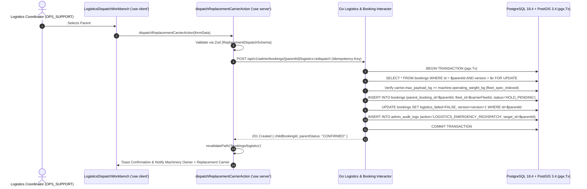

# Lowboy Logistics Dispatch Console & Bidirectional Cascade Manager
## Admin Subsystem Specification — `docs/admin/booking-operations/03-logistics-dispatch-management.md`

**Document Identifier:** `SPEC-ADM-BKG-03`  
**Classification:** Canonical Subsystem UI/UX & Technical Behavior Specification  
**Governing Documents:** `Dink_Machinery_UI_UX_Design_Brief.md`, `SRS-DINK-CORE-V7.0`, `docs/components/admin/DESIGN.md`, `contracts/openapi.yaml`  
**Target Subsystem:** Next.js 16 Web Admin Console (`admin/src/app/(dashboard)/bookings/logistics/page.tsx`)  
**Primary Persona / Actor:** `OPS_SUPPORT` (Logistics Coordinator), `SUPER_ADMIN`  
**Associated Requirements:** `LG-01`..`LG-09`, `REQ-05-08`, `REQ-07-03`, `AD-06`  
**Associated Interaction Flows:** `FLOW-09` / `FLOW-18` (Logistics Transport Sub-Booking & Bidirectional Cascade Cancellation)  
**Associated ADRs:** `ADR-006` (Parent-Child Linked Booking State Machine), `ADR-008` (Server-Driven UI Engine)  
**Status:** Approved Technical Design Baseline

---

## 1. Domain Context, Business Rules & Architectural Invariants

The **Lowboy Logistics Dispatch Console & Bidirectional Cascade Manager** (`SPEC-ADM-BKG-03`) governs heavy haulage transport sub-bookings (`LG-01`..`LG-09`, `FLOW-18`). Tracked excavators, bulldozers, and cranes cannot self-propel along public highways; they require a compatible **Lowboy Tractor-Trailer or Multi-Axle Flatbed** booked as a linked transport sub-booking (`bookings.parent_booking_id = main_machinery_booking.id`).

### 1.1 Bidirectional Cascade & Mobilization Rules (`LG-04`..`LG-09`, `FLOW-18`)
1. **Payload & Dimensional Compatibility Matching (`LG-02`):**
   - When suggesting replacement carriers for a parent machinery booking, the backend queries `fleet_spec_indexed` to ensure `carrier.max_payload_kg >= machine.operating_weight_kg` and `carrier.deck_length_m >= machine.transport_length_m`. Incompatible carriers are rejected with `422 FLEET_ATTACHMENT_UNSUPPORTED` / `LOGISTICS_PAYLOAD_EXCEEDED`.
2. **Downward Cascade (Main Machinery Lease Cancelled -> Cancel Linked Transport):**
   - If the Renter or Admin cancels the parent machinery booking (`#BK-101`), the backend atomically cascades cancellation to all active child transport sub-bookings (`WHERE parent_booking_id = 101`) inside the same `pgx.Tx`.
3. **Upward Reverse Cascade (Carrier Cancels Transport -> Viability Alert on Main Lease):**
   - If a Logistics Carrier Owner cancels a confirmed transport sub-booking (`#BK-505`), the parent machinery booking (`#BK-101`) is **not immediately cancelled**; instead, the backend sets `bookings.logistics_failed = TRUE` and starts a **Re-Dispatch SLA Timer** equal to $\min(24\text{ hours}, \text{Parent Lease StartTime})$.
   - Operations staff use this console to emergency-match and dispatch a replacement lowboy carrier. If the SLA window expires without a confirmed replacement carrier, the parent booking auto-cancels with **zero penalty to the Machinery Owner** and a **100% prepayment refund obligation** to the Renter.
4. **Mobilization Delay Tracking (`AWAITING_FLEET_READINESS`):**
   - Tracks machines delayed during lowboy transit (`AWAITING_FLEET_READINESS`) and any additional mobilization fee requests (`PENDING_ADDITIONAL_PAYMENT`).

---

## 2. Screen Anatomy, Layout & Component Hierarchy

### 2.1 Logistics Sub-Booking Monitor & Reverse-Cascade Re-Dispatch Console Wireframe

```text
+------------------------------------------------------------------------------------------------------------------------------------------+
| Bookings & Logistics > Lowboy Dispatch & Bidirectional Cascade Console (`LG-01..09`)     [🚨 Carrier Failed: 3] [⏳ Mobilizing: 14]       |
+------------------------------------------------------------------------------------------------------------------------------------------+
| FILTER TABS: *[🚨 Reverse Cascade Emergency (3)]  [🟠 Awaiting Fleet Readiness (6)]  [🚛 Active Lowboy Transit (8)]  [All Linked (42)]    |
+-------------------------------------------------------------------+----------------------------------------------------------------------+
| LEFT PANE: LINKED PARENT-CHILD DISPATCH QUEUE (46% Width)         | RIGHT PANE: EMERGENCY LOWBOY RE-DISPATCH MATCHER (54% Width)         |
| +---------------------------------------------------------------+ | +------------------------------------------------------------------+ |
| | Parent Lease   | Machine (Weight) | Sub-Booking | SLA / Status| | | 🚨 REVERSE CASCADE ALERT — Parent Lease `#BK-9085` [Version: 4]  | |
| |----------------+------------------+-------------+-------------| | | Failed Child Sub-Booking: `#BK-9099` (Cancelled by Carrier Owner)| |
| |*#BK-9085       | CAT D8R (37.5T)  | #BK-9099 ✗  | ⏱ 06h 14m!  | | | Auto-Cancel Zero-Penalty Deadline: 2026-10-29 20:00 UTC (06h 14m)| |
| | #BK-9072       | PC200-8 (21.0T)  | #BK-9081 ✗  | ⏱ 11h 40m!  | | +------------------------------------------------------------------+ |
| | #BK-9064       | XCMG 50T (41.0T) | #BK-9070 ✗  | ⏱ 18h 05m!  | | | HAULAGE ROUTE & PAYLOAD REQUIREMENTS (`fleet_spec_indexed`)      | |
| | #BK-9098       | CAT 320D3 (21.4T)| #BK-9102 ✓  | IN_TRANSIT  | | | • Cargo Machine:      Caterpillar D8R Bulldozer (`AA-3-77120`)   | |
| |                |                  |             |             | | | • Operating Weight:   `37,500 kg` (37.5 Metric Tons)             | |
| |                |                  |             |             | | | • Dimensions (LxWxH): `6.40m x 3.94m x 3.51m` (Wide Load Permit) | |
| |                |                  |             |             | | | • Origin Pickup:      Kaliti Depot (`8.9314, 38.7592`)           | |
| |                |                  |             |             | | | • Destination Site:   Adama Industrial Park (`8.5410, 39.2688`)  | |
| |                |                  |             |             | | +------------------------------------------------------------------+ |
| |                |                  |             |             | | | POSTGIS COMPATIBLE REPLACEMENT LOWBOY CARRIERS (`payload >= 38T`)| |
| |                |                  |             |             | | | +--------------------------------------------------------------+ | |
| |                |                  |             |             | | | | (o) #FLT-881: Faymonville 45T 4-Axle Lowboy (`AA-3-90112`)   | | |
| |                |                  |             |             | | | |     Max Payload: 45,000 kg ✓ | Dist to Pickup: 4.2 km        | | |
| |                |                  |             |             | | | |     Carrier: EthioHeavy Haulage PLC | Rate: 32,000.00 ETB    | | |
| |                |                  |             |             | | | +--------------------------------------------------------------+ | |
| |                |                  |             |             | | | | ( ) #FLT-849: Sinotruk Howo 40T Lowboy (`AA-3-66301`)        | | |
| |                |                  |             |             | | | |     Max Payload: 40,000 kg ✓ | Dist to Pickup: 11.8 km       | | |
| |                |                  |             |             | | | +--------------------------------------------------------------+ | |
| |                |                  |             |             | | | [ ✗ PENALTY-FREE CANCEL PARENT ] [ 🚛 DISPATCH REPLACEMENT ]   | |
| +---------------------------------------------------------------+ | +------------------------------------------------------------------+ |
+-------------------------------------------------------------------+----------------------------------------------------------------------+
```

---

## 3. W3C DTCG Design Token Mapping Table

| Logistics Console Element | W3C Token Path (`design-tokens.json`) | Resolved Value | Behavioral & Accessibility Constraint |
|---|---|---|---|
| **Reverse Cascade SLA Timer** | `component.countdown.holdCriticalBg` / `holdCriticalText` | `#FEF2F2` fill / `#B91C1C` text | Displays remaining time before automatic penalty-free parent lease cancellation (`FLOW-18`). |
| **Payload & Dimension Figures** | `typography.fontFamily.mono` + `typography.fontSize.14` | `Space Mono`, `14sp`, `#020617` | Ensures exact numeric readability when comparing machine `37,500 kg` vs lowboy `45,000 kg`. |
| **Replacement Carrier Radio Card** | `semantic.light.surface.card` + `color.brand.amber.500` | `#FFFFFF` surface, `#F59E0B` selected ring | Keyboard navigable radio group (`role="radiogroup"`) showing PostGIS distance to pickup depot. |
| **Dispatch Replacement CTA** | `semantic.light.action.primary.bg` / `text` | `#F59E0B` bg / `#020617` text (`48dp` height) | Creates a new linked child sub-booking (`parent_booking_id`) and clears `logistics_failed` once confirmed. |

---

## 4. Interactive State Machine & Sequence Choreography

### 4.1 Parent-Child Logistics & Reverse Cascade State Machine (`FLOW-18`)



### 4.2 Emergency Lowboy Replacement Dispatch Sequence



---

## 5. Concrete Next.js 16 Implementation Blueprint

### 5.1 Server Action: Emergency Lowboy Re-Dispatch (`src/app/(dashboard)/bookings/logistics/actions.ts`)

```typescript
// src/app/(dashboard)/bookings/logistics/actions.ts
'use server';

import { cookies } from 'next/headers';
import { revalidatePath } from 'next/cache';
import { z } from 'zod';
import { ProblemDetails } from '@/types/dynamic-ui';

const ReplacementDispatchSchema = z.object({
  parentBookingId: z.string().uuid(),
  parentVersion: z.coerce.number().int().positive(),
  replacementCarrierFleetId: z.string().uuid('Please select a compatible replacement lowboy carrier.'),
  dispatchNotes: z.string().trim().min(5, 'Dispatch audit notes are required.').max(500),
});

export async function dispatchReplacementCarrierAction(formData: FormData): Promise<{
  success: boolean;
  childBookingId?: string;
  problem?: ProblemDetails;
}> {
  const parsed = ReplacementDispatchSchema.safeParse({
    parentBookingId: formData.get('parentBookingId'),
    parentVersion: formData.get('parentVersion'),
    replacementCarrierFleetId: formData.get('replacementCarrierFleetId'),
    dispatchNotes: formData.get('dispatchNotes'),
  });

  if (!parsed.success) {
    return {
      success: false,
      problem: {
        type: 'https://api.dinkmachinery.com/errors/request-validation-failed',
        title: 'Invalid Re-Dispatch Selection',
        status: 400,
        detail: 'Please select a compatible lowboy carrier and provide dispatch notes.',
        code: 'REQ_VALIDATION_FAILED',
        invalidParams: parsed.error.issues.map((i) => ({
          name: i.path.join('.'),
          reason: i.message,
        })),
      },
    };
  }

  const cookieStore = await cookies();
  const sessionToken = cookieStore.get('dink_admin_session')?.value;
  const countryCode = cookieStore.get('dink_admin_country')?.value ?? 'ET';

  const res = await fetch(
    `${process.env.INTERNAL_BACKEND_URL}/api/v1/admin/bookings/${parsed.data.parentBookingId}/logistics:redispatch`,
    {
      method: 'POST',
      headers: {
        'Content-Type': 'application/json',
        'Authorization': `Bearer ${sessionToken}`,
        'Idempotency-Key': crypto.randomUUID(),
        'X-Country-Code': countryCode,
      },
      body: JSON.stringify(parsed.data),
    }
  );

  const payload = await res.json();
  if (!res.ok) {
    return { success: false, problem: payload.error as ProblemDetails };
  }

  revalidatePath('/bookings/logistics');
  revalidatePath(`/bookings/${parsed.data.parentBookingId}`);
  return {
    success: true,
    childBookingId: payload.data.childBookingId,
  };
}
```

---

## 6. OpenAPI 3.1.0 Contract Bindings & RFC 9457 Error Matrix

| HTTP Method & Route | Operation ID | Required Headers | Success Envelope | RFC 9457 Error Codes & Trigger Conditions |
|---|---|---|---|---|
| `GET /api/v1/bookings/{id}/logistics-suggestions` | `getCompatibleLogisticsCarriers` | `Authorization`, `X-Country-Code` | `200 OK` (PostGIS + payload-filtered carrier list) | `404 BOOKING_NOT_FOUND` |
| `POST /api/v1/admin/bookings/{id}/logistics:redispatch` | `redispatchLogisticsSubBooking` | `Authorization`, `Idempotency-Key`, `X-Country-Code` | `201 Created` (`{ childBookingId }`) | `409 BOOKING_DATES_UNAVAILABLE` (Selected lowboy already booked)<br>`409 BOOKING_CONCURRENCY_CONFLICT` (`parentVersion` mismatch)<br>`422 FLEET_ATTACHMENT_UNSUPPORTED` (Carrier payload capacity $<$ machine operating weight) |

---

## 7. Verification & Acceptance Criteria

1. **Payload Compatibility Enforcement (Playwright E2E):**
   - Replacement carrier suggestions for a `37,500 kg` CAT D8R Bulldozer include only lowboy trailers with `max_payload_kg >= 37500`.
2. **Reverse Cascade Timer Display:**
   - Parent bookings with `logistics_failed == TRUE` display a high-priority crimson countdown timer indicating the remaining window before automatic penalty-free cancellation.

---
*Canonical specification entry for Dink Machinery platform development. Changes require an explicit design review.*
