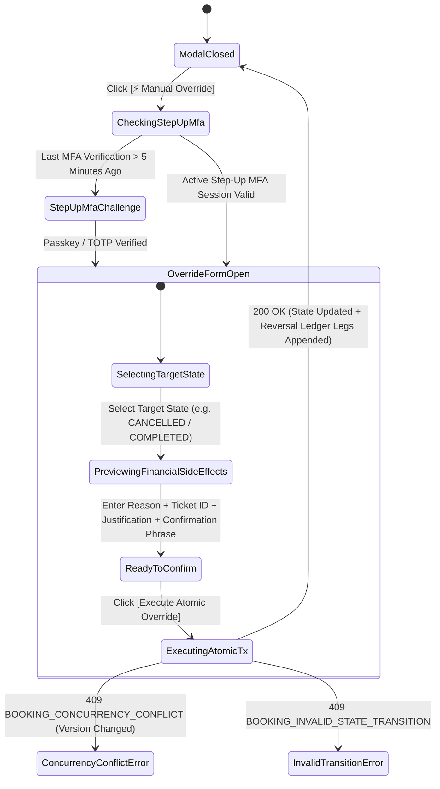
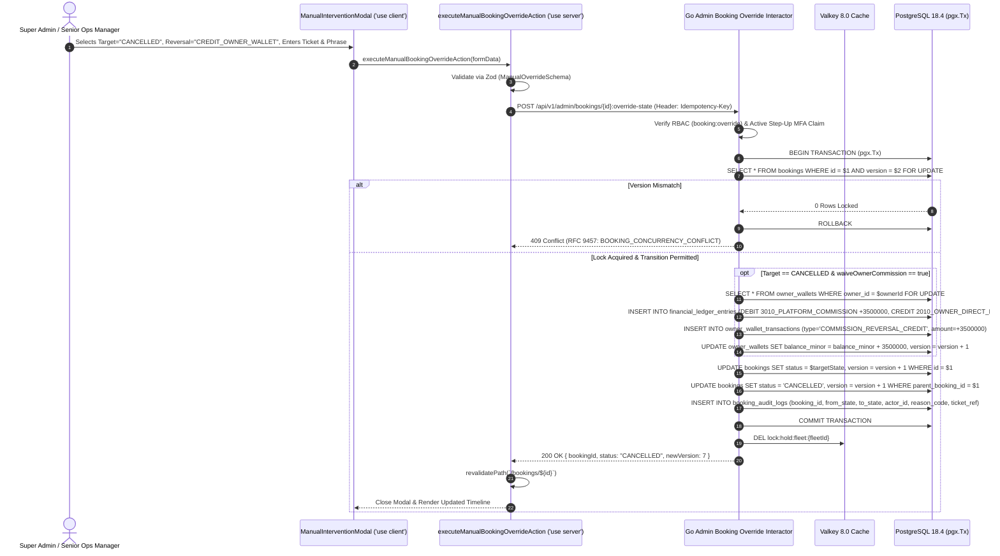

# Dual-Control Manual Booking State Override & Emergency Intervention Modal
## Admin Subsystem Specification — `docs/admin/booking-operations/04-manual-intervention-modal.md`

**Document Identifier:** `SPEC-ADM-BKG-04`  
**Classification:** Canonical Subsystem UI/UX & Technical Behavior Specification  
**Governing Documents:** `Dink_Machinery_UI_UX_Design_Brief.md`, `SRS-DINK-CORE-V7.0`, `docs/components/admin/DESIGN.md`, `contracts/openapi.yaml`  
**Target Subsystem:** Next.js 16 Web Admin Console (`admin/src/components/booking/ManualInterventionModal.tsx`)  
**Primary Persona / Actor:** `SUPER_ADMIN`, Senior Operations Manager (`booking:override`)  
**Associated Requirements:** `AD-08`, `REQ-05-05`, `REQ-08`, `BK-17-BE`  
**Associated Interaction Flows:** `FLOW-06` (20-State Booking Machine & OCC), `FLOW-10` (Ledger Reversal), `FLOW-12`  
**Associated ADRs:** `ADR-005` (Double-Entry Financial Reversal), `ADR-006` (Optimistic Concurrency Control), `ADR-011` (Step-Up MFA)  
**Status:** Approved Technical Design Baseline

---

## 1. Domain Context, Business Rules & Architectural Invariants

The **Dual-Control Manual Booking State Override & Emergency Intervention Modal** (`SPEC-ADM-BKG-04`) provides an audited administrative escape hatch (`AD-08`) when real-world field emergencies—such as catastrophic mechanical breakdown during mobilization, force majeure road closures, or unrecoverable mobile device loss on a remote site—leave a reservation deadlocked in the 20-state lifecycle.

### 1.1 Core Business Rules & Financial Safety Invariants
1. **Strict Optimistic Concurrency Control (`version` Check, `ADR-006`):**
   - Every manual intervention submission must pass the booking's current integer `version` (`WHERE id = $1 AND version = $2`). If a mobile client or cron job mutated the booking while the modal was open, the backend rejects the override with `409 BOOKING_CONCURRENCY_CONFLICT`.
2. **Forbidden Un-Audited Transitions (`BOOKING_INVALID_STATE_TRANSITION`):**
   - Even administrative overrides cannot violate accounting physics: a terminal state (`CANCELLED`, `CLOSED`, `HOLD_EXPIRED`) can never transition back to `ACTIVE`, and `HOLD_PENDING` cannot jump directly to `COMPLETED` without a settled payment record.
3. **Automatic Double-Entry Commission Reversal on Force-Cancellation (`BK-17-BE`, `ADR-005`):**
   - When an administrator forces a transition from `CONFIRMED`, `AWAITING_FLEET_READINESS`, or `READY_FOR_PICKUP` to `CANCELLED` with `waiveOwnerCommission = true` (e.g., Renter-fault or Force Majeure cancellation), the single atomic `pgx.Tx` automatically:
     1. Locks `owner_wallets` (`SELECT ... FOR UPDATE`),
     2. Inserts balanced offsetting `DEBIT` (`3010_PLATFORM_COMMISSION`) and `CREDIT` (`2010_OWNER_DIRECT_RETAIN`) rows into `financial_ledger_entries` (never mutating or deleting the original ledger entries, which would violate `LEDGER_IMMUTABLE_MUTATION`),
     3. Refunds the debited commission minor units (`+feeMinor`) back to `owner_wallets.balance_minor`, and
     4. Cascades cancellation to any linked child transport sub-bookings (`WHERE parent_booking_id = $id`).
4. **Mandatory Reason Code, Ticket Reference & Step-Up MFA (`ADR-011`):**
   - Requires a structured `overrideReasonCode` (`MECHANICAL_BREAKDOWN_BEFORE_HANDOVER`, `FORCE_MAJEURE_CORRIDOR_CLOSURE`, `OFFLINE_PAPER_INSPECTION_VERIFIED`, `FRAUD_EMERGENCY_ABORT`), a mandatory support ticket reference (`#SUP-...`), and an active Step-Up MFA assertion (`SPEC-ADM-SHL-02`).

---

## 2. Screen Anatomy, Layout & Component Hierarchy

### 2.1 Dual-Control Administrative State Override Modal Wireframe

```text
+------------------------------------------------------------------------------------------------------------------------------------------+
| [BLURRED FORENSIC BOOKING DETAIL BACKDROP — `backdrop-blur-sm bg-slate-950/75` — FOCUS TRAPPED IN RADIX DIALOG]                          |
|                                                                                                                                          |
|   +----------------------------------------------------------------------------------------------------------------------------------+   |
|   | [⚡] ADMINISTRATIVE BOOKING STATE OVERRIDE (`AD-08`) — #BK-9042 (CAT 320D3)                            [OCC v6] [🔒 MFA Verified] |   |
|   +----------------------------------------------------------------------------------------------------------------------------------+   |
|   | [!] CAUTION: Manual state intervention writes an immutable record to `booking_audit_logs` and triggers automatic double-entry    |   |
|   |     financial ledger reversals if cancelling a confirmed reservation.                                                            |   |
|   +----------------------------------------------------------------------------------------------------------------------------------+   |
|   | CURRENT LIFECYCLE STATE                                      | TARGET OVERRIDE STATE *                                           |   |
|   | [ 🟠 AWAITING_FLEET_READINESS (Version 6)                  ] | [ 🔴 CANCELLED (Terminal Administrative Abort)                 v] |   |
|   +--------------------------------------------------------------+-------------------------------------------------------------------+   |
|   | AUTOMATED FINANCIAL & LOGISTICS SIDE-EFFECT PREVIEW (COMPUTED IN INTEGER MINOR UNITS)                                            |   |
|   | • Original Platform Commission Debited:  `3,500,000` Santims (`35,000.00 ETB`) on Tx `#WLT-4410`                                 |   |
|   | • Commission Reversal Policy *:          (o) Reverse & Credit `+35,000.00 ETB` back to OwnerWallet (Force Majeure / Renter Fault)|   |
|   |                                          ( ) Retain `-35,000.00 ETB` Commission Debit (Substantiated Owner Default Penalty)      |   |
|   | • Linked Transport Sub-Booking Cascade:  Child Lowboy Booking `#BK-9098` will automatically transition to `CANCELLED`.           |   |
|   +----------------------------------------------------------------------------------------------------------------------------------+   |
|   | MANDATORY AUDIT & GOVERNANCE ATTESTATION                                                                                         |   |
|   | Override Reason Code *                                         Support / Incident Ticket ID *                                    |   |
|   | [ FORCE_MAJEURE_CORRIDOR_CLOSURE                           v ] [ SUP-2026-10942                                                ] |   |
|   |                                                                                                                                  |   |
|   | Detailed Forensic Justification (Min 20 characters, visible in compliance audit logs) *                                          |   |
|   | [ Heavy landslide on Addis-Djibouti highway km 114 blocked lowboy mobilization; verified with regional traffic authority.      ] |   |
|   |                                                                                                                                  |   |
|   | Type `OVERRIDE #BK-9042` to confirm destructive state transition *                                                               |   |
|   | [ OVERRIDE #BK-9042                                          ]                                                                   |   |
|   +----------------------------------------------------------------------------------------------------------------------------------+   |
|   | Request Tracking Token: `req_01J8OVR77123`                     [ CANCEL (ESC) ]   [ ⚡ EXECUTE ATOMIC OVERRIDE & LEDGER REVERSAL ] |   |
|   +----------------------------------------------------------------------------------------------------------------------------------+   |
+------------------------------------------------------------------------------------------------------------------------------------------+
```

---

## 3. W3C DTCG Design Token Mapping Table

| Override Modal Element | W3C Token Path (`design-tokens.json`) | Resolved Value | Behavioral & Accessibility Constraint |
|---|---|---|---|
| **Modal Dialog Surface** | `semantic.light.surface.cardElevated` + `elevation.modal` | `#FFFFFF` (`#334155` Dark), `24dp` blur shadow | Radix `@radix-ui/react-dialog` with `aria-labelledby` and `aria-describedby`. |
| **Caution Alert Callout** | `color.feedback.crimson.50` + `color.feedback.crimson.700` | `#FEF2F2` fill / `#B91C1C` text / `#EF4444` border | High-contrast warning banner explaining immutable ledger side effects. |
| **Side-Effect Minor-Unit Preview** | `typography.fontFamily.mono` / `typography.fontSize.14` | `Space Mono`, `14sp`, `#020617` | Displays exact `amountMinor` reversal impact before execution. |
| **Execute Override Button** | `semantic.light.action.destructive.bg` / `text` | `#EF4444` (`#DC2626` hover) / `#FFFFFF` | Remains `disabled` until confirmation phrase matches `OVERRIDE #<ref>` and justification $\ge 20$ chars. |

---

## 4. Interactive State Machine & Sequence Choreography

### 4.1 Administrative State Override & Ledger Reversal State Machine



### 4.2 Atomic State Override & Double-Entry Commission Reversal Sequence



---

## 5. Concrete Next.js 16 Implementation Blueprint

### 5.1 Server Action: Atomic Administrative Booking Override (`src/app/(dashboard)/bookings/[id]/override-actions.ts`)

```typescript
// src/app/(dashboard)/bookings/[id]/override-actions.ts
'use server';

import { cookies } from 'next/headers';
import { revalidatePath } from 'next/cache';
import { z } from 'zod';
import { ProblemDetails } from '@/types/dynamic-ui';

const ManualBookingOverrideSchema = z
  .object({
    bookingId: z.string().uuid(),
    bookingReference: z.string().min(4),
    version: z.coerce.number().int().positive(),
    targetState: z.enum([
      'CONFIRMED',
      'READY_FOR_PICKUP',
      'ACTIVE',
      'RETURN_INITIATED',
      'COMPLETED',
      'CANCELLED',
    ]),
    overrideReasonCode: z.enum([
      'MECHANICAL_BREAKDOWN_BEFORE_HANDOVER',
      'FORCE_MAJEURE_CORRIDOR_CLOSURE',
      'OFFLINE_PAPER_INSPECTION_VERIFIED',
      'FRAUD_EMERGENCY_ABORT',
      'PAYMENT_RECONCILED_MANUALLY',
    ]),
    waiveOwnerCommission: z.coerce.boolean().default(false),
    supportTicketRef: z
      .string()
      .trim()
      .regex(/^SUP-\d{4}-\d{4,8}$/, 'Ticket reference must match format SUP-YYYY-NNNNN.'),
    justificationNotes: z
      .string()
      .trim()
      .min(20, 'Forensic justification must be at least 20 characters.')
      .max(1500),
    confirmationPhrase: z.string().trim(),
  })
  .refine(
    (data) => data.confirmationPhrase === `OVERRIDE #${data.bookingReference}`,
    {
      message: 'Confirmation phrase must match exact string "OVERRIDE #<BookingRef>".',
      path: ['confirmationPhrase'],
    }
  );

export async function executeManualBookingOverrideAction(
  formData: FormData
): Promise<{
  success: boolean;
  problem?: ProblemDetails;
}> {
  const parsed = ManualBookingOverrideSchema.safeParse({
    bookingId: formData.get('bookingId'),
    bookingReference: formData.get('bookingReference'),
    version: formData.get('version'),
    targetState: formData.get('targetState'),
    overrideReasonCode: formData.get('overrideReasonCode'),
    waiveOwnerCommission: formData.get('waiveOwnerCommission') === 'true',
    supportTicketRef: formData.get('supportTicketRef'),
    justificationNotes: formData.get('justificationNotes'),
    confirmationPhrase: formData.get('confirmationPhrase'),
  });

  if (!parsed.success) {
    return {
      success: false,
      problem: {
        type: 'https://api.dinkmachinery.com/errors/request-validation-failed',
        title: 'Override Governance Validation Failed',
        status: 400,
        detail: 'All mandatory audit fields, ticket reference, and confirmation phrase must be valid.',
        code: 'REQ_VALIDATION_FAILED',
        invalidParams: parsed.error.issues.map((i) => ({
          name: i.path.join('.'),
          reason: i.message,
        })),
      },
    };
  }

  const cookieStore = await cookies();
  const sessionToken = cookieStore.get('dink_admin_session')?.value;
  const countryCode = cookieStore.get('dink_admin_country')?.value ?? 'ET';

  const res = await fetch(
    `${process.env.INTERNAL_BACKEND_URL}/api/v1/admin/bookings/${parsed.data.bookingId}:override-state`,
    {
      method: 'POST',
      headers: {
        'Content-Type': 'application/json',
        'Authorization': `Bearer ${sessionToken}`,
        'Idempotency-Key': crypto.randomUUID(),
        'X-Country-Code': countryCode,
      },
      body: JSON.stringify({
        version: parsed.data.version,
        targetState: parsed.data.targetState,
        overrideReasonCode: parsed.data.overrideReasonCode,
        waiveOwnerCommission: parsed.data.waiveOwnerCommission,
        supportTicketRef: parsed.data.supportTicketRef,
        justificationNotes: parsed.data.justificationNotes,
      }),
    }
  );

  const payload = await res.json();
  if (!res.ok) {
    return {
      success: false,
      problem: payload.error as ProblemDetails,
    };
  }

  revalidatePath('/bookings');
  revalidatePath(`/bookings/${parsed.data.bookingId}`);
  return { success: true };
}
```

---

## 6. OpenAPI 3.1.0 Contract Bindings & RFC 9457 Error Matrix

| HTTP Method & Route | Operation ID | Required Headers | Success Envelope | RFC 9457 Error Codes & Trigger Conditions |
|---|---|---|---|---|
| `POST /api/v1/admin/bookings/{id}:override-state` | `overrideBookingState` | `Authorization`, `Idempotency-Key`, `X-Country-Code` | `200 OK` (`BookingDetailSuccessResponse`) | `400 REQ_VALIDATION_FAILED` (Missing ticket ref or notes < 20 chars)<br>`403 ADMIN_UNAUTHORIZED_OVERRIDE` (Missing `SUPER_ADMIN` / `booking:override` clearance or stale Step-Up MFA)<br>`409 BOOKING_INVALID_STATE_TRANSITION` (Terminal state reversal attempted)<br>`409 BOOKING_CONCURRENCY_CONFLICT` (`version` mismatch)<br>`500 LEDGER_IMMUTABLE_MUTATION` (Never update/delete existing ledger rows; always append offsetting legs) |

---

## 7. Verification & Acceptance Criteria

1. **OCC Version Conflict Handling (Playwright E2E):**
   - If the booking `version` increments in the background while `ManualInterventionModal` is open, submitting the form returns HTTP `409` (`BOOKING_CONCURRENCY_CONFLICT`) and prompts the administrator to reload the latest state.
2. **Immutable Offsetting Ledger Reversal:**
   - Forcing cancellation with `waiveOwnerCommission = true` appends two new offsetting rows to `financial_ledger_entries` summing to `0` minor units and increments `owner_wallets.balance_minor` by the exact commission amount.

---
*Canonical specification entry for Dink Machinery platform development. Changes require an explicit design review.*
