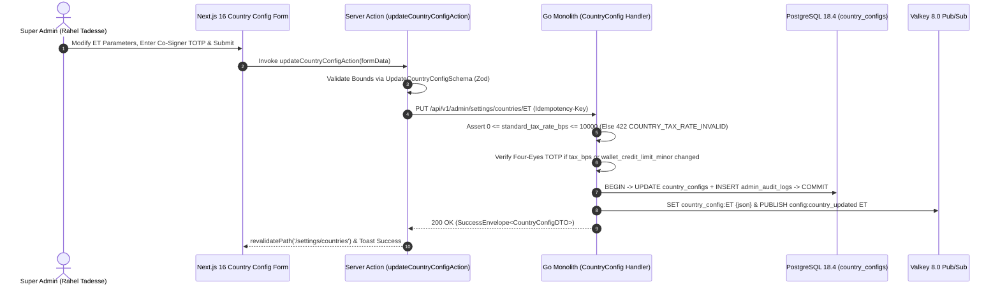

# Multi-Country Operational Parameters & Jurisdictional Tax Matrix (`country_configs`)
## Admin Subsystem Specification — `docs/admin/configuration/01-multi-country-parameters.md`

**Document Identifier:** `SPEC-ADM-CFG-01`  
**Classification:** Canonical Subsystem UI/UX & Technical Behavior Specification  
**Governing Documents:** `Dink_Machinery_UI_UX_Design_Brief.md`, `SRS-DINK-CORE-V7.0` (§5.23 `LOC-01-BE`, §7.8 `REQ-07-08`, §5.11 `AD-06-BE`), `docs/components/admin/DESIGN.md`, `docs/shared/design/design-tokens.json`, `docs/ERROR_CATALOG.md`, `contracts/openapi.yaml`, `ADR-015`  
**Target Subsystem:** Next.js 16 Web Admin Console (`admin/src/app/(dashboard)/settings/countries/`)  
**Primary Persona / Actor:** Super Administrator (*Rahel Tadesse*), International Operations Lead  
**Associated Requirements:** `REQ-05-23` (`LOC-01-BE`), `REQ-07-08`, `REQ-05-09` (`CW-06`, `CW-12`), `ADR-015`  
**Associated Interaction Flows:** `FLOW-12` (Admin Dynamic UI Engine & Country Configs)  
**Status:** Approved Technical Design Baseline

---

## 1. Executive Summary & Architectural Invariants

The **Multi-Country Operational Parameters & Jurisdictional Tax Matrix Console** (`SPEC-ADM-CFG-01`) is the single administrative control plane for the PostgreSQL `country_configs` table (`LOC-01-BE`, `ADR-015`). In Dink Machinery, **zero country-specific constants (tax percentages, currencies, phone prefixes, negative wallet credit limits, booking hold timers, or payment gateway routings) are hardcoded in Go or Dart/TypeScript code**. Every operational parameter is keyed by ISO 3166-1 alpha-2 `country_code` (`ET` for Ethiopia, `KE` for Kenya) and cached in Valkey 8.0 (`country_config:{country_code}`).

### 1.1 Canonical Jurisdictional Parameter Matrix (`country_configs`)

| Parameter Column (`snake_case`) | Ethiopia (`ET`) Default | Kenya (`KE`) Default | Invariant & Validation Rule |
|---|---|---|---|
| `country_code` (PK) | `'ET'` | `'KE'` | ISO 3166-1 alpha-2 uppercase string. |
| `default_currency` | `'ETB'` (`100 Santims`) | `'KES'` (`100 Cents`) | ISO 4217 3-letter currency code; immutable after first ledger entry. |
| `dialing_prefix` | `'+251'` | `'+254'` | E.164 international dialing prefix (`^\+\d{1,4}$`). |
| `standard_tax_rate_bps` | `1500` (`15.00%` ERCA VAT) | `1600` (`16.00%` KRA VAT) | Integer basis points `[0 .. 10000]`. Validated against `COUNTRY_TAX_RATE_INVALID`. |
| `withholding_tax_bps` | `200` (`2.00%` ERCA WHT) | `300` (`3.00%` KRA WHT) | Integer basis points `[0 .. 10000]`. |
| `unverified_tin_wht_bps` | `3000` (`30.00%` Penalty) | `2000` (`20.00%` Penalty) | Penalty withholding rate applied when supplier TIN/PIN is unverified. |
| `platform_commission_bps` | `1000` (`10.00%` Std Fee) | `1000` (`10.00%` Std Fee) | Default marketplace take rate (`CW-01`). |
| `wallet_credit_limit_minor` | `-500000` (`-5,000.00 ETB`) | `-650000` (`-6,500.00 KES`) | Negative integer minor units defining the `CW-06` automatic fleet lockout floor. |
| `hold_duration_minutes` | `60` (`60m` Payment Hold) | `45` (`45m` Payment Hold) | Reservation hold countdown timer (`BK-08`) in minutes `[15 .. 240]`. |
| `owner_verify_sla_minutes` | `120` (`2h` Slip Audit SLA) | `120` (`2h` Slip Audit SLA) | Window before unverified bank slip escalates to `WIRE_DISPUTED` (`BK-13`). |
| `active_payment_gateways` | `["TELEBIRR","CBE_BIRR","CHAPA","MANUAL_BANK_SLIP"]` | `["MPESA_STK","EQUITY_EFT","MANUAL_BANK_SLIP"]` | Ordered JSON array of enabled payment rail adapters. |
| `active_sms_providers` | `["ETHIO_TELECOM_SMPP","GEEZSMS"]` | `["AFRICAS_TALKING_KE"]` | Ordered failover array of SMS gateway adapters (`NT-02`). |

### 1.2 Architectural Safety Invariants
- **Four-Eyes Dual Control on Tax & Financial Floor Mutations:** Modifying `standard_tax_rate_bps`, `withholding_tax_bps`, `platform_commission_bps`, or `wallet_credit_limit_minor` requires a second `SUPER_ADMIN` / `FINANCE_CONTROLLER` TOTP co-signature and only applies to **newly created bookings**—in-flight confirmed bookings retain their snapshot rates (`bookings.applied_tax_rate_bps`).

---

## 2. Screen Anatomy, Layout & Bespoke Desktop Wireframe

```text
+------------------------------------------------------------------------------------------------------------------------------------------+
| DINK ADMIN [Global Super Admin]   Configuration > Multi-Country Parameters (country_configs)     [+ Provision New Jurisdiction (UG/TZ)]  |
+------------------------------------------------------------------------------------------------------------------------------------------+
| JURISDICTION SELECTOR: [ (*) ET — Ethiopia (ETB / +251 / ERCA) ]   [ ( ) KE — Kenya (KES / +254 / KRA) ]     Cache Status: Valkey SYNCED |
+------------------------------------------------------------------------------------------------------------------------------------------+
| TAXATION & COMMISSION BASIS POINTS (50% Width)                        | OPERATIONAL TIMERS, WALLET FLOOR & RAILS (50% Width)             |
|-----------------------------------------------------------------------|------------------------------------------------------------------|
| JURISDICTION IDENTITY (Immutable Post-Ledger Activation)              | OWNER WALLET & BOOKING STATE MACHINE TIMERS                      |
| Country ISO Code:         [ ET ] (Ethiopia / ኢትዮጵያ)                   | Negative Wallet Lockout Floor (`wallet_credit_limit_minor`):     |
| Default Currency (4217):  [ ETB ] (1 ETB = 100 Santims)               | [ -500000 ] Santims  ==  -5,000.00 ETB (CW-06 Grace Limit)       |
| E.164 Dialing Prefix:     [ +251 ]  | Timezone: [ Africa/Addis_Ababa ]|                                                                  |
| Primary Calendar Display: [ ETHIOPIAN_GEEZ_AND_GREGORIAN           v] | Renter Payment Hold Window (`hold_duration_minutes` BK-08):      |
|-----------------------------------------------------------------------| [ 60 ] Minutes (Range: 15 .. 240 mins)                           |
| STATUTORY TAX & TAKE-RATE BASIS POINTS (100 bps = 1.00%)              | Owner Slip Verification Window (`owner_verify_sla_minutes` BK-13)|
| Standard VAT Rate (`standard_tax_rate_bps`):                          | [ 120 ] Minutes (Escalates to WIRE_DISPUTED on expiry)           |
| [ 1500 ] bps  (15.00% ERCA Standard VAT)                              |------------------------------------------------------------------|
|                                                                       | ACTIVE PAYMENT RAILS & SMS FAILOVER CHAIN                        |
| Withholding Tax Rate (`withholding_tax_bps` CW-12):                   | Enabled Payment Gateways (Drag to Set Priority):                 |
| [  200 ] bps  ( 2.00% ERCA Rental Service WHT > 3,000 ETB)            | [x] 1. MANUAL_BANK_SLIP (CBE / Awash / Dashen / BOA OCR Queue)   |
|                                                                       | [x] 2. TELEBIRR_H5_USSD (Ethio Telecom Merchant API)             |
| Unverified TIN Penalty WHT (`unverified_tin_wht_bps`):                | [x] 3. CBE_BIRR_GATEWAY                                          |
| [ 3000 ] bps  (30.00% Statutory Non-TIN Withholding)                  | [x] 4. CHAPA_CHECKOUT                                            |
|                                                                       |                                                                  |
| Platform Base Commission (`platform_commission_bps` CW-01):           | Primary & Failover SMS Gateways (`active_sms_providers`):        |
| [ 1000 ] bps  (10.00% Marketplace Take Rate)                          | Primary: [ETHIO_TELECOM_SMPP v]  -> Failover: [GEEZSMS_REST   v] |
|                                                                       |------------------------------------------------------------------|
| FOUR-EYES AUTHORIZATION STEP-UP (Required for BPS / Floor Changes)    | Audit Reason: [Annual ERCA Directive 2026 verification_________] |
| Co-Signer 6-Digit TOTP: [ 9 1 0 4 4 2 ]                               | [Save & Broadcast to Valkey (ET v12)]  [Reset Unsaved Changes]   |
+------------------------------------------------------------------------------------------------------------------------------------------+
```

---

## 3. W3C DTCG Design Token Mapping Table

| UI Component / Element | W3C Token Path (`design-tokens.json`) | Resolved Value (Light / Dark / Outdoor) | Behavioral & Accessibility Invariant |
|---|---|---|---|
| **Basis Points (`bps`) Numeric Input** | `typography.fontFamily.mono` + `semantic.light.border.focus` | `Space Mono, monospace`, `#D97706` focus ring | Displays live computed percentage suffix (`1500 bps -> 15.00%`) in an adjacent `aria-live="polite"` badge. |
| **Negative Credit Floor Input** | `typography.fontFamily.mono` + `color.feedback.crimson.700` | `Space Mono`, `#B91C1C` text | Displays exact integer minor units (`-500000`) alongside major currency (`-5,000.00 ETB`). |
| **Jurisdiction Active Tab** | `color.brand.amber.500` + `color.brand.slate.950` | `#F59E0B` active bar, `#020617` bold label | Keyboard-accessible tablist (`role="tablist"`). |

---

## 4. Interactive State Machine & Sequence Flows

### 4.1 Country Configuration Mutation & Valkey Broadcast (`sequenceDiagram`)



---

## 5. Concrete Next.js 16 Implementation Blueprint

### 5.1 Dynamic UI Engine Configuration (`/api/v1/admin/ui-config?route=settings/countries`)

```json
{
  "tableId": "tbl_settings_country_configs_v1",
  "title": "Multi-Country Operational Parameters (country_configs)",
  "description": "Configure jurisdictional VAT/WHT basis points, currencies, negative wallet floors, and payment/SMS gateways.",
  "defaultSortField": "countryCode",
  "defaultSortDirection": "asc",
  "pageSize": 20,
  "columns": [
    { "id": "countryCode", "header": "ISO Code", "accessorKey": "countryCode", "dataType": "badge", "isSortable": true, "isFilterable": true },
    { "id": "countryName", "header": "Jurisdiction", "accessorKey": "countryName", "dataType": "text", "isSortable": true, "isFilterable": true },
    { "id": "defaultCurrency", "header": "Currency", "accessorKey": "defaultCurrency", "dataType": "badge", "isSortable": false, "isFilterable": false },
    { "id": "vatBps", "header": "Standard VAT (bps)", "accessorKey": "standardTaxRateBps", "dataType": "text", "align": "right", "isSortable": true, "isFilterable": false },
    { "id": "whtBps", "header": "WHT (bps)", "accessorKey": "withholdingTaxBps", "dataType": "text", "align": "right", "isSortable": true, "isFilterable": false },
    { "id": "walletFloor", "header": "Wallet Lock Floor", "accessorKey": "walletCreditLimit", "dataType": "money", "align": "right", "isSortable": true, "isFilterable": false },
    { "id": "holdMinutes", "header": "Hold Timer (m)", "accessorKey": "holdDurationMinutes", "dataType": "text", "align": "center", "isSortable": true, "isFilterable": false }
  ],
  "facets": [],
  "rowActions": [
    {
      "id": "edit_country_config",
      "label": "Update Country Parameters",
      "variant": "default",
      "requiredPermission": "system.country_config.manage",
      "endpoint": "/api/v1/admin/settings/countries/{countryCode}",
      "method": "PUT",
      "requiresFourEyes": true
    }
  ],
  "bulkActions": []
}
```

### 5.2 Server Action for Updating `country_configs` (`admin/src/app/(dashboard)/settings/countries/actions.ts`)

```typescript
// admin/src/app/(dashboard)/settings/countries/actions.ts
'use server';

import { revalidatePath } from 'next/cache';
import { cookies } from 'next/headers';
import { z } from 'zod';
import { ProblemDetails } from '@/types/dynamic-ui';

const UpdateCountryConfigSchema = z.object({
  countryCode: z.enum(['ET', 'KE']),
  version: z.coerce.number().int().positive(),
  standardTaxRateBps: z.coerce
    .number()
    .int()
    .min(0, 'VAT basis points cannot be negative.')
    .max(10000, 'VAT basis points cannot exceed 10000 bps (100%).'),
  withholdingTaxBps: z.coerce
    .number()
    .int()
    .min(0, 'Withholding tax basis points cannot be negative.')
    .max(10000, 'Withholding tax basis points cannot exceed 10000 bps (100%).'),
  unverifiedTinWhtBps: z.coerce.number().int().min(0).max(10000),
  platformCommissionBps: z.coerce.number().int().min(100).max(3000),
  walletCreditLimitMinor: z.coerce
    .bigint()
    .refine((v) => v <= 0n && v >= -10000000n, 'Wallet credit floor must be negative minor units (e.g. -500000).'),
  holdDurationMinutes: z.coerce.number().int().min(15).max(240),
  ownerVerifySlaMinutes: z.coerce.number().int().min(30).max(720),
  activePaymentGateways: z.array(z.string()).min(1, 'At least one payment gateway must be active.'),
  activeSmsProviders: z.array(z.string()).min(1, 'At least one SMS provider must be active.'),
  coSignerTotpCode: z.string().regex(/^\d{6}$/, '6-digit Four-Eyes TOTP required to modify country parameters.'),
  auditReason: z.string().trim().min(10, 'Provide regulatory/operational audit justification.').max(500),
});

export async function updateCountryConfigAction(formData: FormData): Promise<{
  success: boolean;
  problem?: ProblemDetails;
}> {
  const parsed = UpdateCountryConfigSchema.safeParse({
    countryCode: formData.get('countryCode'),
    version: formData.get('version'),
    standardTaxRateBps: formData.get('standardTaxRateBps'),
    withholdingTaxBps: formData.get('withholdingTaxBps'),
    unverifiedTinWhtBps: formData.get('unverifiedTinWhtBps'),
    platformCommissionBps: formData.get('platformCommissionBps'),
    walletCreditLimitMinor: formData.get('walletCreditLimitMinor'),
    holdDurationMinutes: formData.get('holdDurationMinutes'),
    ownerVerifySlaMinutes: formData.get('ownerVerifySlaMinutes'),
    activePaymentGateways: JSON.parse((formData.get('activePaymentGateways') as string) || '[]'),
    activeSmsProviders: JSON.parse((formData.get('activeSmsProviders') as string) || '[]'),
    coSignerTotpCode: formData.get('coSignerTotpCode'),
    auditReason: formData.get('auditReason'),
  });

  if (!parsed.success) {
    return {
      success: false,
      problem: {
        type: 'https://api.dinkmachinery.com/errors/country-tax-rate-invalid',
        title: 'Country Configuration Validation Failed',
        status: 422,
        detail: 'One or more jurisdictional basis point or minor-unit parameters are out of bounds.',
        code: 'COUNTRY_TAX_RATE_INVALID',
        invalidParams: parsed.error.issues.map((i) => ({ name: i.path.join('.'), reason: i.message })),
      },
    };
  }

  const cookieStore = await cookies();
  const sessionToken = cookieStore.get('dink_admin_session')?.value;

  const res = await fetch(
    `${process.env.INTERNAL_BACKEND_URL}/api/v1/admin/settings/countries/${parsed.data.countryCode}`,
    {
      method: 'PUT',
      headers: {
        'Content-Type': 'application/json',
        Authorization: `Bearer ${sessionToken}`,
        'Idempotency-Key': crypto.randomUUID(),
      },
      body: JSON.stringify({
        ...parsed.data,
        walletCreditLimitMinor: Number(parsed.data.walletCreditLimitMinor),
      }),
    }
  );

  const payload = await res.json();
  if (!res.ok) {
    return { success: false, problem: payload.error as ProblemDetails };
  }

  revalidatePath('/settings/countries');
  return { success: true };
}
```

---

## 6. OpenAPI 3.1.0 Contract & RFC 9457 Error Matrix

| HTTP Method & Route | Operation ID | Required RBAC Permission | Idempotency-Key | Description |
|---|---|---|---|---|
| `GET /api/v1/admin/settings/countries` | `listCountryConfigs` | `system.country_config.read` | No | Returns all registered `country_configs` (`ET`, `KE`). |
| `PUT /api/v1/admin/settings/countries/{countryCode}` | `updateCountryConfig` | `system.country_config.manage` | Yes (UUID v4) | Updates jurisdictional parameters, writes `admin_audit_logs`, and refreshes Valkey. |

| Error Code | HTTP Status | RFC 9457 Type URI | Trigger Condition |
|---|---|---|---|
| `COUNTRY_CONFIG_NOT_FOUND` | `404 Not Found` | `https://api.dinkmachinery.com/errors/country-config-not-found` | Requested ISO country code is not provisioned in `country_configs`. |
| `COUNTRY_TAX_RATE_INVALID` | `422 Unprocessable` | `https://api.dinkmachinery.com/errors/country-tax-rate-invalid` | Basis points (`bps`) outside `[0 .. 10000]` or positive `walletCreditLimitMinor`. |
| `ADMIN_UNAUTHORIZED_OVERRIDE` | `403 Forbidden` | `https://api.dinkmachinery.com/errors/admin-unauthorized-override` | Missing or invalid Four-Eyes co-signer TOTP when changing tax or wallet floor parameters. |

---

## 7. Verification & Acceptance Criteria Checklist

- [ ] **Basis Point Boundary Enforcement (`COUNTRY_TAX_RATE_INVALID`):** Submitting `standardTaxRateBps = 12000` (`120%`) returns HTTP `422 COUNTRY_TAX_RATE_INVALID` and binds the error message to the `standardTaxRateBps` form input.
- [ ] **In-Flight Booking Snapshot Isolation:** Changing Ethiopia's `standard_tax_rate_bps` from `1500` to `1600` applies to newly created quotes while leaving existing `CONFIRMED` bookings at their snapshotted `1500 bps`.
