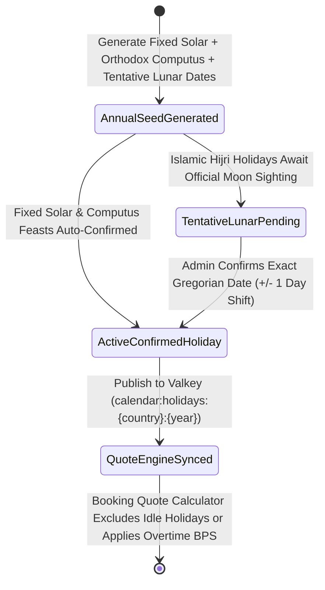

# Ethiopian Ge'ez & Kenyan Public Holiday Calendar & Overtime Multiplier Console
## Admin Subsystem Specification — `docs/admin/configuration/02-ethiopian-calendar-holidays.md`

**Document Identifier:** `SPEC-ADM-CFG-02`  
**Classification:** Canonical Subsystem UI/UX & Technical Behavior Specification  
**Governing Documents:** `Dink_Machinery_UI_UX_Design_Brief.md`, `SRS-DINK-CORE-V7.0` (§5.23 `REQ-05-23` `HC-01`..`HC-05`, §5.5 `BK-04`), `docs/components/admin/DESIGN.md`, `docs/shared/design/design-tokens.json`, `docs/ERROR_CATALOG.md`, `contracts/openapi.yaml`  
**Target Subsystem:** Next.js 16 Web Admin Console (`admin/src/app/(dashboard)/settings/holiday-calendars/`)  
**Primary Persona / Actor:** Operations Lead, Super Administrator (*Rahel Tadesse*)  
**Associated Requirements:** `REQ-05-23` (`HC-01`..`HC-05`), `REQ-05-05` (`BK-04` Rental Pricing & Billable Day Calculation)  
**Associated Interaction Flows:** `FLOW-05` (Date Selection & Quote Pricing), `FLOW-12` (Admin Dynamic UI Engine)  
**Status:** Approved Technical Design Baseline

---

## 1. Executive Summary & Architectural Invariants

The **Ethiopian Ge'ez & Kenyan Public Holiday Calendar & Overtime Multiplier Console** (`SPEC-ADM-CFG-02`) implements `SRS-DINK-CORE-V7.0` **Section 05.23 (`HC-01`..`HC-05`)**. Construction site operations across Ethiopia (`ET`) and Kenya (`KE`) observe statutory national and religious holidays where heavy machinery either stands down (non-billable idle day) or operates under a mandatory operator overtime surcharge.

### 1.1 Dual-Calendar Synchronization (`Ethiopic 13-Month Calendar` $\leftrightarrow$ `ISO-8601 Gregorian`)
1. **13-Month Ethiopian Ge'ez Calendar (`HC-01`):** Ethiopia operates on the 13-month Ge'ez calendar (`Meskerem` through `Nehase`, each 30 days, plus `Pagume` with 5 days or 6 days in a leap year *Zemene Lukas*). Every date in the database is persisted as canonical **ISO-8601 UTC (`YYYY-MM-DD`)** alongside its deterministic Ethiopian Calendar tuple (`eth_year`, `eth_month_1_13`, `eth_day_1_30`).
2. **Three Holiday Classifications (`HC-02`):**
   - `FIXED_SOLAR`: Fixed date in the Ethiopian/Gregorian calendar (e.g., *Enkutatash / Ethiopian New Year* on `Meskerem 1`, *Meskel* on `Meskerem 17`, *Adwa Victory Day* on `Yekatit 23`, *Jamhuri Day Kenya* on `12-Dec`).
   - `ORTHODOX_COMPUTUS_MOVEABLE`: Computed via the Alexandrian Orthodox computus algorithm (e.g., *Siklet / Good Friday*, *Fasika / Ethiopian Easter*).
   - `ISLAMIC_HIJRI_LUNAR`: Astronomical lunar sighting dates (`TENTATIVE_LUNAR` $\rightarrow$ `CONFIRMED_BY_ADMIN` 48 hours prior to *Eid al-Fitr*, *Eid al-Adha*, *Mawlid*).
3. **Rental Pricing & Billable Day Rules (`HC-03`..`HC-05`):**
   - `NON_WORKING_EXCLUDED`: If a rental spans a statutory stop-work holiday (e.g., *Fasika* or *Enkutatash*) and the machine is idle (`0` telematics/meter hours logged), the day is excluded from billable rental days (`0 bps`).
   - `OVERTIME_SURCHARGE_BPS`: If the Renter elects to operate the machine on a public holiday with an Owner-provided operator, the operator daily rate is multiplied by `holiday_overtime_surcharge_bps` (default `15000 bps` = `1.50x` or `20000 bps` = `2.00x`).

---

## 2. Screen Anatomy, Layout & Bespoke Desktop Wireframe

```text
+------------------------------------------------------------------------------------------------------------------------------------------+
| DINK ADMIN [ET: Ethiopia (2019 E.C. / 2026-2027 G.C.) v]  Configuration > Public Holiday & Ge'ez Calendar   [+ Add Holiday] [Sync Year]  |
+------------------------------------------------------------------------------------------------------------------------------------------+
| CALENDAR VIEW: [ (*) Ethiopia (13-Month Ge'ez + Gregorian) ]  [ ( ) Kenya (Gregorian KRA/Gazette) ]   Default Overtime: [15000 bps (1.5x)]|
+------------------------------------------------------------------------------------------------------------------------------------------+
| DUAL-CALENDAR MONTH GRID: MESKEREM 2019 E.C. (Sep 11 - Oct 10, 2026)  | HOLIDAY BILLING & LUNAR CONFIRMATION INSPECTOR                   |
|-----------------------------------------------------------------------|------------------------------------------------------------------|
| +---------+---------+---------+---------+---------+---------+-------+ | SELECTED HOLIDAY: Meskel (Finding of the True Cross / መስቀል)      |
| | ሰኞ/Mon  | ማክ/Tue  | ረቡ/Wed  | ሐሙ/Thu  | ዓር/Fri  | ቅዳ/Sat  | እሑ/Sun| |------------------------------------------------------------------|
| +---------+---------+---------+---------+---------+---------+-------+ | Holiday Code:       ET-2019-MESKEL                               |
| |         |         |         |         | 1 መስከረም | 2 መስከረም | 3 መስከ | | Name (English):     [Meskel (Finding of the True Cross)        ] |
| |         |         |         |         | 11-Sep  | 12-Sep  | 13-Sep| | Name (Amharic):     [የመስቀል በዓል                                ] |
| |         |         |         |         | [ENKUTA]|         |       | | Calculation Rule:   [FIXED_SOLAR (Meskerem 17 Every Year)     v] |
| +---------+---------+---------+---------+---------+---------+-------+ | Ethiopian Date:     [Meskerem (01) v] [Day: 17 v] [Year: 2019  ] |
| | 4 መስከረም | 5 መስከረም | 6 መስከረም | 7 መስከረም | 8 መስከረም | 9 መስከረም | 10 መስ | | Resolved Gregorian: 2026-09-27 (Sunday)                          |
| | 14-Sep  | 15-Sep  | 16-Sep  | 17-Sep  | 18-Sep  | 19-Sep  | 20-Sep| |------------------------------------------------------------------|
| +---------+---------+---------+---------+---------+---------+-------+ | RENTAL BILLING & OPERATOR OVERTIME POLICY (HC-03 .. HC-05)       |
| | 11 መስከረ | 12 መስከረ | 13 መስከረ | 14 መስከረ | 15 መስከረ | 16 መስከረ |*17 መስ*| | Default Billing Behavior when Machine is Idle:                   |
| | 21-Sep  | 22-Sep  | 23-Sep  | 24-Sep  | 25-Sep  | 26-Sep  |27-Sep | | (*) NON_WORKING_EXCLUDED (0 Billable Days if Meter Delta == 0h)  |
| |         |         |         |         |         |         |[MESKL]| | ( ) STANDARD_BILLABLE_DAY (Counted in Multi-Week Dry Lease)      |
| +---------+---------+---------+---------+---------+---------+-------+ |                                                                  |
|                                                                       | Operator Active Work Surcharge (`overtime_surcharge_bps`):       |
| UPCOMING MOVEABLE & LUNAR FEASTS REQUIRING CONFIRMATION               | [ 20000 ] bps (200.00% = 2.00x Operator Daily Rate on Holiday)   |
| Holiday             | Ethiopic Date   | Gregorian  | Status           |                                                                  |
|---------------------|-----------------|------------|------------------| Gazette / Proclamation Ref: [FDRE Public Holidays Proc. 1334/24] |
| >Meskel (መስቀል)      | 17 Meskerem 2019| 2026-09-27 | CONFIRMED_FIXED  |                                                                  |
|  Timkat (ጥምቀት)      | 11 Tir 2019     | 2027-01-19 | CONFIRMED_LB_YR  | [Save Holiday Rule]  [Confirm Lunar Sighting Date & Recalc Quotes]|
| !Eid al-Fitr (ኢድ)   | ~21 Megabit 2019| 2027-03-30 | TENTATIVE_LUNAR  |                                                                  |
+-----------------------------------------------------------------------+------------------------------------------------------------------+
```

---

## 3. W3C DTCG Design Token Mapping Table

| UI Component / Element | W3C Token Path (`design-tokens.json`) | Resolved Value (Light / Dark / Outdoor) | Behavioral & Accessibility Invariant |
|---|---|---|---|
| **Dual-Date Calendar Cell** | `semantic.light.surface.card` + `typography.fontFamily.ethiopic` | `#FFFFFF` surface, Ge'ez top + Latin bottom | Renders Ge'ez numerals/month names with `1.38` line-height factor (`ethiopicGolden`). |
| **Confirmed Holiday Cell (`[MESKL]`)** | `color.brand.amber.100` + `color.brand.amber.900` | `#FEF3C7` fill, `#78350F` text | Marked with `aria-label="Public Holiday: Meskel, September 27, 2026"`. |
| **Tentative Lunar Holiday Badge** | `color.feedback.purple.100` + `color.feedback.purple.900` | `#F3E8FF` fill, `#581C87` text | Alerts Operations Lead 7 days prior to lunar sighting to confirm exact Gregorian date. |

---

## 4. Interactive State Machine & Sequence Flows

### 4.1 Holiday Calendar & Quote Recalculation State Machine (`stateDiagram-v2`)



---

## 5. Concrete Next.js 16 Implementation Blueprint

### 5.1 Dynamic UI Engine Configuration (`/api/v1/admin/ui-config?route=settings/holiday-calendars`)

```json
{
  "tableId": "tbl_settings_holiday_calendars_v1",
  "title": "Public Holiday & Ge'ez Calendar Registry",
  "description": "Manage Ethiopian 13-month Ge'ez and Kenyan public holidays, lunar confirmations, and operator overtime basis points.",
  "defaultSortField": "gregorianDate",
  "defaultSortDirection": "asc",
  "pageSize": 50,
  "columns": [
    { "id": "gregorianDate", "header": "Gregorian Date (ISO)", "accessorKey": "gregorianDate", "dataType": "text", "isSortable": true, "isFilterable": true },
    { "id": "ethiopicDateLabel", "header": "Ethiopian Date (E.C.)", "accessorKey": "ethiopicDateLabel", "dataType": "text", "isSortable": false, "isFilterable": false },
    { "id": "nameEn", "header": "Holiday Name (EN)", "accessorKey": "nameEn", "dataType": "text", "isSortable": true, "isFilterable": true },
    { "id": "nameLocal", "header": "Local Name (አማርኛ / Kiswahili)", "accessorKey": "nameLocal", "dataType": "text", "isSortable": false, "isFilterable": false },
    { "id": "calculationType", "header": "Rule Type", "accessorKey": "calculationType", "dataType": "badge", "isSortable": true, "isFilterable": true },
    { "id": "overtimeSurchargeBps", "header": "Overtime BPS", "accessorKey": "overtimeSurchargeBps", "dataType": "text", "align": "right", "isSortable": true, "isFilterable": false },
    { "id": "confirmationStatus", "header": "Status", "accessorKey": "confirmationStatus", "dataType": "badge", "isSortable": true, "isFilterable": true,
      "badgeVariants": { "CONFIRMED": "success", "TENTATIVE_LUNAR": "warning" }
    }
  ],
  "facets": [
    {
      "id": "calculationType",
      "label": "Holiday Calculation Type",
      "type": "select",
      "options": [
        { "label": "Fixed Solar (Ethiopic / Gregorian)", "value": "FIXED_SOLAR" },
        { "label": "Orthodox Computus (Fasika / Siklet)", "value": "ORTHODOX_COMPUTUS_MOVEABLE" },
        { "label": "Islamic Hijri Lunar Sighting", "value": "ISLAMIC_HIJRI_LUNAR" }
      ]
    }
  ],
  "rowActions": [
    {
      "id": "confirm_lunar_holiday",
      "label": "Confirm Lunar Date",
      "variant": "default",
      "requiredPermission": "system.holiday_calendar.manage",
      "endpoint": "/api/v1/admin/settings/holidays/{id}:confirm-date",
      "method": "POST"
    }
  ],
  "bulkActions": []
}
```

### 5.2 Server Action for Upserting & Confirming Holiday Rules (`admin/src/app/(dashboard)/settings/holiday-calendars/actions.ts`)

```typescript
// admin/src/app/(dashboard)/settings/holiday-calendars/actions.ts
'use server';

import { revalidatePath } from 'next/cache';
import { cookies } from 'next/headers';
import { z } from 'zod';
import { ProblemDetails } from '@/types/dynamic-ui';

const UpsertHolidayRuleSchema = z.object({
  holidayId: z.string().uuid().optional(),
  countryCode: z.enum(['ET', 'KE']),
  gregorianDate: z.string().date('Must be a valid ISO-8601 date YYYY-MM-DD.'),
  ethiopianYear: z.coerce.number().int().min(2015).max(2100).optional(),
  ethiopianMonth: z.coerce.number().int().min(1).max(13, 'Ethiopian month must be 1..13 (13 = Pagume).').optional(),
  ethiopianDay: z.coerce.number().int().min(1).max(30).optional(),
  nameEn: z.string().trim().min(3).max(100),
  nameLocal: z.string().trim().min(2).max(120),
  calculationType: z.enum(['FIXED_SOLAR', 'ORTHODOX_COMPUTUS_MOVEABLE', 'ISLAMIC_HIJRI_LUNAR']),
  idleBillingPolicy: z.enum(['NON_WORKING_EXCLUDED', 'STANDARD_BILLABLE_DAY']),
  overtimeSurchargeBps: z.coerce
    .number()
    .int()
    .min(10000, 'Overtime multiplier must be at least 10000 bps (1.00x).')
    .max(30000, 'Overtime multiplier cannot exceed 30000 bps (3.00x).'),
  confirmationStatus: z.enum(['CONFIRMED', 'TENTATIVE_LUNAR']),
});

export async function upsertHolidayRuleAction(formData: FormData): Promise<{
  success: boolean;
  problem?: ProblemDetails;
}> {
  const parsed = UpsertHolidayRuleSchema.safeParse({
    holidayId: formData.get('holidayId') || undefined,
    countryCode: formData.get('countryCode'),
    gregorianDate: formData.get('gregorianDate'),
    ethiopianYear: formData.get('ethiopianYear') || undefined,
    ethiopianMonth: formData.get('ethiopianMonth') || undefined,
    ethiopianDay: formData.get('ethiopianDay') || undefined,
    nameEn: formData.get('nameEn'),
    nameLocal: formData.get('nameLocal'),
    calculationType: formData.get('calculationType'),
    idleBillingPolicy: formData.get('idleBillingPolicy'),
    overtimeSurchargeBps: formData.get('overtimeSurchargeBps'),
    confirmationStatus: formData.get('confirmationStatus'),
  });

  if (!parsed.success) {
    return {
      success: false,
      problem: {
        type: 'https://api.dinkmachinery.com/errors/request-validation-failed',
        title: 'Holiday Calendar Validation Failed',
        status: 400,
        detail: 'Check Ethiopian 13-month calendar bounds and overtime basis points.',
        code: 'REQ_VALIDATION_FAILED',
        invalidParams: parsed.error.issues.map((i) => ({ name: i.path.join('.'), reason: i.message })),
      },
    };
  }

  const cookieStore = await cookies();
  const sessionToken = cookieStore.get('dink_admin_session')?.value;

  const res = await fetch(`${process.env.INTERNAL_BACKEND_URL}/api/v1/admin/settings/holidays`, {
    method: 'POST',
    headers: {
      'Content-Type': 'application/json',
      Authorization: `Bearer ${sessionToken}`,
      'X-Country-Code': parsed.data.countryCode,
      'Idempotency-Key': crypto.randomUUID(),
    },
    body: JSON.stringify(parsed.data),
  });

  const payload = await res.json();
  if (!res.ok) {
    return { success: false, problem: payload.error as ProblemDetails };
  }

  revalidatePath('/settings/holiday-calendars');
  return { success: true };
}
```

---

## 6. OpenAPI 3.1.0 Contract & RFC 9457 Error Matrix

| HTTP Method & Route | Operation ID | Required RBAC Permission | Idempotency-Key | Description |
|---|---|---|---|---|
| `GET /api/v1/admin/settings/holidays` | `listPublicHolidays` | `system.holiday_calendar.read` | No | Returns dual-calendar holiday schedule for `ET` or `KE`. |
| `POST /api/v1/admin/settings/holidays` | `upsertPublicHoliday` | `system.holiday_calendar.manage` | Yes (UUID v4) | Creates or updates a holiday rule and syncs the Valkey quote pricing calendar. |
| `POST /api/v1/admin/settings/holidays/{id}:confirm-date` | `confirmLunarHolidayDate` | `system.holiday_calendar.manage` | Yes (UUID v4) | Locks in an Islamic lunar holiday date upon official sighting. |

| Error Code | HTTP Status | RFC 9457 Type URI | Trigger Condition |
|---|---|---|---|
| `REQ_VALIDATION_FAILED` | `400 Bad Request` | `https://api.dinkmachinery.com/errors/request-validation-failed` | Invalid `Pagume` day (`> 5` in non-leap year or `> 6` in Ethiopian leap year) or `overtimeSurchargeBps < 10000`. |
| `REQ_INVALID_COUNTRY_CODE` | `400 Bad Request` | `https://api.dinkmachinery.com/errors/invalid-country-code` | Unrecognized jurisdiction code. |

---

## 7. Verification & Acceptance Criteria Checklist

- [ ] **Ethiopian Leap Year (`Pagume 6` / `Timkat`) Accuracy:** Verify the calendar converter accurately handles the 6th day of *Pagume* every 4 years and shifts *Timkat* (`11 Tir`) to January 20 in Gregorian post-leap years.
- [ ] **Quote Engine Non-Working Day Exclusion (`HC-03`):** Marking `2026-09-27` (*Meskel*) as `NON_WORKING_EXCLUDED` causes a 5-day booking spanning Sep 25–Sep 29 to bill `4` working days unless holiday overtime operation is explicitly selected.
