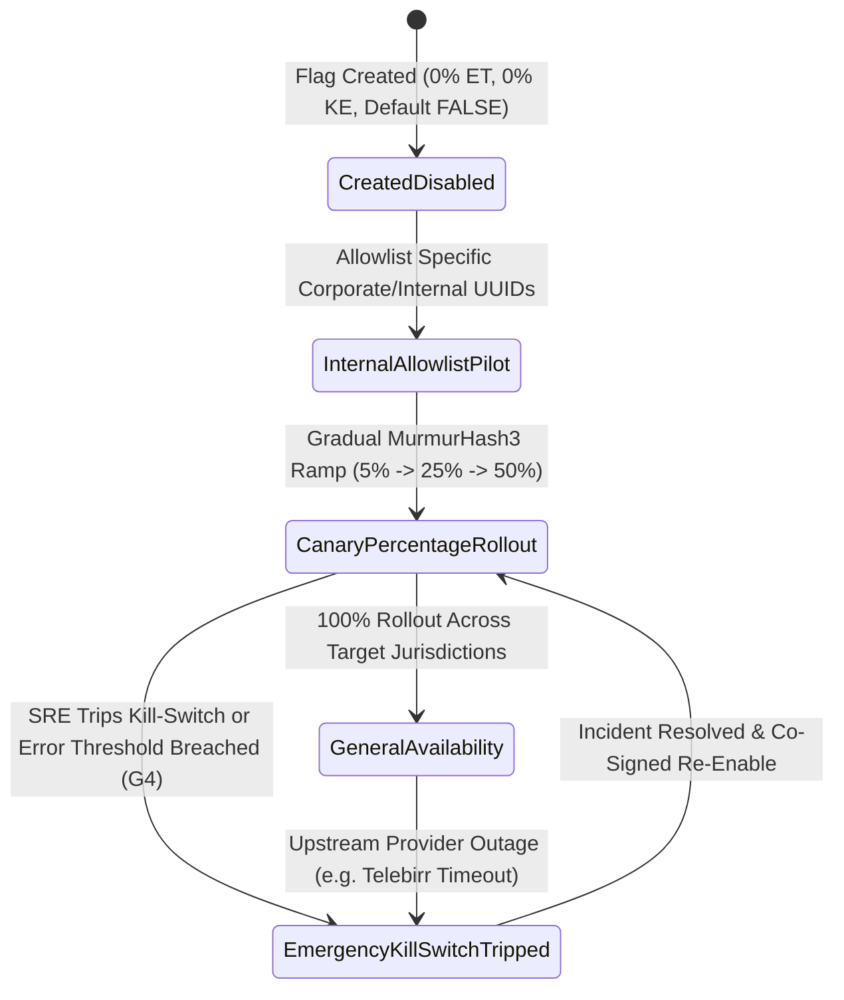

# Real-Time Feature Flagging, Canary Rollout & Operational Kill-Switch Console
## Admin Subsystem Specification — `docs/admin/configuration/03-feature-flags-remote-config.md`

**Document Identifier:** `SPEC-ADM-CFG-03`  
**Classification:** Canonical Subsystem UI/UX & Technical Behavior Specification  
**Governing Documents:** `Dink_Machinery_UI_UX_Design_Brief.md`, `SRS-DINK-CORE-V7.0` (§5.21 `REQ-05-21` `FF-01`..`FF-05`, §5.11 `AD-06-BE`), `docs/components/admin/DESIGN.md`, `docs/shared/design/design-tokens.json`, `docs/ERROR_CATALOG.md`, `contracts/openapi.yaml`  
**Target Subsystem:** Next.js 16 Web Admin Console (`admin/src/app/(dashboard)/settings/feature-flags/`)  
**Primary Persona / Actor:** Platform Architect, Site Reliability Engineer (SRE), Super Administrator (*Rahel Tadesse*)  
**Associated Requirements:** `REQ-05-21` (`FF-01`..`FF-05`), `REQ-07-01`..`REQ-07-10` (Phase 3 Gated Modules), `REQ-05-11`  
**Associated Interaction Flows:** `FLOW-12` (Admin Dynamic UI Engine & Kill-Switch Propagation)  
**Status:** Approved Technical Design Baseline

---

## 1. Executive Summary & Architectural Invariants

The **Real-Time Feature Flagging, Canary Rollout & Operational Kill-Switch Console** (`SPEC-ADM-CFG-03`) implements `SRS-DINK-CORE-V7.0` **Section 05.21 (`FF-01`..`FF-05`)**. It governs two mission-critical capabilities:
1. **Phased Architectural Rollouts (`REQ-07`):** Safely gating Phase 2/Phase 3 modules—such as `FF_GATEWAY_ESCROW_PAYOUTS` (`REQ-07-01`), `FF_TELEBIRR_H5_CHECKOUT` (`REQ-07-02`), `FF_AI_DYNAMIC_PRICING` (`REQ-07-04`), and `FF_IOT_CANBUS_TELEMATICS` (`REQ-07-03`)—by jurisdiction (`ET` vs `KE`), user persona (`CORPORATE_TENANT`, `OWNER`, `RENTER`), or deterministic MurmurHash3 percentage canary (`0% .. 100%`).
2. **Sub-Second Emergency Operational Kill-Switches (`FF-04`):** Instantaneous circuit-breakers when an external third-party dependency degrades (e.g., tripping `KILLSWITCH_TELEBIRR_GATEWAY` during an Ethio Telecom maintenance window to automatically fall back to `MANUAL_BANK_SLIP` uploads, or tripping `KILLSWITCH_OTA_FONT_STREAMING` on high CDN latency).

### 1.1 Deterministic Evaluation & Valkey Pub/Sub Invariants (`FF-01`..`FF-05`)
- **Deterministic Bucketing (`MurmurHash3`):** Percentage canary rollouts evaluate:
  $$\text{bucket} = \text{MurmurHash3\_32}(\texttt{flag\_key} \mathbin{\Vert} \texttt{":"} \mathbin{\Vert} \texttt{user\_id}) \bmod 100$$
  A user assigned to a `15%` canary cohort remains deterministically in that cohort across mobile (`Flutter Isar cache`) and backend API requests without session flicker.
- **Sub-500ms Global Kill-Switch Propagation:** Toggling a kill-switch writes to PostgreSQL `feature_flags`, updates Valkey `ff:v1:bundle`, and publishes a high-priority message on Valkey Pub/Sub channel `ff:killswitch:broadcast` to all Go backend instances and SSE/WebSocket connected clients within `< 500 ms`.

---

## 2. Screen Anatomy, Layout & Bespoke Desktop Wireframe

```text
+------------------------------------------------------------------------------------------------------------------------------------------+
| DINK ADMIN [Global SRE]   Configuration > Feature Flags, Canary Rollouts & Kill-Switches         [+ Create Feature Flag] [Export Bundle] |
+------------------------------------------------------------------------------------------------------------------------------------------+
| EMERGENCY OPERATIONAL KILL-SWITCHES (Instant Valkey Pub/Sub Broadcast — <500ms Propagation)                                              |
| +-----------------------------------+ +-----------------------------------+ +-----------------------------------+ +--------------------+ |
| | [ACTIVE] TELEBIRR H5 GATEWAY      | | [ACTIVE] M-PESA STK PUSH (KE)     | | [ACTIVE] ETHIO TELECOM SMPP SMS   | | [TRIPPED!] AI SURGE| |
| | Fallback: MANUAL_BANK_SLIP (CW-04)| | Fallback: EQUITY_BANK_EFT         | | Fallback: GEEZSMS_REST_API        | | Fallback: BASE_RATE| |
| | [Trip Kill-Switch (Disable Rail)] | | [Trip Kill-Switch (Disable Rail)] | | [Trip Kill-Switch (Failover Now)] | | [Restore Module]   | |
| +-----------------------------------+ +-----------------------------------+ +-----------------------------------+ +--------------------+ |
+------------------------------------------------------------------------------------------------------------------------------------------+
| FEATURE FLAG REGISTRY (55% Width)                                     | TARGETING & CANARY RULE BUILDER (FF_GATEWAY_ESCROW_PAYOUTS)      |
|-----------------------------------------------------------------------|------------------------------------------------------------------|
| Flag Key                        | Type       | ET %  | KE %  | State  | FLAG METADATA & EVALUATION PRECEDENCE                            |
|---------------------------------|------------|-------|-------|--------| Flag Key:        FF_GATEWAY_ESCROW_PAYOUTS (SRS REQ-07-01)       |
| >FF_GATEWAY_ESCROW_PAYOUTS      | RELEASE    |   10% |  100% | CANARY | Evaluation Type: BOOLEAN_TARGETED  | Default Fallback: [FALSE]   |
|  FF_CORPORATE_NET30_CREDIT      | RELEASE    |  100% |  100% | ON     |------------------------------------------------------------------|
|  FF_IOT_CANBUS_TELEMATICS       | EXPERIMENT |   25% |   50% | CANARY | RULE 1: JURISDICTION & PERSONA ALLOWLIST                         |
|  FF_OTA_ETHIOPIC_FONT_SUBSET    | OPS_TUNING |  100% |    0% | ON     | Country Filter:  [x] ET (Ethiopia)    [x] KE (Kenya)             |
|  FF_AI_DYNAMIC_SURGE_PRICING    | EXPERIMENT |    0% |    0% | KILLED | Persona Filter:  [x] CORPORATE_TENANT [ ] INDIVIDUAL_RENTER      |
|  FF_OFFLINE_ISAR_INSPECTION_V2  | RELEASE    |  100% |  100% | ON     | Specific UUIDs:  [corp_01JM2290 (Sunshine Construction PLC)    ] |
|                                 |            |       |       |        |------------------------------------------------------------------|
|                                 |            |       |       |        | RULE 2: DETERMINISTIC MURMURHASH3 CANARY ROLLOUT                 |
|                                 |            |       |       |        | Ethiopia (ET) Rollout Percentage: [██░░░░░░░░░░░░░░░░░░]  10%    |
|                                 |            |       |       |        | Kenya (KE) Rollout Percentage:    [████████████████████] 100%    |
|                                 |            |       |       |        |------------------------------------------------------------------|
|                                 |            |       |       |        | DRY-RUN CONTEXT SIMULATOR                                        |
|                                 |            |       |       |        | Test User UUID: [usr_01HJ9912] Country: [ET] -> Result: [TRUE]   |
|                                 |            |       |       |        | Audit Reason:   [Expand ET corporate escrow pilot to 10%_______] |
|-----------------------------------------------------------------------|------------------------------------------------------------------|
| Bundle ETag: sha256:4a91c... | Valkey Subscribers: 6 Go Nodes [OK]    | [Publish Flag Rules (v22)]  [Instant Kill Flag (Set 0% Global)]  |
+------------------------------------------------------------------------------------------------------------------------------------------+
```

---

## 3. W3C DTCG Design Token Mapping Table

| UI Component / Element | W3C Token Path (`design-tokens.json`) | Resolved Value (Light / Dark / Outdoor) | Behavioral & Accessibility Invariant |
|---|---|---|---|
| **Kill-Switch Card (`TRIPPED!`)** | `color.feedback.crimson.100` + `color.feedback.crimson.700` + `stroke.border.heavy` | `#FEE2E2` surface, `#B91C1C` text, `3dp` `#DC2626` border | High-visibility emergency state with `role="alert"` announcement. |
| **Kill-Switch Card (`ACTIVE`)** | `color.feedback.emerald.50` + `color.feedback.emerald.700` | `#ECFDF5` surface, `#047857` text | Displays active fallback rail that will engage if tripped. |
| **Canary Percentage Slider** | `component.actuator.slider.accentColor` + `typography.fontFamily.mono` | `#FF5722` thumb/track, `Space Mono` `%` readout | Keyboard operable via `ArrowLeft`/`ArrowRight` (`1%` step) and `PageUp`/`PageDown` (`10%` step). |

---

## 4. Interactive State Machine & Sequence Flows

### 4.1 Feature Flag Rollout & Kill-Switch Circuit Breaker (`stateDiagram-v2`)



---

## 5. Concrete Next.js 16 Implementation Blueprint

### 5.1 Dynamic UI Engine Configuration (`/api/v1/admin/ui-config?route=settings/feature-flags`)

```json
{
  "tableId": "tbl_settings_feature_flags_v1",
  "title": "Feature Flag & Operational Kill-Switch Registry",
  "description": "Manage percentage canary rollouts, country/persona targeting rules, and instant Valkey Pub/Sub kill-switches.",
  "defaultSortField": "flagKey",
  "defaultSortDirection": "asc",
  "pageSize": 50,
  "columns": [
    { "id": "flagKey", "header": "Flag Key", "accessorKey": "flagKey", "dataType": "text", "isSortable": true, "isFilterable": true },
    { "id": "flagCategory", "header": "Category", "accessorKey": "flagCategory", "dataType": "badge", "isSortable": true, "isFilterable": true },
    { "id": "rolloutEtPct", "header": "Ethiopia (ET) %", "accessorKey": "rolloutEtPct", "dataType": "progress", "align": "right", "isSortable": true, "isFilterable": false },
    { "id": "rolloutKePct", "header": "Kenya (KE) %", "accessorKey": "rolloutKePct", "dataType": "progress", "align": "right", "isSortable": true, "isFilterable": false },
    { "id": "lifecycleState", "header": "State", "accessorKey": "lifecycleState", "dataType": "badge", "isSortable": true, "isFilterable": true,
      "badgeVariants": { "ACTIVE_ON": "success", "CANARY": "warning", "KILLSWITCH_TRIPPED": "destructive", "OFF": "outline" }
    }
  ],
  "facets": [
    {
      "id": "flagCategory",
      "label": "Flag Type",
      "type": "select",
      "options": [
        { "label": "Operational Kill-Switch", "value": "KILLSWITCH" },
        { "label": "Phase 2/3 Feature Release", "value": "RELEASE" },
        { "label": "Pricing / UX Experiment", "value": "EXPERIMENT" }
      ]
    }
  ],
  "rowActions": [
    {
      "id": "trip_killswitch",
      "label": "Trip Emergency Kill-Switch",
      "variant": "destructive",
      "requiredPermission": "system.feature_flags.killswitch",
      "endpoint": "/api/v1/admin/settings/feature-flags/{flagKey}:kill",
      "method": "POST"
    }
  ],
  "bulkActions": []
}
```

### 5.2 Server Action for Updating Canary Rules & Tripping Kill-Switches (`admin/src/app/(dashboard)/settings/feature-flags/actions.ts`)

```typescript
// admin/src/app/(dashboard)/settings/feature-flags/actions.ts
'use server';

import { revalidatePath } from 'next/cache';
import { cookies } from 'next/headers';
import { z } from 'zod';
import { ProblemDetails } from '@/types/dynamic-ui';

const UpdateFeatureFlagSchema = z.object({
  flagKey: z.string().regex(/^[A-Z0-9_]{4,64}$/, 'Flag key must be UPPER_SNAKE_CASE.'),
  expectedVersion: z.coerce.number().int().positive(),
  isKillSwitchTripped: z.coerce.boolean(),
  rolloutEtPct: z.coerce.number().int().min(0).max(100),
  rolloutKePct: z.coerce.number().int().min(0).max(100),
  allowedPersonas: z.array(z.enum(['RENTER', 'OWNER', 'DRIVER_OPERATOR', 'CORPORATE_TENANT', 'ADMIN'])),
  auditReason: z.string().trim().min(8, 'Provide operational audit reason (min 8 chars).').max(500),
});

export async function updateFeatureFlagAction(formData: FormData): Promise<{
  success: boolean;
  bundleEtag?: string;
  problem?: ProblemDetails;
}> {
  const parsed = UpdateFeatureFlagSchema.safeParse({
    flagKey: formData.get('flagKey'),
    expectedVersion: formData.get('expectedVersion'),
    isKillSwitchTripped: formData.get('isKillSwitchTripped') === 'true',
    rolloutEtPct: formData.get('rolloutEtPct'),
    rolloutKePct: formData.get('rolloutKePct'),
    allowedPersonas: JSON.parse((formData.get('allowedPersonas') as string) || '[]'),
    auditReason: formData.get('auditReason'),
  });

  if (!parsed.success) {
    return {
      success: false,
      problem: {
        type: 'https://api.dinkmachinery.com/errors/request-validation-failed',
        title: 'Feature Flag Validation Failed',
        status: 400,
        detail: 'Rollout percentages must be integer values between 0 and 100.',
        code: 'REQ_VALIDATION_FAILED',
        invalidParams: parsed.error.issues.map((i) => ({ name: i.path.join('.'), reason: i.message })),
      },
    };
  }

  const cookieStore = await cookies();
  const sessionToken = cookieStore.get('dink_admin_session')?.value;

  const res = await fetch(
    `${process.env.INTERNAL_BACKEND_URL}/api/v1/admin/settings/feature-flags/${parsed.data.flagKey}`,
    {
      method: 'PUT',
      headers: {
        'Content-Type': 'application/json',
        Authorization: `Bearer ${sessionToken}`,
        'Idempotency-Key': crypto.randomUUID(),
      },
      body: JSON.stringify(parsed.data),
    }
  );

  const payload = await res.json();
  if (!res.ok) {
    return { success: false, problem: payload.error as ProblemDetails };
  }

  revalidatePath('/settings/feature-flags');
  return {
    success: true,
    bundleEtag: payload.data.bundleEtag,
  };
}
```

---

## 6. OpenAPI 3.1.0 Contract & RFC 9457 Error Matrix

| HTTP Method & Route | Operation ID | Required RBAC Permission | Idempotency-Key | Description |
|---|---|---|---|---|
| `GET /api/v1/admin/settings/feature-flags` | `listFeatureFlags` | `system.feature_flags.read` | No | Returns all feature flags, canary rules, and kill-switch states. |
| `PUT /api/v1/admin/settings/feature-flags/{flagKey}` | `updateFeatureFlag` | `system.feature_flags.manage` | Yes (UUID v4) | Updates rollout percentages and publishes to Valkey `ff:killswitch:broadcast`. |
| `POST /api/v1/admin/settings/feature-flags/{flagKey}:kill` | `tripFeatureKillSwitch` | `system.feature_flags.killswitch` | Yes (UUID v4) | Immediately sets flag to `0%` / `KILLSWITCH_TRIPPED` globally. |

| Error Code | HTTP Status | RFC 9457 Type URI | Trigger Condition |
|---|---|---|---|
| `BOOKING_CONCURRENCY_CONFLICT` | `409 Conflict` | `https://api.dinkmachinery.com/errors/booking-concurrency-conflict` | `expectedVersion` mismatch because another SRE modified the flag concurrently. |
| `AUTH_INSUFFICIENT_PERMISSIONS` | `403 Forbidden` | `https://api.dinkmachinery.com/errors/insufficient-permissions` | Principal lacks `system.feature_flags.killswitch` or `system.feature_flags.manage`. |

---

## 7. Verification & Acceptance Criteria Checklist

- [ ] **Deterministic MurmurHash3 Cohort Stability (`FF-02`):** Increasing `rolloutEtPct` from `10%` to `25%` preserves `TRUE` evaluation for all users who were already in the `0..9` hash bucket.
- [ ] **Sub-500ms Kill-Switch Fallback (`FF-04`):** Tripping `KILLSWITCH_TELEBIRR_GATEWAY` broadcasts over Valkey Pub/Sub and switches checkout quotes to `MANUAL_BANK_SLIP` within `< 500 ms` without dropping active sessions.
