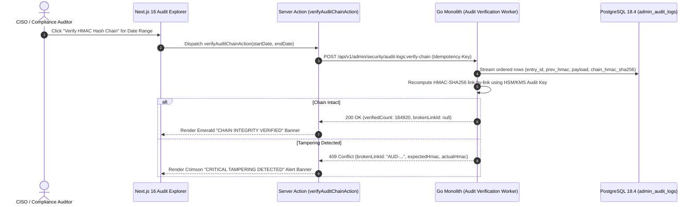

# Immutable ASVS Level 3 Security Audit Trail, JSON Diff Viewer & SIEM Exporter
## Admin Subsystem Specification — `docs/admin/configuration/04-audit-log-security-monitoring.md`

**Document Identifier:** `SPEC-ADM-CFG-04`  
**Classification:** Canonical Subsystem UI/UX & Technical Behavior Specification  
**Governing Documents:** `Dink_Machinery_UI_UX_Design_Brief.md`, `SRS-DINK-CORE-V7.0` (§5.11 `AD-09`, §5.24 `REQ-05-24`), `docs/components/admin/DESIGN.md`, `docs/shared/design/design-tokens.json`, `docs/ERROR_CATALOG.md`, `contracts/openapi.yaml`  
**Target Subsystem:** Next.js 16 Web Admin Console (`admin/src/app/(dashboard)/settings/audit-logs/`)  
**Primary Persona / Actor:** Chief Information Security Officer (CISO), Compliance Officer (*Yohannes Bekele*), Super Administrator (*Rahel Tadesse*)  
**Associated Requirements:** `REQ-05-11` (`AD-09`), `REQ-05-24` (Immutable Audit Trail & Cryptographic Hash Chaining), `OWASP ASVS 4.0.3 Level 3`  
**Associated Interaction Flows:** `FLOW-12` (Admin Dynamic UI Engine), `FLOW-APPENDIX-B` (Security Audit & Incident Forensics)  
**Status:** Approved Technical Design Baseline

---

## 1. Executive Summary & Architectural Invariants

The **Immutable ASVS Level 3 Security Audit Trail, JSON Diff Viewer & SIEM Exporter** (`SPEC-ADM-CFG-04`) implements `SRS-DINK-CORE-V7.0` **Sections 05.11 (`AD-09`) and 05.24 (`REQ-05-24`)**. Every administrative state transition, RBAC role modification, Four-Eyes co-signature, manual booking override, bank slip reconciliation, or PII export across Ethiopia (`ET`) and Kenya (`KE`) is synchronously persisted into the append-only PostgreSQL `admin_audit_logs` table inside the same ACID database transaction as the domain mutation.

### 1.1 Tamper-Evident Cryptographic Hash Chaining (`REQ-05-24`)
1. **HMAC-SHA256 Merkle Chain (`chain_hmac_sha256`):** Each row in `admin_audit_logs` computes an HMAC-SHA256 digest over:
   $$\text{HMAC}_{K_{\text{audit}}}\!\left(\texttt{prev\_entry\_hmac} \mathbin{\Vert} \texttt{entry\_id} \mathbin{\Vert} \texttt{actor\_id} \mathbin{\Vert} \texttt{action\_key} \mathbin{\Vert} \texttt{canonical\_json(previous\_state)} \mathbin{\Vert} \texttt{canonical\_json(new\_state)} \mathbin{\Vert} \texttt{created\_at\_utc}\right)$$
   If an attacker with raw disk access alters or deletes a single historical row, the **Verify Cryptographic Chain** action detects the broken hash link immediately.
2. **PostgreSQL Append-Only Trigger Guard:** `UPDATE`, `DELETE`, and `TRUNCATE` privileges on `admin_audit_logs` are revoked from the application database role and blocked by a `BEFORE UPDATE OR DELETE` trigger (`prevent_audit_log_mutation_trg`).
3. **W3C Distributed Trace Correlation (`trace_id` & `request_id`):** Every audit record captures the OpenTelemetry W3C `traceparent` (`trace_id`), `requestId` (`req_01JM9K82...`), actor IP (`inet`), TLS JA4/User-Agent fingerprint, and Four-Eyes `co_signer_actor_id`.
4. **Zero Unmasked Secrets/PII in State Snapshots:** Before `previous_state` and `new_state` JSONB snapshots are written, the backend redactor scrubs bearer tokens, TOTP codes, and masks phone/TIN/bank account strings.

---

## 2. Screen Anatomy, Layout & Bespoke Desktop Wireframe

```text
+------------------------------------------------------------------------------------------------------------------------------------------+
| DINK ADMIN [Global CISO]   Configuration > Immutable Security & Operational Audit Trail        [Verify HMAC Hash Chain] [SIEM CEF Export]|
+------------------------------------------------------------------------------------------------------------------------------------------+
| CHAIN INTEGRITY: [VERIFIED: 184,920 Contiguous HMAC-SHA256 Links | Genesis -> AUD-01JM9R88]   Last Check: 2026-10-30 09:40:00Z (0 Breaks)|
+------------------------------------------------------------------------------------------------------------------------------------------+
| Filter: [Action: ALL v] [Actor: All Admins v] [Severity: ALL | Four-Eyes Override | Security Alert] [Trace/Req ID: req_01JM9P43________] |
+------------------------------------------------------------------------------------------------------------------------------------------+
| APPEND-ONLY AUDIT LOG REGISTER (Cursor Keyset Paginated — 50% Width)  | SIDE-BY-SIDE JSON STATE DIFF & FORENSIC INSPECTOR (50% Width)    |
|-----------------------------------------------------------------------|------------------------------------------------------------------|
| Audit ID   | Timestamp (UTC)     | Actor          | Action Key  | 4Eye| EVENT FORENSIC TELEMETRY (AUD-01JM9R88)                          |
|------------|---------------------|----------------|-------------|-----| W3C Trace ID:     4bf92f3577b34da6a3ce929d0e0e4736               |
| >AUD-9R88  | 2026-10-30 09:14:22 | Solomon Kassa  | CREDIT_OVRD | YES | API Request ID:   req_01JM9R87X9910234                           |
|  AUD-9R81  | 2026-10-30 08:52:10 | Rahel Tadesse  | COUNTRY_UPD | YES | Primary Actor:    Solomon Kassa (FINANCE_CONTROLLER / usr_01H82) |
|  AUD-9R74  | 2026-10-30 08:30:04 | Yohannes B.    | DISPUTE_RUL | NO  | Co-Signer (4Eye): Rahel Tadesse (SUPER_ADMIN / usr_01H01)        |
|  AUD-9R69  | 2026-10-30 08:11:49 | Solomon Kassa  | SLIP_APPRV  | NO  | Source IP / ASN:  196.188.42.19 (Ethio Telecom Addis Ababa)      |
| !AUD-9R55  | 2026-10-30 07:45:01 | Unknown/Failed | OTP_LOCKOUT | —   | HMAC Chain Hash:  sha256:e49a810c...992b (Prev: sha256:7c11...)  |
|  AUD-9R40  | 2026-10-30 07:12:33 | Tewodros M.    | FLEET_APPRV | NO  |------------------------------------------------------------------|
|            |                     |                |             |     | STATE SNAPSHOT DIFF (`previous_state` vs `new_state`)            |
|            |                     |                |             |     | +------------------------------+-------------------------------+ |
|            |                     |                |             |     | | PREVIOUS STATE (Before)      | NEW STATE (After Mutation)    | |
|            |                     |                |             |     | +------------------------------+-------------------------------+ |
|            |                     |                |             |     | | {                            | {                             | |
|            |                     |                |             |     | |   "walletCode": "WLT-8821",  |   "walletCode": "WLT-8821",   | |
|            |                     |                |             |     | |   "balanceMinor": -645000,   |   "balanceMinor": -645000,    | |
|            |                     |                |             |     | | - "creditFloor": -500000,    | + "creditFloor": -1500000,    | |
|            |                     |                |             |     | | - "isDelinquentLocked": true,| + "isDelinquentLocked": false,| |
|            |                     |                |             |     | | - "overrideExpiresAt": null  | + "overrideExpiresAt":        | |
|            |                     |                |             |     | |                              |     "2026-11-02T09:14:22Z"    | |
|            |                     |                |             |     | | }                            | }                             | |
|            |                     |                |             |     | +------------------------------+-------------------------------+ |
|            |                     |                |             |     | Justification: "CBE RTGS slip SLIP-9K82 in verification queue"   |
|-----------------------------------------------------------------------|------------------------------------------------------------------|
| Cursor: cur_aud_9R40 | Page Size: 100 | [<< Newer] [Older >>]         | [Copy W3C Trace ID] [Export Signed Forensic JSON]                |
+------------------------------------------------------------------------------------------------------------------------------------------+
```

---

## 3. W3C DTCG Design Token Mapping Table

| UI Component / Element | W3C Token Path (`design-tokens.json`) | Resolved Value (Light / Dark / Outdoor) | Behavioral & Accessibility Invariant |
|---|---|---|---|
| **JSON Diff Removed Line (`-`)** | `color.feedback.crimson.50` + `color.feedback.crimson.700` | `#FEF2F2` bg, `#B91C1C` `Space Mono` text | Prefixed with explicit `-` character so diff is legible without color vision. |
| **JSON Diff Added Line (`+`)** | `color.feedback.emerald.50` + `color.feedback.emerald.700` | `#ECFDF5` bg, `#047857` `Space Mono` text | Prefixed with explicit `+` character for colorblind accessibility. |
| **W3C Trace & Request ID Badge** | `typography.fontFamily.mono` + `color.brand.slate.100` | `Space Mono, monospace`, `12sp`, `#F1F5F9` | One-click copy to clipboard with `sonner` toast confirmation. |

---

## 4. Interactive State Machine & Sequence Flows

### 4.1 Audit Log Chain Verification & SIEM Export (`sequenceDiagram`)



---

## 5. Concrete Next.js 16 Implementation Blueprint

### 5.1 Dynamic UI Engine Configuration (`/api/v1/admin/ui-config?route=settings/audit-logs`)

```json
{
  "tableId": "tbl_settings_admin_audit_logs_v1",
  "title": "Immutable Security & Operational Audit Trail",
  "description": "Explore append-only ASVS Level 3 audit logs with HMAC-SHA256 hash chain verification and JSON state diffs.",
  "defaultSortField": "createdAt",
  "defaultSortDirection": "desc",
  "pageSize": 100,
  "columns": [
    { "id": "auditCode", "header": "Audit ID", "accessorKey": "auditCode", "dataType": "text", "isSortable": true, "isFilterable": true },
    { "id": "createdAt", "header": "Timestamp (UTC)", "accessorKey": "createdAt", "dataType": "date", "isSortable": true, "isFilterable": true },
    { "id": "actorName", "header": "Actor Principal", "accessorKey": "actorDisplayName", "dataType": "text", "isSortable": false, "isFilterable": true },
    { "id": "actionKey", "header": "Action Key", "accessorKey": "actionKey", "dataType": "badge", "isSortable": false, "isFilterable": true },
    { "id": "targetEntity", "header": "Target Entity", "accessorKey": "targetEntityLabel", "dataType": "text", "isSortable": false, "isFilterable": true },
    { "id": "fourEyesVerified", "header": "4-Eyes Co-Signed", "accessorKey": "isFourEyesVerified", "dataType": "boolean_flag", "isSortable": false, "isFilterable": true }
  ],
  "facets": [
    {
      "id": "actionCategory",
      "label": "Audit Domain",
      "type": "select",
      "options": [
        { "label": "Financial & Ledger Overrides", "value": "FINANCE_LEDGER" },
        { "label": "RBAC & Permission Elevations", "value": "RBAC_SECURITY" },
        { "label": "KYC & Fleet Compliance Approvals", "value": "COMPLIANCE_KYC" },
        { "label": "Multi-Country & Kill-Switch Config", "value": "SYSTEM_CONFIG" }
      ]
    }
  ],
  "rowActions": [],
  "bulkActions": [
    {
      "id": "verify_hmac_chain",
      "label": "Verify HMAC-SHA256 Hash Chain",
      "variant": "default",
      "requiredPermission": "security.audit_log.verify",
      "endpoint": "/api/v1/admin/security/audit-logs:verify-chain",
      "method": "POST"
    }
  ]
}
```

### 5.2 Server Action for Cryptographic Chain Verification (`admin/src/app/(dashboard)/settings/audit-logs/actions.ts`)

```typescript
// admin/src/app/(dashboard)/settings/audit-logs/actions.ts
'use server';

import { cookies } from 'next/headers';
import { z } from 'zod';
import { ProblemDetails } from '@/types/dynamic-ui';

const VerifyAuditChainSchema = z.object({
  fromTimestampUtc: z.string().datetime(),
  toTimestampUtc: z.string().datetime(),
});

export async function verifyAuditChainAction(formData: FormData): Promise<{
  success: boolean;
  verifiedLinksCount?: number;
  isChainIntact?: boolean;
  firstBrokenAuditCode?: string | null;
  problem?: ProblemDetails;
}> {
  const parsed = VerifyAuditChainSchema.safeParse({
    fromTimestampUtc: formData.get('fromTimestampUtc'),
    toTimestampUtc: formData.get('toTimestampUtc'),
  });

  if (!parsed.success) {
    return {
      success: false,
      problem: {
        type: 'https://api.dinkmachinery.com/errors/request-validation-failed',
        title: 'Invalid Verification Window',
        status: 400,
        detail: 'Provide valid ISO-8601 UTC start and end timestamps.',
        code: 'REQ_VALIDATION_FAILED',
        invalidParams: parsed.error.issues.map((i) => ({ name: i.path.join('.'), reason: i.message })),
      },
    };
  }

  const cookieStore = await cookies();
  const sessionToken = cookieStore.get('dink_admin_session')?.value;

  const res = await fetch(`${process.env.INTERNAL_BACKEND_URL}/api/v1/admin/security/audit-logs:verify-chain`, {
    method: 'POST',
    headers: {
      'Content-Type': 'application/json',
      Authorization: `Bearer ${sessionToken}`,
      'Idempotency-Key': crypto.randomUUID(),
    },
    body: JSON.stringify(parsed.data),
  });

  const payload = await res.json();
  if (!res.ok) {
    return { success: false, problem: payload.error as ProblemDetails };
  }

  return {
    success: true,
    verifiedLinksCount: payload.data.verifiedLinksCount,
    isChainIntact: payload.data.isChainIntact,
    firstBrokenAuditCode: payload.data.firstBrokenAuditCode,
  };
}
```

---

## 6. OpenAPI 3.1.0 Contract & RFC 9457 Error Matrix

| HTTP Method & Route | Operation ID | Required RBAC Permission | Idempotency-Key | Description |
|---|---|---|---|---|
| `GET /api/v1/admin/security/audit-logs` | `listAdminAuditLogs` | `security.audit_log.read` | No | Keyset-paginated audit trail browser (`OFFSET` prohibited). |
| `POST /api/v1/admin/security/audit-logs:verify-chain` | `verifyAuditLogHmacChain` | `security.audit_log.verify` | Yes (UUID v4) | Verifies contiguous HMAC-SHA256 Merkle chain integrity across the specified window. |
| `POST /api/v1/admin/security/audit-logs:export-siem` | `exportAuditLogsSiem` | `security.audit_log.export` | Yes (UUID v4) | Exports JSONL or ArcSight CEF bundle for external SIEM ingestion. |

| Error Code | HTTP Status | RFC 9457 Type URI | Trigger Condition |
|---|---|---|---|
| `AUTH_INSUFFICIENT_PERMISSIONS` | `403 Forbidden` | `https://api.dinkmachinery.com/errors/insufficient-permissions` | Non-CISO/SuperAdmin role attempted to access raw audit logs or SIEM export. |
| `REQ_VALIDATION_FAILED` | `400 Bad Request` | `https://api.dinkmachinery.com/errors/request-validation-failed` | Query attempted to use offset pagination (`?offset=`) instead of cursor pagination (`?cursor=`). |

---

## 7. Verification & Acceptance Criteria Checklist

- [ ] **Append-Only Database Trigger Enforcement:** Any SQL `UPDATE` or `DELETE` against `admin_audit_logs` raises a PostgreSQL exception and leaves the audit record unchanged.
- [ ] **Zero PII Leakage in Diff Snapshots (`ASVS L3`):** `previous_state` and `new_state` JSONB columns mask phone numbers (`+251****489`), TINs (`TIN: *****4821`), and bank accounts (`ACC: *******7123`) before persistence.
