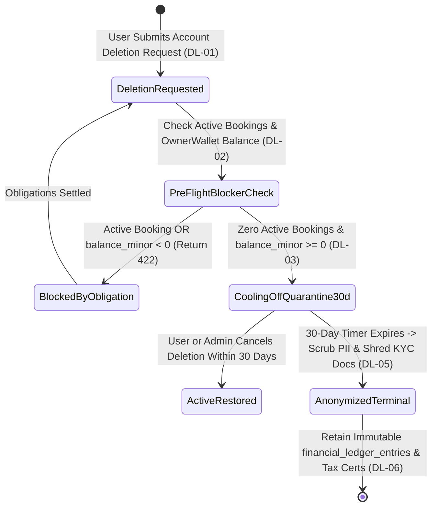

# Legal Policy Versioning, 30-Day Account Deletion Queue & Soft-Delete Trash Console
## Admin Subsystem Specification — `docs/admin/configuration/05-policy-versioning-soft-delete-trash.md`

**Document Identifier:** `SPEC-ADM-CFG-05`  
**Classification:** Canonical Subsystem UI/UX & Technical Behavior Specification  
**Governing Documents:** `Dink_Machinery_UI_UX_Design_Brief.md`, `SRS-DINK-CORE-V7.0` (§5.19 `REQ-05-19` `DL-01`..`DL-06`, §5.20 `REQ-05-20` `PT-01`..`PT-05`, §5.22 `REQ-05-22` `SD-01`..`SD-04`), `docs/components/admin/DESIGN.md`, `docs/shared/design/design-tokens.json`, `docs/ERROR_CATALOG.md`, `contracts/openapi.yaml`  
**Target Subsystem:** Next.js 16 Web Admin Console (`admin/src/app/(dashboard)/settings/governance-lifecycle/`)  
**Primary Persona / Actor:** Data Protection Officer (DPO), Legal & Compliance Officer (*Yohannes Bekele*), Super Administrator (*Rahel Tadesse*)  
**Associated Requirements:** `REQ-05-19` (`DL-01`..`DL-06` Account Deletion & PII Anonymization), `REQ-05-20` (`PT-01`..`PT-05` Legal Terms/Privacy Versioning), `REQ-05-22` (`SD-01`..`SD-04` Global Soft-Delete & Restoration)  
**Associated Interaction Flows:** `FLOW-12` (Admin Dynamic UI Engine), `FLOW-18` (GDPR / Kenya DPA 2019 & FDRE Privacy Lifecycle)  
**Status:** Approved Technical Design Baseline

---

## 1. Executive Summary & Architectural Invariants

The **Legal Policy Versioning, 30-Day Account Deletion Queue & Soft-Delete Trash Console** (`SPEC-ADM-CFG-05`) unifies three regulatory and data-integrity lifecycle domains from `SRS-DINK-CORE-V7.0`:

### 1.1 Three Regulatory & Data-Lifecycle Pillars
1. **30-Day Account Deletion Cooling-Off & Cryptographic PII Scrubber (`REQ-05-19` `DL-01`..`DL-06`):**
   - To satisfy Apple App Store, Google Play Store, and the **Kenya Data Protection Act 2019** alongside **National Bank of Ethiopia (NBE) 10-year financial ledger retention laws**, user-initiated account deletions (`ACCOUNT_DELETION_REQUESTED`) first undergo a **Pre-Deletion Blocker Check (`DL-02`)**: an account cannot enter the deletion queue if it has active bookings (`CONFIRMED`, `ACTIVE_OPERATION`, `WIRE_DISPUTED`) or an unsettled negative `OwnerWallet` balance (`balance_minor < 0`).
   - Eligible accounts enter a **30-Day Cooling-Off Quarantine (`DL-03`)** during which the user or an admin can cancel the deletion and restore the account.
   - At Day 30 (`DL-04`, `DL-05`), an automated worker executes **Irreversible Cryptographic PII Anonymization**: `full_name` $\rightarrow$ `'REDACTED_USER_' || substr(id, 1, 8)`, `phone_e164` $\rightarrow$ `sha256_salted_hash`, KYC S3 documents shredded, while **immutable `financial_ledger_entries` and tax certificates (`2020_TAX_PAYABLE`) are preserved intact** for statutory audit (`DL-06`).
2. **Versioned Legal Policy Publisher & Forced Re-Consent Gate (`REQ-05-20` `PT-01`..`PT-05`):**
   - Manages versioned multilingual Markdown documents (`TERMS_OF_SERVICE`, `PRIVACY_POLICY`, `OWNER_ESCROW_AGREEMENT`, `OPERATOR_SAFETY_CHARTER`) across `en`, `am`, `om`, `ti`, `so`, `sw`.
   - Publishing a major version (`v2.0` $\rightarrow$ `v3.0`) with `requires_reconsent = true` sets a middleware gate that prompts mobile/web users to sign an immutable `user_policy_acceptances` record (`policy_version_id`, `ip_address`, `accepted_at`) before initiating new bookings (`PT-04`).
3. **Global Soft-Delete (`deleted_at`) Trash Browser & Restoration Console (`REQ-05-22` `SD-01`..`SD-04`):**
   - Operational entities (`fleets`, `machinery_categories`, `corporate_cost_centers`, `SavedAddresses`) are never hard-deleted via `DELETE FROM`; they set `deleted_at = NOW()` and `deleted_by_actor_id` (`SD-01`).
   - Super Admins can inspect soft-deleted records, verify referential integrity, and execute atomic restoration (`SET deleted_at = NULL`).

---

## 2. Screen Anatomy, Layout & Bespoke Desktop Wireframe

```text
+------------------------------------------------------------------------------------------------------------------------------------------+
| DINK ADMIN [Global DPO / Legal]   Configuration > Legal Policy Versioning, 30-Day Deletion Queue & Soft-Delete Trash                     |
+------------------------------------------------------------------------------------------------------------------------------------------+
| WORKSPACE TABS: [ (*) Tab 1: 30-Day Account Deletion Queue (DL-01..06) ] [ ( ) Tab 2: Legal Policy Publisher (PT-01..05) ] [ ( ) Trash ] |
+------------------------------------------------------------------------------------------------------------------------------------------+
| [In 30-Day Cooling-Off]       | [Blocked by Active Debt/Bkg]  | [PII Scrubbed This Month]     | [Active Terms Version (Forced Consent)]  |
| 14 Accounts (Cancelable)      | 6 Accounts (Hold: Negative Wlt)| 39 Accounts (Ledger Retained) | TOS v3.2 (98.4% Re-Consented)            |
+------------------------------------------------------------------------------------------------------------------------------------------+
| 30-DAY DELETION & SOFT-DELETE QUEUE (55% Width)                       | LIFECYCLE & LEGAL POLICY INSPECTOR (45% Width)                   |
|-----------------------------------------------------------------------|------------------------------------------------------------------|
| Req ID     | Domain     | Entity / Masked User| Days Left | Status    | ACCOUNT DELETION & PII SCRUBBING DOSSIER (DEL-01JM8812)          |
|------------|------------|---------------------|-----------|-----------| Subject Principal: usr_01HJ4491 (+251****319 / RENTER)           |
| >DEL-8812  | DL-03 USER | +251****319 (Renter)| 04d 11h   | COOLING   | Requested At:      2026-10-04 10:15:00 UTC                       |
|  DEL-8809  | DL-03 USER | +254****802 (Owner) | 19d 06h   | COOLING   | Scheduled Scrub:   2026-11-03 10:15:00 UTC (In 4 Days, 11 Hours) |
| !DEL-8804  | DL-02 HOLD | +251****994 (Owner) | BLOCKED   | DEBT_HOLD |------------------------------------------------------------------|
|  DEL-8790  | DL-05 ANON | REDACTED_USER_01fe2 | 00d 00h   | SCRUBBED  | PRE-SCRUB INVARIANT VERIFICATION (REQ-05-19 DL-02 & DL-06)       |
|  SD-4410   | SD-01 FLEET| CAT 320D (FLEET-912)| Soft-Del  | RESTORABLE| [x] Active / Pending Bookings:      0 Found [CLEAR]              |
|  SD-4402   | SD-01 CAT  | Mini Trenchers      | Soft-Del  | RESTORABLE| [x] OwnerWallet Negative Balance:   0 Santims [CLEAR]            |
|            |            |                     |           |           | [x] Open Escrow / Wire Disputes:    0 Found [CLEAR]              |
|            |            |                     |           |           | [x] Historical Ledger Entries:      14 Rows in 1010/3010         |
|            |            |                     |           |           |     (Will be RETAINED & linked to anonymized actor UUID per NBE) |
|            |            |                     |           |           |------------------------------------------------------------------|
|            |            |                     |           |           | LEGAL POLICY PUBLISHER QUICK STATUS (REQ-05-20)                  |
|            |            |                     |           |           | Document: [TERMS_OF_SERVICE v] | Active: v3.2 | Draft: v3.3      |
|            |            |                     |           |           | [x] Force Mandatory Re-Consent Modal on Mobile/Web Login (PT-04) |
|            |            |                     |           |           | Audit Notes: [Verified user identity on support ticket #9912___] |
|-----------------------------------------------------------------------|------------------------------------------------------------------|
| Showing 1-50 of 61 | Cursor: cur_del_4402                             | [Cancel Deletion & Restore Account] [Restore Soft-Deleted Entity]|
+------------------------------------------------------------------------------------------------------------------------------------------+
```

---

## 3. W3C DTCG Design Token Mapping Table

| UI Component / Element | W3C Token Path (`design-tokens.json`) | Resolved Value (Light / Dark / Outdoor) | Behavioral & Accessibility Invariant |
|---|---|---|---|
| **Cooling-Off Countdown Badge** | `component.countdown.holdUrgentBg` + `component.countdown.holdUrgentText` | `#FFF7ED` fill, `#C2410C` text | Displays remaining days/hours before irreversible PII anonymization (`DL-03`). |
| **Debt/Booking Hold Badge (`DEBT_HOLD`)** | `color.feedback.crimson.100` + `color.feedback.crimson.700` | `#FEE2E2` fill, `#B91C1C` text | Indicates account deletion is blocked by unsettled negative `OwnerWallet` or active rental (`DL-02`). |
| **Restorable Soft-Delete Badge** | `color.feedback.blue.50` + `color.feedback.blue.900` | `#EFF6FF` fill, `#1E3A8A` text | Marks `deleted_at IS NOT NULL` entities eligible for single-click state restoration (`SD-03`). |

---

## 4. Interactive State Machine & Sequence Flows

### 4.1 30-Day Account Deletion & PII Anonymization Lifecycle (`stateDiagram-v2`)



---

## 5. Concrete Next.js 16 Implementation Blueprint

### 5.1 Dynamic UI Engine Configuration (`/api/v1/admin/ui-config?route=settings/governance-lifecycle`)

```json
{
  "tableId": "tbl_settings_governance_lifecycle_v1",
  "title": "Account Deletion Cooling-Off, Policy Versioning & Soft-Delete Trash",
  "description": "Manage 30-day GDPR/DPA deletion cooling-off requests (REQ-05-19), legal policy versions (REQ-05-20), and soft-deleted entities (REQ-05-22).",
  "defaultSortField": "requestedAt",
  "defaultSortDirection": "asc",
  "pageSize": 50,
  "columns": [
    { "id": "recordCode", "header": "Record ID", "accessorKey": "recordCode", "dataType": "text", "isSortable": true, "isFilterable": true },
    { "id": "lifecycleDomain", "header": "Domain", "accessorKey": "lifecycleDomain", "dataType": "badge", "isSortable": true, "isFilterable": true },
    { "id": "entityLabel", "header": "Target Entity / Principal", "accessorKey": "entityLabel", "dataType": "text", "isSortable": false, "isFilterable": true },
    { "id": "countdownLabel", "header": "Cooling-Off / Deleted At", "accessorKey": "countdownLabel", "dataType": "text", "isSortable": true, "isFilterable": false },
    { "id": "status", "header": "Lifecycle Status", "accessorKey": "status", "dataType": "badge", "isSortable": true, "isFilterable": true,
      "badgeVariants": { "COOLING_OFF_30D": "warning", "BLOCKED_DEBT_OR_BOOKING": "destructive", "PII_SCRUBBED": "outline", "SOFT_DELETED_RESTORABLE": "default" }
    }
  ],
  "facets": [
    {
      "id": "lifecycleDomain",
      "label": "Governance Domain",
      "type": "select",
      "options": [
        { "label": "30-Day Account Deletion Queue (REQ-05-19)", "value": "ACCOUNT_DELETION_DL" },
        { "label": "Soft-Deleted Entities Trash (REQ-05-22)", "value": "SOFT_DELETE_SD" },
        { "label": "Legal Policy Versions (REQ-05-20)", "value": "POLICY_VERSION_PT" }
      ]
    }
  ],
  "rowActions": [
    {
      "id": "restore_entity_or_account",
      "label": "Restore Entity / Cancel Deletion",
      "variant": "default",
      "requiredPermission": "system.governance.restore",
      "endpoint": "/api/v1/admin/settings/governance/{id}:restore",
      "method": "POST"
    }
  ],
  "bulkActions": []
}
```

### 5.2 Server Actions for Legal Policy Publishing & Soft-Delete Restoration (`admin/src/app/(dashboard)/settings/governance-lifecycle/actions.ts`)

```typescript
// admin/src/app/(dashboard)/settings/governance-lifecycle/actions.ts
'use server';

import { revalidatePath } from 'next/cache';
import { cookies } from 'next/headers';
import { z } from 'zod';
import { ProblemDetails } from '@/types/dynamic-ui';

const PublishLegalPolicyVersionSchema = z.object({
  policyType: z.enum(['TERMS_OF_SERVICE', 'PRIVACY_POLICY', 'OWNER_ESCROW_AGREEMENT', 'OPERATOR_SAFETY_CHARTER']),
  countryCode: z.enum(['ET', 'KE']),
  semanticVersion: z.string().regex(/^\d+\.\d+\.\d+$/, 'Use semantic version format (e.g., 3.2.0).'),
  requiresForcedReconsent: z.coerce.boolean(),
  effectiveAtUtc: z.string().datetime(),
  markdownEn: z.string().trim().min(100, 'English legal markdown body required.'),
  markdownAm: z.string().trim().min(100, 'Amharic/Local legal markdown body required.'),
  auditSummary: z.string().trim().min(10).max(500),
});

export async function publishLegalPolicyVersionAction(formData: FormData): Promise<{
  success: boolean;
  policyVersionId?: string;
  problem?: ProblemDetails;
}> {
  const parsed = PublishLegalPolicyVersionSchema.safeParse({
    policyType: formData.get('policyType'),
    countryCode: formData.get('countryCode'),
    semanticVersion: formData.get('semanticVersion'),
    requiresForcedReconsent: formData.get('requiresForcedReconsent') === 'true',
    effectiveAtUtc: formData.get('effectiveAtUtc'),
    markdownEn: formData.get('markdownEn'),
    markdownAm: formData.get('markdownAm'),
    auditSummary: formData.get('auditSummary'),
  });

  if (!parsed.success) {
    return {
      success: false,
      problem: {
        type: 'https://api.dinkmachinery.com/errors/request-validation-failed',
        title: 'Legal Policy Publication Validation Failed',
        status: 400,
        detail: 'Check semantic version format and localized Markdown bodies.',
        code: 'REQ_VALIDATION_FAILED',
        invalidParams: parsed.error.issues.map((i) => ({ name: i.path.join('.'), reason: i.message })),
      },
    };
  }

  const cookieStore = await cookies();
  const sessionToken = cookieStore.get('dink_admin_session')?.value;

  const res = await fetch(`${process.env.INTERNAL_BACKEND_URL}/api/v1/admin/settings/legal-policies:publish`, {
    method: 'POST',
    headers: {
      'Content-Type': 'application/json',
      Authorization: `Bearer ${sessionToken}`,
      'X-Country-Code': parsed.data.countryCode,
      'Idempotency-Key': crypto.randomUUID(),
    },
    body: JSON.stringify(parsed.data),
  });

  const payload = await res.json();
  if (!res.ok) {
    return { success: false, problem: payload.error as ProblemDetails };
  }

  revalidatePath('/settings/governance-lifecycle');
  return {
    success: true,
    policyVersionId: payload.data.policyVersionId,
  };
}

const RestoreSoftDeletedEntitySchema = z.object({
  recordId: z.string().uuid(),
  entityType: z.enum(['USER_COOLING_OFF', 'FLEET_ASSET', 'MACHINERY_CATEGORY', 'CORPORATE_COST_CENTER']),
  auditReason: z.string().trim().min(10, 'Provide restoration justification (min 10 chars).').max(500),
});

export async function restoreGovernanceRecordAction(formData: FormData): Promise<{
  success: boolean;
  problem?: ProblemDetails;
}> {
  const parsed = RestoreSoftDeletedEntitySchema.safeParse({
    recordId: formData.get('recordId'),
    entityType: formData.get('entityType'),
    auditReason: formData.get('auditReason'),
  });

  if (!parsed.success) {
    return {
      success: false,
      problem: {
        type: 'https://api.dinkmachinery.com/errors/request-validation-failed',
        title: 'Restoration Validation Failed',
        status: 400,
        detail: 'Valid record UUID and audit reason are required.',
        code: 'REQ_VALIDATION_FAILED',
        invalidParams: parsed.error.issues.map((i) => ({ name: i.path.join('.'), reason: i.message })),
      },
    };
  }

  const cookieStore = await cookies();
  const sessionToken = cookieStore.get('dink_admin_session')?.value;

  const res = await fetch(
    `${process.env.INTERNAL_BACKEND_URL}/api/v1/admin/settings/governance/${parsed.data.recordId}:restore`,
    {
      method: 'POST',
      headers: {
        'Content-Type': 'application/json',
        Authorization: `Bearer ${sessionToken}`,
        'Idempotency-Key': crypto.randomUUID(),
      },
      body: JSON.stringify(parsed.data),
    }
  );

  const payload = await res.json();
  if (!res.ok) {
    return { success: false, problem: payload.error as ProblemDetails };
  }

  revalidatePath('/settings/governance-lifecycle');
  return { success: true };
}
```

---

## 6. OpenAPI 3.1.0 Contract & RFC 9457 Error Matrix

| HTTP Method & Route | Operation ID | Required RBAC Permission | Idempotency-Key | Description |
|---|---|---|---|---|
| `GET /api/v1/admin/settings/governance` | `listGovernanceLifecycleRecords` | `system.governance.read` | No | Lists 30-day account deletion requests (`DL-03`) and soft-deleted entities (`SD-01`). |
| `POST /api/v1/admin/settings/governance/{id}:restore` | `restoreGovernanceRecord` | `system.governance.restore` | Yes (UUID v4) | Cancels a 30-day account deletion or clears `deleted_at = NULL` on a soft-deleted entity. |
| `POST /api/v1/admin/settings/legal-policies:publish` | `publishLegalPolicyVersion` | `system.legal_policy.publish` | Yes (UUID v4) | Publishes a new immutable legal policy version and optionally triggers forced re-consent (`PT-04`). |

| Error Code | HTTP Status | RFC 9457 Type URI | Trigger Condition |
|---|---|---|---|
| `BOOKING_INVALID_STATE_TRANSITION` | `409 Conflict` | `https://api.dinkmachinery.com/errors/booking-invalid-state` | Attempted to cancel/restore an account deletion after Day 30 when `PII_SCRUBBED` state is already terminal (`DL-05`). |
| `FLEET_REGISTRATION_EXISTS` | `409 Conflict` | `https://api.dinkmachinery.com/errors/fleet-registration-exists` | Restoring a soft-deleted `FLEET_ASSET` failed because its chassis/plate number was re-registered on another active asset while in trash. |

---

## 7. Verification & Acceptance Criteria Checklist

- [ ] **Financial Ledger Preservation on PII Scrub (`DL-06`):** After the 30-day cooling-off timer expires and a user's PII is scrubbed (`REDACTED_USER_*`), `SELECT SUM(signed_amount_minor) FROM financial_ledger_entries` remains `0` and all historical ledger rows remain intact.
- [ ] **Forced Re-Consent Enforcement (`PT-04`):** Publishing `TERMS_OF_SERVICE v3.3.0` with `requiresForcedReconsent: true` blocks booking creation (`403 AUTH_INSUFFICIENT_PERMISSIONS` with `POLICY_RECONSENT_REQUIRED` detail) until the user accepts `v3.3.0`.
