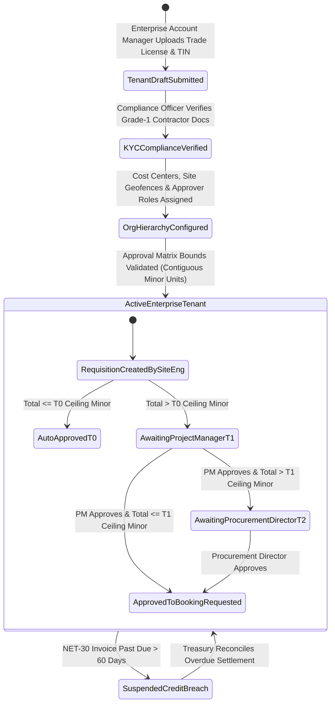

# Corporate Tenant Provisioning, Organizational Hierarchy & Approval Matrix Console
## Admin Subsystem Specification — `docs/admin/corporate-governance/01-corporate-tenant-provisioning-hierarchy.md`

**Document Identifier:** `SPEC-ADM-CRP-01`  
**Classification:** Canonical Subsystem UI/UX & Technical Behavior Specification  
**Governing Documents:** `Dink_Machinery_UI_UX_Design_Brief.md`, `SRS-DINK-CORE-V7.0` (§6.1 `REQ-06-01`, §6.2 `REQ-06-02`, §5.11 `AD-06-BE`), `docs/components/admin/DESIGN.md`, `docs/shared/design/design-tokens.json`, `docs/ERROR_CATALOG.md`, `contracts/openapi.yaml`  
**Target Subsystem:** Next.js 16 Web Admin Console (`admin/src/app/(dashboard)/corporate/tenants/`)  
**Primary Persona / Actor:** Enterprise Account Manager, Compliance Officer (*Yohannes Bekele*), Super Administrator (*Rahel Tadesse*)  
**Associated Requirements:** `REQ-06-01` (Corporate Accounts & Org Hierarchy), `REQ-06-02` (Multi-Tier Booking Approval Workflows), `REQ-05-11` (`AD-06-BE`)  
**Associated Interaction Flows:** `FLOW-12` (Admin Dynamic UI Engine), `FLOW-14` (Enterprise Corporate Onboarding & Requisition Approval)  
**Status:** Approved Technical Design Baseline

---

## 1. Executive Summary & Architectural Invariants

The **Corporate Tenant Provisioning, Organizational Hierarchy & Approval Matrix Console** (`SPEC-ADM-CRP-01`) enables Dink Machinery administrators to onboard Grade-1 civil construction contractors, mining conglomerates, NGOs, and government highway authorities across Ethiopia (`ET`) and Kenya (`KE`) as multi-user **Corporate Tenants (`REQ-06-01`)** with programmable **Multi-Tier Requisition Approval Matrices (`REQ-06-02`)**.

### 1.1 Multi-Tier Organizational Tree (`REQ-06-01`)
Unlike individual retail renters who book with a single account, an Enterprise Corporate Tenant (`corporate_tenants`) is structured as a 3-tier PostgreSQL `ltree` hierarchy:
1. **Level 1 — Corporate Holding / Parent Entity:** Verified by Commercial Registration Certificate, Grade-1 Construction License, and ERCA TIN / KRA PIN (e.g., *Sunshine Construction PLC*, *Ethiopian Roads Administration*, *China Communications Construction Co. East Africa*).
2. **Level 2 — Regional Division / Cost Center:** Budget-isolated business units (`cost_center_code`, e.g., `CC-ADAMA-EXPRESSWAY`, `CC-GERD-TRANSMISSION`, `CC-MOMBASA-PORT-BERTH`).
3. **Level 3 — Active Construction Project Site & Geofence:** PostGIS polygon geofence (`POLYGON((...))`) + assigned **Site Engineers** (who initiate machinery requisitions), **Project Managers** (Tier-1 approvers), and **Corporate Procurement Directors / CFOs** (Tier-2 financial approvers).

### 1.2 Multi-Tier Requisition Approval Matrix (`REQ-06-02`)
When a Site Engineer submits a machinery rental requisition (`CORPORATE_APPROVAL_PENDING`), the booking hold timer is governed by the tenant's configured **Spending Threshold Approval Rules** in integer minor units (`Santims` or `Cents`):
- **Tier 0 (Auto-Approve):** Requisition total `<= auto_approve_ceiling_minor` (e.g., `<= 5,000,000 Santims` / `50,000.00 ETB`) advances immediately to `BOOKING_REQUESTED`.
- **Tier 1 (Project Manager Approval):** Requisition within `(auto_approve_ceiling_minor .. tier1_ceiling_minor]` (e.g., `50,000.01 ETB` to `500,000.00 ETB`) requires 1 signature from an assigned `CORP_PROJECT_MANAGER`.
- **Tier 2 (Dual Executive Approval):** Requisition `> tier1_ceiling_minor` (`> 500,000.00 ETB`) requires sequential signatures from `CORP_PROJECT_MANAGER` $\rightarrow$ `CORP_PROCUREMENT_DIRECTOR`.

---

## 2. Screen Anatomy, Layout & Bespoke Desktop Wireframe

```text
+------------------------------------------------------------------------------------------------------------------------------------------+
| DINK ADMIN [ET: Ethiopia (ETB) v]  Corporate Governance > Tenant Provisioning & Org Hierarchy     [+ Provision New Corporate Tenant]     |
+------------------------------------------------------------------------------------------------------------------------------------------+
| Filter: [Status: ALL (34) | Active Enterprise (28) | Pending KYC Underwriting (4) | Suspended (2)] [Grade: Grade-1 Contractor v]         |
+------------------------------------------------------------------------------------------------------------------------------------------+
| CORPORATE TENANTS REGISTER (45% Width)                    | ORG HIERARCHY TREE & APPROVAL MATRIX BUILDER (CORP-01JM2290: Sunshine Const.)|
|-----------------------------------------------------------|------------------------------------------------------------------------------|
| Tenant Code | Legal Entity Name    | Cost Ctrs | Status   | [Tab 1: Org Hierarchy & Cost Centers] [Tab 2: Spending Approval Matrix]      |
|-------------|----------------------|-----------|----------|------------------------------------------------------------------------------|
| >CORP-2290  | Sunshine Constr. PLC | 8 Sites   | ACTIVE   | ORGANIZATIONAL LTREE HIERARCHY (Sunshine Construction PLC — TIN: *****8821)  |
|  CORP-2284  | Ovid Construction    | 5 Sites   | ACTIVE   | └── [HQ] Sunshine Construction PLC (Addis Ababa, Bole)                       |
|  CORP-2279  | Rama Construction    | 6 Sites   | ACTIVE   |     ├── [Cost Center: CC-AA-CORRIDOR] Addis Corridor Lot 4                   |
|  CORP-2271  | Rift Valley Mining   | 3 Sites   | PENDING  |     │   ├── Site Geofence: Bole -> Megenagna (PostGIS Polygon 14.2 km²)      |
|  CORP-2260  | Mombasa Civil Works  | 4 Sites   | ACTIVE   |     │   ├── Site Engineers (Requisitioners): 4 Assigned (+251****901, ...)   |
|             |                      |           |          |     │   └── Project Manager (Tier-1 Approver): Eng. Dawit T. (+251****112)   |
|             |                      |           |          |     └── [Cost Center: CC-ARBAMINCH-DAM] South Irrigation Project             |
|             |                      |           |          |         ├── Site Geofence: Arba Minch Sector B (PostGIS Polygon 48.0 km²)    |
|             |                      |           |          |         └── Project Manager (Tier-1 Approver): Eng. Meron A. (+251****449)   |
|             |                      |           |          |------------------------------------------------------------------------------|
|             |                      |           |          | MULTI-TIER SPENDING APPROVAL MATRIX (REQ-06-02 — Minor Units Enforced)       |
|             |                      |           |          | Tier | Requisition Bounds (ETB / Santims)      | Required Approver Chain     |
|             |                      |           |          | -----|-----------------------------------------|---------------------------- |
|             |                      |           |          | T0   | 0 .. 50,000.00 ETB (5,000,000 Santims)  | Auto-Approved (Site Eng.)   |
|             |                      |           |          | T1   | 50,000.01 .. 500,000.00 ETB (50M Sant.) | 1x CORP_PROJECT_MANAGER     |
|             |                      |           |          | T2   | > 500,000.00 ETB (> 50,000,000 Santims) | PM -> CORP_PROCUREMENT_DIR  |
|             |                      |           |          | Escalation Timeout: [24 Hours] -> Auto-Escalate to Alternate Approver        |
|-----------------------------------------------------------|------------------------------------------------------------------------------|
| Showing 1-34 of 34 | Cursor: cur_corp_2260                | [Save Org & Approval Matrix] [+ Add Cost Center / Project Site] [Suspend]    |
+------------------------------------------------------------------------------------------------------------------------------------------+
```

---

## 3. W3C DTCG Design Token Mapping Table

| UI Component / Element | W3C Token Path (`design-tokens.json`) | Resolved Value (Light / Dark / Outdoor) | Behavioral & Accessibility Invariant |
|---|---|---|---|
| **Org Hierarchy Tree Connector** | `stroke.border.medium` + `color.brand.slate.300` | `2dp` `#CBD5E1` / `#475569` | Supports WAI-ARIA `role="tree"` and `role="treeitem"` keyboard navigation (`ArrowRight` expand, `ArrowLeft` collapse). |
| **Spending Bound Minor Input** | `typography.fontFamily.mono` + `semantic.light.text.numericLedger` | `Space Mono, monospace`, `14sp` | Converts major currency inputs (`500,000.00`) via `parseToMinorUnits()` into `50000000` integer `Santims`. |
| **Active Enterprise Badge** | `color.feedback.emerald.100` + `color.feedback.emerald.700` | `#D1FAE5` fill, `#047857` text | Indicates verified commercial registration + active approval matrix. |
| **Save Matrix Primary CTA** | `semantic.light.action.primary.bg` + `stroke.border.heavy` | `#F59E0B` bg, `#020617` text, `3dp` bottom lip | Dispatches idempotent Server Action with optimistic version check. |

---

## 4. Interactive State Machine & Sequence Flows

### 4.1 Corporate Tenant & Requisition Approval Lifecycle (`stateDiagram-v2`)



---

## 5. Concrete Next.js 16 Implementation Blueprint

### 5.1 Dynamic UI Engine Configuration (`/api/v1/admin/ui-config?route=corporate/tenants`)

```json
{
  "tableId": "tbl_corporate_tenants_v1",
  "title": "Enterprise Corporate Tenants & Hierarchy Directory",
  "description": "Manage Grade-1 contractors, multi-tier cost centers, project geofences, and spending approval matrices.",
  "defaultSortField": "createdAt",
  "defaultSortDirection": "desc",
  "pageSize": 50,
  "columns": [
    { "id": "tenantCode", "header": "Tenant ID", "accessorKey": "tenantCode", "dataType": "text", "isSortable": true, "isFilterable": true },
    { "id": "legalName", "header": "Legal Entity Name", "accessorKey": "legalEntityName", "dataType": "text", "isSortable": true, "isFilterable": true },
    { "id": "contractorGrade", "header": "Grade / Sector", "accessorKey": "contractorClassification", "dataType": "badge", "isSortable": true, "isFilterable": true },
    { "id": "costCentersCount", "header": "Cost Centers", "accessorKey": "costCentersCount", "dataType": "text", "align": "center", "isSortable": true, "isFilterable": false },
    { "id": "tier1Ceiling", "header": "Tier-1 Approval Cap", "accessorKey": "tier1CeilingAmount", "dataType": "money", "align": "right", "isSortable": true, "isFilterable": false },
    { "id": "status", "header": "Status", "accessorKey": "tenantStatus", "dataType": "badge", "isSortable": true, "isFilterable": true,
      "badgeVariants": { "ACTIVE": "success", "PENDING_UNDERWRITING": "warning", "SUSPENDED": "destructive" }
    }
  ],
  "facets": [
    {
      "id": "tenantStatus",
      "label": "Tenant Status",
      "type": "select",
      "options": [
        { "label": "Active Enterprise", "value": "ACTIVE" },
        { "label": "Pending Underwriting", "value": "PENDING_UNDERWRITING" },
        { "label": "Suspended", "value": "SUSPENDED" }
      ]
    }
  ],
  "rowActions": [
    {
      "id": "configure_approval_matrix",
      "label": "Configure Approval Matrix",
      "variant": "default",
      "requiredPermission": "corporate.tenant.manage",
      "endpoint": "/api/v1/admin/corporate/tenants/{id}:configure-matrix",
      "method": "PUT"
    }
  ],
  "bulkActions": []
}
```

### 5.2 Server Action for Updating Multi-Tier Approval Matrix (`admin/src/app/(dashboard)/corporate/tenants/actions.ts`)

```typescript
// admin/src/app/(dashboard)/corporate/tenants/actions.ts
'use server';

import { revalidatePath } from 'next/cache';
import { cookies } from 'next/headers';
import { z } from 'zod';
import { ProblemDetails } from '@/types/dynamic-ui';

const ConfigureApprovalMatrixSchema = z
  .object({
    tenantId: z.string().uuid('Invalid Corporate Tenant UUID.'),
    version: z.coerce.number().int().positive(),
    currency: z.enum(['ETB', 'KES']),
    autoApproveCeilingMinor: z.coerce.bigint().min(0n, 'Auto-approve ceiling cannot be negative.'),
    tier1CeilingMinor: z.coerce.bigint().positive('Tier-1 ceiling must be positive.'),
    escalationTimeoutHours: z.coerce.number().int().min(2).max(168),
    requireCostCenterCode: z.coerce.boolean(),
    auditNotes: z.string().trim().min(10, 'Provide audit notes (min 10 chars).').max(500),
  })
  .refine((data) => data.tier1CeilingMinor > data.autoApproveCeilingMinor, {
    message: 'Tier-1 Project Manager ceiling must be strictly greater than Tier-0 Auto-Approve ceiling.',
    path: ['tier1CeilingMinor'],
  });

export async function updateCorporateApprovalMatrixAction(formData: FormData): Promise<{
  success: boolean;
  problem?: ProblemDetails;
}> {
  const parsed = ConfigureApprovalMatrixSchema.safeParse({
    tenantId: formData.get('tenantId'),
    version: formData.get('version'),
    currency: formData.get('currency'),
    autoApproveCeilingMinor: formData.get('autoApproveCeilingMinor'),
    tier1CeilingMinor: formData.get('tier1CeilingMinor'),
    escalationTimeoutHours: formData.get('escalationTimeoutHours'),
    requireCostCenterCode: formData.get('requireCostCenterCode') === 'true',
    auditNotes: formData.get('auditNotes'),
  });

  if (!parsed.success) {
    return {
      success: false,
      problem: {
        type: 'https://api.dinkmachinery.com/errors/request-validation-failed',
        title: 'Approval Matrix Validation Failed',
        status: 400,
        detail: 'Tier spending ceilings must be contiguous and strictly increasing in minor units.',
        code: 'REQ_VALIDATION_FAILED',
        invalidParams: parsed.error.issues.map((i) => ({ name: i.path.join('.'), reason: i.message })),
      },
    };
  }

  const cookieStore = await cookies();
  const sessionToken = cookieStore.get('dink_admin_session')?.value;
  const countryCode = cookieStore.get('dink_admin_country')?.value ?? 'ET';

  const res = await fetch(
    `${process.env.INTERNAL_BACKEND_URL}/api/v1/admin/corporate/tenants/${parsed.data.tenantId}:configure-matrix`,
    {
      method: 'PUT',
      headers: {
        'Content-Type': 'application/json',
        Authorization: `Bearer ${sessionToken}`,
        'X-Country-Code': countryCode,
        'Idempotency-Key': crypto.randomUUID(),
      },
      body: JSON.stringify({
        version: parsed.data.version,
        currency: parsed.data.currency,
        autoApproveCeilingMinor: Number(parsed.data.autoApproveCeilingMinor),
        tier1CeilingMinor: Number(parsed.data.tier1CeilingMinor),
        escalationTimeoutHours: parsed.data.escalationTimeoutHours,
        requireCostCenterCode: parsed.data.requireCostCenterCode,
        auditNotes: parsed.data.auditNotes,
      }),
    }
  );

  const payload = await res.json();
  if (!res.ok) {
    return { success: false, problem: payload.error as ProblemDetails };
  }

  revalidatePath('/corporate/tenants');
  return { success: true };
}
```

---

## 6. OpenAPI 3.1.0 Contract & RFC 9457 Error Matrix

| HTTP Method & Route | Operation ID | Required RBAC Permission | Idempotency-Key | Description |
|---|---|---|---|---|
| `GET /api/v1/admin/corporate/tenants` | `listCorporateTenants` | `corporate.tenant.read` | No | Cursor-paginated list of enterprise corporate tenants and hierarchy stats. |
| `POST /api/v1/admin/corporate/tenants` | `provisionCorporateTenant` | `corporate.tenant.manage` | Yes (UUID v4) | Provisions a new corporate tenant, initial cost center, and corporate admin principal. |
| `PUT /api/v1/admin/corporate/tenants/{id}:configure-matrix` | `configureCorporateApprovalMatrix` | `corporate.tenant.manage` | Yes (UUID v4) | Updates multi-tier requisition approval minor-unit thresholds (`REQ-06-02`). |

| Error Code | HTTP Status | RFC 9457 Type URI | Trigger Condition |
|---|---|---|---|
| `REQ_VALIDATION_FAILED` | `400 Bad Request` | `https://api.dinkmachinery.com/errors/request-validation-failed` | Non-contiguous or overlapping spending approval tier ceilings (`tier1CeilingMinor <= autoApproveCeilingMinor`). |
| `GEO_INVALID_COORDINATES` | `400 Bad Request` | `https://api.dinkmachinery.com/errors/geo-invalid-coordinates` | Project site geofence polygon is not closed or has coordinates outside valid WGS-84 bounds. |
| `BOOKING_CONCURRENCY_CONFLICT` | `409 Conflict` | `https://api.dinkmachinery.com/errors/booking-concurrency-conflict` | Optimistic lock `version` mismatch on the corporate tenant record. |

---

## 7. Verification & Acceptance Criteria Checklist

- [ ] **Contiguous Spending Tier Validation (`REQ-06-02`):** Setting `tier1CeilingMinor` (`4,000,000 Santims`) lower than or equal to `autoApproveCeilingMinor` (`5,000,000 Santims`) fails Zod validation immediately and binds an inline error to the `tier1CeilingMinor` input via `bindProblemDetailsErrors`.
- [ ] **Accessible Tree Keyboard Navigation:** The Organizational Hierarchy Tree supports full WAI-ARIA tree navigation (`ArrowUp`, `ArrowDown`, `ArrowRight`, `ArrowLeft`, `Home`, `End`) with zero `@axe-core/playwright` violations.
