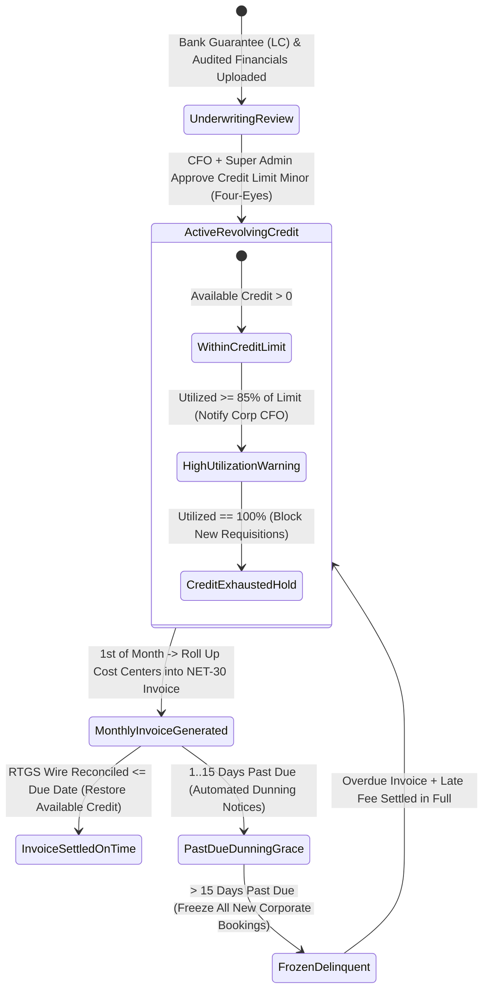

# Corporate Credit Line Underwriting, Custom Rate-Cards & NET-30 Invoice Ledger
## Admin Subsystem Specification — `docs/admin/corporate-governance/02-corporate-credit-underwriting-net30-ledger.md`

**Document Identifier:** `SPEC-ADM-CRP-02`  
**Classification:** Canonical Subsystem UI/UX & Technical Behavior Specification  
**Governing Documents:** `Dink_Machinery_UI_UX_Design_Brief.md`, `SRS-DINK-CORE-V7.0` (§6.3 `REQ-06-03`, §5.9 `CW-01`, §5.11 `AD-06-BE`), `docs/components/admin/DESIGN.md`, `docs/shared/design/design-tokens.json`, `docs/ERROR_CATALOG.md`, `contracts/openapi.yaml`, `ADR-010`  
**Target Subsystem:** Next.js 16 Web Admin Console (`admin/src/app/(dashboard)/corporate/credit-ledger/`)  
**Primary Persona / Actor:** Chief Financial Officer, Credit Underwriting Officer, Financial Controller (*Solomon Kassa*)  
**Associated Requirements:** `REQ-06-03` (Corporate Credit Terms, Custom Rate Cards & Consolidated NET-30 Invoicing), `REQ-05-09` (`CW-01`), `ADR-010`  
**Associated Interaction Flows:** `FLOW-11` (Financial Ledger), `FLOW-12` (Admin Dynamic UI Engine), `FLOW-14` (Corporate NET-30 Billing)  
**Status:** Approved Technical Design Baseline

---

## 1. Executive Summary & Architectural Invariants

The **Corporate Credit Line Underwriting, Custom Rate-Cards & NET-30 Invoice Ledger** (`SPEC-ADM-CRP-02`) implements `SRS-DINK-CORE-V7.0` **Section 06.03 (`REQ-06-03`)**. Enterprise contractors frequently execute simultaneous multi-machine rentals across dozens of active highway and dam sites where per-booking 60-minute payment holds (`BK-08`) are operationally impractical. Approved Corporate Tenants are underwritten for a revolving **Corporate Credit Facility (`NET-15`, `NET-30`, or `NET-45`)** backed by a bank performance guarantee or letter of credit (LC).

### 1.1 Revolving Credit Facility & Exposure Formula (`REQ-06-03`)
1. **Available Corporate Credit (`available_credit_minor`):**
   $$\text{available\_credit\_minor} = \text{credit\_limit\_minor} - (\text{unbilled\_active\_exposure\_minor} + \text{unpaid\_invoiced\_receivables\_minor})$$
2. **Pre-Booking Credit Reservation:** When a corporate booking requisition passes Tier-1/Tier-2 approval (`REQ-06-02`), the backend atomically verifies `booking_total_minor <= available_credit_minor` (`SELECT ... FOR UPDATE` on `corporate_credit_facilities`). If verified, the booking bypasses `PAYMENT_PENDING` and transitions directly to `CONFIRMED` (`REQ-06-03`).
3. **Negotiated Custom Rate-Cards (`commission_rate_bps` & Volume Discounts):** Allows Finance Controllers to configure custom take-rate basis points (e.g., `750 bps` / `7.50%` instead of standard `1000 bps` / `10.00%`) and minimum monthly commitment tiers per equipment category.
4. **Consolidated Monthly `NET-30` Tax Invoice & Aging Dunning:** On the 1st of each month (or Ethiopian calendar month-end), all unbilled corporate bookings across cost centers are rolled into a single consolidated **ERCA VAT / KRA eTIMS Tax Invoice** with `30/60/90+ day` aging buckets and automated credit-freeze triggers.

---

## 2. Screen Anatomy, Layout & Bespoke Desktop Wireframe

```text
+------------------------------------------------------------------------------------------------------------------------------------------+
| DINK ADMIN [ET: Ethiopia (ETB) v]  Corporate Governance > Credit Underwriting & NET-30 Ledger    [Generate Monthly Consolidated Invoices]|
+------------------------------------------------------------------------------------------------------------------------------------------+
| [Total Underwritten Credit]   | [Active Unbilled Exposure]    | [Invoiced NET-30 Receivables] | [Past Due > 30 Days (Dunning)]           |
| 12,500,000,000 Santims        | 3,140,000,000 Santims         | 4,820,000,000 Santims         | 650,000,000 Santims (1 Tenant Frozen)    |
| 125,000,000.00 ETB Across 28  | 31,400,000.00 ETB (25.1% Util)| 48,200,000.00 ETB Current     | 6,500,000.00 ETB (31-60 Day Aging Bucket)|
+------------------------------------------------------------------------------------------------------------------------------------------+
| CORPORATE CREDIT & AGING LEDGER (55% Width)                           | UNDERWRITING & RATE-CARD INSPECTOR (CORP-2290: Sunshine Constr.) |
|-----------------------------------------------------------------------|------------------------------------------------------------------|
| Tenant      | Terms  | Credit Limit | Utilized % | AgingBucket| State | CREDIT FACILITY & BANK GUARANTEE                                 |
|-------------|--------|--------------|------------|------------|-------| Credit Limit:     25,000,000.00 ETB (2,500,000,000 Santims)      |
| >CORP-2290  | NET-30 | 25.0M ETB    | [████░] 74%| CURRENT    | OK    | Unbilled Active:   6,400,000.00 ETB (  640,000,000 Santims)      |
|  CORP-2284  | NET-30 | 15.0M ETB    | [███░░] 60%| CURRENT    | OK    | Unpaid Invoiced:  12,100,000.00 ETB (1,210,000,000 Santims)      |
| !CORP-2279  | NET-15 | 10.0M ETB    | [█████] 98%| 45d OVERDUE| FROZEN| Available Credit:  6,500,000.00 ETB (  650,000,000 Santims)      |
|  CORP-2260  | NET-45 | 30.0M KES    | [██░░░] 41%| CURRENT    | OK    | Collateral Ref:   CBE Bank Guarantee #BG-2026-8841 (Exp Dec 2027)|
|             |        |              |            |            |       |------------------------------------------------------------------|
|             |        |              |            |            |       | NEGOTIATED CUSTOM RATE-CARD OVERRIDES (REQ-06-03)                |
|             |        |              |            |            |       | Category               | Std Rate | Corp Override | Volume Disc  |
|             |        |              |            |            |       | -----------------------|----------|---------------|------------- |
|             |        |              |            |            |       | Earthmoving Excavators | 1000 bps |  750 bps (7.5%)| -500 bps >30d|
|             |        |              |            |            |       | Heavy Mobile Cranes    | 1000 bps |  800 bps (8.0%)| -400 bps >30d|
|             |        |              |            |            |       | Lowbed Haulage         | 1000 bps |  850 bps (8.5%)| None         |
|             |        |              |            |            |       |------------------------------------------------------------------|
|             |        |              |            |            |       | CONSOLIDATED NET-30 INVOICES (By Cost Center Breakdown)          |
|             |        |              |            |            |       | INV-2026-10-004 | Due 30-Nov | 12,100,000.00 ETB | [Download PDF]|
|-----------------------------------------------------------------------|------------------------------------------------------------------|
| Showing 1-28 of 28 | Cursor: cur_crd_2260                             | [Adjust Credit Limit (Four-Eyes)] [Freeze Credit Line]           |
+------------------------------------------------------------------------------------------------------------------------------------------+
```

---

## 3. W3C DTCG Design Token Mapping Table

| UI Component / Element | W3C Token Path (`design-tokens.json`) | Resolved Value (Light / Dark / Outdoor) | Behavioral & Accessibility Invariant |
|---|---|---|---|
| **Credit Utilization Progress Bar** | `color.feedback.emerald.500` / `color.brand.amber.500` / `color.feedback.crimson.500` | `<75%` `#10B981`, `75-90%` `#F59E0B`, `>90%` `#EF4444` | Includes numeric percentage text (`74%`) and `aria-valuenow` for screen readers. |
| **Overdue Frozen Row (`FROZEN`)** | `color.feedback.crimson.100` + `color.feedback.crimson.700` | `#FEE2E2` fill, `#B91C1C` text | Blocks new corporate requisitions when `days_past_due > grace_days`. |
| **Credit Limit Minor Figures** | `typography.fontFamily.mono` + `semantic.light.text.numericLedger` | `Space Mono, monospace`, `#020617` | Uses `BigInt` formatting to handle multi-billion Santim corporate credit lines safely. |

---

## 4. Interactive State Machine & Sequence Flows

### 4.1 Corporate Credit Facility & NET-30 Billing State Machine (`stateDiagram-v2`)



---

## 5. Concrete Next.js 16 Implementation Blueprint

### 5.1 Dynamic UI Engine Configuration (`/api/v1/admin/ui-config?route=corporate/credit-ledger`)

```json
{
  "tableId": "tbl_corporate_credit_facilities_v1",
  "title": "Corporate Credit Underwriting & NET-30 Aging Ledger",
  "description": "Manage revolving corporate credit limits, bank guarantees, custom rate-card basis points, and NET-30 invoice dunning.",
  "defaultSortField": "utilizedAmountMinor",
  "defaultSortDirection": "desc",
  "pageSize": 50,
  "columns": [
    { "id": "tenantCode", "header": "Tenant ID", "accessorKey": "tenantCode", "dataType": "text", "isSortable": true, "isFilterable": true },
    { "id": "legalName", "header": "Corporate Entity", "accessorKey": "legalEntityName", "dataType": "text", "isSortable": true, "isFilterable": true },
    { "id": "paymentTerms", "header": "Terms", "accessorKey": "paymentTerms", "dataType": "badge", "isSortable": true, "isFilterable": true },
    { "id": "creditLimit", "header": "Credit Limit", "accessorKey": "creditLimit", "dataType": "money", "align": "right", "isSortable": true, "isFilterable": false },
    { "id": "availableCredit", "header": "Available Credit", "accessorKey": "availableCredit", "dataType": "money", "align": "right", "isSortable": true, "isFilterable": false },
    { "id": "utilizationPct", "header": "Utilization", "accessorKey": "utilizationPct", "dataType": "progress", "align": "right", "isSortable": true, "isFilterable": false },
    { "id": "agingStatus", "header": "Aging Bucket", "accessorKey": "agingBucket", "dataType": "badge", "isSortable": true, "isFilterable": true,
      "badgeVariants": { "CURRENT": "success", "PAST_DUE_1_30": "warning", "PAST_DUE_31_60": "destructive", "PAST_DUE_60_PLUS": "destructive" }
    }
  ],
  "facets": [
    {
      "id": "paymentTerms",
      "label": "Credit Terms",
      "type": "select",
      "options": [
        { "label": "NET-15 Days", "value": "NET_15" },
        { "label": "NET-30 Days", "value": "NET_30" },
        { "label": "NET-45 Days", "value": "NET_45" }
      ]
    },
    {
      "id": "agingBucket",
      "label": "Receivables Aging",
      "type": "select",
      "options": [
        { "label": "Current (Not Yet Due)", "value": "CURRENT" },
        { "label": "1–30 Days Past Due", "value": "PAST_DUE_1_30" },
        { "label": "31–60 Days Past Due", "value": "PAST_DUE_31_60" },
        { "label": "60+ Days Past Due (Frozen)", "value": "PAST_DUE_60_PLUS" }
      ]
    }
  ],
  "rowActions": [
    {
      "id": "underwrite_credit_limit",
      "label": "Adjust Credit Facility",
      "variant": "default",
      "requiredPermission": "corporate.credit.underwrite",
      "endpoint": "/api/v1/admin/corporate/credit-facilities/{id}:underwrite",
      "method": "POST"
    }
  ],
  "bulkActions": [
    {
      "id": "generate_monthly_net30_invoices",
      "label": "Generate Monthly Consolidated Invoices",
      "variant": "default",
      "requiredPermission": "corporate.invoice.generate",
      "endpoint": "/api/v1/admin/corporate/invoices:generate-batch",
      "method": "POST"
    }
  ]
}
```

### 5.2 Server Action for Underwriting Corporate Credit Limit & Custom Rate-Card (`admin/src/app/(dashboard)/corporate/credit-ledger/actions.ts`)

```typescript
// admin/src/app/(dashboard)/corporate/credit-ledger/actions.ts
'use server';

import { revalidatePath } from 'next/cache';
import { cookies } from 'next/headers';
import { z } from 'zod';
import { ProblemDetails } from '@/types/dynamic-ui';

const UnderwriteCorporateCreditSchema = z.object({
  facilityId: z.string().uuid(),
  version: z.coerce.number().int().positive(),
  paymentTerms: z.enum(['NET_15', 'NET_30', 'NET_45']),
  creditLimitMinor: z.coerce
    .bigint()
    .refine((v) => v >= 0n && v <= 50000000000n, 'Credit limit must be between 0 and 500,000,000.00 major units.'),
  currency: z.enum(['ETB', 'KES']),
  negotiatedCommissionBps: z.coerce
    .number()
    .int()
    .min(250, 'Negotiated commission cannot fall below 250 bps (2.50%).')
    .max(1500, 'Negotiated commission cannot exceed 1500 bps (15.00%).'),
  bankGuaranteeReference: z.string().trim().min(5, 'Bank Guarantee / LC reference required.').max(100),
  bankGuaranteeExpiryDate: z.string().date(),
  checkerTotpCode: z.string().regex(/^\d{6}$/, '6-digit Four-Eyes Checker TOTP required for credit underwriting.'),
  auditNotes: z.string().trim().min(15).max(1000),
});

export async function underwriteCorporateCreditAction(formData: FormData): Promise<{
  success: boolean;
  problem?: ProblemDetails;
}> {
  const parsed = UnderwriteCorporateCreditSchema.safeParse({
    facilityId: formData.get('facilityId'),
    version: formData.get('version'),
    paymentTerms: formData.get('paymentTerms'),
    creditLimitMinor: formData.get('creditLimitMinor'),
    currency: formData.get('currency'),
    negotiatedCommissionBps: formData.get('negotiatedCommissionBps'),
    bankGuaranteeReference: formData.get('bankGuaranteeReference'),
    bankGuaranteeExpiryDate: formData.get('bankGuaranteeExpiryDate'),
    checkerTotpCode: formData.get('checkerTotpCode'),
    auditNotes: formData.get('auditNotes'),
  });

  if (!parsed.success) {
    return {
      success: false,
      problem: {
        type: 'https://api.dinkmachinery.com/errors/request-validation-failed',
        title: 'Corporate Underwriting Validation Failed',
        status: 400,
        detail: 'Check credit limit minor units, basis points, and Bank Guarantee expiry date.',
        code: 'REQ_VALIDATION_FAILED',
        invalidParams: parsed.error.issues.map((i) => ({ name: i.path.join('.'), reason: i.message })),
      },
    };
  }

  const cookieStore = await cookies();
  const sessionToken = cookieStore.get('dink_admin_session')?.value;
  const countryCode = cookieStore.get('dink_admin_country')?.value ?? 'ET';

  const res = await fetch(
    `${process.env.INTERNAL_BACKEND_URL}/api/v1/admin/corporate/credit-facilities/${parsed.data.facilityId}:underwrite`,
    {
      method: 'POST',
      headers: {
        'Content-Type': 'application/json',
        Authorization: `Bearer ${sessionToken}`,
        'X-Country-Code': countryCode,
        'Idempotency-Key': crypto.randomUUID(),
      },
      body: JSON.stringify({
        ...parsed.data,
        creditLimitMinor: Number(parsed.data.creditLimitMinor),
      }),
    }
  );

  const payload = await res.json();
  if (!res.ok) {
    return { success: false, problem: payload.error as ProblemDetails };
  }

  revalidatePath('/corporate/credit-ledger');
  return { success: true };
}
```

---

## 6. OpenAPI 3.1.0 Contract & RFC 9457 Error Matrix

| HTTP Method & Route | Operation ID | Required RBAC Permission | Idempotency-Key | Description |
|---|---|---|---|---|
| `GET /api/v1/admin/corporate/credit-facilities` | `listCorporateCreditFacilities` | `corporate.credit.read` | No | Cursor-paginated list of corporate credit facilities, utilization, and aging buckets. |
| `POST /api/v1/admin/corporate/credit-facilities/{id}:underwrite` | `underwriteCorporateCredit` | `corporate.credit.underwrite` | Yes (UUID v4) | Adjusts revolving credit limit minor units and custom commission rate-card (`REQ-06-03`). |
| `POST /api/v1/admin/corporate/invoices:generate-batch` | `generateConsolidatedNet30Invoices` | `corporate.invoice.generate` | Yes (UUID v4) | Compiles monthly cost-center-grouped tax invoices for all active corporate tenants. |

| Error Code | HTTP Status | RFC 9457 Type URI | Trigger Condition |
|---|---|---|---|
| `ADMIN_UNAUTHORIZED_OVERRIDE` | `403 Forbidden` | `https://api.dinkmachinery.com/errors/admin-unauthorized-override` | Credit limit increase exceeds `10,000,000 Santims` without Four-Eyes co-signature. |
| `WALLET_INSUFFICIENT_FUNDS` | `422 Unprocessable` | `https://api.dinkmachinery.com/errors/wallet-insufficient-funds` | Cannot reduce `creditLimitMinor` below current `unbilled_active_exposure_minor + unpaid_invoiced_receivables_minor`. |

---

## 7. Verification & Acceptance Criteria Checklist

- [ ] **BigInt Precision for Multi-Million ETB Facilities:** A `25,000,000.00 ETB` credit limit (`2,500,000,000 Santims`) formats and validates via `BigInt` without 32-bit integer overflow (`> 2,147,483,647`).
- [ ] **Consolidated Cost-Center Invoice Grouping:** Generated `NET-30` invoices group line items by `cost_center_code` (`CC-AA-CORRIDOR`, `CC-ARBAMINCH-DAM`) and compute `1500 bps` VAT (`ET`) or `1600 bps` VAT (`KE`) + `200 bps` WHT accurately.
