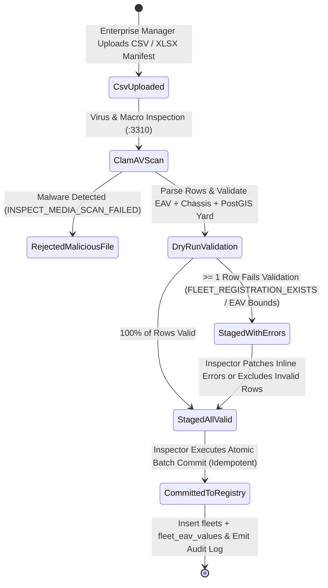

# Enterprise Fleet Bulk Import Validator, Multi-Yard Mapping & Corporate SLA Analytics
## Admin Subsystem Specification — `docs/admin/corporate-governance/03-enterprise-fleet-bulk-import-analytics.md`

**Document Identifier:** `SPEC-ADM-CRP-03`  
**Classification:** Canonical Subsystem UI/UX & Technical Behavior Specification  
**Governing Documents:** `Dink_Machinery_UI_UX_Design_Brief.md`, `SRS-DINK-CORE-V7.0` (§6.4 `REQ-06-04`, §6.5 `REQ-06-05`, §5.2 `FL-03`, §5.11 `AD-06-BE`), `docs/components/admin/DESIGN.md`, `docs/shared/design/design-tokens.json`, `docs/ERROR_CATALOG.md`, `contracts/openapi.yaml`  
**Target Subsystem:** Next.js 16 Web Admin Console (`admin/src/app/(dashboard)/corporate/bulk-fleet-import/`)  
**Primary Persona / Actor:** Fleet Inspector & Catalog Manager (*Ato Tewodros Mengistu*), Enterprise Account Manager  
**Associated Requirements:** `REQ-06-04` (Enterprise Fleet Bulk Onboarding & Multi-Yard Depot Management), `REQ-06-05` (Corporate Utilization, Mechanical Uptime & SLA Analytics), `REQ-05-02` (`FL-03` EAV Spec Validation)  
**Associated Interaction Flows:** `FLOW-03` (Fleet Registration), `FLOW-12` (Admin Dynamic UI Engine), `FLOW-14` (Enterprise Fleet Operations)  
**Status:** Approved Technical Design Baseline

---

## 1. Executive Summary & Architectural Invariants

The **Enterprise Fleet Bulk Import Validator, Multi-Yard Mapping & Corporate SLA Analytics Workbench** (`SPEC-ADM-CRP-03`) implements `SRS-DINK-CORE-V7.0` **Sections 06.04 (`REQ-06-04`) and 06.05 (`REQ-06-05`)**. Large plant-hire syndicates and state-owned equipment enterprises in Ethiopia and Kenya own 50 to 500+ heavy machines distributed across regional equipment yards (e.g., *Kality Central Yard*, *Adama Dry Port Depot*, *Hawassa Industrial Yard*, *Nairobi Embakasi Depot*). Onboarding 200 machines one-by-one through the mobile wizard is prohibitive.

### 1.1 Two-Phase Bulk CSV/Excel Staging & EAV Schema Validator (`REQ-06-04`)
1. **Stage 1 — Dry-Run Parsing & Row-Level Validation (`STAGED_FOR_REVIEW`):**
   - Uploaded CSV/XLSX manifests are scanned by ClamAV (`:3310`) and parsed row-by-row against:
     - **Unique Chassis / VIN / Libre Plate Check (`FLEET_REGISTRATION_EXISTS`):** Rejects duplicate chassis numbers within the CSV or against existing active `fleets` in PostgreSQL.
     - **Category EAV Specification Bounds (`FL-03`):** Validates category-specific dynamic EAV attributes (e.g., `operating_weight_tons` within `[1.0 .. 120.0]`, `bucket_capacity_m3` within `[0.1 .. 8.0]`).
     - **PostGIS Yard Depot Mapping (`GEO_INVALID_COORDINATES`):** Maps each row's `yard_code` to a verified `enterprise_fleet_yards` PostGIS `POINT(lon lat)` geometry.
     - **Daily/Hourly Rate Minor Units (`FLEET_DAILY_RATE_INVALID`):** Validates integer minor units (`daily_rate_minor > 0`) and `currency` (`ETB` | `KES`).
2. **Stage 2 — Atomic Batch Commit (`COMMITTED`):**
   - Only when 100% of included rows pass validation (or invalid rows are explicitly excluded to an error CSV) can the Fleet Inspector commit the batch into `PENDING_ROADWORTHINESS_INSPECTION` or `ACTIVE`.

### 1.2 Cross-Project Corporate Utilization & SLA Analytics (`REQ-06-05`)
Tracks enterprise KPIs across multi-project sites:
- **Financial & Physical Utilization Rate (`%`):** $\frac{\text{Billable Engine Hours}}{\text{Total Available Yard Hours}} \times 100$
- **Mechanical Uptime & Breakdown Replacement SLA (`%`):** Tracks adherence to the 12-hour breakdown replacement SLA (`REQ-06-05`) and Mean Time Between Failures (`MTBF`).

---

## 2. Screen Anatomy, Layout & Bespoke Desktop Wireframe

```text
+------------------------------------------------------------------------------------------------------------------------------------------+
| DINK ADMIN [ET: Ethiopia (ETB) v]  Corporate Governance > Enterprise Bulk Fleet Import & SLA   [Download EAV CSV Template] [+ Upload CSV]|
+------------------------------------------------------------------------------------------------------------------------------------------+
| [Tab 1: Bulk CSV Staging & EAV Validator (REQ-06-04)]   [Tab 2: Multi-Yard Depot Map]   [Tab 3: Corporate Utilization & SLA (REQ-06-05)] |
+------------------------------------------------------------------------------------------------------------------------------------------+
| STAGED IMPORT JOB: IMP-2026-0192 | Owner: Ethio-Engineering Plant Hire PLC | Total Rows: 85 | Valid: 82 [OK] | Errors: 3 [ACTION REQ]    |
+------------------------------------------------------------------------------------------------------------------------------------------+
| STAGED MACHINERY MANIFEST (Virtualized 40dp Rows)                     | ROW EAV & GEOSPATIAL ERROR INSPECTOR (Row #14 — EXC-CAT-336D)    |
|-----------------------------------------------------------------------|------------------------------------------------------------------|
| Row | Chassis / VIN     | Category      | Yard Depot | Rate/Day| Stat | VALIDATION DIAGNOSTICS FOR ROW #14                               |
|-----|-------------------|---------------|------------|---------|------| Chassis / Serial:  CAT0336DJPZY04821                             |
|  12 | CAT0320DJPBA01922 | Excavator 20T | KALITY-HQ  | 38,000  | OK   | Category Slug:     earthmoving/tracked-excavators                |
|  13 | KOM0PC200J8819201 | Excavator 20T | ADAMA-YD1  | 36,500  | OK   | Assigned Yard:     KALITY-HQ (POINT 38.7612 8.9124 — Verified)   |
| >14 | CAT0336DJPZY04821 | Excavator 36T | KALITY-HQ  | 52,000  | ERR  |------------------------------------------------------------------|
|  15 | XCMG0LW500FN99102 | Wheel Loader  | HAWASSA-YD | 29,000  | OK   | RFC 9457 FIELD VALIDATION ERRORS (2 Issues Found):               |
| >16 | CAT0140KJPAA00391 | Motor Grader  | KALITY-HQ  | 44,000  | DUPL | 1. [eavSpecs.bucket_capacity_m3]: Value "14.5" exceeds maximum   |
|  17 | SANY0STC500T88120 | Mobile Crane  | DIREDAWA   | 65,000  | OK   |    allowed bound (8.0 m³) for category "tracked-excavators".     |
|     |                   |               |            |         |      |    Fix Inline: [ 2.20 ] m³                                       |
|     |                   |               |            |         |      | 2. [dailyRateMinor]: Supplied "52000" is below minimum minor-unit|
|     |                   |               |            |         |      |    threshold (500,000 Santims = 5,000.00 ETB). Did you mean      |
|     |                   |               |            |         |      |    5,200,000 Santims (52,000.00 ETB)?                            |
|     |                   |               |            |         |      |    Fix Inline: [ 5200000 ] Santims (52,000.00 ETB)               |
|     |                   |               |            |         |      |------------------------------------------------------------------|
|     |                   |               |            |         |      | [Validate & Patch Row #14]  [Exclude 3 Error Rows from Batch]    |
|-----------------------------------------------------------------------|------------------------------------------------------------------|
| Showing 1-85 of 85 | Filter: [All (85) | Valid (82) | Errors (3)]     | [Commit 82 Valid Machines to Fleet Registry] [Download Error CSV]|
+------------------------------------------------------------------------------------------------------------------------------------------+
```

---

## 3. W3C DTCG Design Token Mapping Table

| UI Component / Element | W3C Token Path (`design-tokens.json`) | Resolved Value (Light / Dark / Outdoor) | Behavioral & Accessibility Invariant |
|---|---|---|---|
| **Valid Staged Row (`OK`)** | `color.feedback.emerald.50` + `color.feedback.emerald.700` | `#ECFDF5` badge, `#047857` text | Indicates Chassis uniqueness, PostGIS yard coordinate, and EAV specs passed. |
| **Duplicate Chassis Row (`DUPL`)** | `color.feedback.crimson.100` + `color.feedback.crimson.700` | `#FEE2E2` fill, `#B91C1C` text | Maps to `FLEET_REGISTRATION_EXISTS` (`HTTP 409`). |
| **Inline EAV Fix Input** | `semantic.light.border.focus` + `typography.fontFamily.mono` | `#D97706` focus ring, `Space Mono` | Allows inspector to patch EAV or minor-unit typos without re-uploading a 500-row CSV. |

---

## 4. Interactive State Machine & Sequence Flows

### 4.1 Bulk Fleet Import Staging & Commit State Machine (`stateDiagram-v2`)



---

## 5. Concrete Next.js 16 Implementation Blueprint

### 5.1 Dynamic UI Engine Configuration (`/api/v1/admin/ui-config?route=corporate/bulk-fleet-import`)

```json
{
  "tableId": "tbl_corporate_bulk_fleet_staging_v1",
  "title": "Enterprise Bulk Machinery Import Staging Grid",
  "description": "Validate bulk CSV machinery manifests against EAV category schemas, chassis uniqueness, and PostGIS yard depots.",
  "defaultSortField": "rowNumber",
  "defaultSortDirection": "asc",
  "pageSize": 100,
  "columns": [
    { "id": "rowNumber", "header": "Row #", "accessorKey": "rowNumber", "dataType": "text", "isSortable": true, "isFilterable": false },
    { "id": "chassisNumber", "header": "Chassis / VIN", "accessorKey": "chassisNumber", "dataType": "text", "isSortable": true, "isFilterable": true },
    { "id": "categorySlug", "header": "Category Taxonomy", "accessorKey": "categorySlug", "dataType": "text", "isSortable": true, "isFilterable": true },
    { "id": "yardCode", "header": "Yard Depot", "accessorKey": "yardCode", "dataType": "badge", "isSortable": true, "isFilterable": true },
    { "id": "dailyRate", "header": "Daily Rate", "accessorKey": "dailyRate", "dataType": "money", "align": "right", "isSortable": true, "isFilterable": false },
    { "id": "validationStatus", "header": "Dry-Run Status", "accessorKey": "validationStatus", "dataType": "badge", "isSortable": true, "isFilterable": true,
      "badgeVariants": { "VALID": "success", "EAV_BOUND_ERROR": "warning", "DUPLICATE_CHASSIS": "destructive", "INVALID_YARD_GEO": "destructive" }
    }
  ],
  "facets": [
    {
      "id": "validationStatus",
      "label": "Row Validation Status",
      "type": "select",
      "options": [
        { "label": "Valid Rows Ready for Commit", "value": "VALID" },
        { "label": "EAV Specification Bound Errors", "value": "EAV_BOUND_ERROR" },
        { "label": "Duplicate Chassis / Registration", "value": "DUPLICATE_CHASSIS" }
      ]
    }
  ],
  "rowActions": [
    {
      "id": "patch_staged_row",
      "label": "Patch & Re-Validate Row",
      "variant": "default",
      "requiredPermission": "fleet.bulk_import.manage",
      "endpoint": "/api/v1/admin/corporate/bulk-imports/{jobId}/rows/{rowNumber}",
      "method": "PATCH"
    }
  ],
  "bulkActions": [
    {
      "id": "commit_valid_rows",
      "label": "Commit Valid Machines to Fleet Registry",
      "variant": "default",
      "requiredPermission": "fleet.bulk_import.commit",
      "endpoint": "/api/v1/admin/corporate/bulk-imports/{jobId}:commit",
      "method": "POST"
    }
  ]
}
```

### 5.2 Server Action for Committing Validated Bulk Fleet Import (`admin/src/app/(dashboard)/corporate/bulk-fleet-import/actions.ts`)

```typescript
// admin/src/app/(dashboard)/corporate/bulk-fleet-import/actions.ts
'use server';

import { revalidatePath } from 'next/cache';
import { cookies } from 'next/headers';
import { z } from 'zod';
import { ProblemDetails } from '@/types/dynamic-ui';

const CommitBulkFleetImportSchema = z.object({
  importJobId: z.string().uuid('Invalid Bulk Import Job UUID.'),
  ownerId: z.string().uuid('Invalid Enterprise Owner UUID.'),
  excludeErroredRows: z.coerce.boolean(),
  initialLifecycleStatus: z.enum(['PENDING_INSPECTION', 'ACTIVE_PRE_INSPECTED']),
  auditNotes: z.string().trim().min(10, 'Enter bulk onboarding audit notes (min 10 chars).').max(500),
});

export async function commitBulkFleetImportAction(formData: FormData): Promise<{
  success: boolean;
  committedCount?: number;
  excludedCount?: number;
  problem?: ProblemDetails;
}> {
  const parsed = CommitBulkFleetImportSchema.safeParse({
    importJobId: formData.get('importJobId'),
    ownerId: formData.get('ownerId'),
    excludeErroredRows: formData.get('excludeErroredRows') === 'true',
    initialLifecycleStatus: formData.get('initialLifecycleStatus'),
    auditNotes: formData.get('auditNotes'),
  });

  if (!parsed.success) {
    return {
      success: false,
      problem: {
        type: 'https://api.dinkmachinery.com/errors/request-validation-failed',
        title: 'Bulk Fleet Commit Validation Error',
        status: 400,
        detail: 'Invalid bulk import commit parameters.',
        code: 'REQ_VALIDATION_FAILED',
        invalidParams: parsed.error.issues.map((i) => ({ name: i.path.join('.'), reason: i.message })),
      },
    };
  }

  const cookieStore = await cookies();
  const sessionToken = cookieStore.get('dink_admin_session')?.value;
  const countryCode = cookieStore.get('dink_admin_country')?.value ?? 'ET';

  const res = await fetch(
    `${process.env.INTERNAL_BACKEND_URL}/api/v1/admin/corporate/bulk-imports/${parsed.data.importJobId}:commit`,
    {
      method: 'POST',
      headers: {
        'Content-Type': 'application/json',
        Authorization: `Bearer ${sessionToken}`,
        'X-Country-Code': countryCode,
        'Idempotency-Key': crypto.randomUUID(),
      },
      body: JSON.stringify(parsed.data),
    }
  );

  const payload = await res.json();
  if (!res.ok) {
    return { success: false, problem: payload.error as ProblemDetails };
  }

  revalidatePath('/corporate/bulk-fleet-import');
  return {
    success: true,
    committedCount: payload.data.committedCount,
    excludedCount: payload.data.excludedCount,
  };
}
```

---

## 6. OpenAPI 3.1.0 Contract & RFC 9457 Error Matrix

| HTTP Method & Route | Operation ID | Required RBAC Permission | Idempotency-Key | Description |
|---|---|---|---|---|
| `POST /api/v1/admin/corporate/bulk-imports` | `stageBulkFleetImport` | `fleet.bulk_import.manage` | Yes (UUID v4) | Uploads CSV/XLSX manifest, runs ClamAV scan, and executes dry-run EAV & chassis validation. |
| `PATCH /api/v1/admin/corporate/bulk-imports/{jobId}/rows/{rowNumber}` | `patchStagedImportRow` | `fleet.bulk_import.manage` | Yes (UUID v4) | Inline correction of EAV spec or minor-unit rate on a staged row. |
| `POST /api/v1/admin/corporate/bulk-imports/{jobId}:commit` | `commitBulkFleetImport` | `fleet.bulk_import.commit` | Yes (UUID v4) | Atomically inserts all validated rows into `fleets` and `fleet_eav_values`. |
| `GET /api/v1/admin/corporate/sla-analytics` | `getCorporateSlaAnalytics` | `corporate.analytics.read` | No | Returns corporate fleet utilization %, MTBF, and 12-hour breakdown replacement SLA metrics (`REQ-06-05`). |

| Error Code | HTTP Status | RFC 9457 Type URI | Trigger Condition |
|---|---|---|---|
| `FLEET_REGISTRATION_EXISTS` | `409 Conflict` | `https://api.dinkmachinery.com/errors/fleet-registration-exists` | Chassis number or license plate already exists in active `fleets` or appears twice in the CSV. |
| `FLEET_DAILY_RATE_INVALID` | `422 Unprocessable` | `https://api.dinkmachinery.com/errors/fleet-daily-rate-invalid` | Daily rate minor units fall outside jurisdictional bounds (e.g., entering major units instead of minor `Santims`). |
| `CAT_NOT_FOUND` | `404 Not Found` | `https://api.dinkmachinery.com/errors/category-not-found` | CSV `category_slug` does not match an active taxonomy node. |

---

## 7. Verification & Acceptance Criteria Checklist

- [ ] **Duplicate Chassis Detection Within & Across Manifests:** Uploading a 100-row CSV where Row #16 shares a chassis number with an existing database record flags Row #16 with `FLEET_REGISTRATION_EXISTS` during dry-run staging before any database insert occurs.
- [ ] **Dynamic EAV Schema Enforcement (`FL-03`):** Each CSV row's JSON/columnar EAV attributes are validated against the active `SpecFieldDefinition` bounds (`min_val`, `max_val`, `enum_options`) of its target category.
