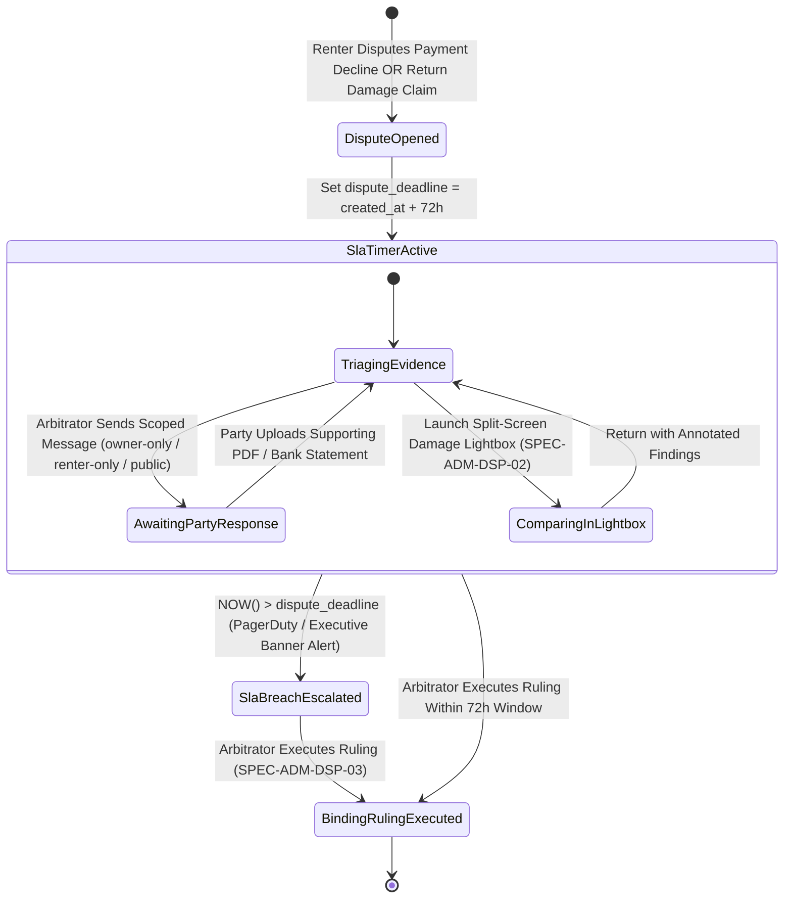
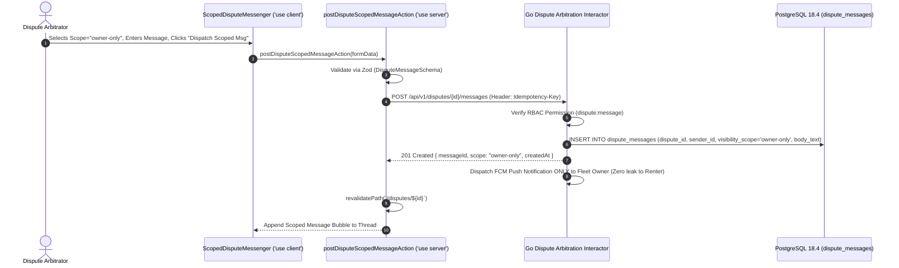

# Contested Payment & Damage Dispute Resolution Workbench
## Admin Subsystem Specification — `docs/admin/dispute-arbitration/01-dispute-resolution-workbench.md`

**Document Identifier:** `SPEC-ADM-DSP-01`  
**Classification:** Canonical Subsystem UI/UX & Technical Behavior Specification  
**Governing Documents:** `Dink_Machinery_UI_UX_Design_Brief.md`, `SRS-DINK-CORE-V7.0`, `docs/components/admin/DESIGN.md`, `contracts/openapi.yaml`  
**Target Subsystem:** Next.js 16 Web Admin Console (`admin/src/app/(dashboard)/disputes/page.tsx` & `src/app/(dashboard)/disputes/[id]/page.tsx`)  
**Primary Persona / Actor:** `DISPUTE_ARBITRATOR`, Legal Claims Specialist, `SUPER_ADMIN`  
**Associated Requirements:** `BK-13`, `RC-04`, `AD-04`, `AD-06`, `REQ-05-07`, `REQ-05-18`  
**Associated Interaction Flows:** `FLOW-08` (Contested Bank Payment Slip Arbitration), `FLOW-09` / `FLOW-10` (Damage & Hour Meter Dispute Escalation)  
**Associated ADRs:** `ADR-008` (Server-Driven Dynamic UI Metadata), `ADR-010` (First-Class Dispute Aggregate & Tri-Party Scoped Messaging)  
**Status:** Approved Technical Design Baseline

---

## 1. Domain Context, Business Rules & Architectural Invariants

The **Contested Payment & Damage Dispute Resolution Workbench** (`SPEC-ADM-DSP-01`) is the primary triage and investigation console (`src/app/(dashboard)/disputes/page.tsx`) for the first-class `Dispute` domain aggregate (`ADR-010`).

### 1.1 The Three Canonical Dispute Origins & 72-Hour SLA Mandate (`BK-13`, `RC-04`)
1. **Origin 1 — Contested Payment Slip (`PAYMENT_SLIP_DECLINED` / `DISPUTE_OPENED`, `BK-13`, `FLOW-08`):**
   - Triggered when a Renter uploads a direct bank transfer slip (`PAYMENT_EVIDENCE_UPLOADED`), the Fleet Owner declines it (`PAYMENT_DECLINED`), and the Renter contests the decline asserting funds were genuinely transferred to the Owner's bank account.
2. **Origin 2 — Post-Rental Physical Damage Claim (`RETURN_DAMAGE`, `RC-04`, `FLOW-09`):**
   - Triggered during `RETURN_INITIATED` when the Fleet Owner files a quantified damage claim in integer minor units (`claimedAmountMinor`, e.g., `4,500,000` Santims = `45,000.00 ETB` for a cracked hydraulic boom cylinder) and the Renter disputes liability.
3. **Origin 3 — Engine Hour Meter Conflict (`HOUR_METER_DISCREPANCY`, `RC-04`):**
   - Triggered at `READY_FOR_PICKUP` (Pre-Rental) or `RETURN_INITIATED` (Post-Rental) when the Renter and Operator/Owner disagree on the physical engine hour meter reading (`DISPUTED_HOUR_METER`).
4. **Strict 72-Hour (3-Day) Resolution SLA (`dispute_deadline = created_at + 72 hours`):**
   - Every opened dispute carries a deterministic `dispute_deadline` timestamp. A background SLA escalation daemon scans `WHERE status = 'OPEN'` and raises high-priority alerts at `< 12 hours` (`URGENT`) and `< 0 hours` (`SLA_BREACHED`).
5. **Tri-Party Scoped Evidence Messaging (`owner-only` | `renter-only` | `public`, `ADR-010`):**
   - Arbitrators communicate with the parties via `POST /api/v1/disputes/{id}/messages` using an explicit visibility `scope`:
     - `owner-only`: Private demand to Fleet Owner (e.g., *"Upload official bank statement or authorized dealer repair invoice"*); invisible to Renter.
     - `renter-only`: Private demand to Renter (e.g., *"Provide original CBE branch stamped advice"*); invisible to Owner.
     - `public`: Shared arbitration notice visible to both Renter and Owner.

---

## 2. Screen Anatomy, Layout & Component Hierarchy

### 2.1 Dispute Triage Queue & Tri-Party Scoped Messaging Workbench Wireframe

```text
+------------------------------------------------------------------------------------------------------------------------------------------+
| Dispute Arbitration > Triage Workbench & SLA Escalation Manager (`ADR-010`)                   [Open: 5] [🚨 SLA <4h: 2] [Jurisdiction: ET]|
+------------------------------------------------------------------------------------------------------------------------------------------+
| ORIGIN FILTER TABS: *[All Open (5)]  [🧾 Contested Payment Slip (2)]  [🔧 Return Damage Claim (2)]  [⏱ Hour Meter Conflict (1)]          |
+-------------------------------------------------------------------+----------------------------------------------------------------------+
| LEFT PANE: SLA-SORTED DISPUTE QUEUE (`DynamicTable.tsx` — 44% W)  | RIGHT PANE: CASE DOSSIER & TRI-PARTY SCOPED MESSAGING (56% Width)    |
| +---------------------------------------------------------------+ | +------------------------------------------------------------------+ |
| | Case ID  | Origin          | Claimed (ETB)  | SLA Timer | St  | | | #DSP-9042 — RETURN_DAMAGE (`Booking #BK-9042` — CAT 320D3)       | |
| |----------+-----------------+----------------+-----------+-----| | | Claimed: `45,000.00 ETB` (`4500000` Santims) | SLA: `02h 18m` 🚨 | |
| |*#DSP-9042| RETURN_DAMAGE   |  45,000.00 ETB | 02h 18m 🚨| OPEN| | | [🔍 Launch Split-Screen Lightbox]  [⚖ Open Ruling Execution Panel]| |
| | #DSP-9088| PAYMENT_SLIP    | 127,650.00 ETB | 03h 45m 🚨| OPEN| | +------------------------------------------------------------------+ |
| | #DSP-9101| HOUR_METER_DIFF |  18,500.00 ETB | 29h 10m 🟠| OPEN| | | PARTY STATEMENTS & FINANCIAL LIABILITY SUMMARY                   | |
| | #DSP-9105| RETURN_DAMAGE   |  82,000.00 ETB | 51h 40m 🟢| OPEN| | | • Owner Claim (Mesfin PLC): "Cracked boom hydraulic cylinder     | |
| | #DSP-9109| PAYMENT_SLIP    |  64,000.00 ETB | 68h 12m 🟢| OPEN| | |   discovered at check-out (1,498.5h). Attached Cat dealer quote."| |
| |          |                 |                |           |     | | | • Renter Rebuttal (Tekleberhan): "Hairline leak existed at       | |
| |          |                 |                |           |     | | |   check-in (1,450.5h); machine operated within normal pressure." | |
| |          |                 |                |           |     | | +------------------------------------------------------------------+ |
| |          |                 |                |           |     | | | TRI-PARTY SCOPED ARBITRATION MESSAGING (`dispute_messages`)      | |
| |          |                 |                |           |     | | | Filter Thread: *[All Scopes] [🔒 Owner-Only] [🔒 Renter-Only]    | |
| |          |                 |                |           |     | | | +--------------------------------------------------------------+ | |
| |          |                 |                |           |     | | | | [🔒 OWNER-ONLY] Arbitrator -> Mesfin PLC (Yesterday 16:10)   | | |
| |          |                 |                |           |     | | | | "Please upload the stamped Ries Engineering pro-forma quote."| | |
| |          |                 |                |           |     | | | | [🔒 OWNER-ONLY] Mesfin PLC -> Arbitrator (Today 09:05)       | | |
| |          |                 |                |           |     | | | | "[Attachment: ries_proforma_45k.pdf — ClamAV: CLEAN ✓]"      | | |
| |          |                 |                |           |     | | | | [🌐 PUBLIC] Arbitrator -> Both Parties (Today 10:30)         | | |
| |          |                 |                |           |     | | | | "Evidence review complete. Final ruling by 16:00 UTC today." | | |
| |          |                 |                |           |     | | | +--------------------------------------------------------------+ | |
| |          |                 |                |           |     | | | Message Visibility Scope *:                                      | |
| |          |                 |                |           |     | | | (o) `owner-only` (Private)  ( ) `renter-only`  ( ) `public`      | |
| |          |                 |                |           |     | | | [ Type official arbitration inquiry or evidence request...     ] | |
| |          |                 |                |           |     | | | [ 📎 Attach PDF ]                    [ 📨 DISPATCH SCOPED MSG ]  | |
| +---------------------------------------------------------------+ | +------------------------------------------------------------------+ |
+-------------------------------------------------------------------+----------------------------------------------------------------------+
```

---

## 3. W3C DTCG Design Token Mapping Table

| Dispute Workbench Element | W3C Token Path (`design-tokens.json`) | Resolved Value | Behavioral & Accessibility Constraint |
|---|---|---|---|
| **Dispute Origin Pill** | `color.feedback.purple.100` + `color.feedback.purple.900` | `#F3E8FF` fill / `#581C87` text | Distinguishes `PAYMENT_SLIP`, `RETURN_DAMAGE`, and `HOUR_METER_DIFF`. |
| **72-Hour SLA Countdown Pill** | `component.countdown.holdCriticalBg` / `holdUrgentBg` / `holdNormalBg` | `#FEF2F2` (<4h) / `#FFF7ED` (<24h) / `#FFFBEB` (>24h) | Sorted ascending by `disputeDeadline` so near-breach cases stay pinned at top of queue. |
| **Scoped Message Bubble (`owner-only`)** | `color.brand.amber.50` + `color.brand.amber.700` | `#FFFBEB` fill / `#B45309` left border (`3dp`) | Includes explicit `[🔒 OWNER-ONLY]` lock badge so arbitrator never confuses private vs public threads. |
| **Scoped Message Bubble (`renter-only`)** | `color.feedback.blue.50` + `color.feedback.blue.900` | `#EFF6FF` fill / `#1E3A8A` text | Includes explicit `[🔒 RENTER-ONLY]` lock badge. |
| **Claimed Amount Figure** | `typography.fontFamily.mono` + `typography.fontSize.16` | `Space Mono`, `16sp`, `#020617` | Formatted from integer `claimedAmountMinor` via `formatMinorUnits`. |

---

## 4. Interactive State Machine & Sequence Choreography

### 4.1 Dispute Triage, Scoped Evidence Gathering & Escalation State Machine



### 4.2 Tri-Party Scoped Arbitration Message Dispatch Sequence



---

## 5. Concrete Next.js 16 Implementation Blueprint

### 5.1 `/api/v1/admin/ui-config?route=disputes` Metadata Schema

```json
{
  "tableId": "admin_dispute_arbitration_queue",
  "title": "Contested Payment & Damage Dispute Arbitration Queue",
  "description": "72-hour SLA triage queue for contested bank transfer slips, post-rental damage claims, and hour meter discrepancies.",
  "defaultSortField": "disputeDeadline",
  "defaultSortDirection": "asc",
  "pageSize": 25,
  "columns": [
    { "id": "caseRef", "header": "Case ID", "accessorKey": "caseReference", "dataType": "text", "isSortable": false, "isFilterable": true },
    { "id": "origin", "header": "Dispute Origin", "accessorKey": "origin", "dataType": "badge", "isSortable": true, "isFilterable": true,
      "badgeVariants": { "PAYMENT_SLIP_DECLINED": "warning", "RETURN_DAMAGE": "destructive", "HOUR_METER_DISCREPANCY": "default" }
    },
    { "id": "bookingRef", "header": "Booking Ref", "accessorKey": "bookingReference", "dataType": "text", "isSortable": false, "isFilterable": true },
    { "id": "claimedAmount", "header": "Claimed Liability", "accessorKey": "claimedAmount", "dataType": "money", "isSortable": true, "isFilterable": false, "align": "right" },
    { "id": "disputeDeadline", "header": "72h SLA Deadline", "accessorKey": "disputeDeadline", "dataType": "date", "isSortable": true, "isFilterable": false }
  ],
  "facets": [
    {
      "id": "origin",
      "label": "Dispute Origin",
      "type": "select",
      "options": [
        { "label": "Contested Payment Slip (FLOW-08)", "value": "PAYMENT_SLIP_DECLINED" },
        { "label": "Post-Rental Damage Claim (FLOW-09)", "value": "RETURN_DAMAGE" },
        { "label": "Engine Hour Meter Conflict", "value": "HOUR_METER_DISCREPANCY" }
      ]
    }
  ],
  "rowActions": [],
  "bulkActions": []
}
```

### 5.2 Server Action: Post Tri-Party Scoped Arbitration Message (`src/app/(dashboard)/disputes/actions.ts`)

```typescript
// src/app/(dashboard)/disputes/actions.ts
'use server';

import { cookies } from 'next/headers';
import { revalidatePath } from 'next/cache';
import { z } from 'zod';
import { ProblemDetails } from '@/types/dynamic-ui';

const PostDisputeMessageSchema = z.object({
  disputeId: z.string().uuid(),
  scope: z.enum(['owner-only', 'renter-only', 'public'], {
    errorMap: () => ({ message: 'Visibility scope must be owner-only, renter-only, or public.' }),
  }),
  messageText: z
    .string()
    .trim()
    .min(5, 'Arbitration message must contain at least 5 characters.')
    .max(2000),
});

export async function postDisputeScopedMessageAction(formData: FormData): Promise<{
  success: boolean;
  problem?: ProblemDetails;
}> {
  const parsed = PostDisputeMessageSchema.safeParse({
    disputeId: formData.get('disputeId'),
    scope: formData.get('scope'),
    messageText: formData.get('messageText'),
  });

  if (!parsed.success) {
    return {
      success: false,
      problem: {
        type: 'https://api.dinkmachinery.com/errors/request-validation-failed',
        title: 'Invalid Scoped Message',
        status: 400,
        detail: 'Please select a valid message visibility scope and enter a message.',
        code: 'REQ_VALIDATION_FAILED',
        invalidParams: parsed.error.issues.map((i) => ({
          name: i.path.join('.'),
          reason: i.message,
        })),
      },
    };
  }

  const cookieStore = await cookies();
  const sessionToken = cookieStore.get('dink_admin_session')?.value;
  const countryCode = cookieStore.get('dink_admin_country')?.value ?? 'ET';

  const res = await fetch(
    `${process.env.INTERNAL_BACKEND_URL}/api/v1/disputes/${parsed.data.disputeId}/messages`,
    {
      method: 'POST',
      headers: {
        'Content-Type': 'application/json',
        'Authorization': `Bearer ${sessionToken}`,
        'Idempotency-Key': crypto.randomUUID(),
        'X-Country-Code': countryCode,
      },
      body: JSON.stringify({
        scope: parsed.data.scope,
        text: parsed.data.messageText,
      }),
    }
  );

  const payload = await res.json();
  if (!res.ok) {
    return { success: false, problem: payload.error as ProblemDetails };
  }

  revalidatePath(`/disputes/${parsed.data.disputeId}`);
  return { success: true };
}
```

---

## 6. OpenAPI 3.1.0 Contract Bindings & RFC 9457 Error Matrix

| HTTP Method & Route | Operation ID | Required Headers | Success Envelope | RFC 9457 Error Codes & Trigger Conditions |
|---|---|---|---|---|
| `GET /api/v1/admin/disputes` | `listAdminDisputes` | `Authorization`, `X-Country-Code` | `200 OK` (Cursor-paginated dispute queue) | `401 AUTH_INVALID_TOKEN`<br>`403 AUTH_INSUFFICIENT_PERMISSIONS` |
| `GET /api/v1/admin/disputes/{id}` | `getAdminDisputeDetail` | `Authorization`, `X-Country-Code` | `200 OK` (Consolidated dossier + pre/post inspections + scoped messages) | `404 DISPUTE_NOT_FOUND` |
| `POST /api/v1/disputes/{id}/messages` | `postDisputeScopedMessage` | `Authorization`, `Idempotency-Key`, `X-Country-Code` | `201 Created` (`DisputeMessageResponse`) | `400 REQ_VALIDATION_FAILED` (Invalid `scope` enum)<br>`403 AUTH_INSUFFICIENT_PERMISSIONS`<br>`409 BOOKING_INVALID_STATE_TRANSITION` (Dispute is already closed/resolved) |

---

## 7. Verification & Acceptance Criteria

1. **Tri-Party Message Scope Isolation (Playwright E2E):**
   - Messages sent with `scope: "owner-only"` render with the `[🔒 OWNER-ONLY]` amber badge in the Admin Workbench and are excluded from the Renter's API view (`GET /api/v1/bookings/{id}/dispute`).
2. **72-Hour SLA Priority Sorting:**
   - The queue orders active disputes by `disputeDeadline ASC` by default so cases with $<4\text{ hours}$ remaining appear at row index 0 with a crimson countdown indicator.

---
*Canonical specification entry for Dink Machinery platform development. Changes require an explicit design review.*
