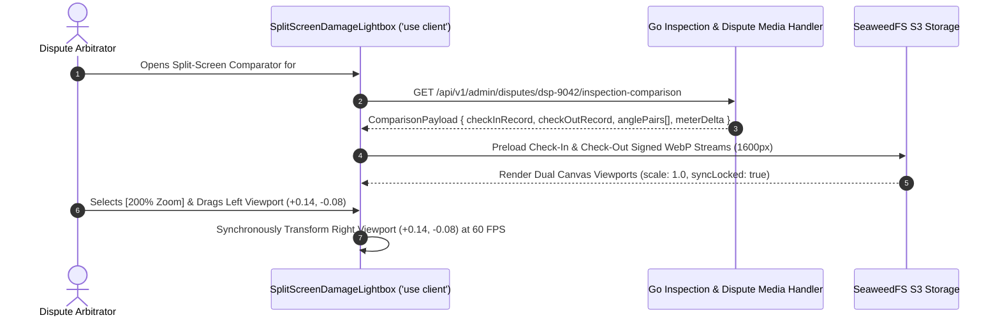

# Synchronized Split-Screen Inspection Photo & Hour Meter Lightbox
## Admin Subsystem Specification — `docs/admin/dispute-arbitration/02-split-screen-damage-lightbox.md`

**Document Identifier:** `SPEC-ADM-DSP-02`  
**Classification:** Canonical Subsystem UI/UX & Technical Behavior Specification  
**Governing Documents:** `Dink_Machinery_UI_UX_Design_Brief.md`, `SRS-DINK-CORE-V7.0`, `docs/components/admin/DESIGN.md`, `contracts/openapi.yaml`  
**Target Subsystem:** Next.js 16 Web Admin Console (`admin/src/components/feedback/SplitScreenDamageLightbox.tsx`)  
**Primary Persona / Actor:** `DISPUTE_ARBITRATOR`, Technical Mechanical Expert, `SUPER_ADMIN`  
**Associated Requirements:** `AD-04-WEB`, `REQ-05-06`, `REQ-05-07`, `AR-01-MOB`  
**Associated Interaction Flows:** `FLOW-07` (Handover Check-In & Check-Out Inspection), `FLOW-09` (Damage Dispute Arbitration)  
**Associated ADRs:** `ADR-010` (Forensic Dispute Evidence & Synchronized Inspection Diffing)  
**Status:** Approved Technical Design Baseline

---

## 1. Domain Context, Business Rules & Architectural Invariants

The **Synchronized Split-Screen Inspection Photo & Hour Meter Lightbox** (`SPEC-ADM-DSP-02`, `AD-04-WEB`) is a specialized dual-viewport forensic image comparator used by `DISPUTE_ARBITRATOR` officers to adjudicate post-rental physical damage claims (`RETURN_DAMAGE`) and engine hour meter conflicts (`DISPUTED_HOUR_METER`).

### 1.1 Core Forensic Inspection Capabilities & Invariants
1. **Side-by-Side Angle-Locked Viewport Synchronization (`AD-04-WEB`):**
   - **Left Viewport (`CHECK_IN` Baseline):** Displays the pre-rental handover photo captured by the Operator/Renter at lease activation (`READY_FOR_PICKUP` -> `ACTIVE`), alongside the recorded baseline hour meter (`e.g., 1,450.50 Hrs`), fuel percentage (`85%`), UTC timestamp, and PostGIS GPS capture coordinate.
   - **Right Viewport (`CHECK_OUT` Return / Damage):** Displays the corresponding post-rental return photo (`RETURN_INITIATED`) for the **exact same equipment angle** (`ANGLE_1_FRONT`, `ANGLE_2_REAR`, `ANGLE_3_LEFT_TRACK`, `ANGLE_4_RIGHT_TRACK`, `ANGLE_5_HOUR_METER`, or `DAMAGE_CLOSEUP`), alongside the return hour meter (`e.g., 1,498.50 Hrs`).
2. **Synchronized Pan & Zoom Matrix (`100%` to `400%`):**
   - When `isSyncLocked == true` (default), zooming (`100%`, `200%`, `400%`, or mouse wheel) or panning (`pointerdown` drag / keyboard `WASD` or arrow keys) on Viewport A applies the identical normalized affine transformation matrix `(scale, translateXRatio, translateYRatio)` to Viewport B at 60 FPS (`requestAnimationFrame`).
   - Arbitrators can temporarily unlock sync (`[🔓 Unlock Sync]`) to align slightly offset camera angles, then re-lock (`[🔒 Lock Sync]`) to zoom into a specific hydraulic cylinder, bucket tooth, or digital LCD hour meter digit.
3. **Cryptographic Media Provenance & ClamAV Verification HUD:**
   - Each viewport overlays a forensic provenance header confirming: (a) Camera-enforced capture flag (`camera_enforced: true`, banning gallery spoofing per `AR-01-MOB`), (b) ClamAV antivirus status (`CLEAN`), (c) SHA-256 binary checksum, and (d) PostGIS distance from the approved construction site geofence at the moment the photo was taken.
4. **Monotonic Hour Meter Delta & Overtime Calculator:**
   - When the `ANGLE_5_HOUR_METER` slot is active, the bottom HUD displays the recorded numeric readings (`1,450.50 Hrs` vs `1,498.50 Hrs`), net elapsed machine hours (`48.00 Hrs`), contracted allowance (`e.g., 6 Days * 8 Hrs/Day = 48.00 Hrs`), and any billable overtime hours in integer minor units.

---

## 2. Screen Anatomy, Layout & Component Hierarchy

### 2.1 Split-Screen Dispute Arbitration Lightbox Wireframe (`1920x1080` Full-Viewport Modal)

```text
+------------------------------------------------------------------------------------------------------------------------------------------+
| DISPUTE #DSP-9042: CRAWLER EXCAVATOR CAT 320D3 (`AA-3-98234`) — BOOM HYDRAULIC CYLINDER CRACK         [Proceed to Ruling ->] [ESC Close] |
+-------------------------------------------------------------------+----------------------------------------------------------------------+
| ANGLE SELECTOR: [1. Front] [2. Rear] [3. Left Track] [4. Right Track] *[5. Boom / Hydraulic Cylinder] [6. Physical Engine Hour Meter]    |
+-------------------------------------------------------------------+----------------------------------------------------------------------+
| LEFT VIEWPORT: CHECK-IN BASELINE (`2026-10-12 09:14:08 UTC`)      | RIGHT VIEWPORT: CHECK-OUT RETURN (`2026-10-18 16:30:44 UTC`)         |
| [✓ Camera-Enforced] [✓ ClamAV: CLEAN] [GPS: 42m from Site Pin ✓]  | [✓ Camera-Enforced] [✓ ClamAV: CLEAN] [GPS: 18m from Site Pin ✓]     |
| +---------------------------------------------------------------+ | +------------------------------------------------------------------+ |
| |                                                               | | |                                                                  | |
| |                                                               | | |                                                                  | |
| |              [ HIGH-RES WEBP CANVAS VIEWPORT A ]              | | |              [ HIGH-RES WEBP CANVAS VIEWPORT B ]                 | |
| |                                                               | | |                                                                  | |
| |         +-------------------------------------------+         | | |         +-------------------------------------------+            | |
| |         |  Hydraulic Boom Cylinder Seal — INTACT    |         | | |         |  Hydraulic Boom Cylinder — FRACTURE + OIL |            | |
| |         |  Zoom: 200% | Pan: (x: +0.14, y: -0.08)   |         | | |         |  Zoom: 200% | Pan: (x: +0.14, y: -0.08)   |            | |
| |         +-------------------------------------------+         | | |         +-------------------------------------------+            | |
| |                                                               | | |                                                                  | |
| |                                                               | | |                                                                  | |
| +---------------------------------------------------------------+ | +------------------------------------------------------------------+ |
| SHA-256: `9f86d081884c...7029a` | Signed: `/s/ Dawit Wolde (PM)`  | SHA-256: `4b227777d4dd...891c3` | Reported By: Operator (`usr_8551`) |
| Recorded Meter: `1,450.50 Hours` | Fuel Level: `85%`              | Recorded Meter: `1,498.50 Hours` | Fuel Level: `80%` (Delta: +48.0h) |
+-------------------------------------------------------------------+----------------------------------------------------------------------+
| SYNCHRONIZED VIEWPORT CONTROLS & TELEMETRY HUD (`component.lightbox.*`)                                                                  |
| Zoom: [ 100% ] *[ 200% ] [ 400% ] | *[🔒 Synchronize Pan & Zoom (Space)] | [☀ High-Contrast Invert] | Claimed Damage: `45,000.00 ETB`    |
| [ ⚖ LAUNCH ESCROW & INVOICE ARBITRATION RULING PANEL (`SPEC-ADM-DSP-03`) ]                                                               |
+------------------------------------------------------------------------------------------------------------------------------------------+
```

---

## 3. W3C DTCG Design Token Mapping Table

| Lightbox UI Element | W3C Token Path (`design-tokens.json`) | Resolved Value | Behavioral & Accessibility Constraint |
|---|---|---|---|
| **Full-Screen Lightbox Backdrop** | `semantic.dark.surface.overlay` | `rgba(2, 6, 23, 0.85)` / `#020617` canvas | High-density darkroom environment maximizing photographic contrast. |
| **Split Viewport Center Divider** | `component.lightbox.dividerWidth` + `dividerColor` | `3dp` (`stroke.border.heavy`), `#F59E0B` (`amber.500`) | High-visibility safety amber center line separating `CHECK_IN` from `CHECK_OUT`. |
| **Floating Telemetry HUD Bar** | `component.lightbox.hudBackground` + `hudBorderRadius` | `rgba(2, 6, 23, 0.85)`, `4dp` (`stroke.radius.sharp`) | Renders `component.lightbox.hudTextColor` (`#FFFFFF`) with `Space Mono` coordinates and meter readings. |
| **Provenance Verified Badge** | `color.feedback.emerald.950` + `color.feedback.emerald.500` | `#064E3B` bg / `#10B981` text | Confirms camera-enforced capture, ClamAV scan, and PostGIS geofence proximity. |
| **Angle Selector Active Tab** | `color.brand.amber.500` + `color.brand.slate.950` | `#F59E0B` bg / `#020617` bold text | Keyboard shortcut keys `1` through `6` switch directly between inspection angles. |

---

## 4. Interactive State Machine & Sequence Choreography

### 4.1 Synchronized Dual-Viewport Pan/Zoom & Angle Switching State Machine

```mermaid
stateDiagram-v2
    [*] --> LightboxMounted: Open from Dispute Workbench (#DSP-9042)
    LightboxMounted --> AnglePairLoaded: Load Check-In + Check-Out WebP Pair (Default: Damage Angle)

    state AnglePairLoaded {
        [*] --> SyncLocked100Pct
        
        state SyncMode {
            SyncLocked100Pct --> SyncLockedZoomed: Set Zoom (200% / 400%) or Wheel Scroll
            SyncLockedZoomed --> SyncLockedZoomed: Drag / Arrow Keys -> Apply (dx, dy) to BOTH Viewports A & B
            SyncLockedZoomed --> SyncUnlockedIndependent: Press [Space] or Click [Unlock Sync]
            SyncUnlockedIndependent --> SyncUnlockedIndependent: Drag Viewport B Only (Align Camera Offset)
            SyncUnlockedIndependent --> SyncLockedZoomed: Press [Space] or Click [Lock Sync] (Preserve Relative Offset)
        }
        
        AnglePairLoaded --> SwitchingAngleSlot: Press Key [1..6] or Click Angle Tab
        SwitchingAngleSlot --> AnglePairLoaded: Reset Transform to (scale=1, x=0, y=0) & Render New Pair
    }

    AnglePairLoaded --> RulingModalTransition: Click [Launch Arbitration Ruling Panel]
    AnglePairLoaded --> [*]: Press [Escape]
```

### 4.2 High-Resolution Inspection Media Fetch & Provenance Verification Sequence



---

## 5. Concrete Next.js 16 Implementation Blueprint

### 5.1 Client Interactive Leaf: `SplitScreenDamageLightbox.tsx`

```tsx
// src/components/feedback/SplitScreenDamageLightbox.tsx
'use client';

import React, { useState, useCallback } from 'react';
import { formatMinorUnits } from '@/lib/currency';

export interface InspectionMediaArtifact {
  angleKey: string;
  angleLabel: string;
  imageUrl: string;
  sha256Digest: string;
  clamavStatus: 'CLEAN' | 'QUARANTINED';
  cameraEnforced: boolean;
  distanceFromSiteMeters: number;
  capturedAtUtc: string;
}

export interface SplitComparisonProps {
  disputeReference: string;
  fleetTitle: string;
  claimedAmountMinor: number;
  currency: 'ETB' | 'KES';
  checkInMeterHours: number;
  checkOutMeterHours: number;
  checkInFuelPct: number;
  checkOutFuelPct: number;
  anglePairs: Array<{
    angleKey: string;
    angleLabel: string;
    checkIn: InspectionMediaArtifact;
    checkOut: InspectionMediaArtifact;
  }>;
  onOpenRulingModal: () => void;
  onClose: () => void;
}

export function SplitScreenDamageLightbox({
  disputeReference,
  fleetTitle,
  claimedAmountMinor,
  currency,
  checkInMeterHours,
  checkOutMeterHours,
  checkInFuelPct,
  checkOutFuelPct,
  anglePairs,
  onOpenRulingModal,
  onClose,
}: SplitComparisonProps) {
  const [activeAngleIdx, setActiveAngleIdx] = useState(0);
  const [zoomScale, setZoomScale] = useState<1 | 2 | 4>(1);
  const [isSyncLocked, setIsSyncLocked] = useState(true);
  const [panLeft, setPanLeft] = useState({ x: 0, y: 0 });
  const [panRight, setPanRight] = useState({ x: 0, y: 0 });

  const currentPair = anglePairs[activeAngleIdx];
  const meterDelta = (checkOutMeterHours - checkInMeterHours).toFixed(2);

  const handleNudgePan = useCallback(
    (dx: number, dy: number, target: 'LEFT' | 'RIGHT') => {
      if (isSyncLocked) {
        setPanLeft((p) => ({ x: p.x + dx, y: p.y + dy }));
        setPanRight((p) => ({ x: p.x + dx, y: p.y + dy }));
      } else if (target === 'LEFT') {
        setPanLeft((p) => ({ x: p.x + dx, y: p.y + dy }));
      } else {
        setPanRight((p) => ({ x: p.x + dx, y: p.y + dy }));
      }
    },
    [isSyncLocked]
  );

  return (
    <div
      role="dialog"
      aria-modal="true"
      aria-label={`Split-screen inspection comparator for ${disputeReference}`}
      className="fixed inset-0 z-50 flex flex-col bg-slate-950 text-white"
    >
      {/* Top Bar */}
      <header className="flex h-14 items-center justify-between border-b border-slate-800 px-6">
        <div className="flex items-center gap-4">
          <span className="rounded bg-purple-600 px-2.5 py-1 font-mono text-xs font-bold">
            {disputeReference}
          </span>
          <h2 className="text-sm font-bold">{fleetTitle}</h2>
        </div>
        <div className="flex items-center gap-3">
          <button
            type="button"
            onClick={onOpenRulingModal}
            className="rounded bg-amber-500 px-4 py-2 text-xs font-bold text-slate-950 hover:bg-amber-400"
          >
            Proceed to Arbitration Ruling →
          </button>
          <button
            type="button"
            onClick={onClose}
            className="rounded border border-slate-700 px-3 py-2 text-xs hover:bg-slate-800"
          >
            Close (ESC)
          </button>
        </div>
      </header>

      {/* Angle Selector Strip */}
      <nav
        aria-label="Inspection Angle Selector"
        className="flex items-center gap-2 border-b border-slate-800 bg-slate-900 px-6 py-2"
      >
        {anglePairs.map((pair, idx) => (
          <button
            key={pair.angleKey}
            type="button"
            onClick={() => {
              setActiveAngleIdx(idx);
              setPanLeft({ x: 0, y: 0 });
              setPanRight({ x: 0, y: 0 });
            }}
            className={`rounded px-3 py-1.5 text-xs font-semibold transition-colors ${
              idx === activeAngleIdx
                ? 'bg-amber-500 text-slate-950'
                : 'bg-slate-800 text-slate-300 hover:bg-slate-700'
            }`}
          >
            {idx + 1}. {pair.angleLabel}
          </button>
        ))}
      </nav>

      {/* Dual Synchronized Viewports Separated by 3dp Amber Divider */}
      <div className="grid flex-1 grid-cols-2 divide-x-[3px] divide-amber-500 overflow-hidden">
        {/* Left Viewport: CHECK-IN */}
        <div className="relative flex flex-col overflow-hidden bg-black">
          <div className="z-10 flex items-center justify-between bg-slate-950/85 px-4 py-2 font-mono text-xs">
            <span className="font-bold text-emerald-400">
              CHECK-IN BASELINE ({currentPair.checkIn.capturedAtUtc})
            </span>
            <span>
              ClamAV: {currentPair.checkIn.clamavStatus} | GPS: {currentPair.checkIn.distanceFromSiteMeters}m
            </span>
          </div>
          <div className="relative flex-1 overflow-hidden flex items-center justify-center">
            
          </div>
          <div className="z-10 flex items-center justify-between bg-slate-950/90 px-4 py-2 font-mono text-xs">
            <span>Recorded Meter: {checkInMeterHours.toFixed(2)} Hrs</span>
            <span>Fuel: {checkInFuelPct}%</span>
            <span className="text-slate-400">SHA-256: {currentPair.checkIn.sha256Digest.slice(0, 14)}…</span>
          </div>
        </div>

        {/* Right Viewport: CHECK-OUT */}
        <div className="relative flex flex-col overflow-hidden bg-black">
          <div className="z-10 flex items-center justify-between bg-slate-950/85 px-4 py-2 font-mono text-xs">
            <span className="font-bold text-amber-400">
              CHECK-OUT RETURN ({currentPair.checkOut.capturedAtUtc})
            </span>
            <span>
              ClamAV: {currentPair.checkOut.clamavStatus} | GPS: {currentPair.checkOut.distanceFromSiteMeters}m
            </span>
          </div>
          <div className="relative flex-1 overflow-hidden flex items-center justify-center">
            
          </div>
          <div className="z-10 flex items-center justify-between bg-slate-950/90 px-4 py-2 font-mono text-xs">
            <span>
              Recorded Meter: {checkOutMeterHours.toFixed(2)} Hrs (Delta: +{meterDelta}h)
            </span>
            <span>Fuel: {checkOutFuelPct}%</span>
            <span className="text-slate-400">SHA-256: {currentPair.checkOut.sha256Digest.slice(0, 14)}…</span>
          </div>
        </div>
      </div>

      {/* Bottom Synchronized Controls HUD */}
      <footer className="flex h-14 items-center justify-between border-t border-slate-800 bg-slate-900 px-6 text-xs">
        <div className="flex items-center gap-3">
          <span className="font-semibold text-slate-400">Synchronized Zoom:</span>
          {([1, 2, 4] as const).map((scale) => (
            <button
              key={scale}
              type="button"
              onClick={() => setZoomScale(scale)}
              className={`rounded px-3 py-1 font-mono font-bold ${
                zoomScale === scale ? 'bg-amber-500 text-slate-950' : 'bg-slate-800 text-white'
              }`}
            >
              {scale * 100}%
            </button>
          ))}

          <button
            type="button"
            aria-pressed={isSyncLocked}
            onClick={() => setIsSyncLocked((prev) => !prev)}
            className={`ml-4 rounded border px-3 py-1 font-semibold ${
              isSyncLocked
                ? 'border-emerald-500 bg-emerald-950 text-emerald-300'
                : 'border-slate-600 bg-slate-800 text-slate-300'
            }`}
          >
            {isSyncLocked ? '🔒 Pan & Zoom Sync Locked' : '🔓 Independent Pan Mode'}
          </button>

          <div className="ml-2 flex items-center gap-1">
            <button
              type="button"
              onClick={() => handleNudgePan(-40, 0, 'LEFT')}
              className="rounded bg-slate-800 px-2 py-1 font-mono"
              aria-label="Pan viewports left"
            >
              ←
            </button>
            <button
              type="button"
              onClick={() => handleNudgePan(40, 0, 'LEFT')}
              className="rounded bg-slate-800 px-2 py-1 font-mono"
              aria-label="Pan viewports right"
            >
              →
            </button>
          </div>
        </div>

        <div className="font-mono text-sm font-bold text-amber-400">
          Claimed Damage Liability: {formatMinorUnits(claimedAmountMinor, currency)}
        </div>
      </footer>
    </div>
  );
}
```

---

## 6. OpenAPI 3.1.0 Contract Bindings & RFC 9457 Error Matrix

| HTTP Method & Route | Operation ID | Required Headers | Success Envelope | RFC 9457 Error Codes & Trigger Conditions |
|---|---|---|---|---|
| `GET /api/v1/admin/disputes/{id}/inspection-comparison` | `getDisputeInspectionComparison` | `Authorization`, `X-Country-Code` | `200 OK` (`InspectionComparisonSuccessResponse`) | `401 AUTH_INVALID_TOKEN`<br>`403 AUTH_INSUFFICIENT_PERMISSIONS`<br>`404 BOOKING_NOT_FOUND`<br>`422 INSPECT_MEDIA_SCAN_FAILED` (Media blocked if ClamAV status $\ne$ `CLEAN`) |

---

## 7. Verification & Acceptance Criteria

1. **Synchronized Pan & Zoom Invariant (Playwright E2E):**
   - With `Pan & Zoom Sync Locked` active, clicking `200%` and panning Left Viewport updates the CSS `transform: scale(2) translate(...)` on both Left and Right images identically.
2. **Independent Alignment Toggle:**
   - Toggling `Independent Pan Mode` (`aria-pressed="false"`) allows panning a single viewport without moving the other.
3. **Keyboard Accessibility:**
   - Pressing `Escape` closes the lightbox and returns focus to the triggering button in the Dispute Workbench.

---
*Canonical specification entry for Dink Machinery platform development. Changes require an explicit design review.*
