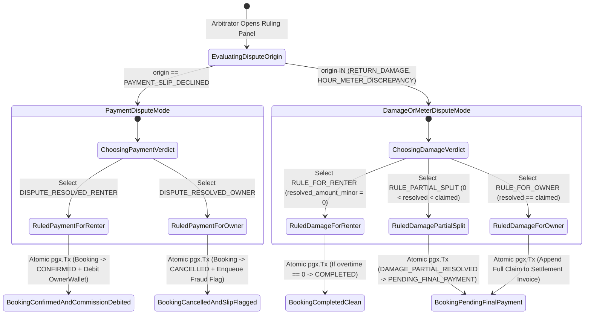
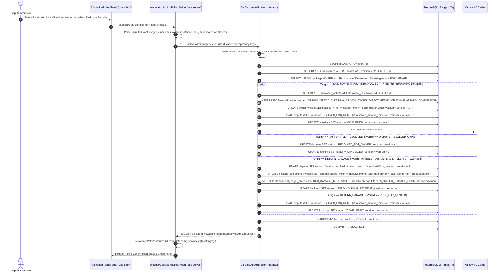

# Binding Arbitration Ruling Execution & Final Settlement Invoice Panel
## Admin Subsystem Specification — `docs/admin/dispute-arbitration/03-escrow-arbitration-decision.md`

**Document Identifier:** `SPEC-ADM-DSP-03`  
**Classification:** Canonical Subsystem UI/UX & Technical Behavior Specification  
**Governing Documents:** `Dink_Machinery_UI_UX_Design_Brief.md`, `SRS-DINK-CORE-V7.0`, `docs/components/admin/DESIGN.md`, `contracts/openapi.yaml`  
**Target Subsystem:** Next.js 16 Web Admin Console (`admin/src/components/dispute/ArbitrationRulingPanel.tsx` & `src/app/(dashboard)/disputes/actions.ts`)  
**Primary Persona / Actor:** `DISPUTE_ARBITRATOR`, `SUPER_ADMIN` (`dispute:rule` — Explicitly SoD-blocked for `COMPLIANCE_OFFICER` and `OPS_SUPPORT`)  
**Associated Requirements:** `BK-13`, `BK-17-BE`, `RC-05`, `CW-05`, `REQ-05-07`, `REQ-05-09`  
**Associated Interaction Flows:** `FLOW-08` (Contested Payment Slip Ruling), `FLOW-09` / `FLOW-10` (Damage & Hour Meter Arbitration Settlement)  
**Associated ADRs:** `ADR-005` (Double-Entry Financial Ledger & Minor-Unit Math), `ADR-006` (20-State Booking Machine & OCC), `ADR-010` (Binding Dispute Adjudication & Settlement Invoice Mutation)  
**Status:** Approved Technical Design Baseline

---

## 1. Domain Context, Business Rules & Architectural Invariants

The **Binding Arbitration Ruling Execution & Final Settlement Invoice Panel** (`SPEC-ADM-DSP-03`) is the terminal financial and legal decision engine for contested bookings (`BK-13`, `RC-05`, `CW-05`, `ADR-010`). Because Dink Machinery operates primarily on the **Direct Bank Transfer + Pre-Funded Owner Wallet Commission Debit Model (`BK-17-BE`)** alongside optional payment gateways, executing a binding arbitration ruling must deterministically mutate both the `disputes` aggregate, the 20-state `bookings` state machine, the `owner_wallets` balance, and `financial_ledger_entries` inside a **single atomic PostgreSQL transaction (`pgx.Tx`)**.

### 1.1 Dual-Pathway Arbitration Adjudication Mechanics (`ADR-010`)

#### Pathway A: Contested Payment Slip Ruling (`origin == 'PAYMENT_SLIP_DECLINED'` / Booking in `DISPUTE_OPENED`, `BK-13`, `FLOW-08`)
When a Fleet Owner declines a Renter's uploaded bank transfer slip and the Renter opens a payment dispute, the Arbitrator inspects the bank transfer evidence and executes one of two binding rulings:
1. **`DISPUTE_RESOLVED_RENTER` (Bank Slip Ruled Authentic & Valid):**
   - **Atomic `pgx.Tx` Execution:**
     1. `SELECT * FROM bookings WHERE id = $bookingId AND version = $version FOR UPDATE` (verify state is `DISPUTE_OPENED`).
     2. `SELECT * FROM owner_wallets WHERE owner_id = $ownerId FOR UPDATE`.
     3. Compute platform commission in integer minor units: $\text{feeMinor} = \lfloor (\text{rentalBaseMinor} \times \text{commissionBps}) / 10000 \rfloor$.
     4. Insert balanced 3-leg double-entry rows into `financial_ledger_entries` (`DEBIT 1010_DIRECT_CLEARING`, `CREDIT 2010_OWNER_DIRECT_RETAIN`, `CREDIT 3010_PLATFORM_COMMISSION` — net sum $= 0$ minor units).
     5. Insert `COMMISSION_DEBIT` transaction (`-\text{feeMinor}`) into `owner_wallet_transactions` and decrement `owner_wallets.balance_minor = balance_minor - feeMinor`.
     6. Update `disputes SET status = 'RESOLVED_FOR_RENTER', resolved_by = $adminId, resolved_at = NOW()`.
     7. Transition `bookings SET status = 'CONFIRMED', version = version + 1` and delete the Valkey hold mutex (`DEL lock:hold:fleet:{fleetId}`).
2. **`DISPUTE_RESOLVED_OWNER` (Bank Slip Ruled Invalid / Unsettled / Forged):**
   - **Atomic `pgx.Tx` Execution:**
     1. Update `disputes SET status = 'RESOLVED_FOR_OWNER', resolved_by = $adminId, resolved_at = NOW()`.
     2. Transition `bookings SET status = 'CANCELLED', version = version + 1` (zero commission debited from OwnerWallet; asset immediately returned to public availability pool).
     3. If the slip was flagged as forged (`flagFraudulentSlip == true`), automatically enqueue a high-risk `DUP_BANK_SLIP_SHA` / `FORGED_SLIP` ticket in the Marketplace Integrity Queue (`SPEC-ADM-OPS-06`).

#### Pathway B: Post-Rental Damage & Hour Meter Dispute Ruling (`origin IN ('RETURN_DAMAGE', 'HOUR_METER_DISCREPANCY')`, `RC-05`, `FLOW-09`)
When a booking is in `RETURN_INITIATED` / `DISPUTED` / `DISPUTED_HOUR_METER` with a claimed damage liability (`claimedAmountMinor`) or contested return hour meter reading, the Arbitrator executes one of three binding rulings:
1. **`RULE_FOR_RENTER` (`resolvedAmountMinor = 0`):**
   - Dismisses the Owner's damage claim or upholds the Renter's hour meter reading (`0` minor units added to final invoice).
   - If zero other overtime charges exist, transitions `bookings.status = 'COMPLETED'`; otherwise transitions to `PENDING_FINAL_PAYMENT` for agreed overtime only.
2. **`RULE_PARTIAL_SPLIT` (`0 < resolvedAmountMinor < claimedAmountMinor`):**
   - Assigns partial financial liability in exact integer minor units (`resolved_amount_minor`, e.g., `2,500,000` Santims = `25,000.00 ETB` out of a claimed `45,000.00 ETB`).
   - Updates `disputes SET status = 'RESOLVED_PARTIAL_SPLIT', resolved_amount_minor = $resolvedMinor`.
   - Transitions `bookings.status` through `DAMAGE_PARTIAL_RESOLVED` -> `PENDING_FINAL_PAYMENT`, appending `resolved_amount_minor` to the booking's **Final Settlement Invoice (`booking_settlement_invoices`)** and recording balanced receivable/payable legs in `financial_ledger_entries`.
3. **`RULE_FOR_OWNER` (`resolvedAmountMinor == claimedAmountMinor`):**
   - Upholds 100% of the Owner's claimed damage repair cost (`resolved_amount_minor = claimed_amount_minor`) or return hour meter reading.
   - Updates `disputes SET status = 'RESOLVED_FOR_OWNER', resolved_amount_minor = $claimedMinor`, appends the full amount to `booking_settlement_invoices`, and transitions `bookings.status = 'PENDING_FINAL_PAYMENT'`.

---

## 2. Screen Anatomy, Layout & Component Hierarchy

### 2.1 Dual-Mode Binding Arbitration Ruling Panel Wireframe (`ArbitrationRulingPanel.tsx`)

```text
+------------------------------------------------------------------------------------------------------------------------------------------+
| Dispute Arbitration > #DSP-9042 (`Booking #BK-9042` — CAT 320D3) > Binding Ruling Execution Panel        [🔒 Step-Up MFA Active: 04:40]  |
+------------------------------------------------------------------------------------------------------------------------------------------+
| [!] BINDING ARBITRATION NOTICE (`ADR-010`): Executing this ruling commits an atomic PostgreSQL transaction (`pgx.Tx`) updating the       |
|     Dispute record, the 20-State Booking Machine, the Final Settlement Invoice, and the Double-Entry Financial Ledger (`SUM == 0`).      |
+-------------------------------------------------------------------+----------------------------------------------------------------------+
| MODE A: CONTESTED PAYMENT SLIP RULING (`PAYMENT_SLIP_DECLINED`)   | MODE B: RETURN DAMAGE / HOUR METER RULING (`RETURN_DAMAGE` — ACTIVE) |
| (Shown when `dispute.origin == 'PAYMENT_SLIP_DECLINED'`)          | +------------------------------------------------------------------+ |
| +---------------------------------------------------------------+ | | CASE #DSP-9042 — POST-RENTAL HYDRAULIC BOOM CYLINDER DAMAGE      | |
| | Booking `#BK-9088` | Current State: `DISPUTE_OPENED` [v3]     | | | • Owner Claimed Liability:  `45,000.00 ETB` (`4500000` Santims)  | |
| | Contested Prepayment Slip: `127,650.00 ETB` (`CBE FT262991`)  | | | • Renter Informational Dep: `50,000.00 ETB` (`5000000` Santims)  | |
| |                                                               | | | • Check-In / Out Meter:     `1,450.50h` -> `1,498.50h` (+48.00h) | |
| | Select Binding Payment Ruling *:                              | | +------------------------------------------------------------------+ |
| | (o) `DISPUTE_RESOLVED_RENTER` (Slip Authentic -> Confirm)     | | | SELECT BINDING DAMAGE / METER RULING (`RC-05` / `ADR-010`) *     | |
| |     • Booking transitions `DISPUTE_OPENED` -> `CONFIRMED`     | | | ( ) `RULE_FOR_RENTER` — Dismiss Claim (`0.00 ETB` Liability)     | |
| |     • Debits `-12,765.00 ETB` (`1276500` Santims) commission  | | | (o) `RULE_PARTIAL_SPLIT` — Apportion Shared Repair Liability     | |
| |       from `OwnerWallet` (`BK-17-BE` Atomic Ledger Entry)     | | | ( ) `RULE_FOR_OWNER` — Uphold 100% Claim (`45,000.00 ETB`)       | |
| |                                                               | | +------------------------------------------------------------------+ |
| | ( ) `DISPUTE_RESOLVED_OWNER` (Slip Invalid -> Cancel Booking) | | | INTEGER MINOR-UNIT SETTLEMENT CALCULATOR (`currency.ts`)         | |
| |     • Booking transitions `DISPUTE_OPENED` -> `CANCELLED`     | | | Approved Damage Award (ETB) *       Exact Minor Units (Santims)  | |
| |     • Zero commission debited; [x] Flag slip in Fraud Queue   | | | [ 25000.00                    ETB ] [ `2500000` Santims (55.5%) ]| |
| +---------------------------------------------------------------+ | |                                                                  | |
|                                                                   | | Verified Return Hour Meter Reading (Hours) *                     | |
|                                                                   | | [ 1498.50                     Hrs ] (Overtime Due: `0.00 ETB`)   | |
|                                                                   | +------------------------------------------------------------------+ |
|                                                                   | | ATOMIC DOUBLE-ENTRY LEDGER & INVOICE PREVIEW (`pgx.Tx`)          | |
|                                                                   | | • `disputes.resolved_amount_minor`:     `2500000` (`25,000 ETB`) | |
|                                                                   | | • `bookings.status` Transition:         `DAMAGE_PARTIAL_RESOLVED`| |
|                                                                   | |                                         -> `PENDING_FINAL_PAYMENT`| |
|                                                                   | | • Leg 1 (DR `1020_DAMAGE_RECEIVABLE`):  `+2,500,000` Santims     | |
|                                                                   | | • Leg 2 (CR `2020_OWNER_DAMAGE_CLAIM`): `-2,500,000` Santims     | |
|                                                                   | | • Net Ledger Balance Check:             `0` Santims [✓ BALANCED] | |
|                                                                   | +------------------------------------------------------------------+ |
|                                                                   | | Formal Written Arbitration Finding (Sent to Renter & Owner) *    | |
|                                                                   | | [ Lightbox inspection confirms pre-existing seal weeping at      | |
|                                                                   | |   check-in exacerbated by site operation; 55.5% split awarded. ] | |
|                                                                   | |                                                                  | |
|                                                                   | | [ CANCEL (ESC) ]    [ ⚖ EXECUTE BINDING ARBITRATION RULING ]    | |
+-------------------------------------------------------------------+----------------------------------------------------------------------+
```

---

## 3. W3C DTCG Design Token Mapping Table

| Ruling Panel Element | W3C Token Path (`design-tokens.json`) | Resolved Value | Behavioral & Accessibility Constraint |
|---|---|---|---|
| **Ruling Option Radio Cards** | `semantic.light.surface.card` + `color.feedback.purple.500` | `#FFFFFF` surface, `#A855F7` active border (`2dp`) | Accessible `<fieldset>` with keyboard arrow selection across `RULE_FOR_RENTER`, `RULE_PARTIAL_SPLIT`, `RULE_FOR_OWNER`. |
| **Minor-Unit Settlement Input** | `typography.fontFamily.mono` + `typography.fontSize.18` | `Space Mono`, `18sp`, `#020617` | Parses decimal input via `parseToMinorUnits(value, currency)` (`BigInt`) with zero `parseFloat` usage. |
| **Atomic Ledger Preview Box** | `color.brand.slate.900` + `color.feedback.emerald.500` | `#0F172A` surface, `#10B981` zero-sum badge | Live preview of the exact `DEBIT` and `CREDIT` legs to be committed inside `pgx.Tx`. |
| **Execute Binding Ruling CTA** | `semantic.light.action.primary.bg` / `text` | `#F59E0B` bg / `#020617` text (`56dp` height) | Requires `DISPUTE_ARBITRATOR` or `SUPER_ADMIN` role (`dispute:rule`) and active Step-Up MFA. |

---

## 4. Interactive State Machine & Sequence Choreography

### 4.1 Dual-Origin Arbitration Ruling & Booking State Transition Machine



### 4.2 Atomic `pgx.Tx` Execution Sequence for Both Payment & Damage Rulings



---

## 5. Concrete Next.js 16 Implementation Blueprint

### 5.1 Server Action: Binding Arbitration Ruling Execution (`src/app/(dashboard)/disputes/ruling-actions.ts`)

```typescript
// src/app/(dashboard)/disputes/ruling-actions.ts
'use server';

import { cookies } from 'next/headers';
import { revalidatePath } from 'next/cache';
import { z } from 'zod';
import { parseToMinorUnits } from '@/lib/currency';
import { ProblemDetails } from '@/types/dynamic-ui';

const ExecuteArbitrationRulingSchema = z
  .object({
    disputeId: z.string().uuid(),
    disputeVersion: z.coerce.number().int().positive(),
    bookingId: z.string().uuid(),
    bookingVersion: z.coerce.number().int().positive(),
    origin: z.enum(['PAYMENT_SLIP_DECLINED', 'RETURN_DAMAGE', 'HOUR_METER_DISCREPANCY']),
    rulingVerdict: z.enum([
      'DISPUTE_RESOLVED_RENTER',
      'DISPUTE_RESOLVED_OWNER',
      'RULE_FOR_RENTER',
      'RULE_PARTIAL_SPLIT',
      'RULE_FOR_OWNER',
    ]),
    claimedAmountMinor: z.coerce.number().int().nonnegative(),
    resolvedAmountMinor: z.coerce.number().int().nonnegative(),
    verifiedReturnMeterHours: z.coerce.number().positive().optional(),
    flagFraudulentSlip: z.coerce.boolean().default(false),
    currency: z.enum(['ETB', 'KES']).default('ETB'),
    findingNotes: z
      .string()
      .trim()
      .min(20, 'Formal written arbitration finding must be at least 20 characters.')
      .max(2000),
  })
  .superRefine((data, ctx) => {
    if (data.origin === 'PAYMENT_SLIP_DECLINED') {
      if (
        data.rulingVerdict !== 'DISPUTE_RESOLVED_RENTER' &&
        data.rulingVerdict !== 'DISPUTE_RESOLVED_OWNER'
      ) {
        ctx.addIssue({
          code: z.ZodIssueCode.custom,
          path: ['rulingVerdict'],
          message: 'Payment disputes must use DISPUTE_RESOLVED_RENTER or DISPUTE_RESOLVED_OWNER.',
        });
      }
    } else {
      if (data.rulingVerdict === 'RULE_FOR_RENTER' && data.resolvedAmountMinor !== 0) {
        ctx.addIssue({
          code: z.ZodIssueCode.custom,
          path: ['resolvedAmountMinor'],
          message: 'RULE_FOR_RENTER requires resolvedAmountMinor to equal exactly 0.',
        });
      }
      if (
        data.rulingVerdict === 'RULE_PARTIAL_SPLIT' &&
        (data.resolvedAmountMinor <= 0 || data.resolvedAmountMinor >= data.claimedAmountMinor)
      ) {
        ctx.addIssue({
          code: z.ZodIssueCode.custom,
          path: ['resolvedAmountMinor'],
          message: 'RULE_PARTIAL_SPLIT requires 0 < resolvedAmountMinor < claimedAmountMinor.',
        });
      }
      if (
        data.rulingVerdict === 'RULE_FOR_OWNER' &&
        data.resolvedAmountMinor !== data.claimedAmountMinor
      ) {
        ctx.addIssue({
          code: z.ZodIssueCode.custom,
          path: ['resolvedAmountMinor'],
          message: 'RULE_FOR_OWNER requires resolvedAmountMinor to match claimedAmountMinor.',
        });
      }
    }
  });

export async function executeArbitrationRulingAction(formData: FormData): Promise<{
  success: boolean;
  data?: {
    disputeId: string;
    newBookingStatus: string;
    resolvedAmountMinor: number;
  };
  problem?: ProblemDetails;
}> {
  const currency = (formData.get('currency') as 'ETB' | 'KES') ?? 'ETB';
  const rawMajorAward = String(formData.get('resolvedAmountMajorInput') ?? '0.00');
  const computedMinor = Number(parseToMinorUnits(rawMajorAward, currency));

  const parsed = ExecuteArbitrationRulingSchema.safeParse({
    disputeId: formData.get('disputeId'),
    disputeVersion: formData.get('disputeVersion'),
    bookingId: formData.get('bookingId'),
    bookingVersion: formData.get('bookingVersion'),
    origin: formData.get('origin'),
    rulingVerdict: formData.get('rulingVerdict'),
    claimedAmountMinor: formData.get('claimedAmountMinor'),
    resolvedAmountMinor: computedMinor,
    verifiedReturnMeterHours: formData.get('verifiedReturnMeterHours') || undefined,
    flagFraudulentSlip: formData.get('flagFraudulentSlip') === 'true',
    currency,
    findingNotes: formData.get('findingNotes'),
  });

  if (!parsed.success) {
    return {
      success: false,
      problem: {
        type: 'https://api.dinkmachinery.com/errors/request-validation-failed',
        title: 'Arbitration Ruling Validation Failed',
        status: 400,
        detail: 'Submitted ruling parameters violated minor-unit or verdict invariants.',
        code: 'REQ_VALIDATION_FAILED',
        invalidParams: parsed.error.issues.map((i) => ({
          name: i.path.join('.'),
          reason: i.message,
        })),
      },
    };
  }

  const cookieStore = await cookies();
  const sessionToken = cookieStore.get('dink_admin_session')?.value;
  const countryCode = cookieStore.get('dink_admin_country')?.value ?? 'ET';

  const res = await fetch(
    `${process.env.INTERNAL_BACKEND_URL}/api/v1/admin/disputes/${parsed.data.disputeId}/rule`,
    {
      method: 'POST',
      headers: {
        'Content-Type': 'application/json',
        'Authorization': `Bearer ${sessionToken}`,
        'Idempotency-Key': crypto.randomUUID(),
        'X-Country-Code': countryCode,
      },
      body: JSON.stringify({
        disputeVersion: parsed.data.disputeVersion,
        bookingVersion: parsed.data.bookingVersion,
        ruling: parsed.data.rulingVerdict,
        resolvedAmountMinor: parsed.data.resolvedAmountMinor,
        verifiedReturnMeterHours: parsed.data.verifiedReturnMeterHours,
        flagFraudulentSlip: parsed.data.flagFraudulentSlip,
        findingNotes: parsed.data.findingNotes,
      }),
    }
  );

  const payload = await res.json();
  if (!res.ok) {
    return {
      success: false,
      problem: payload.error as ProblemDetails,
    };
  }

  revalidatePath('/disputes');
  revalidatePath(`/disputes/${parsed.data.disputeId}`);
  revalidatePath(`/bookings/${parsed.data.bookingId}`);

  return {
    success: true,
    data: payload.data,
  };
}
```

---

## 6. OpenAPI 3.1.0 Contract Bindings & RFC 9457 Error Matrix

| HTTP Method & Route | Operation ID | Required Headers | Success Envelope | RFC 9457 Error Codes & Trigger Conditions |
|---|---|---|---|---|
| `POST /api/v1/admin/disputes/{id}/rule` | `executeDisputeArbitrationRuling` | `Authorization`, `Idempotency-Key`, `X-Country-Code` | `200 OK` (`DisputeRulingSuccessResponse`) | `400 REQ_VALIDATION_FAILED` (Partial split minor units out of `[1, claimed-1]` bounds)<br>`403 AUTH_INSUFFICIENT_PERMISSIONS` (SoD violation: `COMPLIANCE_OFFICER` or `OPS_SUPPORT` attempted ruling)<br>`403 ADMIN_UNAUTHORIZED_OVERRIDE` (Missing Step-Up MFA assertion)<br>`409 BOOKING_CONCURRENCY_CONFLICT` (`disputeVersion` or `bookingVersion` mismatch)<br>`409 BOOKING_INVALID_STATE_TRANSITION` (Booking not in `DISPUTE_OPENED` / `DISPUTED` / `DISPUTED_HOUR_METER`)<br>`422 INSPECT_METER_REGRESSION` (`verifiedReturnMeterHours < checkInMeterHours`)<br>`500 LEDGER_DOUBLE_ENTRY_IMBALANCE` (Debit/credit legs failed zero-sum check; `pgx.Tx` rolled back) |

---

## 7. Verification & Acceptance Criteria

1. **Pathway A — Payment Dispute Ruling (`DISPUTE_RESOLVED_RENTER` vs `DISPUTE_RESOLVED_OWNER`, Vitest + Playwright):**
   - Executing `DISPUTE_RESOLVED_RENTER` transitions the booking from `DISPUTE_OPENED` to `CONFIRMED`, debits the exact basis-point commission from `OwnerWallet`, and writes 3 balanced legs to `financial_ledger_entries`.
   - Executing `DISPUTE_RESOLVED_OWNER` transitions the booking to `CANCELLED` with zero commission debit.
2. **Pathway B — Damage Dispute Ruling (`RULE_PARTIAL_SPLIT` Minor-Unit Determinism):**
   - Entering `"25000.00"` ETB on a `45,000.00 ETB` claim converts via `parseToMinorUnits` to `2500000` Santims (`BigInt`), updates `disputes.resolved_amount_minor = 2500000`, appends `25,000.00 ETB` to the Final Settlement Invoice, and transitions the booking to `PENDING_FINAL_PAYMENT`.
3. **Idempotency Replay Safety (`AGENTS.md` Section 1):**
   - Replaying `POST /api/v1/admin/disputes/{id}/rule` with an identical `Idempotency-Key` returns the cached `200 OK` ruling response without double-debiting `OwnerWallet` or duplicating ledger journal entries.

---
*Canonical specification entry for Dink Machinery platform development. Changes require an explicit design review.*
