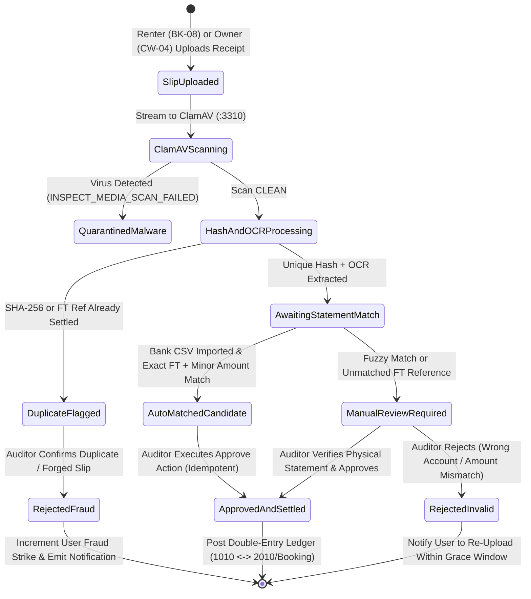
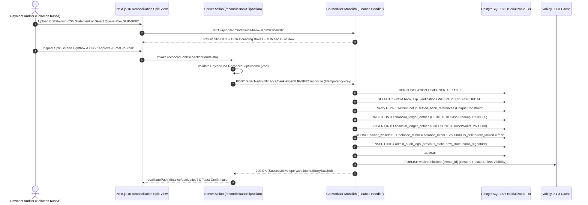

# Manual Bank Slip Reconciliation Queue & OCR Matcher
## Admin Subsystem Specification — `docs/admin/finance-ledger/01-bank-slip-reconciliation-queue.md`

**Document Identifier:** `SPEC-ADM-FIN-01`  
**Classification:** Canonical Subsystem UI/UX & Technical Behavior Specification  
**Governing Documents:** `Dink_Machinery_UI_UX_Design_Brief.md`, `SRS-DINK-CORE-V7.0` (§5.5, §5.9, §5.11), `docs/components/admin/DESIGN.md`, `docs/shared/design/design-tokens.json`, `docs/ERROR_CATALOG.md`, `contracts/openapi.yaml`  
**Target Subsystem:** Next.js 16 Web Admin Console (`admin/src/app/(dashboard)/finance/bank-slips/`)  
**Primary Persona / Actor:** Financial Controller & Revenue Auditor (*Solomon Kassa*), Dispute Arbitrator (*Yohannes Bekele*)  
**Associated Requirements:** `REQ-05-05` (`BK-07`..`BK-13`), `REQ-05-09` (`CW-03`..`CW-04`), `REQ-05-11` (`AD-06-BE`), `ADR-010`  
**Associated Interaction Flows:** `FLOW-06` (Manual Wire Transfer & Bank Slip Audit), `FLOW-11` (Owner Wallet Top-Up), `FLOW-12` (Admin Dynamic UI Engine)  
**Status:** Approved Technical Design Baseline

---

## 1. Executive Summary & Architectural Invariants

The **Manual Bank Slip Reconciliation Queue & OCR Matcher** (`SPEC-ADM-FIN-01`) is a dual-stream financial verification workbench designed for Ethiopian (`ET`) and Kenyan (`KE`) commercial banking operations where high-value B2B wire transfers (`> 100,000.00 ETB` or `> 250,000.00 KES`) bypass instant mobile money rails (Telebirr/M-Pesa) in favor of RTGS, EFT, or branch counter deposits across **Commercial Bank of Ethiopia (CBE)**, **Awash Bank**, **Dashen Bank**, **Bank of Abyssinia**, and **Equity Bank Kenya**.

### 1.1 Dual Reconciliation Streams
1. **Stream A — Owner Pre-Funded Wallet Top-Ups (`CW-03`, `CW-04`):** Machinery owners deposit funds into Dink Machinery's designated commercial settlement account and upload a bank deposit slip (`OwnerWalletTopUp`) to replenish their `OwnerWallet` balance above the `-5,000.00 ETB` (`-500,000 Santims`) negative lock threshold. Approval triggers an atomic double-entry journal (`DEBIT 1010 Cash Clearing`, `CREDIT 2010 Owner Wallet Liability`).
2. **Stream B — Contested Renter-to-Owner Booking Wire Transfers (`BK-07`..`BK-13`):** In Phase 1 direct wire workflows, when a Renter uploads a transfer receipt (`PAYMENT_EVIDENCE_UPLOADED`) within the 60-minute hold window (`BK-08`) and the Owner rejects or fails to verify it within 120 minutes (`BK-13`), the booking escalates to `WIRE_DISPUTED`. The Payment Auditor compares the uploaded slip against bank statement CSV imports and OCR-extracted FT references to either force-confirm the booking (`CONFIRMED`) or penalize fraudulent receipt uploads.

### 1.2 Core Financial & Security Invariants
- **Cryptographic Duplicate Receipt Detection (`SHA-256` & Perceptual Hash `pHash`):** Every uploaded bank slip image/PDF is hashed at ingestion (`sha256_digest` + `dhash_64`). Any slip matching a previously settled transaction ID (`FT26299X8921`) or image digest triggers an immediate `CRITICAL_FRAUD_ALERT` banner and blocks single-click approval.
- **Zero Floating-Point Monetary Comparison:** Slip stated amounts and bank statement CSV credit rows are parsed strictly as 64-bit integer minor units (`amount_minor` in `Santims` or `Cents`) accompanied by ISO 4217 `currency` (`ETB` | `KES`).
- **ClamAV Sanitization Prerequisite:** No bank slip image or PDF is rendered in the Split-Screen Comparison Lightbox unless `clamav_scan_status = 'CLEAN'`.
- **Idempotent Ledger Posting (`ADR-010`):** Confirming a bank slip dispatches a mandatory `Idempotency-Key` header and executes inside a `SERIALIZABLE` PostgreSQL transaction that writes both `financial_ledger_entries` legs simultaneously.

---

## 2. Screen Anatomy, Layout & Bespoke Desktop Wireframe

The workbench utilizes a 1920x1080 high-density split-pane operational layout: a top KPI & Statement CSV Matcher bar, a left virtualized queue grid (`55%` width), and a right interactive OCR & Split-Screen Slip Inspector (`45%` width).

```text
+------------------------------------------------------------------------------------------------------------------------------------------+
| DINK ADMIN [ET: Ethiopia v]  Finance & Ledger > Bank Slip Reconciliation Queue          [Import Bank CSV (CBE/Awash/Equity)] [Export CSV]|
+------------------------------------------------------------------------------------------------------------------------------------------+
| [Stream: ALL (42) | Wallet Top-Ups CW-04 (28) | Contested Booking Wires BK-13 (14)]   [Bank: All v] [Match: Exact | Fuzzy | Duplicate !] |
+------------------------------------------------------------------------------------------------------------------------------------------+
| PENDING VERIFICATION QUEUE (Virtualized 40dp Rows)                    | SPLIT-SCREEN SLIP INSPECTOR & STATEMENT MATCHER (SLIP-01JM9K82)  |
|-----------------------------------------------------------------------|------------------------------------------------------------------|
| ID         | Stream  | Bank  | FT Ref       | Stated Minor | Match    | [Zoom +] [Zoom -] [Rotate 90] [Invert Contrast]  SHA-256: VALID  |
|------------|---------|-------|--------------|--------------|----------| +--------------------------------------------------------------+ |
| >SLIP-9K82 | CW-04   | CBE   | FT26301A9941 | 2,500,000 ETB| 100% OCR | |          COMMERCIAL BANK OF ETHIOPIA - DEPOSIT SLIP          | |
|  SLIP-9K79 | BK-13   | AWASH | AW2026102988 | 8,450,000 ETB| MISMATCH | |  Date: 29-Oct-2026 10:14 EAT     Branch: Bole Medhanialem    | |
|  SLIP-9K75 | CW-04   | DASHN | DB9910234112 | 1,200,000 ETB| DUPL HASH| |  Ref No: [ FT26301A9941 ] <-- OCR Bounding Box (99.4% Conf)  | |
|  SLIP-9K71 | CW-04   | EQTY  | EQ8839201190 | 4,500,000 KES| 100% OCR | |  Credit Acc: 1000394857123 (Dink Machinery Settlement)       | |
|  SLIP-9K64 | BK-13   | CBE   | FT26301B1102 | 6,000,000 ETB| UNMATCHED| |  Amount: ETB 25,000.00 (Twenty-Five Thousand Birr Only)      | |
|  SLIP-9K60 | CW-04   | BOA   | BA7748291004 | 1,500,000 ETB| 94% FUZZY| +--------------------------------------------------------------+ |
|  SLIP-9K55 | CW-04   | CBE   | FT26300Z8819 | 5,000,000 ETB| 100% OCR |                                                                  |
|            |         |       |              |              |          | RECONCILIATION COMPARISON MATRIX                                 |
|            |         |       |              |              |          | Field              | User / OCR Claim     | Bank CSV Statement   |
|            |         |       |              |              |          | -------------------|----------------------|--------------------- |
|            |         |       |              |              |          | Reference Code     | FT26301A9941         | FT26301A9941 [MATCH] |
|            |         |       |              |              |          | Amount (Major)     | 25,000.00 ETB        | 25,000.00 ETB [MATCH]|
|            |         |       |              |              |          | Amount (Minor Int) | 2500000 Santims      | 2500000 Santims [OK] |
|            |         |       |              |              |          | Depositor / Payer  | ****4892 (Abebe K.)  | ABEBE KEBEDE T.      |
|            |         |       |              |              |          | Value Timestamp    | 2026-10-29 07:14 UTC | 2026-10-29 07:14 UTC |
|            |         |       |              |              |          |                                                                  |
|            |         |       |              |              |          | Audit Notes: [Verified against CBE Bole CSV import #402_______]  |
|-----------------------------------------------------------------------|------------------------------------------------------------------|
| Showing 1-50 of 42 | Cursor: cur_01JM9K55 | [Prev] [Next]             | [A: Approve & Post Journal (25,000.00 ETB)] [R: Reject & Flag]   |
+------------------------------------------------------------------------------------------------------------------------------------------+
```

---

## 3. W3C DTCG Design Token Mapping Table

All visual primitives in the reconciliation workbench bind strictly to `docs/shared/design/design-tokens.json`:

| UI Component / Element | W3C Token Path (`design-tokens.json`) | Resolved Value (Light / Dark / Outdoor) | Behavioral & Accessibility Invariant |
|---|---|---|---|
| **Workbench Canvas Backdrop** | `semantic.light.surface.canvas` / `semantic.dark.surface.canvas` | `#F8FAFC` / `#0F172A` / `#000000` | Zero layout shift (`CLS <= 0.05`); full viewport lock `h-[calc(100vh-64px)]`. |
| **Queue Grid Row (Dense)** | `component.table.rowHeightDense` + `component.table.cellPaddingX` | `40dp` height, `16dp` horizontal padding | Virtualized via `@tanstack/react-virtual`; supports `Up`/`Down` arrow row traversal. |
| **Alternating Zebra Row** | `color.brand.slate.100` / `color.brand.slate.800` | `#F1F5F9` / `#1E293B` | Enhances horizontal eye tracking across 6 financial columns. |
| **Minor-Unit Monetary Figures** | `typography.fontFamily.mono` + `semantic.light.text.numericLedger` | `Space Mono, monospace`, `#020617` (`14sp`) | Tabular numerals (`tabular-nums`) right-aligned; displays both major & integer minor units in inspector. |
| **100% OCR / CSV Match Badge** | `color.feedback.emerald.100` + `color.feedback.emerald.700` | Fill `#D1FAE5`, Text `#047857`, Icon `CheckCircle2` | Contrast ratio `7.2:1`; never relies on color alone (paired with `[MATCH]` label). |
| **Duplicate SHA-256 Hazard Alert** | `color.feedback.crimson.100` + `color.feedback.crimson.700` | Fill `#FEE2E2`, Text `#B91C1C`, Border `#DC2626` | Disables single-keystroke `Approve` hotkey (`A`); forces Fraud Rejection modal. |
| **Slip Lightbox HUD Overlay** | `component.lightbox.hudBackground` + `component.lightbox.dividerColor` | `rgba(2, 6, 23, 0.85)`, Divider `#F59E0B` (`3dp`) | Renders OCR bounding box reticle in `color.brand.amber.500` (`#F59E0B`) and locked match in `#10B981`. |
| **Primary Approve CTA Button** | `semantic.light.action.primary.bg` + `component.actuator.button.bottomTactileLip` | `#F59E0B` bg, `#020617` text, `3dp` `#D97706` lip | Minimum `48dp` desktop click target; displays spinner and disables during Server Action flight. |

---

## 4. Interactive State Machine & Sequence Flows

### 4.1 Bank Slip Reconciliation Lifecycle (`stateDiagram-v2`)



### 4.2 End-to-End Statement Match & Ledger Settlement (`sequenceDiagram`)



---

## 5. Concrete Next.js 16 Implementation Blueprint

### 5.1 Dynamic UI Engine Configuration (`/api/v1/admin/ui-config?route=finance/bank-slips`)

```json
{
  "tableId": "tbl_finance_bank_slips_v1",
  "title": "Manual Bank Slip Reconciliation Queue",
  "description": "Audit Owner Wallet top-up deposit slips (CW-04) and contested booking wire receipts (BK-13).",
  "defaultSortField": "uploadedAt",
  "defaultSortDirection": "asc",
  "pageSize": 50,
  "columns": [
    { "id": "slipId", "header": "Slip ID", "accessorKey": "slipCode", "dataType": "text", "isSortable": true, "isFilterable": true },
    { "id": "streamType", "header": "Stream", "accessorKey": "streamType", "dataType": "badge", "isSortable": true, "isFilterable": true,
      "badgeVariants": { "WALLET_TOPUP_CW04": "default", "BOOKING_WIRE_BK13": "warning" }
    },
    { "id": "bankCode", "header": "Bank", "accessorKey": "bankCode", "dataType": "badge", "isSortable": true, "isFilterable": true },
    { "id": "ftReference", "header": "Bank FT Ref", "accessorKey": "claimedReference", "dataType": "text", "isSortable": false, "isFilterable": true },
    { "id": "claimedAmount", "header": "Stated Amount", "accessorKey": "claimedAmount", "dataType": "money", "align": "right", "isSortable": true, "isFilterable": false },
    { "id": "ocrMatchStatus", "header": "OCR / CSV Match", "accessorKey": "matchStatus", "dataType": "badge", "isSortable": true, "isFilterable": true,
      "badgeVariants": { "EXACT_CSV_MATCH": "success", "FUZZY_OCR_MATCH": "warning", "DUPLICATE_HASH": "destructive", "UNMATCHED": "outline" }
    }
  ],
  "facets": [
    {
      "id": "streamType",
      "label": "Reconciliation Stream",
      "type": "select",
      "options": [
        { "label": "Owner Wallet Top-Up (CW-04)", "value": "WALLET_TOPUP_CW04" },
        { "label": "Contested Booking Wire (BK-13)", "value": "BOOKING_WIRE_BK13" }
      ]
    },
    {
      "id": "bankCode",
      "label": "Settlement Bank",
      "type": "select",
      "options": [
        { "label": "Commercial Bank of Ethiopia (CBE)", "value": "CBE" },
        { "label": "Awash Bank", "value": "AWASH" },
        { "label": "Dashen Bank", "value": "DASHEN" },
        { "label": "Bank of Abyssinia", "value": "BOA" },
        { "label": "Equity Bank Kenya", "value": "EQUITY_KE" }
      ]
    }
  ],
  "rowActions": [
    {
      "id": "approve_slip",
      "label": "Approve & Post Ledger",
      "variant": "default",
      "requiredPermission": "finance.bank_slip.reconcile",
      "endpoint": "/api/v1/admin/finance/bank-slips/{id}:reconcile",
      "method": "POST"
    },
    {
      "id": "reject_slip",
      "label": "Reject Slip",
      "variant": "destructive",
      "requiredPermission": "finance.bank_slip.reconcile",
      "endpoint": "/api/v1/admin/finance/bank-slips/{id}:reject",
      "method": "POST"
    }
  ],
  "bulkActions": []
}
```

### 5.2 React Server Component Data Loader (`admin/src/app/(dashboard)/finance/bank-slips/page.tsx`)

```tsx
// admin/src/app/(dashboard)/finance/bank-slips/page.tsx
import React, { Suspense } from 'react';
import { cookies } from 'next/headers';
import { TableConfigResponse } from '@/types/dynamic-ui';
import { BankSlipSplitWorkspace } from './_components/BankSlipSplitWorkspace';
import { ProblemDetailsBanner } from '@/components/feedback/ProblemDetailsBanner';

export interface BankSlipQueueItemDTO {
  id: string;
  slipCode: string;
  streamType: 'WALLET_TOPUP_CW04' | 'BOOKING_WIRE_BK13';
  targetEntityId: string; // ownerWalletId or bookingId
  bankCode: 'CBE' | 'AWASH' | 'DASHEN' | 'BOA' | 'EQUITY_KE';
  claimedReference: string;
  claimedAmount: { amountMinor: number; currency: 'ETB' | 'KES' };
  csvMatchedAmount?: { amountMinor: number; currency: 'ETB' | 'KES' } | null;
  matchStatus: 'EXACT_CSV_MATCH' | 'FUZZY_OCR_MATCH' | 'DUPLICATE_HASH' | 'UNMATCHED';
  sha256Digest: string;
  duplicateOfSlipId?: string | null;
  receiptImageUrl: string;
  ocrConfidencePct: number;
  ocrBoundingBoxes: Array<{ field: string; x: number; y: number; w: number; h: number }>;
  payerMaskedName: string;
  uploadedAt: string;
  version: number;
}

export default async function BankSlipReconciliationPage({
  searchParams,
}: {
  searchParams: Promise<{ cursor?: string; streamType?: string; bankCode?: string; selectedId?: string }>;
}) {
  const params = await searchParams;
  const cookieStore = await cookies();
  const sessionToken = cookieStore.get('dink_admin_session')?.value ?? '';
  const countryCode = cookieStore.get('dink_admin_country')?.value ?? 'ET';

  const headers = {
    Authorization: `Bearer ${sessionToken}`,
    'X-Country-Code': countryCode,
    Accept: 'application/json',
  };

  const [uiConfigRes, queueDataRes] = await Promise.all([
    fetch(`${process.env.INTERNAL_BACKEND_URL}/api/v1/admin/ui-config?route=finance/bank-slips`, {
      headers,
      next: { revalidate: 300, tags: ['ui-config:finance/bank-slips'] },
    }),
    fetch(
      `${process.env.INTERNAL_BACKEND_URL}/api/v1/admin/finance/bank-slips?cursor=${params.cursor ?? ''}&streamType=${params.streamType ?? ''}&bankCode=${params.bankCode ?? ''}`,
      { headers, cache: 'no-store' }
    ),
  ]);

  if (!uiConfigRes.ok || !queueDataRes.ok) {
    const errorPayload = await (uiConfigRes.ok ? queueDataRes : uiConfigRes).json();
    return <ProblemDetailsBanner problem={errorPayload.error} />;
  }

  const uiConfig: TableConfigResponse = (await uiConfigRes.json()).data;
  const queueEnvelope = await queueDataRes.json();
  const items: BankSlipQueueItemDTO[] = queueEnvelope.data.items;

  return (
    <main className="flex h-[calc(100vh-64px)] w-full flex-col bg-slate-50 dark:bg-slate-900">
      <Suspense fallback={<div className="h-full w-full animate-pulse bg-slate-200 dark:bg-slate-800" />}>
        <BankSlipSplitWorkspace
          config={uiConfig}
          items={items}
          pagination={queueEnvelope.meta.pagination}
          initialSelectedId={params.selectedId ?? items[0]?.id}
        />
      </Suspense>
    </main>
  );
}
```

### 5.3 Server Action with Zod Validation & Idempotency (`admin/src/app/(dashboard)/finance/bank-slips/actions.ts`)

```typescript
// admin/src/app/(dashboard)/finance/bank-slips/actions.ts
'use server';

import { revalidatePath } from 'next/cache';
import { cookies } from 'next/headers';
import { z } from 'zod';
import { ProblemDetails } from '@/types/dynamic-ui';

const ReconcileBankSlipSchema = z.object({
  slipId: z.string().uuid('Invalid Bank Slip UUID.'),
  version: z.coerce.number().int().positive(),
  decision: z.enum(['APPROVE', 'REJECT_INVALID', 'REJECT_FRAUD_DUPLICATE']),
  verifiedBankReference: z
    .string()
    .trim()
    .min(6, 'Bank FT/Reference number must contain at least 6 alphanumeric characters.')
    .max(40)
    .regex(/^[A-Z0-9-]+$/i, 'Bank reference must be strictly alphanumeric.'),
  verifiedAmountMinor: z.coerce
    .bigint()
    .refine((val) => val > 0n, 'Verified minor unit amount must be strictly positive.'),
  currency: z.enum(['ETB', 'KES']),
  auditNotes: z.string().trim().min(10, 'Audit justification requires at least 10 characters.').max(1000),
});

export type ReconcileActionState = {
  success: boolean;
  journalEntryBatchId?: string;
  problem?: ProblemDetails;
};

export async function reconcileBankSlipAction(
  _prevState: ReconcileActionState,
  formData: FormData
): Promise<ReconcileActionState> {
  const parsed = ReconcileBankSlipSchema.safeParse({
    slipId: formData.get('slipId'),
    version: formData.get('version'),
    decision: formData.get('decision'),
    verifiedBankReference: formData.get('verifiedBankReference'),
    verifiedAmountMinor: formData.get('verifiedAmountMinor'),
    currency: formData.get('currency'),
    auditNotes: formData.get('auditNotes'),
  });

  if (!parsed.success) {
    return {
      success: false,
      problem: {
        type: 'https://api.dinkmachinery.com/errors/request-validation-failed',
        title: 'Bank Slip Reconciliation Validation Failed',
        status: 400,
        detail: 'One or more reconciliation fields failed validation constraints.',
        code: 'REQ_VALIDATION_FAILED',
        invalidParams: parsed.error.issues.map((i) => ({
          name: i.path.join('.'),
          reason: i.message,
        })),
      },
    };
  }

  const cookieStore = await cookies();
  const sessionToken = cookieStore.get('dink_admin_session')?.value;
  const countryCode = cookieStore.get('dink_admin_country')?.value ?? 'ET';
  const idempotencyKey = (formData.get('idempotencyKey') as string) || crypto.randomUUID();

  const response = await fetch(
    `${process.env.INTERNAL_BACKEND_URL}/api/v1/admin/finance/bank-slips/${parsed.data.slipId}:reconcile`,
    {
      method: 'POST',
      headers: {
        'Content-Type': 'application/json',
        Authorization: `Bearer ${sessionToken}`,
        'X-Country-Code': countryCode,
        'Idempotency-Key': idempotencyKey,
      },
      body: JSON.stringify({
        version: parsed.data.version,
        decision: parsed.data.decision,
        verifiedBankReference: parsed.data.verifiedBankReference,
        verifiedAmountMinor: Number(parsed.data.verifiedAmountMinor),
        currency: parsed.data.currency,
        auditNotes: parsed.data.auditNotes,
      }),
    }
  );

  const payload = await response.json();

  if (!response.ok) {
    return {
      success: false,
      problem: payload.error as ProblemDetails,
    };
  }

  revalidatePath('/finance/bank-slips');
  return {
    success: true,
    journalEntryBatchId: payload.data.journalEntryBatchId,
  };
}
```

---

## 6. OpenAPI 3.1.0 Contract & RFC 9457 Error Matrix

### 6.1 Endpoint Specifications
| HTTP Method & Route | Operation ID | Required RBAC Permission | Idempotency-Key | Description |
|---|---|---|---|---|
| `GET /api/v1/admin/finance/bank-slips` | `listAdminBankSlips` | `finance.bank_slip.read` | No | Cursor-paginated list of pending/disputed bank transfer slips (`CW-04` and `BK-13`). |
| `POST /api/v1/admin/finance/bank-slips/csv-import` | `importBankStatementCsv` | `finance.bank_slip.reconcile` | Yes (UUID v4) | Parses CBE, Awash, Dashen, or Equity Bank CSV exports and auto-matches pending slips by FT reference and minor units. |
| `POST /api/v1/admin/finance/bank-slips/{id}:reconcile` | `reconcileBankSlip` | `finance.bank_slip.reconcile` | Yes (UUID v4) | Approves or rejects a bank slip, writing immutable double-entry ledger entries on approval. |

### 6.2 RFC 9457 Problem Details Error Matrix
| Error Code | HTTP Status | RFC 9457 Type URI | Trigger Condition & Operational Recovery |
|---|---|---|---|
| `PAYMENT_TRANSACTION_EXISTS` | `409 Conflict` | `https://api.dinkmachinery.com/errors/payment-transaction-exists` | Bank FT reference (`verifiedBankReference`) or receipt `sha256_digest` has already been settled in `financial_ledger_entries`. Auditor must reject as duplicate. |
| `BOOKING_CONCURRENCY_CONFLICT` | `409 Conflict` | `https://api.dinkmachinery.com/errors/booking-concurrency-conflict` | Optimistic lock `version` mismatch because another auditor reconciled the same slip concurrently. Reload workspace state. |
| `LEDGER_DOUBLE_ENTRY_IMBALANCE` | `500 Internal` | `https://api.dinkmachinery.com/errors/ledger-imbalance` | Critical safeguard: generated debit (`1010`) and credit (`2010`) minor unit legs do not sum to `0`. Transaction rolled back automatically. |
| `INSPECT_MEDIA_SCAN_FAILED` | `422 Unprocessable` | `https://api.dinkmachinery.com/errors/inspect-media-scan-failed` | Uploaded slip failed ClamAV verification. Slip preview is blocked and quarantined. |
| `REQ_MISSING_IDEMPOTENCY_KEY` | `400 Bad Request` | `https://api.dinkmachinery.com/errors/missing-idempotency-key` | Mutating `:reconcile` request omitted the mandatory `Idempotency-Key` header. |

---

## 7. Verification & Acceptance Criteria Checklist

- [ ] **Duplicate Hash Quarantine (`CW-04` / `BK-13`):** Uploading a bank receipt image with an identical `SHA-256` digest or bank reference `FT26301A9941` highlights the row in `color.feedback.crimson.100` (`#FEE2E2`) and blocks the `APPROVE` action in both the UI and backend handler (`409 PAYMENT_TRANSACTION_EXISTS`).
- [ ] **Zero Floating-Point Drift:** Statement CSV matcher compares `25,000.00 ETB` strictly as `2500000` integer `Santims` using `BigInt` math (`formatMinorUnits` / `parseToMinorUnits`).
- [ ] **Automated Delinquency Unlock (`CW-08`):** Approving a `WALLET_TOPUP_CW04` slip that brings an Owner's `balance_minor` above `-500000` (`-5,000.00 ETB`) atomically clears `is_delinquent_locked = false` and restores their machinery to PostGIS search within `< 5 seconds`.
- [ ] **Keyboard-Only High-Speed Triage:** Payment auditors can navigate queue rows via `ArrowUp`/`ArrowDown`, pan/zoom the slip image via `+`/`-`, and trigger approval/rejection modals with visible `2px` `#D97706` focus rings (WCAG 2.2 AA).
- [ ] **Zero PII Leakage:** Depositor bank account numbers and phone numbers render masked (`ACC: *******7123`, `+251****489`) in table cells and RFC 9457 error responses.
