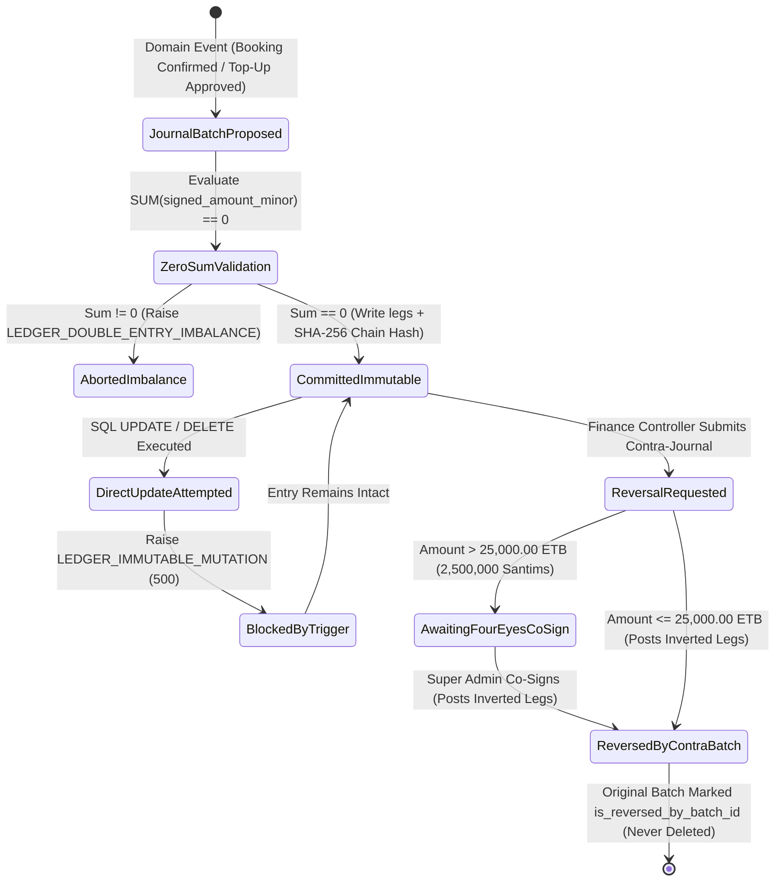

# Double-Entry General Ledger Browser & Zero-Sum Audit
## Admin Subsystem Specification — `docs/admin/finance-ledger/02-double-entry-ledger-browser.md`

**Document Identifier:** `SPEC-ADM-FIN-02`  
**Classification:** Canonical Subsystem UI/UX & Technical Behavior Specification  
**Governing Documents:** `Dink_Machinery_UI_UX_Design_Brief.md`, `SRS-DINK-CORE-V7.0` (§5.5 `BK-17-BE`, §5.9 `CW-01`, §5.11), `docs/components/admin/DESIGN.md`, `docs/shared/design/design-tokens.json`, `docs/ERROR_CATALOG.md`, `contracts/openapi.yaml`, `ADR-010`  
**Target Subsystem:** Next.js 16 Web Admin Console (`admin/src/app/(dashboard)/finance/ledger/`)  
**Primary Persona / Actor:** Chief Financial Officer, Financial Controller (*Solomon Kassa*), External Statutory Auditor  
**Associated Requirements:** `REQ-05-05` (`BK-17-BE`), `REQ-05-09` (`CW-01`..`CW-02`), `REQ-05-11` (`AD-06-BE`), `ADR-010`  
**Associated Interaction Flows:** `FLOW-11` (Commission Deduction & Double-Entry Ledger), `FLOW-12` (Admin Dynamic UI Engine)  
**Status:** Approved Technical Design Baseline

---

## 1. Executive Summary & Architectural Invariants

The **Double-Entry General Ledger Browser & Zero-Sum Audit Console** (`SPEC-ADM-FIN-02`) provides an immutable, cryptographic-grade financial explorer over the PostgreSQL `financial_ledger_entries` table (`BK-17-BE`, `ADR-010`). Every financial event in Dink Machinery—whether an `OwnerWallet` top-up (`CW-04`), a 10% platform commission deduction upon booking confirmation (`CW-01`), a 2% Ethiopian withholding tax accrual (`CW-12`), or an unused pre-funded deposit refund (`CW-11`)—is recorded as a balanced multi-leg journal batch.

### 1.1 Chart of Accounts & Double-Entry Invariants (`ADR-010`)
The ledger enforces a canonical four-account core chart of accounts per jurisdiction (`ETB` in Ethiopia, `KES` in Kenya):
1. **`1010 — Cash & Settlement Clearing (Asset)`:** Commercial bank settlement accounts (CBE, Awash, Dashen, Equity) and mobile money merchant collection pools (Telebirr, CBE Birr, M-Pesa).
2. **`2010 — Owner Wallet Pre-Funded Liability & Receivable (`OwnerWallet`)`:** Tracks each machinery owner's prepaid wallet balance or accrued negative commission debt (down to the `-500,000 Santims` / `-5,000.00 ETB` floor).
3. **`3010 — Platform Commission Revenue (Revenue)`:** Recognizes the platform's 10% (`1000 bps`) commission fee deducted at booking confirmation (`CW-01`).
4. **`2020 — Jurisdictional Tax Withholding & VAT Payable (Liability)`:** Tracks 15% Ethiopian VAT (`1500 bps`), 2% Ethiopian Withholding Tax (`200 bps`), or 16% Kenyan VAT (`1600 bps`) for statutory remittance to ERCA/KRA.

### 1.2 Mathematical & Database Immutability Guarantees
- **Strict Zero-Sum Batch Invariant:** For every `journal_batch_id`, the signed algebraic sum of all legs in integer minor units (`DEBIT` represented as `+amount_minor`, `CREDIT` represented as `-amount_minor`) must satisfy:
  $$\sum_{i=1}^{n} \text{signed\_amount\_minor}_i = 0$$
  Any transaction violating this invariant is aborted by a PostgreSQL `CONSTRAINT TRIGGER` raising `LEDGER_DOUBLE_ENTRY_IMBALANCE` (`HTTP 500`).
- **Append-Only Immutability (`LEDGER_IMMUTABLE_MUTATION`):** `UPDATE` and `DELETE` statements on `financial_ledger_entries` are unconditionally blocked at the PostgreSQL trigger level (`prevent_ledger_mutation_trg`). Corrections require an explicit **Reversing Contra-Journal Batch** referencing `reverses_batch_id`.
- **Cursor-Only Keyset Pagination:** Offset pagination (`OFFSET`/`LIMIT`) is prohibited on `financial_ledger_entries`. Queries traverse `(created_at DESC, entry_id DESC)` using an indexed seek cursor to sustain `< 25 ms` query execution over 10M+ ledger rows.

---

## 2. Screen Anatomy, Layout & Bespoke Desktop Wireframe

The view features a live **Zero-Sum Trial Balance Header Bar**, a virtualized **Multi-Leg Journal Entry Grid**, and a slide-over **T-Account & Reversal Inspector Drawer**.

```text
+------------------------------------------------------------------------------------------------------------------------------------------+
| DINK ADMIN [ET: Ethiopia (ETB) v]   Finance & Ledger > Double-Entry General Ledger Browser     [Verify Ledger Hash Chain] [Export Audit] |
+------------------------------------------------------------------------------------------------------------------------------------------+
| ZERO-SUM INVARIANT MONITOR: [VERIFIED: SUM(DEBIT) - SUM(CREDIT) = 0 SANTIMS]   Last Checked Batch: JRN-01JM9P44 (2026-10-29 13:20:04Z)   |
|------------------------------------------------------------------------------------------------------------------------------------------|
| [1010 Cash Clearing]          | [2010 Owner Wallet Net]       | [3010 Commission Revenue]     | [2020 Tax Withholding (ERCA)]            |
| +482,910,000 Santims          | -142,300,000 Santims          | -294,110,000 Santims          | -46,500,000 Santims                      |
| (4,829,100.00 ETB Dr)         | (1,423,000.00 ETB Cr)         | (2,941,100.00 ETB Cr)         | (465,000.00 ETB Cr)                      |
+------------------------------------------------------------------------------------------------------------------------------------------+
| Filter: [Account: ALL v] [Event: ALL v] [Booking/Wallet ID: ____________] [Date: 2026-10-01 -> 2026-10-29] [Post Reversing Contra Entry] |
+------------------------------------------------------------------------------------------------------------------------------------------+
| JOURNAL ENTRY REGISTER (Cursor Keyset Paginated — 40dp Monospace Rows)                | JOURNAL BATCH INSPECTOR (Batch: JRN-01JM9P44)    |
|---------------------------------------------------------------------------------------|--------------------------------------------------|
| Entry ID   | Batch ID   | Timestamp (UTC)     | Account           | Dir | Minor (ETB) | Event Type:    BOOKING_COMMISSION_DEDUCTION      |
|------------|------------|---------------------|-------------------|-----|-------------| Source Ref:    BKG-2026-88412 (CAT 320D Excav.)  |
| >LED-99412 | JRN-9P44   | 2026-10-29 13:20:04 | 2010 Owner Wallet | DR  |  +1,150,000 | Owner Wallet:  WLT-01HJ8821 (Ato Kebede Fleet)   |
|  LED-99411 | JRN-9P44   | 2026-10-29 13:20:04 | 3010 Comm Revenue | CR  |  -1,000,000 | Idempotency:   idem_01JM9P43Z8819204             |
|  LED-99410 | JRN-9P44   | 2026-10-29 13:20:04 | 2020 Tax Payable  | CR  |    -150,000 | SHA-256 Chain: 8f94e2c0...491a [VALID]           |
|------------|------------|---------------------|-------------------|-----|-------------|--------------------------------------------------|
|  LED-99409 | JRN-9P10   | 2026-10-29 12:05:19 | 1010 Cash Clearing| DR  |  +2,500,000 | T-ACCOUNT BALANCED LEGS (Santims / ETB)          |
|  LED-99408 | JRN-9P10   | 2026-10-29 12:05:19 | 2010 Owner Wallet | CR  |  -2,500,000 | +----------------------+-----------+-----------+ |
|------------|------------|---------------------|-------------------|-----|-------------| | Account              | DEBIT (+) | CREDIT (-)| |
|  LED-99407 | JRN-9M88   | 2026-10-29 11:42:00 | 2010 Owner Wallet | DR  |    +800,000 | +----------------------+-----------+-----------+ |
|  LED-99406 | JRN-9M88   | 2026-10-29 11:42:00 | 3010 Comm Revenue | CR  |    -800,000 | | 2010 Owner Wallet    | 1,150,000 |         0 | |
|            |            |                     |                   |     |             | | 3010 Comm Revenue    |         0 | 1,000,000 | |
|            |            |                     |                   |     |             | | 2020 VAT Payable     |         0 |   150,000 | |
|            |            |                     |                   |     |             | +----------------------+-----------+-----------+ |
|            |            |                     |                   |     |             | | BATCH NET ALGEBRAIC  |        0 SANTIMS [OK] | |
|            |            |                     |                   |     |             | +----------------------+-----------+-----------+ |
|---------------------------------------------------------------------------------------|--------------------------------------------------|
| Cursor: cur_led_99406 | Page Size: 100 Legs | [<< Newer Entries] [Older Entries >>]   | [Post Reversing Contra-Journal (Four-Eyes Req)]  |
+------------------------------------------------------------------------------------------------------------------------------------------+
```

---

## 3. W3C DTCG Design Token Mapping Table

| UI Component / Element | W3C Token Path (`design-tokens.json`) | Resolved Value (Light / Dark / Outdoor) | Behavioral & Accessibility Invariant |
|---|---|---|---|
| **Zero-Sum Invariant Badge (OK)** | `color.feedback.emerald.50` + `color.feedback.emerald.700` | `#ECFDF5` bg, `#047857` text, `#10B981` border | Live ARIA status region (`role="status"`); turns `#DC2626` crimson if any batch imbalance is detected. |
| **Ledger Numeric Cells (`Santims`)** | `typography.fontFamily.mono` + `typography.fontSize.14` | `Space Mono, monospace`, `14sp`, `tabular-nums` | Strict right alignment; displays integer minor units with explicit sign (`+1,150,000` / `-1,000,000`). |
| **Journal Batch Group Divider** | `stroke.border.medium` + `color.brand.slate.300` | `2dp` `#CBD5E1` (Light) / `#334155` (Dark) | Visually groups multi-leg entries belonging to the same `journal_batch_id`. |
| **DEBIT (`DR`) Direction Pill** | `color.feedback.blue.50` + `color.feedback.blue.900` | `#EFF6FF` fill, `#1E3A8A` text | Paired with explicit `DR (+)` text for colorblind safety. |
| **CREDIT (`CR`) Direction Pill** | `color.brand.amber.50` + `color.brand.amber.900` | `#FFFBEB` fill, `#78350F` text | Paired with explicit `CR (-)` text for colorblind safety. |
| **Contra-Journal Destructive CTA** | `semantic.light.action.destructive.bg` | `#EF4444` (Light) / `#B91C1C` (Dark) | Gated by `finance.ledger.reverse` permission and Four-Eyes co-signer prompt. |

---

## 4. Interactive State Machine & Sequence Flows

### 4.1 Immutable Journal & Contra-Reversal State Machine (`stateDiagram-v2`)



---

## 5. Concrete Next.js 16 Implementation Blueprint

### 5.1 Dynamic UI Engine Configuration (`/api/v1/admin/ui-config?route=finance/ledger`)

```json
{
  "tableId": "tbl_financial_ledger_entries_v1",
  "title": "Double-Entry General Ledger Browser",
  "description": "Immutable append-only journal explorer in integer minor units (Santims/Cents).",
  "defaultSortField": "createdAt",
  "defaultSortDirection": "desc",
  "pageSize": 100,
  "columns": [
    { "id": "entryCode", "header": "Entry ID", "accessorKey": "entryCode", "dataType": "text", "isSortable": true, "isFilterable": true },
    { "id": "batchCode", "header": "Batch ID", "accessorKey": "journalBatchCode", "dataType": "text", "isSortable": false, "isFilterable": true },
    { "id": "createdAt", "header": "Timestamp (UTC)", "accessorKey": "createdAt", "dataType": "date", "isSortable": true, "isFilterable": true },
    { "id": "accountCode", "header": "Ledger Account", "accessorKey": "accountCode", "dataType": "badge", "isSortable": false, "isFilterable": true,
      "badgeVariants": { "1010_CASH_CLEARING": "default", "2010_OWNER_WALLET": "warning", "3010_COMMISSION_REV": "success", "2020_TAX_PAYABLE": "outline" }
    },
    { "id": "direction", "header": "Leg", "accessorKey": "direction", "dataType": "badge", "isSortable": false, "isFilterable": true,
      "badgeVariants": { "DEBIT": "default", "CREDIT": "secondary" }
    },
    { "id": "amountMinor", "header": "Amount (Major / Minor)", "accessorKey": "moneyAmount", "dataType": "money", "align": "right", "isSortable": false, "isFilterable": false }
  ],
  "facets": [
    {
      "id": "accountCode",
      "label": "Account Code",
      "type": "select",
      "options": [
        { "label": "1010 — Cash & Settlement Clearing", "value": "1010_CASH_CLEARING" },
        { "label": "2010 — Owner Wallet Liability/Receivable", "value": "2010_OWNER_WALLET" },
        { "label": "3010 — Platform Commission Revenue", "value": "3010_COMMISSION_REV" },
        { "label": "2020 — Withholding & VAT Payable", "value": "2020_TAX_PAYABLE" }
      ]
    }
  ],
  "rowActions": [
    {
      "id": "reverse_journal_batch",
      "label": "Post Contra-Reversal",
      "variant": "destructive",
      "requiredPermission": "finance.ledger.reverse",
      "endpoint": "/api/v1/admin/finance/ledger-batches/{batchId}:reverse",
      "method": "POST",
      "confirmationPrompt": {
        "title": "Post Immutable Contra-Journal Reversal",
        "description": "Ledger entries cannot be deleted. This action appends an inverted debit/credit batch that zeroes out the selected batch.",
        "confirmText": "Post Reversing Batch"
      }
    }
  ],
  "bulkActions": []
}
```

### 5.2 React Server Component Data Loader (`admin/src/app/(dashboard)/finance/ledger/page.tsx`)

```tsx
// admin/src/app/(dashboard)/finance/ledger/page.tsx
import React from 'react';
import { cookies } from 'next/headers';
import { formatMinorUnits } from '@/lib/currency';
import { LedgerBrowserClient } from './_components/LedgerBrowserClient';
import { ProblemDetailsBanner } from '@/components/feedback/ProblemDetailsBanner';

export interface LedgerEntryDTO {
  id: string;
  entryCode: string;
  journalBatchId: string;
  journalBatchCode: string;
  accountCode: '1010_CASH_CLEARING' | '2010_OWNER_WALLET' | '3010_COMMISSION_REV' | '2020_TAX_PAYABLE';
  direction: 'DEBIT' | 'CREDIT';
  signedAmountMinor: number; // Positive for DEBIT, Negative for CREDIT
  moneyAmount: { amountMinor: number; currency: 'ETB' | 'KES' };
  eventType: string;
  referenceEntityId: string;
  chainHashSha256: string;
  reversesBatchId?: string | null;
  createdAt: string;
}

export interface TrialBalanceSummaryDTO {
  currency: 'ETB' | 'KES';
  netAlgebraicSumMinor: number; // Must strictly equal 0
  isZeroSumVerified: boolean;
  lastVerifiedBatchCode: string;
  accountBalancesMinor: Record<string, number>;
}

export default async function DoubleEntryLedgerPage({
  searchParams,
}: {
  searchParams: Promise<{ cursor?: string; accountCode?: string; batchCode?: string }>;
}) {
  const params = await searchParams;
  const cookieStore = await cookies();
  const sessionToken = cookieStore.get('dink_admin_session')?.value ?? '';
  const countryCode = cookieStore.get('dink_admin_country')?.value ?? 'ET';

  const headers = {
    Authorization: `Bearer ${sessionToken}`,
    'X-Country-Code': countryCode,
  };

  const [configRes, trialBalanceRes, entriesRes] = await Promise.all([
    fetch(`${process.env.INTERNAL_BACKEND_URL}/api/v1/admin/ui-config?route=finance/ledger`, {
      headers,
      next: { revalidate: 300 },
    }),
    fetch(`${process.env.INTERNAL_BACKEND_URL}/api/v1/admin/finance/ledger/trial-balance`, {
      headers,
      cache: 'no-store',
    }),
    fetch(
      `${process.env.INTERNAL_BACKEND_URL}/api/v1/admin/finance/ledger/entries?cursor=${params.cursor ?? ''}&accountCode=${params.accountCode ?? ''}&batchCode=${params.batchCode ?? ''}`,
      { headers, cache: 'no-store' }
    ),
  ]);

  if (!configRes.ok || !trialBalanceRes.ok || !entriesRes.ok) {
    const failedRes = !configRes.ok ? configRes : !trialBalanceRes.ok ? trialBalanceRes : entriesRes;
    const errPayload = await failedRes.json();
    return <ProblemDetailsBanner problem={errPayload.error} />;
  }

  const uiConfig = (await configRes.json()).data;
  const trialBalance: TrialBalanceSummaryDTO = (await trialBalanceRes.json()).data;
  const entriesEnvelope = await entriesRes.json();

  return (
    <div className="flex h-[calc(100vh-64px)] flex-col gap-4 p-6 bg-slate-50 dark:bg-slate-900">
      <div
        role="status"
        aria-live="polite"
        className={`flex items-center justify-between rounded-lg border px-4 py-3 ${
          trialBalance.isZeroSumVerified && trialBalance.netAlgebraicSumMinor === 0
            ? 'border-emerald-500 bg-emerald-50 text-emerald-950 dark:bg-emerald-950 dark:text-emerald-100'
            : 'border-red-600 bg-red-50 text-red-950 dark:bg-red-950 dark:text-red-100'
        }`}
      >
        <div className="flex items-center gap-3">
          <span className="font-mono text-sm font-bold uppercase">
            {trialBalance.isZeroSumVerified ? 'ZERO-SUM INVARIANT VERIFIED' : 'CRITICAL LEDGER IMBALANCE'}
          </span>
          <span className="font-mono text-xs">
            Net Algebraic Sum: {trialBalance.netAlgebraicSumMinor} Minor Units (
            {formatMinorUnits(trialBalance.netAlgebraicSumMinor, trialBalance.currency)})
          </span>
        </div>
        <span className="font-mono text-xs">
          Last Batch: {trialBalance.lastVerifiedBatchCode}
        </span>
      </div>

      <LedgerBrowserClient
        config={uiConfig}
        trialBalance={trialBalance}
        entries={entriesEnvelope.data.items as LedgerEntryDTO[]}
        pagination={entriesEnvelope.meta.pagination}
      />
    </div>
  );
}
```

### 5.3 Server Action for Contra-Journal Reversal (`admin/src/app/(dashboard)/finance/ledger/actions.ts`)

```typescript
// admin/src/app/(dashboard)/finance/ledger/actions.ts
'use server';

import { revalidatePath } from 'next/cache';
import { cookies } from 'next/headers';
import { z } from 'zod';
import { ProblemDetails } from '@/types/dynamic-ui';

const ReverseJournalBatchSchema = z.object({
  journalBatchId: z.string().uuid('Invalid journal batch UUID.'),
  reversalReasonCode: z.enum([
    'DUPLICATE_SETTLEMENT_REVERSAL',
    'DISPUTE_RULING_ADJUSTMENT',
    'ERRONEOUS_BANK_SLIP_MATCH',
    'TAX_EXEMPTION_RETROACTIVE',
  ]),
  auditNotes: z.string().trim().min(15, 'Detailed audit explanation (min 15 chars) is mandatory.').max(1000),
  coSignerAdminOtp: z.string().regex(/^\d{6}$/, '6-digit Four-Eyes co-signer OTP required for reversals > 25,000 ETB.').optional(),
});

export async function reverseJournalBatchAction(formData: FormData): Promise<{
  success: boolean;
  contraBatchId?: string;
  problem?: ProblemDetails;
}> {
  const parsed = ReverseJournalBatchSchema.safeParse({
    journalBatchId: formData.get('journalBatchId'),
    reversalReasonCode: formData.get('reversalReasonCode'),
    auditNotes: formData.get('auditNotes'),
    coSignerAdminOtp: formData.get('coSignerAdminOtp') || undefined,
  });

  if (!parsed.success) {
    return {
      success: false,
      problem: {
        type: 'https://api.dinkmachinery.com/errors/request-validation-failed',
        title: 'Contra-Journal Validation Error',
        status: 400,
        detail: 'Invalid reversal parameters submitted.',
        code: 'REQ_VALIDATION_FAILED',
        invalidParams: parsed.error.issues.map((i) => ({ name: i.path.join('.'), reason: i.message })),
      },
    };
  }

  const cookieStore = await cookies();
  const sessionToken = cookieStore.get('dink_admin_session')?.value;
  const countryCode = cookieStore.get('dink_admin_country')?.value ?? 'ET';

  const res = await fetch(
    `${process.env.INTERNAL_BACKEND_URL}/api/v1/admin/finance/ledger-batches/${parsed.data.journalBatchId}:reverse`,
    {
      method: 'POST',
      headers: {
        'Content-Type': 'application/json',
        Authorization: `Bearer ${sessionToken}`,
        'X-Country-Code': countryCode,
        'Idempotency-Key': crypto.randomUUID(),
      },
      body: JSON.stringify(parsed.data),
    }
  );

  const payload = await res.json();
  if (!res.ok) {
    return { success: false, problem: payload.error as ProblemDetails };
  }

  revalidatePath('/finance/ledger');
  return { success: true, contraBatchId: payload.data.contraBatchId };
}
```

---

## 6. OpenAPI 3.1.0 Contract & RFC 9457 Error Matrix

### 6.1 Endpoint Specifications
| HTTP Method & Route | Operation ID | Required RBAC Permission | Idempotency-Key | Description |
|---|---|---|---|---|
| `GET /api/v1/admin/finance/ledger/trial-balance` | `getLedgerTrialBalance` | `finance.ledger.read` | No | Returns aggregate minor-unit balances per account (`1010`, `2010`, `3010`, `2020`) and verifies $\sum = 0$. |
| `GET /api/v1/admin/finance/ledger/entries` | `listLedgerEntries` | `finance.ledger.read` | No | Keyset-paginated journal leg browser using `(created_at, id)` cursor. |
| `POST /api/v1/admin/finance/ledger-batches/{batchId}:reverse` | `reverseLedgerBatch` | `finance.ledger.reverse` | Yes (UUID v4) | Appends an inverted contra-journal batch to reverse an existing batch without mutating historical rows. |

### 6.2 RFC 9457 Problem Details Error Matrix
| Error Code | HTTP Status | RFC 9457 Type URI | Trigger Condition & Operational Recovery |
|---|---|---|---|
| `LEDGER_DOUBLE_ENTRY_IMBALANCE` | `500 Internal` | `https://api.dinkmachinery.com/errors/ledger-imbalance` | Sum of debit and credit legs in a proposed batch does not equal `0` minor units. Transaction rolled back; PagerDuty alert emitted. |
| `LEDGER_IMMUTABLE_MUTATION` | `500 Internal` | `https://api.dinkmachinery.com/errors/ledger-immutable-mutation` | Disallowed attempt to `UPDATE` or `DELETE` a row in `financial_ledger_entries`. Blocked by PostgreSQL trigger. |
| `ADMIN_UNAUTHORIZED_OVERRIDE` | `403 Forbidden` | `https://api.dinkmachinery.com/errors/admin-unauthorized-override` | Contra-journal reversal exceeds `2,500,000 Santims` (`25,000.00 ETB`) without a valid Four-Eyes Super Admin co-signer token. |

---

## 7. Verification & Acceptance Criteria Checklist

- [ ] **Zero-Sum Trial Balance Assertion:** Automated integration test verifies that across 10,000 simulated booking commission deductions and top-ups, `SELECT SUM(signed_amount_minor) FROM financial_ledger_entries` equals `0` and the UI Trial Balance banner displays `ZERO-SUM INVARIANT VERIFIED`.
- [ ] **Database Immutability Trigger:** Executing `DELETE FROM financial_ledger_entries` or `UPDATE financial_ledger_entries` raises `LEDGER_IMMUTABLE_MUTATION` and leaves rows untouched.
- [ ] **Cursor Pagination Only:** Confirm `/api/v1/admin/finance/ledger/entries` rejects `offset` query parameters (`400 REQ_VALIDATION_FAILED`) and exclusively accepts opaque cursor tokens (`meta.pagination.nextCursor`).
- [ ] **BigInt Minor-Unit Formatting:** Ledger browser displays both `1,150,000 Santims` and `11,500.00 ETB` in `Space Mono` font without `Number.MAX_SAFE_INTEGER` precision loss.
