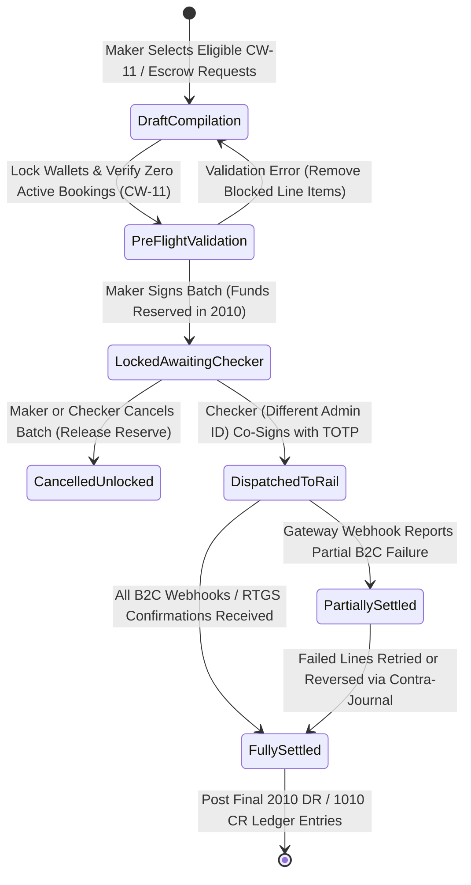
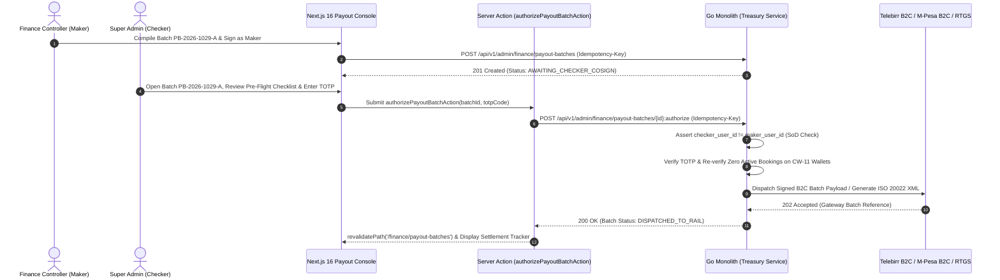

# Owner Payout Batch Execution & Treasury Disbursement Console
## Admin Subsystem Specification — `docs/admin/finance-ledger/03-owner-payout-batch-processing.md`

**Document Identifier:** `SPEC-ADM-FIN-03`  
**Classification:** Canonical Subsystem UI/UX & Technical Behavior Specification  
**Governing Documents:** `Dink_Machinery_UI_UX_Design_Brief.md`, `SRS-DINK-CORE-V7.0` (§5.9 `CW-11`, §7.1 `REQ-07-01`, §7.2 `REQ-07-02`, §5.11), `docs/components/admin/DESIGN.md`, `docs/shared/design/design-tokens.json`, `docs/ERROR_CATALOG.md`, `contracts/openapi.yaml`, `ADR-010`  
**Target Subsystem:** Next.js 16 Web Admin Console (`admin/src/app/(dashboard)/finance/payout-batches/`)  
**Primary Persona / Actor:** Financial Controller & Treasury Lead (*Solomon Kassa*), Super Admin Co-Signer (*Rahel Tadesse*)  
**Associated Requirements:** `REQ-05-09` (`CW-11`), `REQ-07-01`, `REQ-07-02`, `REQ-05-11` (`AD-06-BE`), `ADR-010`  
**Associated Interaction Flows:** `FLOW-11` (Owner Wallet Refund & Disbursement), `FLOW-12` (Admin Dynamic UI Engine)  
**Status:** Approved Technical Design Baseline

---

## 1. Executive Summary & Architectural Invariants

The **Owner Payout Batch Execution & Treasury Disbursement Console** (`SPEC-ADM-FIN-03`) governs all outbound treasury disbursements from Dink Machinery to verified Equipment Owners across Ethiopia (`ET`) and Kenya (`KE`). In strict alignment with `SRS-DINK-CORE-V7.0` and `ADR-010`, the console operates across two phased operational modes gated by feature flags (`REQ-05-21`):

### 1.1 Dual Operational Disbursement Modes
1. **Phase 1 — Pre-Funded `OwnerWallet` Unused Balance Withdrawal Refunds (`CW-11`):**
   - Equipment Owners pre-fund their `OwnerWallet` to cover the platform's 10% commission deductions. When an Owner requests a refund of their unused positive wallet balance (`balance_minor > 0`), the system verifies **zero active or pending bookings** (`BOOKING_REQUESTED`, `PAYMENT_PENDING`, `CONFIRMED`, `ACTIVE_OPERATION`, `WIRE_DISPUTED`) exist on any of the Owner's machinery assets.
   - Verified withdrawal requests enter the Treasury Disbursement Queue for manual RTGS/EFT bank batch export or Telebirr/M-Pesa B2C execution.
2. **Phase 3 — Automated Gateway Escrow Split & Batch Payouts (`REQ-07-01`, `REQ-07-02`, `ADR-010`):**
   - When automated payment gateway escrow is enabled via `FF_GATEWAY_ESCROW_PAYOUTS`, completed rental net settlements (Gross Rental minus 10% Platform Commission minus 2% WHT) are aggregated into daily/weekly settlement batches.
   - Dispatches bulk B2C payout payloads to **Telebirr B2C**, **CBE Birr**, **Chapa Transfer API**, **Safaricom M-Pesa B2C**, or generates **ISO 20022 `pain.001.001.03` / Commercial Bank RTGS CSV** files for bank portal upload.

### 1.2 Treasury Safety & Compliance Invariants
- **Four-Eyes Maker-Checker Authorization (`ASVS L3`):** Any payout batch exceeding `10,000,000 Santims` (`100,000.00 ETB` or `100,000.00 KES`) requires two distinct cryptographic signatures: the **Maker** (`FINANCE_CONTROLLER` who compiles and locks the batch) and the **Checker** (`SUPER_ADMIN` who authorizes release via WebAuthn/TOTP step-up).
- **Pre-Flight Wallet Lock & Liquidity Check (`WALLET_INSUFFICIENT_FUNDS` / `WALLET_LOCKED_PENDING_AUDIT`):** Prior to batch execution, each included `OwnerWallet` is locked (`SELECT ... FOR UPDATE`) and re-verified that `balance_minor >= payout_amount_minor` and `is_audit_locked = false`.
- **Masked Beneficiary Credentials:** Owner IBANs, CBE account numbers, and mobile wallet MSISDNs are masked in the grid (`CBE: *******4821`) and only decrypted inside the isolated backend treasury worker generating the signed bank/gateway payload.

---

## 2. Screen Anatomy, Layout & Bespoke Desktop Wireframe

```text
+------------------------------------------------------------------------------------------------------------------------------------------+
| DINK ADMIN [ET: Ethiopia (ETB) v]   Finance & Ledger > Owner Payout Batch Processing     [+ Compile New Payout Batch] [Download RTGS CSV]|
+------------------------------------------------------------------------------------------------------------------------------------------+
| ACTIVE BATCH: PB-2026-1029-A   | Rail: [Telebirr B2C + CBE RTGS] | Status: [AWAITING_CHECKER_COSIGN] | Maker: Solomon K. | Items: 18     |
| Total Gross: 148,500,000 Santims (1,485,000.00 ETB) | WHT Withheld: 0 Santims | Net Disbursement: 1,485,000.00 ETB | Liquidity: VERIFIED |
+------------------------------------------------------------------------------------------------------------------------------------------+
| Filter: [Mode: ALL | CW-11 Wallet Refund (12) | Escrow Settlement (6)] [Rail: All v] [Pre-Flight Check: Passed (17) | Blocked (1)]       |
+------------------------------------------------------------------------------------------------------------------------------------------+
| PAYOUT BATCH LINE ITEMS (Virtualized 40dp Rows)                        | MAKER-CHECKER AUTHORIZATION & GATEWAY EXECUTION DRAWER          |
|------------------------------------------------------------------------|-----------------------------------------------------------------|
| Line ID   | Mode  | Owner / Fleet Entity | Rail   | Dest Acc   | Minor | BATCH PRE-FLIGHT INVARIANT CHECKLIST (PB-2026-1029-A)           |
|-----------|-------|----------------------|--------|------------|-------| [x] 1. Zero Active Bookings on CW-11 Refund Wallets (12/12 OK)  |
| >PAY-8812 | CW-11 | Addis Heavy Lift PLC | CBE    | *****8912  | 45.0M | [x] 2. Wallet Balance >= Payout Minor Units (17/18 OK, 1 Held)  |
|  PAY-8811 | CW-11 | Habesha Earthmovers  | TELEBR | +251***412 | 12.5M | [x] 3. Zero Compliance / Fraud Locks on Beneficiaries           |
| !PAY-8810 | CW-11 | Rift Valley Cranes   | AWASH  | *****3301  | 18.0M | [x] 4. Double-Entry Pre-Reservation (2010 DR / 1010 CR Balanced)|
|  PAY-8809 | ESCRO | Nile Logistics Group | CBE    | *****1104  | 73.0M |                                                                 |
|           |       |                      |        |            |       | BLOCKED ITEM ALERT (1 Line Excluded from Execution):            |
|           |       |                      |        |            |       | ! PAY-8810 (Rift Valley Cranes): Active Booking BKG-9912 found  |
|           |       |                      |        |            |       |   in state CONFIRMED. CW-11 refund blocked until completion.    |
|           |       |                      |        |            |       |   [Remove PAY-8810 from Batch]                                  |
|           |       |                      |        |            |       |-----------------------------------------------------------------|
|           |       |                      |        |            |       | FOUR-EYES DUAL CONTROL SIGNATURES                               |
|           |       |                      |        |            |       | 1. Maker Signature:  Solomon Kassa (FINANCE_CONTROLLER)         |
|           |       |                      |        |            |       |    Signed At:        2026-10-29 11:45:12 UTC (HMAC: 9a4f..12c)  |
|           |       |                      |        |            |       | 2. Checker Signature: Rahel Tadesse (SUPER_ADMIN)               |
|           |       |                      |        |            |       |    Step-Up 6-Digit TOTP Code: [ 4 8 2 9 1 0 ]                   |
|           |       |                      |        |            |       |    Release Justification:     [Verified CBE treasury balance_]  |
|------------------------------------------------------------------------|-----------------------------------------------------------------|
| Selected: 17 Valid Lines (1,305,000.00 ETB) | Cursor: cur_pay_8809     | [Co-Sign & Dispatch B2C / RTGS Batch]  [Cancel & Unlock Wallets]|
+------------------------------------------------------------------------------------------------------------------------------------------+
```

---

## 3. W3C DTCG Design Token Mapping Table

| UI Component / Element | W3C Token Path (`design-tokens.json`) | Resolved Value (Light / Dark / Outdoor) | Behavioral & Accessibility Invariant |
|---|---|---|---|
| **Maker-Checker Status Banner** | `color.brand.amber.100` + `color.brand.amber.900` | `#FEF3C7` fill, `#78350F` text, `#D97706` border | Announces pending Four-Eyes co-signature requirement via `aria-live="polite"`. |
| **Blocked Line Item Row (`!`)** | `color.feedback.crimson.50` + `color.feedback.crimson.700` | `#FEF2F2` row tint, `#B91C1C` text | Highlights `CW-11` violations (e.g., active booking discovered after request). |
| **Net Disbursement Amount** | `typography.fontFamily.mono` + `typography.fontSize.20` | `Space Mono, monospace`, `20sp` bold | Renders exact minor units (`148,500,000 Santims`) alongside formatted currency (`1,485,000.00 ETB`). |
| **Masked Destination Account** | `typography.fontFamily.mono` + `semantic.light.text.secondary` | `Space Mono`, `#475569` | Enforces `maskBankAccount()` and `maskTelephone()` in all DOM nodes. |
| **Co-Sign & Dispatch Primary CTA** | `semantic.light.action.primary.bg` + `stroke.border.heavy` | `#F59E0B` bg, `#020617` text, `3dp` bottom lip | Disabled if `maker_admin_id === current_admin_id` (enforces strict Separation of Duties). |

---

## 4. Interactive State Machine & Sequence Flows

### 4.1 Payout Batch Lifecycle (`stateDiagram-v2`)



### 4.2 Maker-Checker B2C Disbursement Sequence (`sequenceDiagram`)



---

## 5. Concrete Next.js 16 Implementation Blueprint

### 5.1 Dynamic UI Engine Configuration (`/api/v1/admin/ui-config?route=finance/payout-batches`)

```json
{
  "tableId": "tbl_finance_payout_batches_v1",
  "title": "Owner Payout Batch Execution Console",
  "description": "Execute CW-11 Owner Wallet unused balance refunds and Phase 3 escrow disbursements with Four-Eyes authorization.",
  "defaultSortField": "createdAt",
  "defaultSortDirection": "desc",
  "pageSize": 50,
  "columns": [
    { "id": "lineCode", "header": "Line ID", "accessorKey": "lineCode", "dataType": "text", "isSortable": true, "isFilterable": true },
    { "id": "payoutMode", "header": "Mode", "accessorKey": "payoutMode", "dataType": "badge", "isSortable": true, "isFilterable": true,
      "badgeVariants": { "CW11_WALLET_REFUND": "default", "PHASE3_ESCROW_PAYOUT": "success" }
    },
    { "id": "ownerName", "header": "Beneficiary Owner", "accessorKey": "ownerBusinessName", "dataType": "text", "isSortable": true, "isFilterable": true },
    { "id": "rail", "header": "Payout Rail", "accessorKey": "payoutRail", "dataType": "badge", "isSortable": true, "isFilterable": true },
    { "id": "maskedDestination", "header": "Destination Account", "accessorKey": "maskedAccount", "dataType": "text", "isSortable": false, "isFilterable": false },
    { "id": "netAmount", "header": "Net Payout", "accessorKey": "netAmount", "dataType": "money", "align": "right", "isSortable": true, "isFilterable": false },
    { "id": "preFlightStatus", "header": "Pre-Flight Check", "accessorKey": "preFlightStatus", "dataType": "badge", "isSortable": true, "isFilterable": true,
      "badgeVariants": { "ELIGIBLE": "success", "BLOCKED_ACTIVE_BOOKING": "destructive", "BLOCKED_INSUFFICIENT_FUNDS": "destructive" }
    }
  ],
  "facets": [
    {
      "id": "payoutMode",
      "label": "Disbursement Mode",
      "type": "select",
      "options": [
        { "label": "CW-11 Pre-Funded Wallet Refund", "value": "CW11_WALLET_REFUND" },
        { "label": "Phase 3 Escrow Settlement", "value": "PHASE3_ESCROW_PAYOUT" }
      ]
    },
    {
      "id": "payoutRail",
      "label": "Payment Rail",
      "type": "select",
      "options": [
        { "label": "Commercial Bank of Ethiopia RTGS", "value": "CBE_RTGS" },
        { "label": "Telebirr B2C Transfer", "value": "TELEBIRR_B2C" },
        { "label": "Safaricom M-Pesa B2C", "value": "MPESA_B2C" },
        { "label": "Equity Bank Kenya EFT", "value": "EQUITY_EFT" }
      ]
    }
  ],
  "rowActions": [
    {
      "id": "exclude_line_item",
      "label": "Remove from Batch",
      "variant": "outline",
      "requiredPermission": "finance.payout.compile",
      "endpoint": "/api/v1/admin/finance/payout-lines/{id}:exclude",
      "method": "POST"
    }
  ],
  "bulkActions": [
    {
      "id": "authorize_batch_release",
      "label": "Checker Co-Sign & Release Batch",
      "variant": "default",
      "requiredPermission": "finance.payout.authorize_checker",
      "endpoint": "/api/v1/admin/finance/payout-batches/{batchId}:authorize",
      "method": "POST"
    }
  ]
}
```

### 5.2 Server Action for Four-Eyes Batch Authorization (`admin/src/app/(dashboard)/finance/payout-batches/actions.ts`)

```typescript
// admin/src/app/(dashboard)/finance/payout-batches/actions.ts
'use server';

import { revalidatePath } from 'next/cache';
import { cookies } from 'next/headers';
import { z } from 'zod';
import { ProblemDetails } from '@/types/dynamic-ui';

const AuthorizePayoutBatchSchema = z.object({
  batchId: z.string().uuid('Invalid Payout Batch UUID.'),
  version: z.coerce.number().int().positive(),
  expectedTotalMinor: z.coerce.bigint().refine((v) => v > 0n, 'Total payout minor units must be positive.'),
  currency: z.enum(['ETB', 'KES']),
  checkerTotpCode: z.string().regex(/^\d{6}$/, 'Enter a valid 6-digit Authenticator TOTP code.'),
  releaseNotes: z.string().trim().min(10, 'Checker release justification required (min 10 chars).').max(500),
});

export async function authorizePayoutBatchAction(formData: FormData): Promise<{
  success: boolean;
  gatewayBatchReference?: string;
  problem?: ProblemDetails;
}> {
  const parsed = AuthorizePayoutBatchSchema.safeParse({
    batchId: formData.get('batchId'),
    version: formData.get('version'),
    expectedTotalMinor: formData.get('expectedTotalMinor'),
    currency: formData.get('currency'),
    checkerTotpCode: formData.get('checkerTotpCode'),
    releaseNotes: formData.get('releaseNotes'),
  });

  if (!parsed.success) {
    return {
      success: false,
      problem: {
        type: 'https://api.dinkmachinery.com/errors/request-validation-failed',
        title: 'Batch Authorization Validation Error',
        status: 400,
        detail: 'Invalid Four-Eyes checker authorization fields.',
        code: 'REQ_VALIDATION_FAILED',
        invalidParams: parsed.error.issues.map((i) => ({ name: i.path.join('.'), reason: i.message })),
      },
    };
  }

  const cookieStore = await cookies();
  const sessionToken = cookieStore.get('dink_admin_session')?.value;
  const countryCode = cookieStore.get('dink_admin_country')?.value ?? 'ET';

  const res = await fetch(
    `${process.env.INTERNAL_BACKEND_URL}/api/v1/admin/finance/payout-batches/${parsed.data.batchId}:authorize`,
    {
      method: 'POST',
      headers: {
        'Content-Type': 'application/json',
        Authorization: `Bearer ${sessionToken}`,
        'X-Country-Code': countryCode,
        'Idempotency-Key': crypto.randomUUID(),
      },
      body: JSON.stringify({
        version: parsed.data.version,
        expectedTotalMinor: Number(parsed.data.expectedTotalMinor),
        currency: parsed.data.currency,
        checkerTotpCode: parsed.data.checkerTotpCode,
        releaseNotes: parsed.data.releaseNotes,
      }),
    }
  );

  const payload = await res.json();
  if (!res.ok) {
    return { success: false, problem: payload.error as ProblemDetails };
  }

  revalidatePath('/finance/payout-batches');
  return {
    success: true,
    gatewayBatchReference: payload.data.gatewayBatchReference,
  };
}
```

---

## 6. OpenAPI 3.1.0 Contract & RFC 9457 Error Matrix

### 6.1 Endpoint Specifications
| HTTP Method & Route | Operation ID | Required RBAC Permission | Idempotency-Key | Description |
|---|---|---|---|---|
| `GET /api/v1/admin/finance/payout-batches` | `listPayoutBatches` | `finance.payout.read` | No | Cursor-paginated list of treasury disbursement batches and line items. |
| `POST /api/v1/admin/finance/payout-batches` | `compilePayoutBatch` | `finance.payout.compile` | Yes (UUID v4) | Compiles eligible `CW-11` wallet refund requests into a locked batch (`Maker` step). |
| `POST /api/v1/admin/finance/payout-batches/{batchId}:authorize` | `authorizePayoutBatch` | `finance.payout.authorize_checker` | Yes (UUID v4) | Executes Four-Eyes `Checker` co-signature and dispatches B2C / RTGS transfers. |

### 6.2 RFC 9457 Problem Details Error Matrix
| Error Code | HTTP Status | RFC 9457 Type URI | Trigger Condition & Operational Recovery |
|---|---|---|---|
| `WALLET_INSUFFICIENT_FUNDS` | `422 Unprocessable` | `https://api.dinkmachinery.com/errors/wallet-insufficient-funds` | Target `OwnerWallet` balance dropped below requested `CW-11` withdrawal amount due to a concurrent commission deduction. Exclude line item. |
| `WALLET_LOCKED_PENDING_AUDIT` | `423 Locked` | `https://api.dinkmachinery.com/errors/wallet-locked-pending-audit` | Owner wallet is under compliance/fraud lock; disbursements are suspended. |
| `ADMIN_UNAUTHORIZED_OVERRIDE` | `403 Forbidden` | `https://api.dinkmachinery.com/errors/admin-unauthorized-override` | Separation of Duties violation: the same administrator who compiled the batch (`maker_id`) attempted to authorize it as `checker_id`. |
| `PAYMENT_GATEWAY_TIMEOUT` | `504 Timeout` | `https://api.dinkmachinery.com/errors/payment-gateway-timeout` | Telebirr B2C or M-Pesa B2C upstream gateway timed out. Safe to retry with identical `Idempotency-Key`. |

---

## 7. Verification & Acceptance Criteria Checklist

- [ ] **CW-11 Active Booking Guard:** Attempting to include an Owner in a `CW-11` wallet refund batch while they have an active booking (`CONFIRMED` or `ACTIVE_OPERATION`) flags the row as `BLOCKED_ACTIVE_BOOKING` and prevents batch release.
- [ ] **Separation of Duties (Maker != Checker):** If `Solomon Kassa` compiles batch `PB-2026-1029-A`, the `Checker Co-Sign & Release` button is disabled for `Solomon Kassa`'s session and the backend returns `403 ADMIN_UNAUTHORIZED_OVERRIDE` if called directly.
- [ ] **Idempotent Gateway Replay:** Re-submitting `:authorize` with the same `Idempotency-Key` after a `504 PAYMENT_GATEWAY_TIMEOUT` never double-disburses funds or duplicates `2010 DR / 1010 CR` ledger entries.
