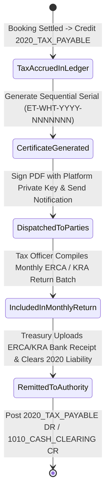

# Withholding Tax Ledger, Certificate Generator & ERCA/KRA Export
## Admin Subsystem Specification — `docs/admin/finance-ledger/04-withholding-tax-management.md`

**Document Identifier:** `SPEC-ADM-FIN-04`  
**Classification:** Canonical Subsystem UI/UX & Technical Behavior Specification  
**Governing Documents:** `Dink_Machinery_UI_UX_Design_Brief.md`, `SRS-DINK-CORE-V7.0` (§5.9 `CW-12`, §5.23 `LOC-01-BE`, §5.11), `docs/components/admin/DESIGN.md`, `docs/shared/design/design-tokens.json`, `docs/ERROR_CATALOG.md`, `contracts/openapi.yaml`, `ADR-015`  
**Target Subsystem:** Next.js 16 Web Admin Console (`admin/src/app/(dashboard)/finance/tax-compliance/`)  
**Primary Persona / Actor:** Tax Compliance Specialist, Financial Controller (*Solomon Kassa*)  
**Associated Requirements:** `REQ-05-09` (`CW-12`), `REQ-05-23` (`LOC-01-BE`), `REQ-05-11` (`AD-06-BE`), `ADR-010`, `ADR-015`  
**Associated Interaction Flows:** `FLOW-11` (Commission & Tax Ledger), `FLOW-12` (Admin Dynamic UI Engine)  
**Status:** Approved Technical Design Baseline

---

## 1. Executive Summary & Architectural Invariants

The **Withholding Tax Ledger, Certificate Generator & ERCA/KRA Export Workbench** (`SPEC-ADM-FIN-04`) automates statutory tax calculation, digital withholding certificate issuance, and monthly regulatory filing exports across Ethiopia (**Ethiopian Revenues and Customs Authority / Ministry of Revenues — ERCA/MoR**) and Kenya (**Kenya Revenue Authority — KRA iTax**).

### 1.1 Jurisdictional Tax Basis Points (`LOC-01-BE` & `CW-12`)
All tax calculations use integer basis points (`100 bps = 1.00%`, `10000 bps = 100.00%`) loaded dynamically from `country_configs` (`ADR-015`) and applied to integer minor units (`Santims` or `Cents`) using deterministic half-up integer rounding:
$$\text{tax\_minor} = \left\lfloor \frac{\text{taxable\_base\_minor} \times \text{rate\_bps} + 5000}{10000} \right\rfloor$$

| Jurisdiction | Regulatory Authority | Standard VAT (`standard_tax_rate_bps`) | Withholding Tax (`withholding_tax_bps`) | Statutory Threshold & Certificate Rule |
|---|---|---|---|---|
| **Ethiopia (`ET`)** | ERCA / Ministry of Revenues | `1500 bps` (`15.00%`) | `200 bps` (`2.00%` on service/rental payments `> 3,000.00 ETB` / `300,000 Santims`; `3000 bps` / `30%` ifTIN unverified) | Mandatory digital **ERCA WHT Certificate** & VAT Tax Invoice featuring Supplier & Withholder 10-digit TINs. |
| **Kenya (`KE`)** | Kenya Revenue Authority (KRA iTax / eTIMS) | `1600 bps` (`16.00%`) | `300 bps` (`3.00%` resident contractual fee WHT) or `500 bps` (`5.00%` equipment lease WHT) | KRA eTIMS Control Unit Invoice Number + KRA PIN validation (`A000000000X`). |

### 1.2 Compliance & Security Invariants
- **TIN / KRA PIN Masking by Default:** Supplier and Renter TINs/KRA PINs are rendered masked (`TIN: *****4829`) in standard table browsing and only unmasked during authenticated statutory CSV/XML generation (`finance.tax.export` permission, logged in `admin_audit_logs`).
- **Immutable Certificate Numbering:** Issued withholding tax certificates receive a sequential, gap-free jurisdictional serial number (`ET-WHT-2026-0004821` or `KE-WHT-2026-0001902`) linked directly to ledger account `2020_TAX_PAYABLE`.

---

## 2. Screen Anatomy, Layout & Bespoke Desktop Wireframe

```text
+------------------------------------------------------------------------------------------------------------------------------------------+
| DINK ADMIN [ET: Ethiopia (ERCA) v]  Finance & Ledger > Withholding Tax & VAT Compliance   [Generate Monthly ERCA Filing CSV] [KRA eTIMS] |
+------------------------------------------------------------------------------------------------------------------------------------------+
| TAX PERIOD: [Meskerem / Oct 2026 v] | Active Config: VAT 1500 bps (15%) | WHT 200 bps (2%) | Penalty Unverified TIN WHT: 3000 bps (30%)  |
|------------------------------------------------------------------------------------------------------------------------------------------|
| [Taxable Gross Volume]        | [15% VAT Payable (Acct 2020)] | [2% WHT Withheld (Acct 2020)] | [Certificates Issued / Pending]          |
| 1,840,000,000 Santims         | 276,000,000 Santims           | 36,800,000 Santims            | 412 Issued / 19 Pending Corporate Upload |
| (18,400,000.00 ETB)           | (2,760,000.00 ETB)            | (368,000.00 ETB)              | Filing Deadline: Tikimt 30 (09-Nov-2026) |
+------------------------------------------------------------------------------------------------------------------------------------------+
| WITHHOLDING TAX & VAT REGISTER (Virtualized 40dp Rows)                 | DIGITAL WHT CERTIFICATE & INVOICE INSPECTOR (ET-WHT-2026-04821) |
|------------------------------------------------------------------------|-----------------------------------------------------------------|
| Cert Serial       | Booking   | Supplier TIN | Base Minor  | WHT (200) | +-------------------------------------------------------------+ |
|-------------------|-----------|--------------|-------------|-----------| | FEDERAL DEMOCRATIC REPUBLIC OF ETHIOPIA - MINISTRY OF REV.  | |
| >ET-WHT-26-04821  | BKG-88412 | TIN: ****891 | 11,500,000  |   230,000 | | OFFICIAL WITHHOLDING TAX RECEIPT (PROCLAMATION 979/2016)    | |
|  ET-WHT-26-04820  | BKG-88390 | TIN: ****402 | 24,000,000  |   480,000 | |-------------------------------------------------------------| |
|  ET-WHT-26-04819  | BKG-88371 | TIN: ****118 |  8,500,000  |   170,000 | | Certificate No:  ET-WHT-2026-0004821                        | |
| !ET-WHT-26-04818  | BKG-88355 | UNVERIFIED!  |  5,000,000  | 1,500,000 | | Issue Date:      29-Oct-2026 (19 Tikimt 2019 E.C.)          | |
|  ET-WHT-26-04817  | BKG-88310 | TIN: ****774 | 19,200,000  |   384,000 | | Withholding Agt: Dink Machinery Aggregator PLC (TIN: **901) | |
|                   |           |              |             |           | | Supplier Entity: Ato Kebede Heavy Earthmovers (TIN: **891)  | |
|                   |           |              |             |           | |-------------------------------------------------------------| |
|                   |           |              |             |           | | Taxable Base:    115,000.00 ETB (11,500,000 Santims)        | |
|                   |           |              |             |           | | VAT (1500 bps):   17,250.00 ETB ( 1,725,000 Santims)        | |
|                   |           |              |             |           | | WHT (200 bps):     2,300.00 ETB (   230,000 Santims)        | |
|                   |           |              |             |           | | Ledger Batch:    JRN-01JM9P44 (Acct 2020_TAX_PAYABLE)       | |
|                   |           |              |             |           | | QR Verification: [SHA-256 Signed Verification URI]          | |
|                   |           |              |             |           | +-------------------------------------------------------------+ |
|------------------------------------------------------------------------|-----------------------------------------------------------------|
| Showing 1-50 of 431 | Cursor: cur_tax_04817 | [Prev] [Next]            | [Issue & Sign Digital PDF] [Dispatch to Owner] [Mark Remitted]  |
+------------------------------------------------------------------------------------------------------------------------------------------+
```

---

## 3. W3C DTCG Design Token Mapping Table

| UI Component / Element | W3C Token Path (`design-tokens.json`) | Resolved Value (Light / Dark / Outdoor) | Behavioral & Accessibility Invariant |
|---|---|---|---|
| **Tax Basis Points Header Pill** | `color.brand.slate.800` + `color.brand.amber.400` | `#1E293B` bg, `#FBBF24` text | Displays exact basis points (`1500 bps`, `200 bps`) alongside human-readable percentage (`15%`, `2%`). |
| **Unverified TIN 30% Penalty Row** | `color.feedback.orange.500` + `color.brand.amber.50` | `#FFFBEB` row bg, `#FF5722` badge | Alerts tax specialist when an owner without a verified TIN was assessed the statutory 30% (`3000 bps`) withholding rate. |
| **Certificate Preview Paper Card** | `semantic.light.surface.card` + `elevation.card` | `#FFFFFF` surface, `1dp` `#E2E8F0` border | Renders dual Gregorian & Ethiopian Ge'ez (`Noto Sans Ethiopic`, line-height `1.38`) dates on Ethiopian certificates. |
| **Minor-Unit Tax Columns** | `typography.fontFamily.mono` + `semantic.light.text.numericLedger` | `Space Mono, monospace`, `#020617` | Displays exact integer minor units (`230,000 Santims` = `2,300.00 ETB`). |

---

## 4. Interactive State Machine & Sequence Flows

### 4.1 Tax Accrual, Certificate Issuance & Statutory Remittance (`stateDiagram-v2`)



---

## 5. Concrete Next.js 16 Implementation Blueprint

### 5.1 Dynamic UI Engine Configuration (`/api/v1/admin/ui-config?route=finance/tax-compliance`)

```json
{
  "tableId": "tbl_finance_withholding_tax_v1",
  "title": "Withholding Tax & VAT Compliance Register",
  "description": "Manage ERCA (Ethiopia 15% VAT / 2% WHT) and KRA (Kenya 16% VAT / WHT) accruals, certificates, and authority exports.",
  "defaultSortField": "issuedAt",
  "defaultSortDirection": "desc",
  "pageSize": 50,
  "columns": [
    { "id": "certificateSerial", "header": "Certificate No.", "accessorKey": "certificateSerial", "dataType": "text", "isSortable": true, "isFilterable": true },
    { "id": "bookingCode", "header": "Booking Ref", "accessorKey": "bookingCode", "dataType": "text", "isSortable": false, "isFilterable": true },
    { "id": "maskedSupplierTin", "header": "Supplier TIN / PIN", "accessorKey": "maskedSupplierTin", "dataType": "text", "isSortable": false, "isFilterable": true },
    { "id": "taxableBase", "header": "Taxable Base", "accessorKey": "taxableBase", "dataType": "money", "align": "right", "isSortable": true, "isFilterable": false },
    { "id": "vatAmount", "header": "VAT Amount", "accessorKey": "vatAmount", "dataType": "money", "align": "right", "isSortable": true, "isFilterable": false },
    { "id": "whtAmount", "header": "WHT Withheld", "accessorKey": "whtAmount", "dataType": "money", "align": "right", "isSortable": true, "isFilterable": false },
    { "id": "filingStatus", "header": "Filing Status", "accessorKey": "filingStatus", "dataType": "badge", "isSortable": true, "isFilterable": true,
      "badgeVariants": { "ACCRUED": "warning", "CERTIFICATE_ISSUED": "default", "EXPORTED_TO_FILING": "secondary", "REMITTED_SETTLED": "success" }
    }
  ],
  "facets": [
    {
      "id": "filingStatus",
      "label": "Statutory Filing Status",
      "type": "select",
      "options": [
        { "label": "Accrued (Pending Certificate)", "value": "ACCRUED" },
        { "label": "Certificate Issued", "value": "CERTIFICATE_ISSUED" },
        { "label": "Exported to ERCA/KRA Return", "value": "EXPORTED_TO_FILING" },
        { "label": "Remitted & Settled", "value": "REMITTED_SETTLED" }
      ]
    }
  ],
  "rowActions": [
    {
      "id": "issue_wht_certificate",
      "label": "Issue Signed WHT Certificate",
      "variant": "default",
      "requiredPermission": "finance.tax.certificate_issue",
      "endpoint": "/api/v1/admin/finance/tax-records/{id}:issue-certificate",
      "method": "POST"
    }
  ],
  "bulkActions": [
    {
      "id": "export_authority_return",
      "label": "Generate ERCA / KRA Monthly Return",
      "variant": "default",
      "requiredPermission": "finance.tax.export",
      "endpoint": "/api/v1/admin/finance/tax-returns:generate",
      "method": "POST"
    }
  ]
}
```

### 5.2 Server Action for Generating Monthly ERCA/KRA Tax Filing & Remittance (`admin/src/app/(dashboard)/finance/tax-compliance/actions.ts`)

```typescript
// admin/src/app/(dashboard)/finance/tax-compliance/actions.ts
'use server';

import { revalidatePath } from 'next/cache';
import { cookies } from 'next/headers';
import { z } from 'zod';
import { ProblemDetails } from '@/types/dynamic-ui';

const GenerateTaxReturnSchema = z.object({
  countryCode: z.enum(['ET', 'KE']),
  taxPeriodYear: z.coerce.number().int().min(2025).max(2100),
  taxPeriodMonth: z.coerce.number().int().min(1).max(13), // Supports 13th month Pagume in Ethiopian calendar reporting
  exportFormat: z.enum(['ERCA_CSV_V2', 'KRA_ITAX_XML', 'STATUTORY_PDF_BUNDLE']),
  auditJustification: z.string().trim().min(10, 'Provide statutory filing justification (min 10 chars).').max(500),
});

export async function generateMonthlyTaxReturnAction(formData: FormData): Promise<{
  success: boolean;
  downloadSignedUrl?: string;
  totalVatMinor?: number;
  totalWhtMinor?: number;
  problem?: ProblemDetails;
}> {
  const parsed = GenerateTaxReturnSchema.safeParse({
    countryCode: formData.get('countryCode'),
    taxPeriodYear: formData.get('taxPeriodYear'),
    taxPeriodMonth: formData.get('taxPeriodMonth'),
    exportFormat: formData.get('exportFormat'),
    auditJustification: formData.get('auditJustification'),
  });

  if (!parsed.success) {
    return {
      success: false,
      problem: {
        type: 'https://api.dinkmachinery.com/errors/request-validation-failed',
        title: 'Tax Return Export Validation Failed',
        status: 400,
        detail: 'Invalid tax period or authority format specified.',
        code: 'REQ_VALIDATION_FAILED',
        invalidParams: parsed.error.issues.map((i) => ({ name: i.path.join('.'), reason: i.message })),
      },
    };
  }

  const cookieStore = await cookies();
  const sessionToken = cookieStore.get('dink_admin_session')?.value;

  const res = await fetch(`${process.env.INTERNAL_BACKEND_URL}/api/v1/admin/finance/tax-returns:generate`, {
    method: 'POST',
    headers: {
      'Content-Type': 'application/json',
      Authorization: `Bearer ${sessionToken}`,
      'X-Country-Code': parsed.data.countryCode,
      'Idempotency-Key': crypto.randomUUID(),
    },
    body: JSON.stringify(parsed.data),
  });

  const payload = await res.json();
  if (!res.ok) {
    return { success: false, problem: payload.error as ProblemDetails };
  }

  revalidatePath('/finance/tax-compliance');
  return {
    success: true,
    downloadSignedUrl: payload.data.downloadSignedUrl,
    totalVatMinor: payload.data.totalVatMinor,
    totalWhtMinor: payload.data.totalWhtMinor,
  };
}
```

---

## 6. OpenAPI 3.1.0 Contract & RFC 9457 Error Matrix

### 6.1 Endpoint Specifications
| HTTP Method & Route | Operation ID | Required RBAC Permission | Idempotency-Key | Description |
|---|---|---|---|---|
| `GET /api/v1/admin/finance/tax-records` | `listTaxRecords` | `finance.tax.read` | No | Cursor-paginated list of VAT and Withholding Tax accruals across `ET` and `KE`. |
| `POST /api/v1/admin/finance/tax-records/{id}:issue-certificate` | `issueWhtCertificate` | `finance.tax.certificate_issue` | Yes (UUID v4) | Generates and digitally signs a bilingual PDF withholding tax certificate. |
| `POST /api/v1/admin/finance/tax-returns:generate` | `generateAuthorityTaxReturn` | `finance.tax.export` | Yes (UUID v4) | Compiles monthly ERCA CSV or KRA iTax XML export and records PII access audit log. |

### 6.2 RFC 9457 Problem Details Error Matrix
| Error Code | HTTP Status | RFC 9457 Type URI | Trigger Condition & Operational Recovery |
|---|---|---|---|
| `COUNTRY_TAX_RATE_INVALID` | `422 Unprocessable` | `https://api.dinkmachinery.com/errors/country-tax-rate-invalid` | Basis points (`bps`) in `country_configs` fall outside permissible `[0..10000]` range. |
| `REQ_INVALID_COUNTRY_CODE` | `400 Bad Request` | `https://api.dinkmachinery.com/errors/invalid-country-code` | Supplied `X-Country-Code` is neither `ET` nor `KE`. |
| `AUTH_INSUFFICIENT_PERMISSIONS` | `403 Forbidden` | `https://api.dinkmachinery.com/errors/insufficient-permissions` | User lacks `finance.tax.export` clearance required to export unmasked TIN/PIN schedules for ERCA/KRA. |

---

## 7. Verification & Acceptance Criteria Checklist

- [ ] **Basis Point Integer Rounding:** Verify `11,500,000 Santims` (`115,000.00 ETB`) at `1500 bps` VAT yields exactly `1,725,000 Santims` (`17,250.00 ETB`) and at `200 bps` WHT yields `230,000 Santims` (`2,300.00 ETB`) with zero floating-point operations.
- [ ] **Bilingual Ge'ez & Latin Certificate Rendering:** Generated Ethiopian WHT PDFs render Amharic headers (`Noto Sans Ethiopic`, line-height `1.38`) and both Ethiopian Calendar (`19 Tikimt 2019 E.C.`) and Gregorian dates without glyph clipping.
- [ ] **Audit Logging on Unmasked TIN Export:** Generating an `ERCA_CSV_V2` or `KRA_ITAX_XML` file appends an immutable entry in `admin_audit_logs` capturing the exporting officer's UUID, IP, and the count of TIN records exported.
