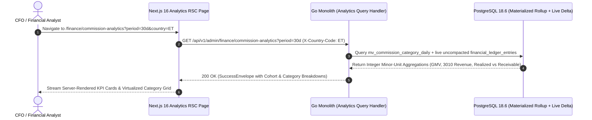

# Platform Commission Revenue Analytics & Take-Rate Intelligence Console
## Admin Subsystem Specification — `docs/admin/finance-ledger/05-platform-commission-analytics.md`

**Document Identifier:** `SPEC-ADM-FIN-05`  
**Classification:** Canonical Subsystem UI/UX & Technical Behavior Specification  
**Governing Documents:** `Dink_Machinery_UI_UX_Design_Brief.md`, `SRS-DINK-CORE-V7.0` (§5.9 `CW-01`..`CW-10`, §7.9 `REQ-07-09`, §5.11), `docs/components/admin/DESIGN.md`, `docs/shared/design/design-tokens.json`, `docs/ERROR_CATALOG.md`, `contracts/openapi.yaml`, `ADR-010`  
**Target Subsystem:** Next.js 16 Web Admin Console (`admin/src/app/(dashboard)/finance/commission-analytics/`)  
**Primary Persona / Actor:** Chief Financial Officer, Financial Controller (*Solomon Kassa*), Executive Management  
**Associated Requirements:** `REQ-05-09` (`CW-01`..`CW-10`), `REQ-07-09`, `REQ-05-11` (`AD-06-BE`), `ADR-010`  
**Associated Interaction Flows:** `FLOW-11` (Commission Deduction & Revenue Recognition), `FLOW-12` (Admin Dynamic UI Engine)  
**Status:** Approved Technical Design Baseline

---

## 1. Executive Summary & Architectural Invariants

The **Platform Commission Revenue Analytics & Take-Rate Intelligence Console** (`SPEC-ADM-FIN-05`) provides real-time financial visibility into Dink Machinery's marketplace unit economics across Ethiopia (`ET`) and Kenya (`KE`). Because Phase 1 operates on a **Pre-Funded `OwnerWallet` Commission Model (`CW-01`..`CW-10`)** where Owners can dip into a temporary negative balance down to `-5,000.00 ETB` (`-500,000 Santims`), executive financial reporting must strictly separate **Cash-Realized Commission Revenue** (backed by positive `OwnerWallet` balances) from **Accrued Negative-Wallet Commission Receivables** (uncollected commission debt owed by Owners whose wallets are between `0` and `-500,000 Santims`).

### 1.1 Revenue Recognition & Take-Rate Formulas (`CW-01`, `REQ-07-09`)
1. **Gross Merchandise Value (`GMV_minor`):** Total confirmed rental value + lowbed logistics fees in integer minor units (`Santims` / `Cents`).
2. **Gross Commission Recognized (`Acct 3010`):** Standard `1000 bps` (`10.00%`) platform commission or negotiated corporate rate-card override (`REQ-06-03`):
   $$\text{commission\_minor} = \left\lfloor \frac{\text{rental\_subtotal\_minor} \times \text{commission\_bps} + 5000}{10000} \right\rfloor$$
3. **Cash-Realized vs. Receivable Split:**
   - **Cash-Realized Commission (`Realized_Minor`):** Portion of `3010` commission covered by pre-existing positive `OwnerWallet` funds at booking confirmation or subsequently settled via `CW-04` top-up.
   - **Accrued Negative-Wallet Receivable (`Receivable_Minor`):** Portion of `3010` commission that pushed an `OwnerWallet` below `0 Santims` (`balance_minor < 0`).
4. **Effective Take Rate (`bps`):**
   $$\text{Effective Take Rate (bps)} = \left\lfloor \frac{\text{Total Net Commission Minor} \times 10000}{\text{Total GMV Minor}} \right\rfloor$$

---

## 2. Screen Anatomy, Layout & Bespoke Desktop Wireframe

```text
+------------------------------------------------------------------------------------------------------------------------------------------+
| DINK ADMIN [ET: Ethiopia (ETB) v]  Finance & Ledger > Platform Commission & Take-Rate Analytics    [Period: Last 30 Days v] [Export CSV] |
+------------------------------------------------------------------------------------------------------------------------------------------+
| [Gross Booking GMV (ETB)]     | [Gross Commission (Acct 3010)]| [Cash-Realized Commission]    | [Accrued Negative-Wallet Receivables]    |
| 4,820,000,000 Santims         | 471,400,000 Santims (978 bps) | 448,900,000 Santims (95.2%)   | 22,500,000 Santims (4.8% At-Risk Debt)   |
| 48,200,000.00 ETB (+18.4% MoM)| 4,714,000.00 ETB              | 4,489,000.00 ETB Collected    | 225,000.00 ETB Across 64 Delinquent Wlts |
+------------------------------------------------------------------------------------------------------------------------------------------+
| COMMISSION REALIZATION & AGING WATERFALL                              | REGIONAL CORRIDOR COHORTS (ET vs KE)                             |
| +-------------------------------------------------------------------+ | +--------------------------------------------------------------+ |
| | Week 1 Oct: [████████████████████████████░░] 96.1% Cash Realized  | | | Corridor              | Bookings | GMV (Major)  | Take Rate  | |
| | Week 2 Oct: [███████████████████████████░░░] 94.8% Cash Realized  | | |-----------------------|----------|--------------|------------| |
| | Week 3 Oct: [████████████████████████████░░] 95.5% Cash Realized  | | | Addis Ababa Metro     |      312 | 24,100,000   |  1000 bps  | |
| | Week 4 Oct: [██████████████████████████░░░░] 93.9% Cash Realized  | | | Adama - Modjo Ind.    |      145 | 11,850,000   |   965 bps  | |
| +-------------------------------------------------------------------+ | | Hawassa Industrial    |       88 |  6,400,000   |   980 bps  | |
|                                                                       | | Mekelle Reconstruction|       64 |  5,850,000   |   920 bps  | |
|                                                                       | +--------------------------------------------------------------+ |
+------------------------------------------------------------------------------------------------------------------------------------------+
| CATEGORY TAKE-RATE & MARGIN BREAKDOWN (Virtualized 40dp Rows)                                                                            |
|------------------------------------------------------------------------------------------------------------------------------------------|
| Category Taxonomy         | Active Assets | Confirmed Bookings | Gross GMV (Minor)   | Commission (3010) | Realized % | Effective Rate   |
|---------------------------|---------------|--------------------|---------------------|-------------------|------------|------------------|
| >Earthmoving > Excavators |           284 |                248 | 2,150,000,000 ETB-m |   212,850,000 ETB |      96.4% |   990 bps (9.90%)|
|  Lifting > Mobile Cranes  |            92 |                 89 | 1,120,000,000 ETB-m |   112,000,000 ETB |      98.1% |  1000 bps (10.0%)|
|  Road > Motor Graders     |            76 |                 71 |   680,000,000 ETB-m |    65,280,000 ETB |      94.0% |   960 bps (9.60%)|
|  Logistics > Lowbed Trail.|           118 |                154 |   540,000,000 ETB-m |    51,300,000 ETB |      91.2% |   950 bps (9.50%)|
|  Compaction > Rollers     |           104 |                 47 |   330,000,000 ETB-m |    29,970,000 ETB |      93.8% |   908 bps (9.08%)|
+------------------------------------------------------------------------------------------------------------------------------------------+
```

---

## 3. W3C DTCG Design Token Mapping Table

| UI Component / Element | W3C Token Path (`design-tokens.json`) | Resolved Value (Light / Dark / Outdoor) | Behavioral & Accessibility Invariant |
|---|---|---|---|
| **KPI Metric Card Surface** | `semantic.light.surface.card` + `elevation.card` | `#FFFFFF` / `#1E293B` / `#000000` | `16dp` (`dimension.space.16`) interior inset; `1dp` `#E2E8F0` border. |
| **Cash-Realized Progress Bar** | `color.feedback.emerald.500` | `#10B981` fill | Visually distinguishes cash-backed commission from negative-wallet debt. |
| **At-Risk Receivable Segment** | `color.brand.amber.500` + `color.feedback.crimson.500` | `#F59E0B` (`0..-499k`) / `#EF4444` (`<=-500k`) | Clicking the At-Risk KPI drills directly into `/finance/wallet-lockouts` (`SPEC-ADM-FIN-06`). |
| **Take-Rate Basis Points Cell** | `typography.fontFamily.mono` + `typography.fontSize.14` | `Space Mono, monospace`, `14sp` | Displays exact integer basis points (`990 bps`) alongside percentage (`9.90%`). |

---

## 4. Interactive State Machine & Sequence Flows

### 4.1 Commission Realization & Cohort Aggregation Pipeline (`sequenceDiagram`)



---

## 5. Concrete Next.js 16 Implementation Blueprint

### 5.1 Dynamic UI Engine Configuration (`/api/v1/admin/ui-config?route=finance/commission-analytics`)

```json
{
  "tableId": "tbl_finance_commission_cohorts_v1",
  "title": "Category Take-Rate & Commission Realization Breakdown",
  "description": "Analyze GMV, recognized commission revenue (Account 3010), cash realization ratios, and effective basis point take rates.",
  "defaultSortField": "grossGmvMinor",
  "defaultSortDirection": "desc",
  "pageSize": 50,
  "columns": [
    { "id": "categoryPath", "header": "Category Taxonomy", "accessorKey": "categoryPath", "dataType": "text", "isSortable": true, "isFilterable": true },
    { "id": "activeAssets", "header": "Active Assets", "accessorKey": "activeAssetsCount", "dataType": "text", "align": "right", "isSortable": true, "isFilterable": false },
    { "id": "confirmedBookings", "header": "Confirmed Bookings", "accessorKey": "confirmedBookingsCount", "dataType": "text", "align": "right", "isSortable": true, "isFilterable": false },
    { "id": "grossGmv", "header": "Gross GMV", "accessorKey": "grossGmv", "dataType": "money", "align": "right", "isSortable": true, "isFilterable": false },
    { "id": "recognizedCommission", "header": "Commission (3010)", "accessorKey": "recognizedCommission", "dataType": "money", "align": "right", "isSortable": true, "isFilterable": false },
    { "id": "cashRealizedPct", "header": "Cash Realized %", "accessorKey": "cashRealizedPct", "dataType": "progress", "align": "right", "isSortable": true, "isFilterable": false },
    { "id": "effectiveTakeRateBps", "header": "Effective Take Rate", "accessorKey": "effectiveTakeRateLabel", "dataType": "badge", "align": "right", "isSortable": true, "isFilterable": false }
  ],
  "facets": [
    {
      "id": "period",
      "label": "Reporting Horizon",
      "type": "select",
      "options": [
        { "label": "Last 7 Days", "value": "7d" },
        { "label": "Last 30 Days", "value": "30d" },
        { "label": "Quarter to Date (QTD)", "value": "qtd" },
        { "label": "Ethiopian Fiscal Year (Hamle 1 - Sene 30)", "value": "efy" }
      ]
    }
  ],
  "rowActions": [],
  "bulkActions": []
}
```

### 5.2 React Server Component Data Loader (`admin/src/app/(dashboard)/finance/commission-analytics/page.tsx`)

```tsx
// admin/src/app/(dashboard)/finance/commission-analytics/page.tsx
import React from 'react';
import { cookies } from 'next/headers';
import { formatMinorUnits } from '@/lib/currency';
import { ProblemDetailsBanner } from '@/components/feedback/ProblemDetailsBanner';
import { CommissionCohortGrid } from './_components/CommissionCohortGrid';

export interface CommissionAnalyticsSummaryDTO {
  currency: 'ETB' | 'KES';
  grossGmvMinor: number;
  grossCommissionMinor: number;
  cashRealizedCommissionMinor: number;
  accruedReceivableCommissionMinor: number;
  delinquentWalletsCount: number;
  effectiveTakeRateBps: number;
  categories: Array<{
    categoryId: string;
    categoryPath: string;
    activeAssetsCount: number;
    confirmedBookingsCount: number;
    grossGmv: { amountMinor: number; currency: 'ETB' | 'KES' };
    recognizedCommission: { amountMinor: number; currency: 'ETB' | 'KES' };
    cashRealizedPct: number;
    effectiveTakeRateBps: number;
    effectiveTakeRateLabel: string;
  }>;
}

export default async function PlatformCommissionAnalyticsPage({
  searchParams,
}: {
  searchParams: Promise<{ period?: string }>;
}) {
  const params = await searchParams;
  const period = params.period ?? '30d';
  const cookieStore = await cookies();
  const sessionToken = cookieStore.get('dink_admin_session')?.value ?? '';
  const countryCode = cookieStore.get('dink_admin_country')?.value ?? 'ET';

  const headers = {
    Authorization: `Bearer ${sessionToken}`,
    'X-Country-Code': countryCode,
  };

  const [uiConfigRes, analyticsRes] = await Promise.all([
    fetch(`${process.env.INTERNAL_BACKEND_URL}/api/v1/admin/ui-config?route=finance/commission-analytics`, {
      headers,
      next: { revalidate: 300 },
    }),
    fetch(`${process.env.INTERNAL_BACKEND_URL}/api/v1/admin/finance/commission-analytics?period=${period}`, {
      headers,
      cache: 'no-store',
    }),
  ]);

  if (!uiConfigRes.ok || !analyticsRes.ok) {
    const err = await (uiConfigRes.ok ? analyticsRes : uiConfigRes).json();
    return <ProblemDetailsBanner problem={err.error} />;
  }

  const uiConfig = (await uiConfigRes.json()).data;
  const summary: CommissionAnalyticsSummaryDTO = (await analyticsRes.json()).data;

  return (
    <main className="flex h-[calc(100vh-64px)] flex-col gap-6 overflow-y-auto p-6 bg-slate-50 dark:bg-slate-900">
      <section aria-label="Commission Revenue Key Performance Indicators" className="grid grid-cols-4 gap-4">
        <div className="rounded-lg border border-slate-200 bg-white p-4 shadow-sm dark:border-slate-700 dark:bg-slate-800">
          <p className="text-xs font-semibold uppercase text-slate-500">Gross Booking GMV</p>
          <p className="mt-1 font-mono text-xl font-bold text-slate-950 dark:text-slate-50">
            {formatMinorUnits(summary.grossGmvMinor, summary.currency)}
          </p>
          <p className="mt-1 font-mono text-xs text-slate-500">{summary.grossGmvMinor.toLocaleString()} Minor Units</p>
        </div>

        <div className="rounded-lg border border-slate-200 bg-white p-4 shadow-sm dark:border-slate-700 dark:bg-slate-800">
          <p className="text-xs font-semibold uppercase text-slate-500">Gross Commission (Acct 3010)</p>
          <p className="mt-1 font-mono text-xl font-bold text-slate-950 dark:text-slate-50">
            {formatMinorUnits(summary.grossCommissionMinor, summary.currency)}
          </p>
          <p className="mt-1 font-mono text-xs text-amber-700 dark:text-amber-400">
            Effective Rate: {summary.effectiveTakeRateBps} bps ({(summary.effectiveTakeRateBps / 100).toFixed(2)}%)
          </p>
        </div>

        <div className="rounded-lg border border-emerald-200 bg-emerald-50/50 p-4 shadow-sm dark:border-emerald-800 dark:bg-emerald-950/40">
          <p className="text-xs font-semibold uppercase text-emerald-800 dark:text-emerald-300">Cash-Realized Commission</p>
          <p className="mt-1 font-mono text-xl font-bold text-emerald-950 dark:text-emerald-100">
            {formatMinorUnits(summary.cashRealizedCommissionMinor, summary.currency)}
          </p>
          <p className="mt-1 font-mono text-xs text-emerald-700 dark:text-emerald-400">
            Backed by Pre-Funded Owner Wallets
          </p>
        </div>

        <div className="rounded-lg border border-amber-300 bg-amber-50/60 p-4 shadow-sm dark:border-amber-700 dark:bg-amber-950/40">
          <p className="text-xs font-semibold uppercase text-amber-900 dark:text-amber-300">Accrued Negative-Wallet Debt</p>
          <p className="mt-1 font-mono text-xl font-bold text-amber-950 dark:text-amber-100">
            {formatMinorUnits(summary.accruedReceivableCommissionMinor, summary.currency)}
          </p>
          <p className="mt-1 font-mono text-xs text-amber-800 dark:text-amber-400">
            Across {summary.delinquentWalletsCount} Delinquent Owner Wallets
          </p>
        </div>
      </section>

      <CommissionCohortGrid config={uiConfig} rows={summary.categories} />
    </main>
  );
}
```

---

## 6. OpenAPI 3.1.0 Contract & RFC 9457 Error Matrix

| HTTP Method & Route | Operation ID | Required RBAC Permission | Description |
|---|---|---|---|
| `GET /api/v1/admin/finance/commission-analytics` | `getCommissionAnalytics` | `finance.analytics.read` | Returns GMV, Account `3010` recognized commission, cash-realized vs negative-wallet receivable split, and category/corridor cohorts. |
| `POST /api/v1/admin/finance/commission-analytics:export` | `exportCommissionReport` | `finance.analytics.export` | Generates a signed CSV report of category and regional commission cohorts. |

| Error Code | HTTP Status | RFC 9457 Type URI | Trigger Condition |
|---|---|---|---|
| `REQ_INVALID_COUNTRY_CODE` | `400 Bad Request` | `https://api.dinkmachinery.com/errors/invalid-country-code` | `X-Country-Code` header missing or invalid. |
| `AUTH_INSUFFICIENT_PERMISSIONS` | `403 Forbidden` | `https://api.dinkmachinery.com/errors/insufficient-permissions` | Principal lacks `finance.analytics.read` scope. |

---

## 7. Verification & Acceptance Criteria Checklist

- [ ] **Realized vs. Receivable Identity Check:** Verify that `cashRealizedCommissionMinor + accruedReceivableCommissionMinor === grossCommissionMinor` across all reporting horizons (`7d`, `30d`, `qtd`, `efy`).
- [ ] **Jurisdictional Isolation (`ETB` vs `KES`):** Switching the top navbar country selector from `ET` to `KE` reloads `/api/v1/admin/finance/commission-analytics` with `X-Country-Code: KE` and never mixes `ETB` and `KES` minor units in a single sum.
