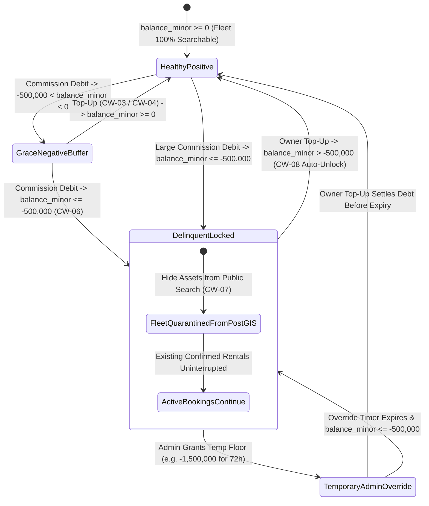

# Owner Wallet Health Monitor, Negative Balance Grace Limit & Credit Lockout Console
## Admin Subsystem Specification — `docs/admin/finance-ledger/06-owner-wallet-topup-credit-lockout.md`

**Document Identifier:** `SPEC-ADM-FIN-06`  
**Classification:** Canonical Subsystem UI/UX & Technical Behavior Specification  
**Governing Documents:** `Dink_Machinery_UI_UX_Design_Brief.md`, `SRS-DINK-CORE-V7.0` (§5.9 `CW-03`..`CW-09`, §5.11), `docs/components/admin/DESIGN.md`, `docs/shared/design/design-tokens.json`, `docs/ERROR_CATALOG.md`, `contracts/openapi.yaml`, `ADR-010`  
**Target Subsystem:** Next.js 16 Web Admin Console (`admin/src/app/(dashboard)/finance/wallet-lockouts/`)  
**Primary Persona / Actor:** Financial Controller (*Solomon Kassa*), Super Administrator (*Rahel Tadesse*)  
**Associated Requirements:** `REQ-05-09` (`CW-03`..`CW-09`), `REQ-05-11` (`AD-06-BE`), `ADR-010`  
**Associated Interaction Flows:** `FLOW-11` (Commission Debt Lockout & Restoration), `FLOW-12` (Admin Dynamic UI Engine)  
**Status:** Approved Technical Design Baseline

---

## 1. Executive Summary & Architectural Invariants

The **Owner Wallet Health Monitor, Negative Balance Grace Limit & Credit Lockout Console** (`SPEC-ADM-FIN-06`) is the operational enforcement center for `SRS-DINK-CORE-V7.0` **Section 05.09 (`CW-03`..`CW-09`)**. Because Phase 1 Renter-to-Owner booking payments flow directly between Renter and Owner via bank wire or mobile money, Dink Machinery collects its 10% platform commission (`1000 bps`) by debiting the Owner's pre-funded **`OwnerWallet`** (`Account 2010`) at the moment a booking transitions to `CONFIRMED` (`CW-01`).

### 1.1 The `-5,000.00 ETB` (`-500,000 Santims`) Grace Limit & Automated Fleet Quarantine
1. **Grace Overdraft Buffer (`CW-05`, `CW-06`):** To prevent a single high-value booking from failing mid-confirmation when an Owner's wallet has a modest positive balance, each `OwnerWallet` is granted a configurable negative balance grace floor defined in `country_configs.wallet_credit_limit_minor`:
   - **Ethiopia (`ET`):** `-500,000 Santims` (`-5,000.00 ETB`)
   - **Kenya (`KE`):** `-650,000 Cents` (`-6,500.00 KES`)
2. **Automated Fleet Quarantine & Delisting (`CW-07`):** The instant a commission debit pushes `owner_wallets.balance_minor <= wallet_credit_limit_minor` (e.g., `<= -500,000 Santims`):
   - `owner_wallets.is_delinquent_locked` transitions atomically to `TRUE`.
   - All machinery assets owned by that `owner_id` are excluded from public PostGIS spatial search queries (`GET /api/v1/fleets/search`) and blocked from accepting new booking requests (`CW-07`), while any **already-confirmed active rentals proceed uninterrupted** so renters are never stranded on-site.
3. **Instant Automated Restoration (`CW-08`):** When an Owner tops up via Telebirr/M-Pesa (`CW-03`) or has a bank slip reconciled (`CW-04`) such that `balance_minor > wallet_credit_limit_minor`, the system automatically sets `is_delinquent_locked = FALSE` and restores PostGIS search visibility within `< 5 seconds`.
4. **Emergency Administrative Temporary Credit Override (`CW-09`):** A `FINANCE_CONTROLLER` or `SUPER_ADMIN` can grant a time-bounded **Temporary Overdraft Floor Override** (e.g., expanding the floor from `-5,000.00 ETB` to `-25,000.00 ETB` for 72 hours while an Enterprise Owner's RTGS transfer clears), requiring a mandatory audit justification and Four-Eyes co-signature if the override exceeds `-100,000.00 ETB` (`-10,000,000 Santims`).

---

## 2. Screen Anatomy, Layout & Bespoke Desktop Wireframe

```text
+------------------------------------------------------------------------------------------------------------------------------------------+
| DINK ADMIN [ET: Ethiopia (ETB) v]  Finance & Ledger > Owner Wallet Health & Credit Lockouts      [Default Grace Limit: -5,000.00 ETB]   |
+------------------------------------------------------------------------------------------------------------------------------------------+
| [Healthy Positive Wallets]    | [In Grace Buffer (0..-4,999)] | [LOCKED: Breached <= -5,000]  | [Active Admin Credit Overrides]          |
| 1,184 Owners                  | 46 Owners (-11.4M Santims)    | 18 Owners (-11.1M Santims)    | 4 Enterprise Owners (Temp 72h Floor)     |
| 100% Search Visible           | Warning SMS Sent (CW-05)      | 74 Machines Quarantined CW-07 | Expiring Within 24h: 2 Overrides         |
+------------------------------------------------------------------------------------------------------------------------------------------+
| Filter: [Health: ALL | LOCKED <= -5,000 ETB (18) | Grace Warning (46) | Override Active (4)] [Search Owner / TIN / Phone: _____________] |
+------------------------------------------------------------------------------------------------------------------------------------------+
| OWNER WALLET HEALTH REGISTER (Virtualized 40dp Rows)                  | WALLET CREDIT & QUARANTINE INSPECTOR (WLT-01HJ8821)              |
|-----------------------------------------------------------------------|------------------------------------------------------------------|
| Wallet ID  | Owner Business      | Balance Minor | Floor Minor| State | Owner Entity:     Abyssinia Heavy Earthmovers PLC (TIN: ****4821)|
|------------|---------------------|---------------|------------|-------| Current Balance:  -645,000 Santims (-6,450.00 ETB) [BREACHED]    |
| >WLT-8821  | Abyssinia Earthmov. |   -645,000 ETB|  -500,000  | LOCKED| Effective Floor:  -500,000 Santims (-5,000.00 ETB)               |
|  WLT-8819  | Bole Crane Rentals  |   -520,000 ETB|  -500,000  | LOCKED| Deficit to Cure:  +145,001 Santims (+1,450.01 ETB Min Top-Up)    |
|  WLT-8804  | Awash Lowbed Trans. |   -410,000 ETB|  -500,000  | GRACE | Fleet Quarantine: 6 of 6 Machines Hidden from PostGIS Search     |
|  WLT-8790  | Tekeze Excavators   | -1,800,000 ETB| -2,500,000 | OVERRD| Active Rentals:   1 Machine in ACTIVE_OPERATION (Uninterrupted)  |
|  WLT-8772  | Habesha Graders PLC | +4,250,000 ETB|  -500,000  | HEALTH|------------------------------------------------------------------|
|            |                     |               |            |       | RECENT WALLET LEDGER LEGS (Account 2010_OWNER_WALLET)            |
|            |                     |               |            |       | 29-Oct 09:12 | BKG-88412 Comm (10%) | DR -280,000 | Bal -645,000 |
|            |                     |               |            |       | 27-Oct 14:40 | BKG-88109 Comm (10%) | DR -365,000 | Bal -365,000 |
|            |                     |               |            |       |------------------------------------------------------------------|
|            |                     |               |            |       | GRANT TEMPORARY CREDIT FLOOR OVERRIDE (CW-09)                    |
|            |                     |               |            |       | New Temporary Floor (ETB): [-15,000.00] (-1,500,000 Santims)     |
|            |                     |               |            |       | Override Expiry Window:    [72 Hours (Expires 01-Nov 13:20 UTC)] |
|            |                     |               |            |       | Audit Justification:       [CBE RTGS slip SLIP-9K82 in queue___] |
|-----------------------------------------------------------------------|------------------------------------------------------------------|
| Showing 1-50 of 1,252 | Cursor: cur_wlt_8772 | [Prev] [Next]          | [Grant Temporary Override & Restore Fleet] [Send Dunning SMS]    |
+------------------------------------------------------------------------------------------------------------------------------------------+
```

---

## 3. W3C DTCG Design Token Mapping Table

| UI Component / Element | W3C Token Path (`design-tokens.json`) | Resolved Value (Light / Dark / Outdoor) | Behavioral & Accessibility Invariant |
|---|---|---|---|
| **LOCKED Breached Badge (`CW-07`)** | `color.feedback.crimson.100` + `color.feedback.crimson.700` | `#FEE2E2` bg, `#B91C1C` text, `Lock` icon | High-priority visual indicator paired with explicit `LOCKED` text. |
| **GRACE Buffer Warning Badge (`CW-05`)** | `color.brand.amber.100` + `color.brand.amber.900` | `#FEF3C7` bg, `#78350F` text, `AlertTriangle` icon | Indicates `balance_minor < 0` but `> wallet_credit_limit_minor`. |
| **OVERRIDE Active Badge (`CW-09`)** | `color.feedback.purple.100` + `color.feedback.purple.900` | `#F3E8FF` bg, `#581C87` text, `ShieldAlert` icon | Displays countdown until temporary overdraft override expires. |
| **Balance Minor Figure** | `typography.fontFamily.mono` + `typography.fontSize.14` | `Space Mono, monospace`, `14sp` | Negative balances rendered in `#B91C1C` with explicit `-` sign; positive in `#047857`. |

---

## 4. Interactive State Machine & Sequence Flows

### 4.1 `OwnerWallet` Credit & Quarantine State Machine (`stateDiagram-v2`)



---

## 5. Concrete Next.js 16 Implementation Blueprint

### 5.1 Dynamic UI Engine Configuration (`/api/v1/admin/ui-config?route=finance/wallet-lockouts`)

```json
{
  "tableId": "tbl_finance_owner_wallet_lockouts_v1",
  "title": "Owner Wallet Health & Credit Lockout Monitor",
  "description": "Monitor OwnerWallet balances against the -5,000.00 ETB (-500,000 Santims) grace floor, quarantined fleets, and temporary overrides.",
  "defaultSortField": "balanceMinor",
  "defaultSortDirection": "asc",
  "pageSize": 50,
  "columns": [
    { "id": "walletCode", "header": "Wallet ID", "accessorKey": "walletCode", "dataType": "text", "isSortable": true, "isFilterable": true },
    { "id": "ownerName", "header": "Owner Entity", "accessorKey": "ownerBusinessName", "dataType": "text", "isSortable": true, "isFilterable": true },
    { "id": "balance", "header": "Current Balance", "accessorKey": "currentBalance", "dataType": "money", "align": "right", "isSortable": true, "isFilterable": false },
    { "id": "creditFloor", "header": "Effective Floor", "accessorKey": "effectiveCreditFloor", "dataType": "money", "align": "right", "isSortable": true, "isFilterable": false },
    { "id": "quarantinedCount", "header": "Quarantined Machines", "accessorKey": "quarantinedMachinesCount", "dataType": "text", "align": "center", "isSortable": true, "isFilterable": false },
    { "id": "healthState", "header": "Wallet Status", "accessorKey": "healthState", "dataType": "badge", "isSortable": true, "isFilterable": true,
      "badgeVariants": { "HEALTHY_POSITIVE": "success", "GRACE_BUFFER": "warning", "DELINQUENT_LOCKED": "destructive", "ADMIN_OVERRIDE_ACTIVE": "outline" }
    }
  ],
  "facets": [
    {
      "id": "healthState",
      "label": "Wallet Health Status",
      "type": "select",
      "options": [
        { "label": "Delinquent Locked (<= -5,000 ETB)", "value": "DELINQUENT_LOCKED" },
        { "label": "In Negative Grace Buffer (0 to -4,999 ETB)", "value": "GRACE_BUFFER" },
        { "label": "Temporary Admin Override Active", "value": "ADMIN_OVERRIDE_ACTIVE" },
        { "label": "Healthy Positive (>= 0 ETB)", "value": "HEALTHY_POSITIVE" }
      ]
    }
  ],
  "rowActions": [
    {
      "id": "grant_credit_override",
      "label": "Grant Temp Credit Override",
      "variant": "default",
      "requiredPermission": "finance.credit.override",
      "endpoint": "/api/v1/admin/finance/owner-wallets/{id}:override-credit-limit",
      "method": "POST"
    },
    {
      "id": "send_dunning_notice",
      "label": "Send Top-Up Reminder SMS",
      "variant": "outline",
      "requiredPermission": "finance.wallet.notify",
      "endpoint": "/api/v1/admin/finance/owner-wallets/{id}:send-dunning",
      "method": "POST"
    }
  ],
  "bulkActions": []
}
```

### 5.2 Server Action for Temporary Credit Floor Override (`admin/src/app/(dashboard)/finance/wallet-lockouts/actions.ts`)

```typescript
// admin/src/app/(dashboard)/finance/wallet-lockouts/actions.ts
'use server';

import { revalidatePath } from 'next/cache';
import { cookies } from 'next/headers';
import { z } from 'zod';
import { ProblemDetails } from '@/types/dynamic-ui';

const OverrideWalletCreditLimitSchema = z.object({
  walletId: z.string().uuid('Invalid OwnerWallet UUID.'),
  version: z.coerce.number().int().positive(),
  temporaryCreditLimitMinor: z.coerce
    .bigint()
    .refine((val) => val < 0n && val >= -50000000n, 'Temporary floor must be negative and not exceed -500,000.00 ETB.'),
  currency: z.enum(['ETB', 'KES']),
  durationHours: z.coerce.number().int().min(12).max(168, 'Override duration cannot exceed 168 hours (7 days).'),
  auditJustification: z.string().trim().min(15, 'Audit justification requires at least 15 characters.').max(1000),
  fourEyesCoSignerOtp: z.string().regex(/^\d{6}$/).optional(),
});

export async function overrideWalletCreditLimitAction(formData: FormData): Promise<{
  success: boolean;
  restoredFleetCount?: number;
  expiresAt?: string;
  problem?: ProblemDetails;
}> {
  const parsed = OverrideWalletCreditLimitSchema.safeParse({
    walletId: formData.get('walletId'),
    version: formData.get('version'),
    temporaryCreditLimitMinor: formData.get('temporaryCreditLimitMinor'),
    currency: formData.get('currency'),
    durationHours: formData.get('durationHours'),
    auditJustification: formData.get('auditJustification'),
    fourEyesCoSignerOtp: formData.get('fourEyesCoSignerOtp') || undefined,
  });

  if (!parsed.success) {
    return {
      success: false,
      problem: {
        type: 'https://api.dinkmachinery.com/errors/request-validation-failed',
        title: 'Credit Limit Override Validation Failed',
        status: 400,
        detail: 'Invalid temporary credit floor parameters.',
        code: 'REQ_VALIDATION_FAILED',
        invalidParams: parsed.error.issues.map((i) => ({ name: i.path.join('.'), reason: i.message })),
      },
    };
  }

  const cookieStore = await cookies();
  const sessionToken = cookieStore.get('dink_admin_session')?.value;
  const countryCode = cookieStore.get('dink_admin_country')?.value ?? 'ET';

  const res = await fetch(
    `${process.env.INTERNAL_BACKEND_URL}/api/v1/admin/finance/owner-wallets/${parsed.data.walletId}:override-credit-limit`,
    {
      method: 'POST',
      headers: {
        'Content-Type': 'application/json',
        Authorization: `Bearer ${sessionToken}`,
        'X-Country-Code': countryCode,
        'Idempotency-Key': crypto.randomUUID(),
      },
      body: JSON.stringify({
        version: parsed.data.version,
        temporaryCreditLimitMinor: Number(parsed.data.temporaryCreditLimitMinor),
        currency: parsed.data.currency,
        durationHours: parsed.data.durationHours,
        auditJustification: parsed.data.auditJustification,
        fourEyesCoSignerOtp: parsed.data.fourEyesCoSignerOtp,
      }),
    }
  );

  const payload = await res.json();
  if (!res.ok) {
    return { success: false, problem: payload.error as ProblemDetails };
  }

  revalidatePath('/finance/wallet-lockouts');
  return {
    success: true,
    restoredFleetCount: payload.data.restoredFleetCount,
    expiresAt: payload.data.expiresAt,
  };
}
```

---

## 6. OpenAPI 3.1.0 Contract & RFC 9457 Error Matrix

| HTTP Method & Route | Operation ID | Required RBAC Permission | Idempotency-Key | Description |
|---|---|---|---|---|
| `GET /api/v1/admin/finance/owner-wallets` | `listOwnerWallets` | `finance.wallet.read` | No | Cursor-paginated list of `OwnerWallet` entities with balance, floor, and quarantine counts. |
| `POST /api/v1/admin/finance/owner-wallets/{id}:override-credit-limit` | `overrideWalletCreditLimit` | `finance.credit.override` | Yes (UUID v4) | Grants a time-bounded negative balance floor expansion and restores quarantined machines to PostGIS search. |
| `POST /api/v1/admin/finance/owner-wallets/{id}:send-dunning` | `sendWalletDunningNotice` | `finance.wallet.notify` | Yes (UUID v4) | Triggers localized SMS/Push top-up reminder (`am`, `om`, `en`, `sw`). |

| Error Code | HTTP Status | RFC 9457 Type URI | Trigger Condition & Operational Recovery |
|---|---|---|---|
| `ADMIN_UNAUTHORIZED_OVERRIDE` | `403 Forbidden` | `https://api.dinkmachinery.com/errors/admin-unauthorized-override` | Temporary credit floor exceeds `-10,000,000 Santims` (`-100,000.00 ETB`) without Four-Eyes Super Admin co-signature. |
| `WALLET_LOCKED_PENDING_AUDIT` | `423 Locked` | `https://api.dinkmachinery.com/errors/wallet-locked-pending-audit` | Wallet is locked due to a fraud/compliance investigation (`COMPLIANCE_OFFICER` hold); credit override cannot bypass a fraud hold. |

---

## 7. Verification & Acceptance Criteria Checklist

- [ ] **Automated Lockout at `-500,000 Santims` (`CW-06`, `CW-07`):** When a booking confirmation deducts commission such that `balance_minor <= -500000`, `is_delinquent_locked` flips to `true` in the same database transaction and the Owner's machinery disappears from public search while active bookings remain `ACTIVE_OPERATION`.
- [ ] **Time-Bounded Override Expiration:** When a 72-hour temporary credit override expires and `balance_minor` is still `<= -500000`, the background scheduler re-locks the wallet and re-quarantines the fleet automatically.
