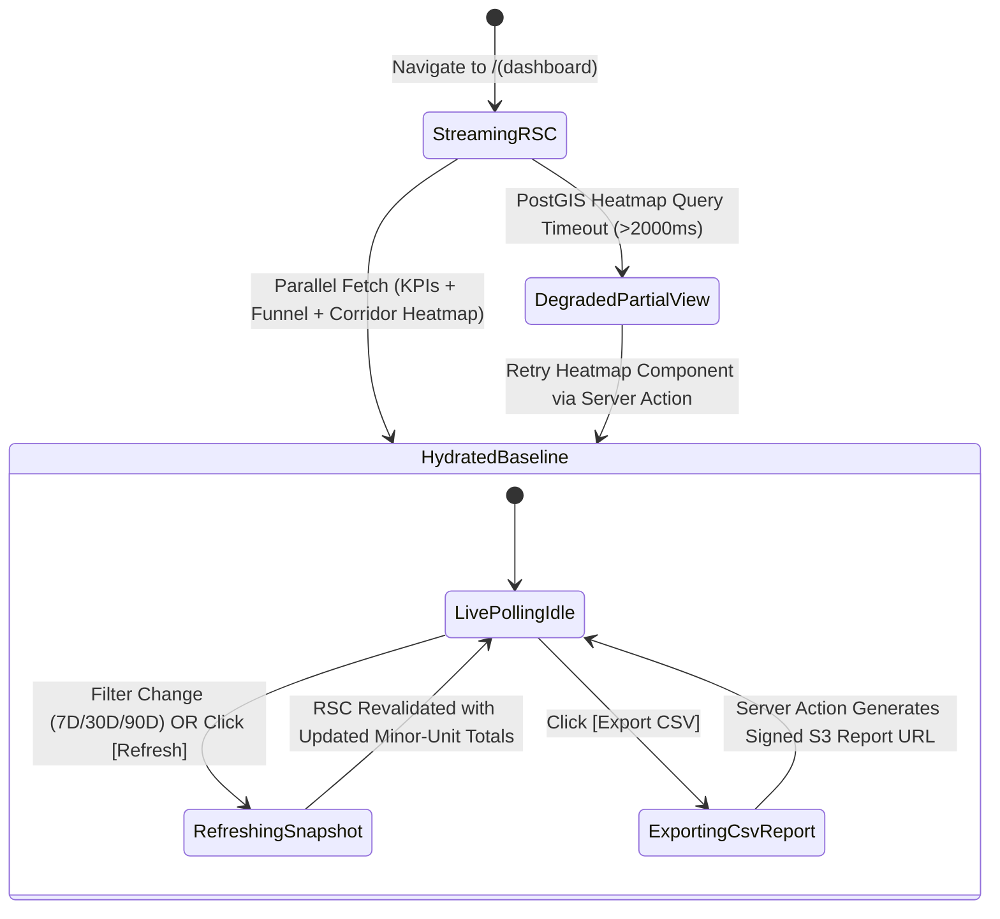
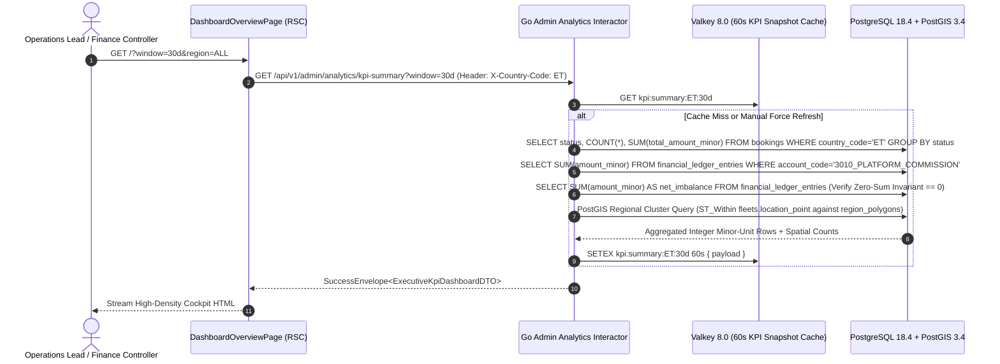

# Executive KPI Cockpit, Fleet Utilization & GMV Ledger Telemetry
## Admin Subsystem Specification — `docs/admin/operations-queues/01-executive-kpi-dashboard.md`

**Document Identifier:** `SPEC-ADM-OPS-01`  
**Classification:** Canonical Subsystem UI/UX & Technical Behavior Specification  
**Governing Documents:** `Dink_Machinery_UI_UX_Design_Brief.md`, `SRS-DINK-CORE-V7.0`, `docs/components/admin/DESIGN.md`, `contracts/openapi.yaml`  
**Target Subsystem:** Next.js 16 Web Admin Console (`admin/src/app/(dashboard)/page.tsx`)  
**Primary Persona / Actor:** `SUPER_ADMIN`, Executive Management, Platform Operations Lead, `FINANCE_CONTROLLER`  
**Associated Requirements:** `AD-01`, `AD-06`, `REQ-05-11`, `REQ-07-09`, `BK-17-BE`  
**Associated Interaction Flows:** `FLOW-12` (Executive Operational Cockpit & Live Queue Telemetry)  
**Associated ADRs:** `ADR-005` (Double-Entry Financial Ledger & Minor-Unit Math), `ADR-008` (Server-Driven UI Engine)  
**Status:** Approved Technical Design Baseline

---

## 1. Domain Context, Business Rules & Architectural Invariants

The **Executive KPI Cockpit, Fleet Utilization & GMV Ledger Telemetry** (`SPEC-ADM-OPS-01`) is the landing workspace (`src/app/(dashboard)/page.tsx`) of the Next.js 16 Admin Web Console. It synthesizes real-time marketplace health across Ethiopia (`ET`) and Kenya (`KE`): active rental states, Gross Merchandise Value (GMV) and platform commission volume in integer minor units, urgent SLA breach countdowns, and a PostGIS-backed regional fleet utilization heatmap.

### 1.1 Core Business Rules & Operational Mandates
1. **Integer Minor-Unit Financial Aggregation (`ADR-005`, `BK-17-BE`):**
   - All financial KPIs—30-Day Gross Merchandise Value (`gmvAmountMinor`), Earned Platform Commission (`commissionRevenueMinor`), Withholding Tax / VAT Liability (`taxCollectedMinor`), and Aggregate Pre-Funded Owner Wallet Liquidity (`ownerWalletFloatMinor`)—are computed directly from immutable `financial_ledger_entries` and `owner_wallets` tables in 64-bit integer minor units (Santims for `ETB`, Cents for `KES`).
   - Floating-point division or aggregation in SQL or JavaScript is strictly prohibited; client display uses `formatMinorUnits(amountMinor, currency)` with `BigInt` arithmetic.
2. **Live 20-State Booking Distribution Funnel (`AD-01`):**
   - Displays the real-time count and minor-unit value of reservations across critical operational buckets:
     - `HOLD_PENDING` (Active 60-minute Valkey reservation holds awaiting payment evidence)
     - `PAYMENT_EVIDENCE_UPLOADED` (Awaiting Fleet Owner bank slip confirmation)
     - `AWAITING_FLEET_READINESS` / `READY_FOR_PICKUP` (Mobilization & lowboy dispatch corridor)
     - `ACTIVE` / `EXTENSION_REQUESTED` (Machinery actively operating on construction sites with 30s GPS telematics)
     - `DISPUTE_OPENED` / `DISPUTED_HOUR_METER` / `DAMAGE_PARTIAL_RESOLVED` (In active arbitration)
3. **SLA Breach & Escalation Alert Strip:**
   - Surfaces immediate one-click triage cards for:
     - **Overdue Disputes:** Open disputes approaching or exceeding the **72-hour (3-day) SLA deadline** (`dispute_deadline - NOW() < 4 hours`).
     - **Logistics Reverse Cascade Alerts:** Main machinery bookings where `logistics_failed == TRUE` due to a carrier cancellation, requiring re-dispatch within $\min(24\text{h}, \text{StartTime})$.
     - **Insurance & Libre Expirations:** Active fleets within **7 days** of policy expiry facing automatic quarantine.
4. **PostGIS Regional Utilization & Demand Heatmap (`REQ-07-09`):**
   - Aggregates active machinery leases vs available verified inventory (`fleets.status = 'AVAILABLE'`) across regional corridors (e.g., Addis Ababa / Sheger, Adama-Hawassa Industrial Corridor, Dire Dawa, Nairobi Metropolitan, Mombasa Port Corridor) alongside unfulfilled spatial radius search density (`geo_search_logs`) to highlight supply shortages.

---

## 2. Screen Anatomy, Layout & Component Hierarchy

### 2.1 High-Density Executive KPI Cockpit Wireframe (`1920x1080` Desktop)

```text
+------------------------------------------------------------------------------------------------------------------------------------------+
| EXECUTIVE OPERATIONAL COCKPIT — ETHIOPIA (ETB)                [Period: Last 30D v] [Corridor: All Regions v] [↻ Refresh] [⬇ Export CSV] |
+------------------------------------------------------------------------------------------------------------------------------------------+
| [🚨 CRITICAL SLA ESCALATION BANNER]                                                                                                      |
|  • 2 Contested Damage Disputes < 4h to 72h SLA Breach (#DSP-9042, #DSP-9088)                                      [Triage Disputes ->]   |
|  • 3 Lowboy Carrier Cancellations (`logistics_failed = TRUE`) awaiting emergency re-dispatch                      [Open Dispatch   ->]   |
+------------------------------------------------------------------------------------------------------------------------------------------+
| +-------------------------------+ +-------------------------------+ +-------------------------------+ +-------------------------------+  |
| | 30D GROSS MERCHANDISE VALUE   | | PLATFORM COMMISSION (EARNED)  | | ACTIVE ON-SITE RENTALS        | | FLEET UTILIZATION RATE        |  |
| | 48,920,500.00 ETB             | | 4,892,050.00 ETB              | | 142 Machines                  | | 68.4% (312 / 456 Active)      |  |
| | `4892050000` Santims          | | `489205000` Santims (1000 bps)| | 128 GPS Live | 14 Mobilizing  | | +6.2% vs Prior 30D            |  |
| | [▲ +14.8% vs Prior 30D]       | | Ledger Balanced: 0 Imbalance  | | 19 Hold Pending (60m Window)  | | Top Shortage: 30T Excavators  |  |
| +-------------------------------+ +-------------------------------+ +-------------------------------+ +-------------------------------+  |
+------------------------------------------------------------------------------------------------------------------------------------------+
| LIVE 20-STATE BOOKING PIPELINE FUNNEL                             | POSTGIS REGIONAL UTILIZATION & SUPPLY/DEMAND CORRIDOR HEATMAP        |
| +---------------------------------------------------------------+ | +------------------------------------------------------------------+ |
| | State Bucket                     | Count | Volume (ETB)       | | | Region / Corridor        | Avail | Rented | Util % | Search Gap  | |
| |----------------------------------+-------+--------------------| | |--------------------------+-------+--------+--------+-------------| |
| | ● HOLD_PENDING (60m Valkey Lock) |    19 |   2,140,000.00 ETB | | | Addis Ababa & Sheger     |    64 |    158 |  71.2% | [HIGH: Dozer| |
| | ● PAYMENT_EVIDENCE_UPLOADED      |    11 |   1,485,000.00 ETB | | | Adama-Hawassa Industrial |    28 |     74 |  72.5% | [MED: Crane]| |
| | ● CONFIRMED / MOBILIZING         |    14 |   3,220,000.00 ETB | | | Dire Dawa / Djibouti Hwy |    19 |     42 |  68.8% | [HIGH: Lowby| |
| | ● ACTIVE (Job Site Operation)    |   142 |  38,450,000.00 ETB | | | Bahir Dar / Amhara       |    18 |     22 |  55.0% | [BALANCED]  | |
| | ● RETURN_INITIATED / FINAL DUE   |     9 |   1,980,500.00 ETB | | | Mekelle / Tigray         |    15 |     16 |  51.6% | [LOW: Grader| |
| | ● DISPUTE_OPENED / HOUR CONFLICT |     5 |   1,645,000.00 ETB | | +------------------------------------------------------------------+ |
| +---------------------------------------------------------------+ | [🗺 Toggle Interactive PostGIS Cluster Map (128 Live GPS Streams)]   |
+------------------------------------------------------------------------------------------------------------------------------------------+
| BACK-OFFICE COMPLIANCE & VERIFICATION QUEUE BACKLOG                                                                                      |
| +-------------------+ +-------------------+ +-------------------+ +-------------------+ +-------------------+ +-----------------------+  |
| | Individual KYC    | | Business KYB/TIN  | | Fleet Approval    | | Operator Certs    | | Integrity / Abuse | | Insurance Expiring <7d|  |
| | 14 Pending        | | 6 Pending         | | 23 Pending        | | 9 Pending         | | 4 High-Risk       | | 8 Auto-Quarantined    |  |
| | Oldest: 1h 42m    | | Oldest: 3h 15m    | | Oldest: 4h 05m    | | Oldest: 2h 10m    | | 2 Dup Bank Slips  | | 3 Active Leases Alert |  |
| | [Open Queue ->]   | | [Open Queue ->]   | | [Open Queue ->]   | | [Open Queue ->]   | | [Open Triage ->]  | | [Open Monitor ->]     |  |
| +-------------------+ +-------------------+ +-------------------+ +-------------------+ +-------------------+ +-----------------------+  |
+------------------------------------------------------------------------------------------------------------------------------------------+
```

---

## 3. W3C DTCG Design Token Mapping Table

| Cockpit UI Element | W3C Token Path (`design-tokens.json`) | Resolved Value | Behavioral & Accessibility Constraint |
|---|---|---|---|
| **KPI Metric Card Container** | `semantic.light.surface.card` + `elevation.card` | `#FFFFFF` (`#1E293B` Dark), `2dp` shadow | `stroke.radius.soft` (`8dp`), `dimension.space.16` (`16dp`) interior padding. |
| **Financial Minor-Unit Figure** | `typography.fontFamily.mono` + `typography.fontSize.24` | `Space Mono`, `24sp`, `#020617` (`numericLedger`) | Tabular numeral alignment (`tabular-nums`); never truncates decimal santims/cents. |
| **SLA Critical Alert Strip** | `color.feedback.crimson.50` + `color.feedback.crimson.700` | `#FEF2F2` bg / `#B91C1C` text / `#EF4444` border | Role `region` with `aria-label="Critical SLA Escalations"`; high-contrast icon prefix. |
| **Active Rental Status Dot** | `color.feedback.emerald.500` | `#10B981` | Paired with text label (`ACTIVE`) so state is never conveyed by color alone (WCAG 1.4.1). |
| **Dispute Escalation Pill** | `color.feedback.purple.100` + `color.feedback.purple.900` | `#F3E8FF` fill / `#581C87` text | Highlights contested bookings requiring `DISPUTE_ARBITRATOR` action. |
| **Utilization Progress Bar** | `color.brand.amber.500` on `color.brand.slate.100` | `#F59E0B` fill on `#F1F5F9` track | Includes `role="progressbar"`, `aria-valuenow`, `aria-valuemin="0"`, `aria-valuemax="100"`. |

---

## 4. Interactive State Machine & Sequence Choreography

### 4.1 Cockpit Telemetry Hydration & Time-Window Filtering State Machine



### 4.2 Executive KPI Aggregation & Double-Entry Ledger Verification Sequence



---

## 5. Concrete Next.js 16 Implementation Blueprint

### 5.1 Executive Cockpit RSC Data Loader (`src/app/(dashboard)/page.tsx`)

```tsx
// src/app/(dashboard)/page.tsx
import React from 'react';
import { cookies } from 'next/headers';
import Link from 'next/link';
import { formatMinorUnits } from '@/lib/currency';
import { exportKpiSnapshotCsvAction } from './kpi-actions';

interface KpiSummaryResponse {
  currency: 'ETB' | 'KES';
  gmv30dMinor: number;
  gmvGrowthBps: number;
  commissionEarnedMinor: number;
  ledgerZeroSumVerified: boolean;
  activeRentalsCount: number;
  liveGpsStreamsCount: number;
  fleetUtilizationBps: number;
  slaAlerts: {
    overdueDisputesCount: number;
    failedLogisticsCascadeCount: number;
    expiringInsurance7dCount: number;
  };
  stateFunnel: Array<{
    stateGroup: string;
    bookingCount: number;
    volumeMinor: number;
  }>;
  regionalUtilization: Array<{
    regionCode: string;
    regionName: string;
    availableCount: number;
    rentedCount: number;
    utilizationBps: number;
    topShortageCategory: string;
  }>;
}

export default async function ExecutiveKpiDashboardPage({
  searchParams,
}: {
  searchParams: Promise<{ window?: string }>;
}) {
  const params = await searchParams;
  const windowParam = params.window ?? '30d';
  const cookieStore = await cookies();
  const sessionToken = cookieStore.get('dink_admin_session')?.value;
  const countryCode = cookieStore.get('dink_admin_country')?.value ?? 'ET';

  const res = await fetch(
    `${process.env.INTERNAL_BACKEND_URL}/api/v1/admin/analytics/kpi-summary?window=${encodeURIComponent(windowParam)}`,
    {
      headers: {
        'Authorization': `Bearer ${sessionToken}`,
        'X-Country-Code': countryCode,
      },
      next: { revalidate: 60 },
    }
  );

  const envelope = await res.json();
  const kpi: KpiSummaryResponse = envelope.data;

  return (
    <div className="space-y-6">
      {/* Critical SLA Escalation Strip */}
      {(kpi.slaAlerts.overdueDisputesCount > 0 || kpi.slaAlerts.failedLogisticsCascadeCount > 0) && (
        <section
          aria-label="Critical SLA Escalations"
          className="flex flex-wrap items-center justify-between gap-4 rounded-lg border-2 border-red-500 bg-red-50 px-4 py-3 text-red-900 dark:bg-red-950/60 dark:text-red-100"
        >
          <div className="space-y-1 text-sm font-medium">
            <p>
              • {kpi.slaAlerts.overdueDisputesCount} Contested Disputes approaching 72-hour SLA deadline
            </p>
            <p>
              • {kpi.slaAlerts.failedLogisticsCascadeCount} Lowboy Carrier Cancellations awaiting emergency re-dispatch
            </p>
          </div>
          <div className="flex items-center gap-3">
            <Link
              href="/disputes?sla=critical"
              className="rounded bg-red-600 px-3 py-1.5 text-xs font-semibold text-white hover:bg-red-700"
            >
              Triage Disputes ({kpi.slaAlerts.overdueDisputesCount})
            </Link>
            <Link
              href="/bookings/logistics?cascade=failed"
              className="rounded border border-red-600 bg-white px-3 py-1.5 text-xs font-semibold text-red-700 hover:bg-red-50"
            >
              Open Dispatch ({kpi.slaAlerts.failedLogisticsCascadeCount})
            </Link>
          </div>
        </section>
      )}

      {/* Top 4 Financial & Operational Metric Cards */}
      <section aria-label="Key Performance Indicators" className="grid grid-cols-1 gap-4 md:grid-cols-2 xl:grid-cols-4">
        <div className="rounded-lg border border-slate-200 bg-white p-4 shadow-sm dark:border-slate-700 dark:bg-slate-800">
          <p className="text-xs font-semibold uppercase tracking-wider text-slate-500">
            {windowParam.toUpperCase()} Gross Merchandise Value
          </p>
          <p className="mt-2 font-mono text-2xl font-bold text-slate-950 dark:text-white">
            {formatMinorUnits(kpi.gmv30dMinor, kpi.currency)}
          </p>
          <p className="mt-1 font-mono text-xs text-emerald-700 dark:text-emerald-400">
            +{ (kpi.gmvGrowthBps / 100).toFixed(1) }% vs prior window
          </p>
        </div>

        <div className="rounded-lg border border-slate-200 bg-white p-4 shadow-sm dark:border-slate-700 dark:bg-slate-800">
          <p className="text-xs font-semibold uppercase tracking-wider text-slate-500">
            Earned Platform Commission
          </p>
          <p className="mt-2 font-mono text-2xl font-bold text-slate-950 dark:text-white">
            {formatMinorUnits(kpi.commissionEarnedMinor, kpi.currency)}
          </p>
          <p className="mt-1 text-xs font-medium text-emerald-700">
            {kpi.ledgerZeroSumVerified ? '✓ Double-Entry Ledger Balanced (0 Drift)' : '⚠ Ledger Audit Pending'}
          </p>
        </div>

        <div className="rounded-lg border border-slate-200 bg-white p-4 shadow-sm dark:border-slate-700 dark:bg-slate-800">
          <p className="text-xs font-semibold uppercase tracking-wider text-slate-500">
            Active On-Site Rentals
          </p>
          <p className="mt-2 font-mono text-2xl font-bold text-slate-950 dark:text-white">
            {kpi.activeRentalsCount} Machines
          </p>
          <p className="mt-1 text-xs text-slate-600 dark:text-slate-400">
            {kpi.liveGpsStreamsCount} streaming 30s GPS telematics
          </p>
        </div>

        <div className="rounded-lg border border-slate-200 bg-white p-4 shadow-sm dark:border-slate-700 dark:bg-slate-800">
          <p className="text-xs font-semibold uppercase tracking-wider text-slate-500">
            Verified Fleet Utilization
          </p>
          <p className="mt-2 font-mono text-2xl font-bold text-slate-950 dark:text-white">
            {(kpi.fleetUtilizationBps / 100).toFixed(1)}%
          </p>
          <div
            role="progressbar"
            aria-valuenow={Math.round(kpi.fleetUtilizationBps / 100)}
            aria-valuemin={0}
            aria-valuemax={100}
            className="mt-2 h-2 w-full overflow-hidden rounded-full bg-slate-100 dark:bg-slate-700"
          >
            <div
              className="h-full bg-amber-500"
              style={{ width: `${Math.min(100, kpi.fleetUtilizationBps / 100)}%` }}
            />
          </div>
        </div>
      </section>
    </div>
  );
}
```

### 5.2 Server Action: Audited KPI Snapshot Export (`src/app/(dashboard)/kpi-actions.ts`)

```typescript
// src/app/(dashboard)/kpi-actions.ts
'use server';

import { cookies } from 'next/headers';
import { z } from 'zod';
import { ProblemDetails } from '@/types/dynamic-ui';

const ExportKpiSchema = z.object({
  window: z.enum(['7d', '30d', '90d']),
  regionCode: z.string().min(2).max(32),
});

export async function exportKpiSnapshotCsvAction(formData: FormData): Promise<{
  success: boolean;
  downloadUrl?: string;
  problem?: ProblemDetails;
}> {
  const parsed = ExportKpiSchema.safeParse({
    window: formData.get('window'),
    regionCode: formData.get('regionCode') ?? 'ALL',
  });

  if (!parsed.success) {
    return {
      success: false,
      problem: {
        type: 'https://api.dinkmachinery.com/errors/request-validation-failed',
        title: 'Invalid Export Parameters',
        status: 400,
        detail: 'Time window must be 7d, 30d, or 90d.',
        code: 'REQ_VALIDATION_FAILED',
      },
    };
  }

  const cookieStore = await cookies();
  const sessionToken = cookieStore.get('dink_admin_session')?.value;
  const countryCode = cookieStore.get('dink_admin_country')?.value ?? 'ET';

  const res = await fetch(
    `${process.env.INTERNAL_BACKEND_URL}/api/v1/admin/analytics/kpi-summary:export`,
    {
      method: 'POST',
      headers: {
        'Content-Type': 'application/json',
        'Authorization': `Bearer ${sessionToken}`,
        'Idempotency-Key': crypto.randomUUID(),
        'X-Country-Code': countryCode,
      },
      body: JSON.stringify(parsed.data),
    }
  );

  const payload = await res.json();
  if (!res.ok) {
    return { success: false, problem: payload.error as ProblemDetails };
  }

  return {
    success: true,
    downloadUrl: payload.data.signedDownloadUrl,
  };
}
```

---

## 6. OpenAPI 3.1.0 Contract Bindings & RFC 9457 Error Matrix

| HTTP Method & Route | Operation ID | Required Headers | Success Envelope | RFC 9457 Error Codes & Trigger Conditions |
|---|---|---|---|---|
| `GET /api/v1/admin/analytics/kpi-summary` | `getExecutiveKpiSummary` | `Authorization`, `X-Country-Code` | `200 OK` (`ExecutiveKpiSuccessResponse`) | `401 AUTH_INVALID_TOKEN`<br>`403 AUTH_INSUFFICIENT_PERMISSIONS`<br>`500 LEDGER_DOUBLE_ENTRY_IMBALANCE` (Critical alert if ledger debit/credit sum $\ne 0$) |
| `POST /api/v1/admin/analytics/kpi-summary:export` | `exportExecutiveKpiCsv` | `Authorization`, `Idempotency-Key`, `X-Country-Code` | `200 OK` (`{ signedDownloadUrl }`) | `400 REQ_VALIDATION_FAILED`<br>`429 SYS_RATE_LIMIT_EXCEEDED` |

---

## 7. Verification & Acceptance Criteria

1. **Minor-Unit Financial Accuracy (Vitest + Playwright):**
   - Given `gmv30dMinor = 4892050000` and `currency = "ETB"`, the KPI card renders `48,920,500.00 ETB` in `Space Mono` font with zero floating-point rounding drift.
2. **SLA Escalation Banner Navigation:**
   - When `overdueDisputesCount > 0`, the critical SLA alert strip is visible and clicking `[Triage Disputes]` navigates directly to `/disputes?sla=critical`.
3. **Accessibility (`@axe-core/playwright`):**
   - All progress bars and metric regions expose semantic ARIA labels and pass WCAG 2.2 AA contrast checks.

---
*Canonical specification entry for Dink Machinery platform development. Changes require an explicit design review.*
