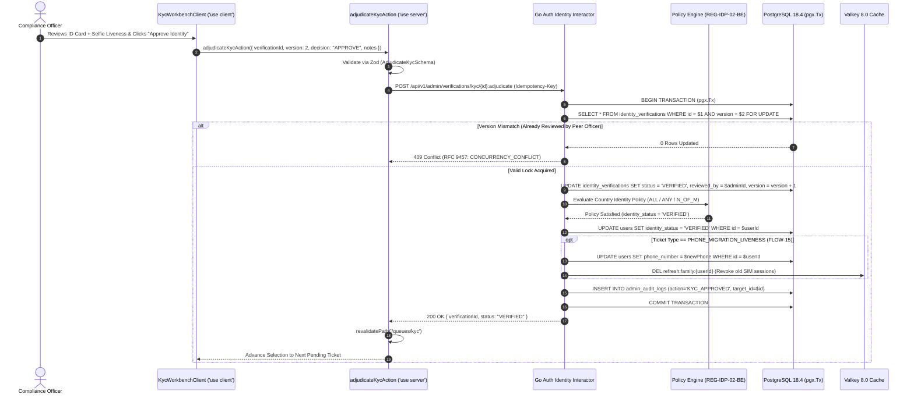

# User KYC Verification Queue, Fayda Identity & Liveness Audit Workbench
## Admin Subsystem Specification — `docs/admin/operations-queues/02-kyc-user-verification-queue.md`

**Document Identifier:** `SPEC-ADM-OPS-02`  
**Classification:** Canonical Subsystem UI/UX & Technical Behavior Specification  
**Governing Documents:** `Dink_Machinery_UI_UX_Design_Brief.md`, `SRS-DINK-CORE-V7.0`, `docs/components/admin/DESIGN.md`, `contracts/openapi.yaml`  
**Target Subsystem:** Next.js 16 Web Admin Console (`admin/src/app/(dashboard)/queues/kyc/page.tsx`)  
**Primary Persona / Actor:** `COMPLIANCE_OFFICER`, `SUPER_ADMIN`  
**Associated Requirements:** `REG-05`, `REG-06`, `REG-07`, `REG-08`, `REG-IDP-01-BE`, `AD-03`, `AD-13-BE`  
**Associated Interaction Flows:** `FLOW-02` (Pluggable Identity Verification & Failover Queue), `FLOW-15` (Self-Service Phone Migration Facial Liveness Audit)  
**Associated ADRs:** `ADR-008` (Server-Driven Dynamic UI), `ADR-011` (Zero PII Leakage & Audited Unmasking)  
**Status:** Approved Technical Design Baseline

---

## 1. Domain Context, Business Rules & Architectural Invariants

The **User KYC Verification Queue, Fayda Identity & Liveness Audit Workbench** (`SPEC-ADM-OPS-02`) is the manual compliance review workbench (`AD-13-BE`) where `COMPLIANCE_OFFICER` staff adjudicate individual identity submissions that either:
1. Fell back to `PENDING_REVIEW` due to upstream **Ethiopian National ID (Fayda)** or **Kenyan eCitizen / Huduma Namba** registry timeouts (`FLOW-02`),
2. Relied on physical **Kebele ID / Passport** document uploads where automated digital lookup is unavailable (`REG-06`), or
3. Triggered a **Phone Number Migration Liveness Review (`FLOW-15`, `REG-08`)** where an existing verified user lost their SIM card and submitted a selfie liveness video/photo challenge to migrate their account to a new E.164 phone number.

### 1.1 Core Business Rules & Compliance Invariants
1. **Age Gate & Identity Policy Enforcement (`REG-05`, `REG-IDP-02-BE`):**
   - Every applicant must be verified as $\ge 18\text{ years}$ old (`minAgeDefault: 18` in `country_configs`) on the date of submission. If the extracted or entered `dateOfBirth` yields an age $< 18$, the "Approve KYC" button is hard-disabled and only `REJECT_UNDERAGE` is permitted.
2. **ClamAV Antivirus & EXIF Integrity Badge (`REG-07`):**
   - Uploaded ID card photos (Front, Back, Selfie Liveness) are streamed through ClamAV (`tcp://clamav:3310`) prior to SeaweedFS S3 storage. The workbench displays the cryptographic SHA-256 media digest and ClamAV scan status (`CLEAN`).
3. **Structured Rejection Reason Codes:**
   - Rejecting a KYC submission requires selecting at least one canonical reason code (`ID_DOCUMENT_BLURRY`, `ID_EXPIRED`, `NAME_MISMATCH`, `LIVENESS_SELFIE_MISMATCH`, `SUSPECTED_FORGERY`) and providing localized feedback notes sent to the user via push/SMS notification.
4. **Phone Migration Account Lock Release (`FLOW-15`):**
   - Approving a `PHONE_MIGRATION_LIVENESS` ticket atomically updates `users.phone_number` to the new E.164 number, revokes all active Valkey refresh tokens and sessions bound to the old phone number, and records an immutable entry in `identity_verification_audits`.

---

## 2. Screen Anatomy, Layout & Component Hierarchy

### 2.1 Dual-Pane KYC & Fayda / Liveness Inspector Workbench Wireframe

```text
+------------------------------------------------------------------------------------------------------------------------------------------+
| Operations & Compliance > Individual KYC & Liveness Verification Queue (`AD-13-BE`)                   [Pending: 14] [SLA Breach <2h: 2] |
+------------------------------------------------------------------------------------------------------------------------------------------+
| FILTER BAR: [Queue Type: All (Fayda Failover / Kebele ID / Phone Migration) v] [Country: ET v] [🔍 Search Ref or Masked Phone...]        |
+-------------------------------------------------------------------+----------------------------------------------------------------------+
| LEFT PANE: VIRTUALIZED KYC QUEUE (`DynamicTable.tsx` — 45% Width) | RIGHT PANE: DUAL DOCUMENT & LIVENESS INSPECTOR (55% Width)           |
| +---------------------------------------------------------------+ | +------------------------------------------------------------------+ |
| | Ref      | Applicant        | Type            | Age  | Status | | | TICKET #KYC-8841 — Solomon Tadesse (`usr_01HP8291`) [Version: 2] | |
| |----------+------------------+-----------------+------+--------| | | Type: FAYDA_FAILOVER_MANUAL | Submitted: 2026-10-29 11:42 UTC    | |
| |*#KYC-8841| Solomon Tadesse  | FAYDA_FAILOVER  | 1h42m| REVIEW | | +------------------------------------------------------------------+ |
| | #KYC-8840| Tigist Alemu     | PHONE_MIGRATION | 1h15m| REVIEW | | | [ID FRONT PHOTO (WebP)]          | [LIVE SELFIE / FAYDA PHOTO]   | |
| | #KYC-8839| Dawit Kebede     | KEBELE_ID_DOC   | 0h54m| REVIEW | | |  +----------------------------+  |  +---------------------------+  | |
| | #KYC-8838| Samuel Ochieng   | HUDUMA_KE       | 0h31m| REVIEW | | |  | [Ethiopian Digital ID]     |  |  | [Camera-Enforced Selfie]  |  | |
| | #KYC-8835| Bereket Hailu    | FAYDA_FAILOVER  | 0h19m| REVIEW | | |  | Name: አቶ ሰለሞን ታደሰ          |  |  | Liveness Score: 98.4%     |  | |
| |          |                  |                 |      |        | | |  | FIN: ****-****-9012        |  |  | [✓ ClamAV: CLEAN]         |  | |
| |          |                  |                 |      |        | | |  +----------------------------+  |  +---------------------------+  | |
| |          |                  |                 |      |        | | |  [🔍 Zoom 200%] [↻ Rotate 90°]   |  [👁 Reveal FIN (Audited)]    | |
| |          |                  |                 |      |        | | +------------------------------------------------------------------+ |
| |          |                  |                 |      |        | | | ATTRIBUTE CROSS-CHECK MATRIX                                     | |
| |          |                  |                 |      |        | | | • Full Name (Profile):  Solomon Tadesse  | (ID): አቶ ሰለሞን ታደሰ     | |
| |          |                  |                 |      |        | | | • Date of Birth:        1991-04-14 (Age: 35 yrs — >=18 PASS ✓)   | |
| |          |                  |                 |      |        | | | • Phone Number:         +251911****82    | Duplicate IDs: 0 ✓    | |
| |          |                  |                 |      |        | | +------------------------------------------------------------------+ |
| |          |                  |                 |      |        | | | ADJUDICATION DECISION & AUDIT NOTES                              | |
| |          |                  |                 |      |        | | | Rejection Reason (if rejecting): [ Select Reason Code...      v] | |
| |          |                  |                 |      |        | | | Reviewer Notes: [ Verified Ge'ez name & DOB against Fayda card ] | |
| |          |                  |                 |      |        | | |                                                                  | |
| |          |                  |                 |      |        | | | [ ✗ REJECT SUBMISSION (R) ]        [ ✓ APPROVE IDENTITY (A) ]    | |
| +---------------------------------------------------------------+ | +------------------------------------------------------------------+ |
+-------------------------------------------------------------------+----------------------------------------------------------------------+
```

---

## 3. W3C DTCG Design Token Mapping Table

| KYC Workbench Element | W3C Token Path (`design-tokens.json`) | Resolved Value | Behavioral & Accessibility Constraint |
|---|---|---|---|
| **Master-Detail Split Grid** | `semantic.light.surface.canvas` / `stroke.border.thin` | `#F8FAFC` / `1dp` `#E2E8F0` divider | Keyboard resizable split pane; left table row selection updates right inspector without full page reload. |
| **Ge'ez Name Comparison Field** | `typography.fontFamily.ethiopic` + `lineHeightFactor.ethiopicGolden` | `Noto Sans Ethiopic`, `16sp`, line-height `1.38` | Prevents upper/lower vowel diacritic clipping when comparing Amharic/Tigrinya ID cards. |
| **Document Viewport HUD** | `component.lightbox.hudBackground` / `hudTextColor` | `rgba(2, 6, 23, 0.85)` / `#FFFFFF` | Floating zoom (`100%`–`400%`) and rotation (`90°`) toolbar over ID card images. |
| **Age Gate Verification Badge** | `color.feedback.emerald.100` + `color.feedback.emerald.700` | `#D1FAE5` fill / `#047857` text | Switches to `color.feedback.crimson.100` (`#FEE2E2`) if `calculatedAge < 18`. |
| **Approve / Reject Actuators** | `color.feedback.emerald.600` / `color.feedback.crimson.600` | `#059669` (Approve) / `#DC2626` (Reject) | `dimension.space.48` (`48dp`) height; supports keyboard shortcuts `A` and `R` when form input is not focused. |

---

## 4. Interactive State Machine & Sequence Choreography

### 4.1 KYC Verification & Phone Migration Liveness State Machine

```mermaid
stateDiagram-v2
    [*] --> QueueLoaded: GET /api/v1/admin/verifications/kyc
    QueueLoaded --> TicketSelected: Select Row #KYC-8841
    
    state TicketSelected {
        [*] --> InspectingEvidence
        InspectingEvidence --> AuditingPiiReveal: Click [Reveal FIN] -> Log Reason in pii_access_audit_logs
        AuditingPiiReveal --> InspectingEvidence: Cleartext FIN Displayed (60s TTL)
        
        InspectingEvidence --> SubmittingApproval: Click [Approve Identity] (Age >= 18 & No Duplicate ID)
        InspectingEvidence --> SelectingRejectionReason: Click [Reject Submission]
        SelectingRejectionReason --> SubmittingRejection: Select ReasonCode + Reviewer Notes
    }

    SubmittingApproval --> QueueLoaded: 200 OK (User Status -> VERIFIED; Advance to Next Row)
    SubmittingRejection --> QueueLoaded: 200 OK (User Notified with Reason; Advance to Next Row)
    SubmittingApproval --> ConcurrencyConflictBanner: 409 BOOKING_CONCURRENCY_CONFLICT (Another Officer Reviewed)
```



### 4.2 Manual KYC Adjudication & Policy Engine Re-Evaluation Sequence



---

## 5. Concrete Next.js 16 Implementation Blueprint

### 5.1 `/api/v1/admin/ui-config?route=queues/kyc` Metadata Schema

```json
{
  "tableId": "admin_kyc_verification_queue",
  "title": "Individual KYC & Liveness Verification Queue",
  "description": "Manual failover review for Fayda/Huduma National IDs, Kebele IDs, and FLOW-15 phone migration liveness challenges.",
  "defaultSortField": "createdAt",
  "defaultSortDirection": "asc",
  "pageSize": 25,
  "columns": [
    { "id": "referenceCode", "header": "Ref", "accessorKey": "referenceCode", "dataType": "text", "isSortable": false, "isFilterable": true },
    { "id": "applicantName", "header": "Applicant", "accessorKey": "applicantName", "dataType": "text", "isSortable": true, "isFilterable": true },
    { "id": "verificationType", "header": "Queue Type", "accessorKey": "verificationType", "dataType": "badge", "isSortable": true, "isFilterable": true,
      "badgeVariants": { "FAYDA_FAILOVER": "warning", "PHONE_MIGRATION": "destructive", "KEBELE_ID_DOC": "default", "HUDUMA_KE": "outline" }
    },
    { "id": "maskedIdentifier", "header": "Masked ID / FIN", "accessorKey": "maskedIdentifier", "dataType": "text", "isSortable": false, "isFilterable": false },
    { "id": "createdAt", "header": "Queued Since", "accessorKey": "createdAt", "dataType": "date", "isSortable": true, "isFilterable": false }
  ],
  "facets": [
    {
      "id": "verificationType",
      "label": "Verification Type",
      "type": "select",
      "options": [
        { "label": "Fayda API Failover", "value": "FAYDA_FAILOVER" },
        { "label": "Phone Migration Liveness (FLOW-15)", "value": "PHONE_MIGRATION" },
        { "label": "Kebele / Passport Upload", "value": "KEBELE_ID_DOC" },
        { "label": "Kenya Huduma / National ID", "value": "HUDUMA_KE" }
      ]
    }
  ],
  "rowActions": [
    {
      "id": "approve_kyc",
      "label": "Approve Identity",
      "variant": "default",
      "requiredPermission": "kyc:review",
      "endpoint": "/api/v1/admin/verifications/kyc/{id}:adjudicate",
      "method": "POST"
    },
    {
      "id": "reject_kyc",
      "label": "Reject Submission",
      "variant": "destructive",
      "requiredPermission": "kyc:review",
      "endpoint": "/api/v1/admin/verifications/kyc/{id}:adjudicate",
      "method": "POST"
    }
  ],
  "bulkActions": []
}
```

### 5.2 Server Action: KYC Adjudication (`src/app/(dashboard)/queues/kyc/actions.ts`)

```typescript
// src/app/(dashboard)/queues/kyc/actions.ts
'use server';

import { cookies } from 'next/headers';
import { revalidatePath } from 'next/cache';
import { z } from 'zod';
import { ProblemDetails } from '@/types/dynamic-ui';

const AdjudicateKycSchema = z
  .object({
    verificationId: z.string().uuid(),
    version: z.coerce.number().int().positive(),
    decision: z.enum(['APPROVE', 'REJECT']),
    rejectionReasonCode: z
      .enum([
        'ID_DOCUMENT_BLURRY',
        'ID_EXPIRED',
        'NAME_MISMATCH',
        'LIVENESS_SELFIE_MISMATCH',
        'REJECT_UNDERAGE',
        'SUSPECTED_FORGERY',
      ])
      .optional(),
    reviewerNotes: z.string().trim().min(5, 'Reviewer audit notes are required.').max(1000),
  })
  .refine(
    (data) => data.decision === 'APPROVE' || Boolean(data.rejectionReasonCode),
    {
      message: 'A structured rejection reason code is mandatory when rejecting a KYC submission.',
      path: ['rejectionReasonCode'],
    }
  );

export async function adjudicateKycAction(formData: FormData): Promise<{
  success: boolean;
  problem?: ProblemDetails;
}> {
  const parsed = AdjudicateKycSchema.safeParse({
    verificationId: formData.get('verificationId'),
    version: formData.get('version'),
    decision: formData.get('decision'),
    rejectionReasonCode: formData.get('rejectionReasonCode') || undefined,
    reviewerNotes: formData.get('reviewerNotes'),
  });

  if (!parsed.success) {
    return {
      success: false,
      problem: {
        type: 'https://api.dinkmachinery.com/errors/request-validation-failed',
        title: 'KYC Adjudication Validation Failed',
        status: 400,
        detail: 'Please provide all required adjudication fields.',
        code: 'REQ_VALIDATION_FAILED',
        invalidParams: parsed.error.issues.map((i) => ({
          name: i.path.join('.'),
          reason: i.message,
        })),
      },
    };
  }

  const cookieStore = await cookies();
  const sessionToken = cookieStore.get('dink_admin_session')?.value;
  const countryCode = cookieStore.get('dink_admin_country')?.value ?? 'ET';

  const res = await fetch(
    `${process.env.INTERNAL_BACKEND_URL}/api/v1/admin/verifications/kyc/${parsed.data.verificationId}:adjudicate`,
    {
      method: 'POST',
      headers: {
        'Content-Type': 'application/json',
        'Authorization': `Bearer ${sessionToken}`,
        'Idempotency-Key': crypto.randomUUID(),
        'X-Country-Code': countryCode,
      },
      body: JSON.stringify(parsed.data),
    }
  );

  const payload = await res.json();
  if (!res.ok) {
    return {
      success: false,
      problem: payload.error as ProblemDetails,
    };
  }

  revalidatePath('/queues/kyc');
  return { success: true };
}
```

---

## 6. OpenAPI 3.1.0 Contract Bindings & RFC 9457 Error Matrix

| HTTP Method & Route | Operation ID | Required Headers | Success Envelope | RFC 9457 Error Codes & Trigger Conditions |
|---|---|---|---|---|
| `GET /api/v1/admin/verifications/kyc` | `listKycVerificationQueue` | `Authorization`, `X-Country-Code` | `200 OK` (Cursor-paginated KYC queue) | `401 AUTH_INVALID_TOKEN`<br>`403 AUTH_INSUFFICIENT_PERMISSIONS` |
| `POST /api/v1/admin/verifications/kyc/{id}:adjudicate` | `adjudicateKycVerification` | `Authorization`, `Idempotency-Key`, `X-Country-Code` | `200 OK` (`KycVerificationDetailResponse`) | `400 REQ_VALIDATION_FAILED` (Missing rejection reason)<br>`403 AUTH_INSUFFICIENT_PERMISSIONS`<br>`409 BOOKING_CONCURRENCY_CONFLICT` (`version` mismatch — already reviewed)<br>`422 INSPECT_MEDIA_SCAN_FAILED` (Evidence quarantined by ClamAV) |

---

## 7. Verification & Acceptance Criteria

1. **FIFO Queue Ordering & Concurrency Locking (Playwright E2E):**
   - Queue sorts oldest-first (`createdAt ASC`) by default so near-SLA tickets are reviewed first; simultaneous submission by two officers returns HTTP `409` (`CONCURRENCY_CONFLICT`) to the second officer.
2. **Ethiopic Script Rendering (`ADR-013`):**
   - Amharic/Tigrinya names returned from Fayda render in `Noto Sans Ethiopic` at `1.38x` line-height with zero clipped glyphs.
3. **Structured Rejection Enforcement:**
   - Clicking `[Reject Submission]` without choosing a `rejectionReasonCode` highlights the select field with an inline `react-hook-form` error without dispatching a backend mutation.

---
*Canonical specification entry for Dink Machinery platform development. Changes require an explicit design review.*
