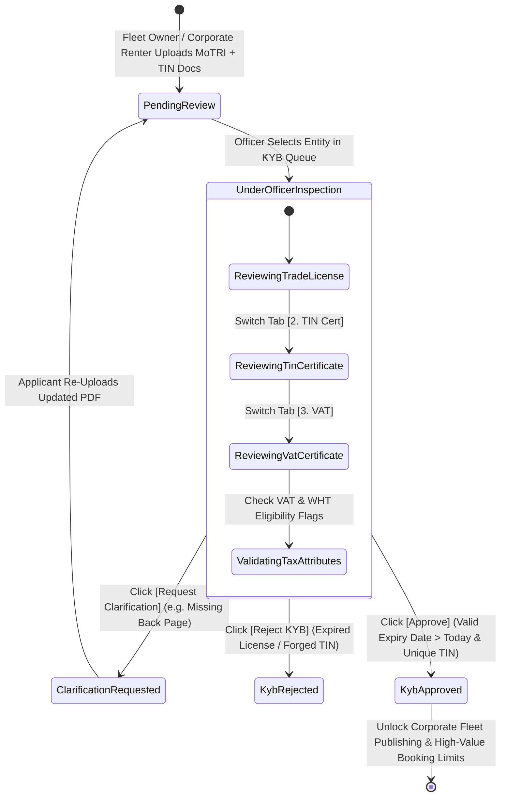
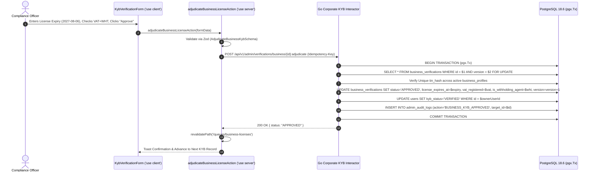

# Commercial Trade License, TIN Registry & Corporate KYB Queue
## Admin Subsystem Specification — `docs/admin/operations-queues/03-business-license-queue.md`

**Document Identifier:** `SPEC-ADM-OPS-03`  
**Classification:** Canonical Subsystem UI/UX & Technical Behavior Specification  
**Governing Documents:** `Dink_Machinery_UI_UX_Design_Brief.md`, `SRS-DINK-CORE-V7.0`, `docs/components/admin/DESIGN.md`, `contracts/openapi.yaml`  
**Target Subsystem:** Next.js 16 Web Admin Console (`admin/src/app/(dashboard)/queues/business-licenses/page.tsx`)  
**Primary Persona / Actor:** `COMPLIANCE_OFFICER`, Corporate Account Manager, `SUPER_ADMIN`  
**Associated Requirements:** `REG-09`, `CA-01`, `AD-03`, `AD-06`, `LOC-01-BE`  
**Associated Interaction Flows:** `FLOW-02` (Entity Verification), `FLOW-13` (Corporate Renter & Fleet Owner KYB Onboarding)  
**Associated ADRs:** `ADR-008` (Server-Driven UI Engine), `ADR-011` (ASVS L3 Zero PII Leakage)  
**Status:** Approved Technical Design Baseline

---

## 1. Domain Context, Business Rules & Architectural Invariants

The **Commercial Trade License, TIN Registry & Corporate KYB Queue** (`SPEC-ADM-OPS-03`) governs the verification of legal business entities—both commercial **Fleet Owners** registering heavy equipment fleets and **Corporate Renters** (General Contractors, Civil Engineering PLCs, Road Authorities) onboarding under requirements `REG-09` and `CA-01`.

### 1.1 Core Business Rules & Jurisdictional Compliance Mandates
1. **Multi-Jurisdictional Commercial Document Verification (`REG-09`, `LOC-01-BE`):**
   - **Ethiopia (`ET`):** Requires verification of (a) **Ministry of Trade and Regional Integration (MoTRI)** Commercial Registration & Renewed Business License (`Current Ethiopian Fiscal Year / E.C.`), (b) **Ministry of Revenues TIN Certificate** (10-digit numeric TIN), and (c) **VAT Registration Certificate** (`1500 bps` / 15% VAT compliance).
   - **Kenya (`KE`):** Requires verification of (a) **Business Registration Service (BRS) Certificate of Incorporation (`CR12`)**, and (b) **Kenya Revenue Authority (KRA) PIN Certificate** (`1600 bps` / 16% VAT compliance).
2. **TIN Uniqueness & Anti-Sybil Corporate Check:**
   - Before approving a corporate entity, the backend verifies that the cryptographic HMAC-SHA256 hash of the normalized TIN/KRA PIN (`tin_hash`) is not bound to any other active or suspended account (`409 BUSINESS_TIN_ALREADY_REGISTERED`).
3. **Withholding Tax (WHT) Agent Eligibility Flag:**
   - During KYB approval, the `COMPLIANCE_OFFICER` verifies whether the corporate entity is a designated Withholding Tax agent (e.g., `200 bps` / 2% WHT in Ethiopia), persisting `is_withholding_agent` and `vat_registered` on the `business_profiles` record so invoice generation calculates exact integer minor-unit tax breakdowns.
4. **License Expiry Date Enforcement:**
   - Every approved trade license must record an explicit `license_expires_at` date (`> CURRENT_DATE`). Thirty days prior to expiration, the entity is automatically routed to the Expiry Monitor (`SPEC-ADM-OPS-07`).

---

## 2. Screen Anatomy, Layout & Component Hierarchy

### 2.1 Split-Screen PDF Document Viewer & MoTRI / KRA Verification Workbench Wireframe

```text
+------------------------------------------------------------------------------------------------------------------------------------------+
| Operations & Compliance > Commercial Trade License & Corporate KYB Queue (`REG-09` / `CA-01`)           [Pending: 6] [Jurisdiction: ET] |
+------------------------------------------------------------------------------------------------------------------------------------------+
| FILTER BAR: [Entity Role: All (Fleet Owner PLC / Corporate Contractor) v] [VAT Status: All v] [🔍 Search Company Name or Masked TIN...]  |
+-------------------------------------------------------------------+----------------------------------------------------------------------+
| LEFT PANE: VIRTUALIZED KYB QUEUE (`DynamicTable.tsx` — 42% Width) | RIGHT PANE: MULTI-DOCUMENT PDF INSPECTOR & REGISTRY CHECK (58% Width)|
| +---------------------------------------------------------------+ | +------------------------------------------------------------------+ |
| | Ref      | Legal Entity Name          | Role   | TIN       |St| | | #KYB-4019 — Mesfin Industrial Equipment PLC (`biz_01HP9102`)     | |
| |----------+----------------------------+--------+-----------+--| | | Role: FLEET_OWNER_CORP | Submitted: 2026-10-29 09:15 UTC [v1]    | |
| |*#KYB-4019| Mesfin Industrial Equip PLC| OWNER  | *****4821 |⏳| | +------------------------------------------------------------------+ |
| | #KYB-4018| Afro-Tsion Construction SC | RENTER | *****9104 |⏳| | | DOCUMENT TABS: *[1. MoTRI Trade License] [2. TIN Cert] [3. VAT]  | |
| | #KYB-4015| Sunshine Civil Works PLC   | RENTER | *****3319 |⏳| | | +--------------------------------------------------------------+ | |
| | #KYB-4012|Abyssinia Heavy Haulage PLC | OWNER  | *****7742 |⏳| | | | [PDF / WEBP HIGH-RES CANVAS — ClamAV Scan: CLEAN ✓]          | | |
| |          |                            |        |           |  | | | |                                                              | | |
| |          |                            |        |           |  | | | |   MINISTRY OF TRADE & REGIONAL INTEGRATION (MoTRI)           | | |
| |          |                            |        |           |  | | | |   Commercial License No: MT/AA/14/6738912/2018 E.C.          | | |
| |          |                            |        |           |  | | | |   Business Sector: Construction Machinery Rental (Code 4550) | | |
| |          |                            |        |           |  | | | |   Renewal Valid Until: Hamle 30, 2019 E.C. (2027-08-06)      | | |
| |          |                            |        |           |  | | | +--------------------------------------------------------------+ | |
| |          |                            |        |           |  | | | [🔍 Zoom +] [🔍 Zoom -] [↻ Rotate] [👁 Reveal Full TIN (Audited)] | |
| |          |                            |        |           |  | | +------------------------------------------------------------------+ |
| |          |                            |        |           |  | | | REGULATORY & TAX COMPLIANCE VERIFICATION FORM                    | |
| |          |                            |        |           |  | | | Verified License Expiry Date *     Verified Sector Code *        | |
| |          |                            |        |           |  | | | [ 2027-08-06                 📅 ]  [ 4550 - Machinery Rental   ] | |
| |          |                            |        |           |  | | |                                                                  | |
| |          |                            |        |           |  | | | [x] Verified Active VAT Registration (1500 bps / 15.00%)         | |
| |          |                            |        |           |  | | | [x] Designated Withholding Tax (WHT) Agent (200 bps / 2.00%)     | |
| |          |                            |        |           |  | | | [x] Authorized Company Signatory Power of Attorney Verified      | |
| |          |                            |        |           |  | | |                                                                  | |
| |          |                            |        |           |  | | | Compliance Notes *: [ Verified MoTRI 2019 E.C. renewal stamp.  ] | |
| |          |                            |        |           |  | | | [ ✗ REJECT KYB ]     [ ⚠ REQUEST CLARIFICATION ]  [ ✓ APPROVE ] | |
| +---------------------------------------------------------------+ | +------------------------------------------------------------------+ |
+-------------------------------------------------------------------+----------------------------------------------------------------------+
```

---

## 3. W3C DTCG Design Token Mapping Table

| KYB Workbench Element | W3C Token Path (`design-tokens.json`) | Resolved Value | Behavioral & Accessibility Constraint |
|---|---|---|---|
| **Document Tab Bar** | `semantic.light.surface.card` + `color.brand.amber.500` | `#FFFFFF` surface, `#F59E0B` active bottom border | WAI-ARIA `role="tablist"` and `role="tab"`; arrow-key navigation switches between Trade License, TIN, and VAT certificates. |
| **Masked TIN Badge** | `typography.fontFamily.mono` + `color.brand.slate.100` | `Space Mono`, `12sp`, `#F1F5F9` pill | Displays `TIN: *****4821` until unmasked via `AuditedPiiCell` (`SPEC-ADM-SHL-03`). |
| **Tax Basis Points Indicator** | `color.feedback.blue.50` + `color.feedback.blue.900` | `#EFF6FF` fill / `#1E3A8A` text | Displays exact basis points (`1500 bps` VAT / `200 bps` WHT) pulled from `country_configs`. |
| **Approve Corporate Entity CTA** | `color.feedback.emerald.600` | `#059669` (`dimension.space.48` height) | Requires valid future `licenseExpiresAt` date and compliance notes before enabling submission. |

---

## 4. Interactive State Machine & Sequence Choreography

### 4.1 Corporate KYB Verification Lifecycle State Machine



### 4.2 Corporate KYB Approval & Tax Profile Activation Sequence



---

## 5. Concrete Next.js 16 Implementation Blueprint

### 5.1 Server Action: Corporate KYB Adjudication (`src/app/(dashboard)/queues/business-licenses/actions.ts`)

```typescript
// src/app/(dashboard)/queues/business-licenses/actions.ts
'use server';

import { cookies } from 'next/headers';
import { revalidatePath } from 'next/cache';
import { z } from 'zod';
import { ProblemDetails } from '@/types/dynamic-ui';

const AdjudicateBusinessKybSchema = z
  .object({
    businessVerificationId: z.string().uuid(),
    version: z.coerce.number().int().positive(),
    decision: z.enum(['APPROVE', 'REQUEST_CLARIFICATION', 'REJECT']),
    licenseExpiresAt: z.string().date().optional(),
    sectorCode: z.string().max(32).optional(),
    vatRegistered: z.coerce.boolean().default(false),
    isWithholdingAgent: z.coerce.boolean().default(false),
    rejectionReasonCode: z
      .enum([
        'TRADE_LICENSE_EXPIRED',
        'TIN_MISMATCH',
        'MISSING_SIGNATORY_POA',
        'SECTOR_CODE_INELIGIBLE',
        'DOCUMENT_ILLEGIBLE',
      ])
      .optional(),
    complianceNotes: z.string().trim().min(10, 'Compliance audit notes must be at least 10 characters.').max(1000),
  })
  .refine(
    (data) => {
      if (data.decision === 'APPROVE') {
        if (!data.licenseExpiresAt) return false;
        return new Date(data.licenseExpiresAt) > new Date();
      }
      return Boolean(data.rejectionReasonCode);
    },
    {
      message: 'Approvals require a future license expiration date; rejections/clarifications require a reason code.',
      path: ['licenseExpiresAt'],
    }
  );

export async function adjudicateBusinessLicenseAction(formData: FormData): Promise<{
  success: boolean;
  problem?: ProblemDetails;
}> {
  const parsed = AdjudicateBusinessKybSchema.safeParse({
    businessVerificationId: formData.get('businessVerificationId'),
    version: formData.get('version'),
    decision: formData.get('decision'),
    licenseExpiresAt: formData.get('licenseExpiresAt') || undefined,
    sectorCode: formData.get('sectorCode') || undefined,
    vatRegistered: formData.get('vatRegistered') === 'true',
    isWithholdingAgent: formData.get('isWithholdingAgent') === 'true',
    rejectionReasonCode: formData.get('rejectionReasonCode') || undefined,
    complianceNotes: formData.get('complianceNotes'),
  });

  if (!parsed.success) {
    return {
      success: false,
      problem: {
        type: 'https://api.dinkmachinery.com/errors/request-validation-failed',
        title: 'Corporate KYB Validation Error',
        status: 400,
        detail: 'Submitted corporate verification parameters failed validation.',
        code: 'REQ_VALIDATION_FAILED',
        invalidParams: parsed.error.issues.map((i) => ({
          name: i.path.join('.'),
          reason: i.message,
        })),
      },
    };
  }

  const cookieStore = await cookies();
  const sessionToken = cookieStore.get('dink_admin_session')?.value;
  const countryCode = cookieStore.get('dink_admin_country')?.value ?? 'ET';

  const res = await fetch(
    `${process.env.INTERNAL_BACKEND_URL}/api/v1/admin/verifications/business/${parsed.data.businessVerificationId}:adjudicate`,
    {
      method: 'POST',
      headers: {
        'Content-Type': 'application/json',
        'Authorization': `Bearer ${sessionToken}`,
        'Idempotency-Key': crypto.randomUUID(),
        'X-Country-Code': countryCode,
      },
      body: JSON.stringify(parsed.data),
    }
  );

  const payload = await res.json();
  if (!res.ok) {
    return {
      success: false,
      problem: payload.error as ProblemDetails,
    };
  }

  revalidatePath('/queues/business-licenses');
  return { success: true };
}
```

---

## 6. OpenAPI 3.1.0 Contract Bindings & RFC 9457 Error Matrix

| HTTP Method & Route | Operation ID | Required Headers | Success Envelope | RFC 9457 Error Codes & Trigger Conditions |
|---|---|---|---|---|
| `GET /api/v1/admin/verifications/business` | `listBusinessKybQueue` | `Authorization`, `X-Country-Code` | `200 OK` (Cursor-paginated KYB list) | `401 AUTH_INVALID_TOKEN`<br>`403 AUTH_INSUFFICIENT_PERMISSIONS` |
| `POST /api/v1/admin/verifications/business/{id}:adjudicate` | `adjudicateBusinessKyb` | `Authorization`, `Idempotency-Key`, `X-Country-Code` | `200 OK` (`BusinessKybDetailResponse`) | `400 REQ_VALIDATION_FAILED` (Past `licenseExpiresAt` date)<br>`409 BOOKING_CONCURRENCY_CONFLICT` (`version` mismatch)<br>`409 FLEET_REGISTRATION_EXISTS` / `BUSINESS_TIN_ALREADY_REGISTERED` (Duplicate TIN hash) |

---

## 7. Verification & Acceptance Criteria

1. **Future Expiry Date Guardrail (Vitest + Playwright):**
   - Attempting to approve a Trade License with `licenseExpiresAt` set in the past triggers a Zod validation error on `licenseExpiresAt` and prevents form submission.
2. **Multi-Tab Document Switching:**
   - Pressing `ArrowRight` / `ArrowLeft` on the document tablist switches cleanly between the MoTRI Trade License, TIN Certificate, and VAT Registration PDFs while preserving zoom level.
3. **Zero Unmasked TIN Exposure:**
   - TIN values remain masked (`*****4821`) in the queue list and detail view unless explicitly unmasked via the audited `PiiRevealModal`.

---
*Canonical specification entry for Dink Machinery platform development. Changes require an explicit design review.*
