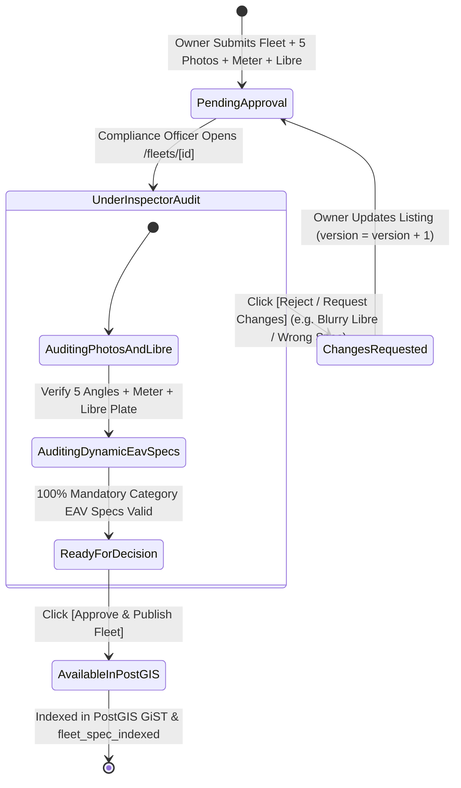
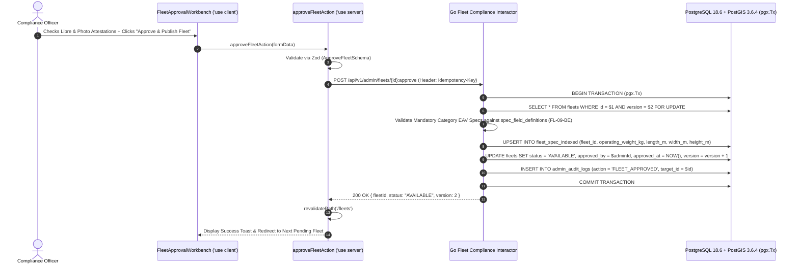

# Machinery & Logistics Fleet Compliance Approval Queue
## Admin Subsystem Specification — `docs/admin/operations-queues/04-fleet-compliance-approval-queue.md`

**Document Identifier:** `SPEC-ADM-OPS-04`  
**Classification:** Canonical Subsystem UI/UX & Technical Behavior Specification  
**Governing Documents:** `Dink_Machinery_UI_UX_Design_Brief.md`, `SRS-DINK-CORE-V7.0`, `docs/components/admin/DESIGN.md`, `contracts/openapi.yaml`  
**Target Subsystem:** Next.js 16 Web Admin Console (`admin/src/app/(dashboard)/fleets/page.tsx` & `src/app/(dashboard)/fleets/[id]/page.tsx`)  
**Primary Persona / Actor:** `COMPLIANCE_OFFICER`, Mechanical Fleet Inspector, `SUPER_ADMIN`  
**Associated Requirements:** `FL-01`..`FL-27`, `FL-09-BE`, `AD-03`, `AD-06`  
**Associated Interaction Flows:** `FLOW-03` (Fleet Registration, Dynamic EAV Taxonomy & Compliance Approval), `FLOW-12`  
**Associated ADRs:** `ADR-004` (Dynamic EAV Category Spec Engine), `ADR-008` (Server-Driven UI Metadata)  
**Status:** Approved Technical Design Baseline

---

## 1. Domain Context, Business Rules & Architectural Invariants

The **Machinery & Logistics Fleet Compliance Approval Queue** (`SPEC-ADM-OPS-04`) is the operational gatekeeper through which every heavy construction machine (Excavators, Bulldozers, Motor Graders, Mobile Cranes, Wheel Loaders) and logistics transport carrier (Lowboy Trailers, Flatbeds) must pass before transitioning from `PENDING_APPROVAL` to `AVAILABLE` in the public PostGIS search catalog (`FL-01`..`FL-27`).

### 1.1 Core Business Rules & Technical Inspection Mandates
1. **Title Deed (`Libre`) & Chassis/Serial Uniqueness Audit (`FL-03`, `AD-03`):**
   - The inspector cross-checks the uploaded **Machinery Ownership Booklet (`Libre`)** or Customs Declaration against the submitted `registrationNumber` (plate) and manufacturer `chassisSerialNumber`.
   - Duplicate registration numbers or chassis serials across active fleets are blocked by database uniqueness constraints (`409 FLEET_REGISTRATION_EXISTS`).
2. **Dynamic EAV Specification Completeness & Logistics Extraction (`FL-09-BE`, `ADR-004`):**
   - Each machinery subcategory defines a JSON Schema template in `spec_field_definitions` (e.g., Crawler Excavator requires `operating_weight_kg`, `bucket_capacity_m3`, `max_digging_depth_mm`, `engine_power_hp`; Lowboy Carrier requires `max_payload_kg`, `deck_length_m`, `axle_count`).
   - Upon approval, the backend validates that 100% of mandatory category EAV fields are populated and extracts `operating_weight_kg` and transport dimensions into `fleet_spec_indexed` so the Logistics Sub-Booking Engine (`SPEC-ADM-BKG-03`) can match compatible lowboy carriers.
3. **5 Mandatory Angles + Baseline Hour Meter Photo Verification (`FL-12`):**
   - Every submission must include at least **5 exterior angle photos** (Front, Rear, Left Track/Side, Right Track/Side, Cabin/Boom) plus **1 high-resolution photo of the physical engine hour meter** matching the submitted `baselineHourMeter` reading. All media objects carry a verified ClamAV `CLEAN` badge.
4. **Integer Minor-Unit Rate & Jurisdictional Bounds Check (`FL-18`):**
   - Daily, weekly, and monthly rates are displayed and audited in integer minor units (`dailyRate.amountMinor`, e.g., `1850000` Santims = `18,500.00 ETB/day`). Rates falling outside jurisdictional sanity bounds trigger `422 FLEET_DAILY_RATE_INVALID`.

---

## 2. Screen Anatomy, Layout & Component Hierarchy

### 2.1 Fleet Compliance Inspector & Dynamic EAV Spec Validator Wireframe

```text
+------------------------------------------------------------------------------------------------------------------------------------------+
| Fleets > Compliance Approval Queue > #FLT-3092: Caterpillar 320D3 Crawler Excavator                   [Status: PENDING_APPROVAL] [v1]    |
+------------------------------------------------------------------------------------------------------------------------------------------+
| OWNER: Mesfin Industrial Equipment PLC (KYB: VERIFIED ✓) | Plate: AA-3-98234 | Serial: CAT0320DPJ801942 | Depot: Kaliti, Addis Ababa     |
+-------------------------------------------------------------------+----------------------------------------------------------------------+
| LEFT PANE: 5-ANGLE + HOUR METER + LIBRE GALLERY (50% Width)       | RIGHT PANE: DYNAMIC EAV SPECS & PRICING AUDIT (50% Width)            |
| +---------------------------------------------------------------+ | +------------------------------------------------------------------+ |
| | ACTIVE VIEWPORT: [6. Baseline Engine Hour Meter] [ClamAV ✓]   | | | PRICING & COMMERCIAL TERMS (INTEGER MINOR UNITS)                 | |
| | +-----------------------------------------------------------+ | | | • Daily Rate:        18,500.00 ETB (`1850000` Santims) [✓ Valid] | |
| | |                                                           | | | | • Min Rental Days:   3 Days        | Operator Included: YES ✓    | |
| | |          [ PHOTO: PHYSICAL HOUR METER GAUGE ]             | | | | • Security Deposit:  50,000.00 ETB (Informational Direct Model)  | |
| | |                   [   0 1 4 5 0 . 5   ]                   | | | +------------------------------------------------------------------+ |
| | |                                                           | | | | DYNAMIC EAV SPECIFICATION AUDIT (`cat: crawler_excavator`)       | |
| | +-----------------------------------------------------------+ | | | [✓] 1. Operating Weight (kg):      21,400 kg  (Indexed for Lowboy| |
| | Declared Baseline Meter: `1,450.5 Hours`  [✓ Matches Photo]   | | | [✓] 2. Bucket Capacity (m³):       1.19 m³                       | |
| |                                                               | | | [✓] 3. Engine Model & Gross Power: Cat C7.1 / 162 hp             | |
| | THUMBNAIL STRIP (All 7 Required Artifacts Uploaded):          | | | [✓] 4. Max Digging Depth (mm):     6,720 mm                      | |
| | [1.Front] [2.Rear] [3.Left] [4.Right] [5.Boom] *[6.Meter]     | | | [✓] 5. Transport Dimensions (LxWxH): 9.53m x 2.98m x 3.01m       | |
| | [7. Title Deed (Libre PDF) — Plate AA-3-98234]                | | | [✓] 6. Hydraulic Auxiliary Line:   Included (Breaker Compatible) | |
| +---------------------------------------------------------------+ | +------------------------------------------------------------------+ |
| | POSTGIS DEPOT COORDINATE CHECK                                | | | COMPLIANCE CHECKLIST & FINAL DECISION                            | |
| | Lat: `8.931400`, Lng: `38.759200` (Akaki Kaliti Subcity)      | | | [x] Ownership Libre matches Owner KYB & Chassis Serial           | |
| | [✓ Inside Enabled Country Polygon: Ethiopia (`ET`)]           | | | [x] All 5 exterior angles + baseline hour meter photo verified   | |
| | [✓ Active Third-Party Insurance Policy Valid to 2027-05-19]   | | |                                                                  | |
| |                                                               | | | Inspector Notes: [ Libre #ET-AA-88321 verified; specs complete ] | |
| |                                                               | | | [ ✗ REJECT / REQUEST CHANGES ]     [ ✓ APPROVE & PUBLISH FLEET ] | |
| +---------------------------------------------------------------+ | +------------------------------------------------------------------+ |
+-------------------------------------------------------------------+----------------------------------------------------------------------+
```

---

## 3. W3C DTCG Design Token Mapping Table

| Fleet Inspector Element | W3C Token Path (`design-tokens.json`) | Resolved Value | Behavioral & Accessibility Constraint |
|---|---|---|---|
| **EAV Spec Group Container** | `semantic.light.surface.card` + `stroke.border.thin` | `#FFFFFF` / `1dp` `#E2E8F0` border | Renders dynamic category fields via `DynamicDetailView.tsx` (`AD-06-BE`). |
| **Monospace Meter & Rate Figures** | `typography.fontFamily.mono` / `typography.fontSize.16` | `Space Mono`, `16sp`, `#020617` | Displays `amountMinor` formatted via `formatMinorUnits` alongside raw minor-unit tooltip. |
| **ClamAV & Spec Completeness Badge** | `color.feedback.emerald.50` + `color.feedback.emerald.700` | `#ECFDF5` fill / `#047857` text | Switches to `color.brand.amber.100` (`#FEF3C7`) if any required category EAV attribute is missing. |
| **Photo Thumbnail Focus Ring** | `semantic.light.border.focus` + `stroke.border.heavy` | `#D97706` (`3dp` solid outline) | Supports keyboard `ArrowLeft` / `ArrowRight` navigation across the 7 required media artifacts. |
| **Approve & Publish Button** | `semantic.light.action.primary.bg` / `text` | `#F59E0B` bg / `#020617` text (`56dp` height) | Tactile `3dp` bottom lip (`#B45309`); disabled until both Libre and Photo checklists are checked. |

---

## 4. Interactive State Machine & Sequence Choreography

### 4.1 Fleet Listing Compliance Lifecycle State Machine



### 4.2 Fleet Approval & PostGIS / Logistics Spec Indexing Sequence



---

## 5. Concrete Next.js 16 Implementation Blueprint

### 5.1 `/api/v1/admin/ui-config?route=fleets` Metadata Schema

```json
{
  "tableId": "admin_fleet_approval_queue",
  "title": "Machinery & Logistics Fleet Compliance Queue",
  "description": "Verify ownership Libre certificates, 5-angle + hour meter photography, and category EAV technical specifications.",
  "defaultSortField": "createdAt",
  "defaultSortDirection": "asc",
  "pageSize": 25,
  "columns": [
    { "id": "registrationNumber", "header": "Plate / Reg #", "accessorKey": "registrationNumber", "dataType": "text", "isSortable": true, "isFilterable": true },
    { "id": "makeModel", "header": "Make & Model", "accessorKey": "makeModel", "dataType": "text", "isSortable": true, "isFilterable": true },
    { "id": "categoryName", "header": "Category", "accessorKey": "categoryName", "dataType": "badge", "isSortable": true, "isFilterable": true },
    { "id": "dailyRate", "header": "Daily Rate", "accessorKey": "dailyRate", "dataType": "money", "isSortable": true, "isFilterable": false, "align": "right" },
    { "id": "eavCompleteness", "header": "EAV Specs", "accessorKey": "eavCompletenessPct", "dataType": "progress", "isSortable": true, "isFilterable": false },
    { "id": "status", "header": "Status", "accessorKey": "status", "dataType": "badge", "isSortable": true, "isFilterable": true,
      "badgeVariants": { "PENDING_APPROVAL": "warning", "AVAILABLE": "success", "CHANGES_REQUESTED": "destructive" }
    }
  ],
  "facets": [
    {
      "id": "categoryCode",
      "label": "Equipment Category",
      "type": "select",
      "options": [
        { "label": "Crawler Excavators", "value": "EXCAVATOR" },
        { "label": "Bulldozers", "value": "BULLDOZER" },
        { "label": "Motor Graders", "value": "MOTOR_GRADER" },
        { "label": "Mobile Cranes", "value": "MOBILE_CRANE" },
        { "label": "Lowboy Logistics Carriers", "value": "LOWBOY_CARRIER" }
      ]
    }
  ],
  "rowActions": [
    {
      "id": "approve_fleet",
      "label": "Approve & Publish",
      "variant": "default",
      "requiredPermission": "fleet:approve",
      "endpoint": "/api/v1/admin/fleets/{id}:approve",
      "method": "POST"
    },
    {
      "id": "reject_fleet",
      "label": "Request Changes",
      "variant": "destructive",
      "requiredPermission": "fleet:approve",
      "endpoint": "/api/v1/admin/fleets/{id}:reject",
      "method": "POST"
    }
  ],
  "bulkActions": []
}
```

### 5.2 Server Action: Fleet Compliance Approval & Rejection (`src/app/(dashboard)/fleets/actions.ts`)

```typescript
// src/app/(dashboard)/fleets/actions.ts
'use server';

import { revalidatePath } from 'next/cache';
import { cookies } from 'next/headers';
import { z } from 'zod';
import { ProblemDetails } from '@/types/dynamic-ui';

const FleetComplianceDecisionSchema = z
  .object({
    fleetId: z.string().uuid(),
    version: z.coerce.number().int().positive(),
    decision: z.enum(['APPROVE', 'REJECT']),
    libreVerified: z.coerce.boolean(),
    photosAndMeterVerified: z.coerce.boolean(),
    rejectionReasonCode: z
      .enum([
        'LIBRE_MISMATCH_OR_EXPIRED',
        'MISSING_REQUIRED_ANGLES',
        'HOUR_METER_PHOTO_ILLEGIBLE',
        'INCOMPLETE_EAV_SPECS',
        'DAILY_RATE_OUT_OF_BOUNDS',
      ])
      .optional(),
    inspectionNotes: z.string().trim().min(5, 'Inspector audit notes are required.').max(1000),
  })
  .refine(
    (data) => {
      if (data.decision === 'APPROVE') {
        return data.libreVerified && data.photosAndMeterVerified;
      }
      return Boolean(data.rejectionReasonCode);
    },
    {
      message: 'Approving a fleet requires verifying both the Libre title deed and all 5+1 inspection photos.',
      path: ['libreVerified'],
    }
  );

export async function adjudicateFleetComplianceAction(formData: FormData): Promise<{
  success: boolean;
  problem?: ProblemDetails;
}> {
  const parsed = FleetComplianceDecisionSchema.safeParse({
    fleetId: formData.get('fleetId'),
    version: formData.get('version'),
    decision: formData.get('decision'),
    libreVerified: formData.get('libreVerified') === 'true',
    photosAndMeterVerified: formData.get('photosAndMeterVerified') === 'true',
    rejectionReasonCode: formData.get('rejectionReasonCode') || undefined,
    inspectionNotes: formData.get('inspectionNotes'),
  });

  if (!parsed.success) {
    return {
      success: false,
      problem: {
        type: 'https://api.dinkmachinery.com/errors/request-validation-failed',
        title: 'Fleet Compliance Validation Failed',
        status: 400,
        detail: 'Please complete all mandatory verification checkboxes before approving.',
        code: 'REQ_VALIDATION_FAILED',
        invalidParams: parsed.error.issues.map((issue) => ({
          name: issue.path.join('.'),
          reason: issue.message,
        })),
      },
    };
  }

  const cookieStore = await cookies();
  const sessionToken = cookieStore.get('dink_admin_session')?.value;
  const countryCode = cookieStore.get('dink_admin_country')?.value ?? 'ET';
  const actionSlug = parsed.data.decision === 'APPROVE' ? 'approve' : 'reject';

  const res = await fetch(
    `${process.env.INTERNAL_BACKEND_URL}/api/v1/admin/fleets/${parsed.data.fleetId}:${actionSlug}`,
    {
      method: 'POST',
      headers: {
        'Content-Type': 'application/json',
        'Authorization': `Bearer ${sessionToken}`,
        'Idempotency-Key': crypto.randomUUID(),
        'X-Country-Code': countryCode,
      },
      body: JSON.stringify({
        version: parsed.data.version,
        rejectionReasonCode: parsed.data.rejectionReasonCode,
        notes: parsed.data.inspectionNotes,
      }),
    }
  );

  const payload = await res.json();
  if (!res.ok) {
    return {
      success: false,
      problem: payload.error as ProblemDetails,
    };
  }

  revalidatePath('/fleets');
  revalidatePath(`/fleets/${parsed.data.fleetId}`);
  return { success: true };
}
```

---

## 6. OpenAPI 3.1.0 Contract Bindings & RFC 9457 Error Matrix

| HTTP Method & Route | Operation ID | Required Headers | Success Envelope | RFC 9457 Error Codes & Trigger Conditions |
|---|---|---|---|---|
| `GET /api/v1/admin/fleets` | `listAdminFleetQueue` | `Authorization`, `X-Country-Code` | `200 OK` (`FleetListSuccessResponse`) | `401 AUTH_INVALID_TOKEN`<br>`403 AUTH_INSUFFICIENT_PERMISSIONS` |
| `POST /api/v1/admin/fleets/{id}:approve` | `approveFleetListing` | `Authorization`, `Idempotency-Key`, `X-Country-Code` | `200 OK` (`FleetDetailSuccessResponse`) | `409 BOOKING_CONCURRENCY_CONFLICT` (`version` mismatch)<br>`409 FLEET_REGISTRATION_EXISTS` (Duplicate plate/chassis)<br>`422 FLEET_DAILY_RATE_INVALID` (Minor units out of bounds)<br>`422 REQ_VALIDATION_FAILED` (Missing mandatory EAV spec attribute) |
| `POST /api/v1/admin/fleets/{id}:reject` | `rejectFleetListing` | `Authorization`, `Idempotency-Key`, `X-Country-Code` | `200 OK` (`FleetDetailSuccessResponse`) | `400 REQ_VALIDATION_FAILED` (Missing rejection reason)<br>`409 BOOKING_CONCURRENCY_CONFLICT` |

---

## 7. Verification & Acceptance Criteria

1. **Dynamic EAV Spec Rendering (Playwright E2E):**
   - Inspecting a Crawler Excavator vs a Lowboy Trailer dynamically renders the category-specific EAV attributes returned from `spec_field_definitions` without hardcoded client fields.
2. **Minor-Unit Rate Display:**
   - `dailyRate: { amountMinor: 1850000, currency: "ETB" }` renders as `18,500.00 ETB` in monospace type.
3. **Checklist Gate Enforcement:**
   - The `[Approve & Publish Fleet]` button remains disabled until both `libreVerified` and `photosAndMeterVerified` checkboxes are checked.

---
*Canonical specification entry for Dink Machinery platform development. Changes require an explicit design review.*
