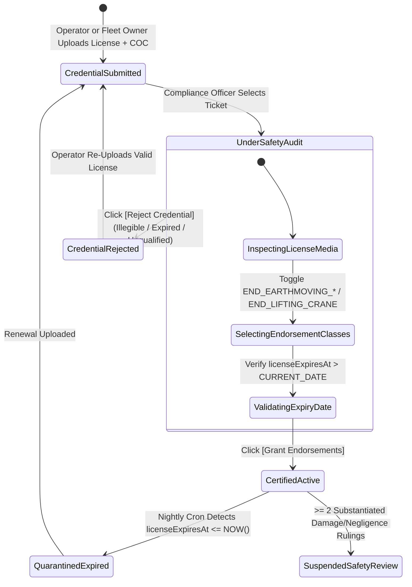
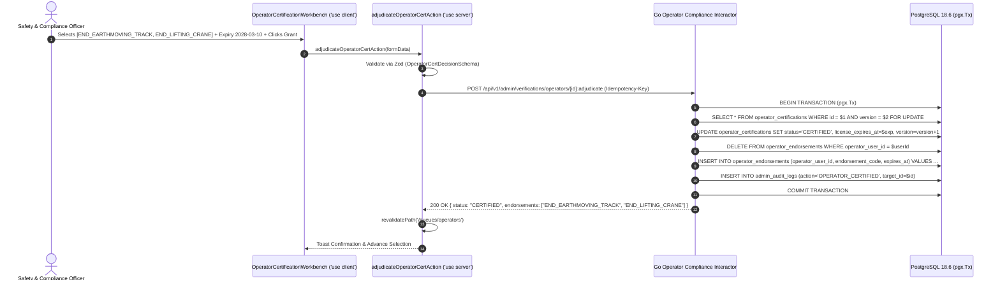

# Operator Driving License & Equipment Category Endorsement Queue
## Admin Subsystem Specification — `docs/admin/operations-queues/05-operator-certification-queue.md`

**Document Identifier:** `SPEC-ADM-OPS-05`  
**Classification:** Canonical Subsystem UI/UX & Technical Behavior Specification  
**Governing Documents:** `Dink_Machinery_UI_UX_Design_Brief.md`, `SRS-DINK-CORE-V7.0`, `docs/components/admin/DESIGN.md`, `contracts/openapi.yaml`  
**Target Subsystem:** Next.js 16 Web Admin Console (`admin/src/app/(dashboard)/queues/operators/page.tsx`)  
**Primary Persona / Actor:** `COMPLIANCE_OFFICER`, Safety & Certification Auditor, `SUPER_ADMIN`  
**Associated Requirements:** `REQ-04`, `FL-38`, `IN-03`, `AD-03`, `AD-06`  
**Associated Interaction Flows:** `FLOW-02` (Operator Credential Onboarding), `FLOW-11` (Operator Dispatch & Telematics Assignment), `FLOW-12`  
**Associated ADRs:** `ADR-008` (Server-Driven Dynamic UI Metadata), `ADR-011` (Zero PII Exposure & Audited Reveal)  
**Status:** Approved Technical Design Baseline

---

## 1. Domain Context, Business Rules & Architectural Invariants

The **Operator Driving License & Equipment Category Endorsement Queue** (`SPEC-ADM-OPS-05`) is the safety compliance workbench where `COMPLIANCE_OFFICER` staff verify the specialized heavy machinery operating licenses and vocational safety certificates of **Field Operators** (`FL-38`, `IN-03`). Under platform liability and insurance rules (`IN-03`), a Fleet Owner cannot assign an operator to an active machine lease (`ACTIVE` or `IN_TRANSIT`) unless the operator holds an active, non-expired category endorsement matching that equipment's taxonomy class.

### 1.1 Core Business Rules & Safety Endorsement Mandates
1. **Equipment Category Endorsement Mapping (`FL-38`, `IN-03`):**
   - Operators are not approved globally for all heavy machinery; each license audit explicitly grants one or more **Category Endorsement Codes** stored in `operator_endorsements`:
     - `END_EARTHMOVING_TRACK` — Crawler Excavators, Bulldozers, Track Loaders
     - `END_EARTHMOVING_WHEEL` — Wheel Loaders, Backhoe Loaders, Motor Graders, Compactors
     - `END_LIFTING_CRANE` — Mobile Telescopic Cranes, Rough-Terrain Cranes, Tower Cranes (Requires additional Lifting Rigging & Load Chart Safety Certificate)
     - `END_HEAVY_HAULAGE` — Lowboy Tractor-Trailers, Multi-Axle Flatbeds (`Dry Cargo / Heavy Transport Grade` license)
2. **Jurisdictional Issuing Authority Verification:**
   - **Ethiopia (`ET`):** Verifies the **Ethiopian Ministry of Transport & Logistics / Addis Ababa Driver and Vehicle Control Authority (DVCA)** Special Mobile Equipment Operating License (`ልዩ ተንቀሳቃሽ ማሽነሪ መንጃ ፈቃድ`) and Federal TVET Vocational Competency Certificate (COC).
   - **Kenya (`KE`):** Verifies the **NTSA (National Transport and Safety Authority)** Class G (Industrial, Construction & Agricultural Plant) endorsement and **NCA (National Construction Authority)** Plant Operator Accreditation card.
3. **Dispatch Blocking on Expiry or Revocation (`IN-03`):**
   - Approving an operator requires recording `licenseExpiresAt`. If `licenseExpiresAt <= CURRENT_DATE`, or if an operator accumulates $\ge 2$ substantiated safety/negligence rulings in `disputes`, their endorsement transitions to `SUSPENDED_SAFETY_REVIEW` and the backend blocks `POST /api/v1/bookings/{id}/operator:assign`.

---

## 2. Screen Anatomy, Layout & Component Hierarchy

### 2.1 Operator Certification & Category Endorsement Workbench Wireframe

```text
+------------------------------------------------------------------------------------------------------------------------------------------+
| Operations & Compliance > Operator Certification & Endorsement Queue (`FL-38` / `IN-03`)               [Pending: 9] [Jurisdiction: ET]   |
+------------------------------------------------------------------------------------------------------------------------------------------+
| FILTER BAR: [Endorsement Class: All (Earthmoving / Crane / Haulage) v] [Employer: All v] [🔍 Search Operator Name or License Ref...]     |
+-------------------------------------------------------------------+----------------------------------------------------------------------+
| LEFT PANE: OPERATOR QUEUE (`DynamicTable.tsx` — 44% Width)        | RIGHT PANE: LICENSE & ENDORSEMENT MATRIX INSPECTOR (56% Width)       |
| +---------------------------------------------------------------+ | +------------------------------------------------------------------+ |
| | Ref      | Operator Name    | Requested Class | Employer  |St | | | #OPR-2190 — Kassahun Bekele (`usr_01HP8551`)         [Version: 1]| |
| |----------+------------------+-----------------+-----------+---| | | Affiliated Fleet Owner: Mesfin Industrial Equipment PLC          | |
| |*#OPR-2190| Kassahun Bekele  | CRANE + TRACK   | Mesfin PLC|⏳ | | +------------------------------------------------------------------+ |
| | #OPR-2188| Yonas Girma      | EARTHMOVING_TRK | Independent|⏳ | | | [SPECIAL EQUIPMENT LICENSE FRONT/BACK] | [TVET COC / CRANE CERT] | |
| | #OPR-2185| Tesfaye Alemu    | HEAVY_HAULAGE   | Abyssinia |⏳ | | | +------------------------------------+ | +---------------------+ | |
| | #OPR-2181| Peter Kamau      | NTSA_CLASS_G    | RiftValley|⏳ | | | | DVCA Special Machinery License     | | | Federal TVET Agency | | |
| |          |                  |                 |           |   | | | | Name: ካሳሁን በቀለ (Kassahun Bekele)  | | | Level IV Mobile     | | |
| |          |                  |                 |           |   | | | | License #: ****-7721               | | | Crane Operation COC | | |
| |          |                  |                 |           |   | | | | Issued: 2024-03-11 | Exp: 2028-03-10| | | [✓ ClamAV: CLEAN]  | | |
| |          |                  |                 |           |   | | | +------------------------------------+ | +---------------------+ | |
| |          |                  |                 |           |   | | | [🔍 Zoom 200%] [↻ Rotate] [👁 Reveal License # (Audited)]         | |
| |          |                  |                 |           |   | | +------------------------------------------------------------------+ |
| |          |                  |                 |           |   | | | GRANTED EQUIPMENT CATEGORY ENDORSEMENTS (`operator_endorsements`)| |
| |          |                  |                 |           |   | | | [x] `END_EARTHMOVING_TRACK` (Crawler Excavators, Bulldozers)     | |
| |          |                  |                 |           |   | | | [x] `END_LIFTING_CRANE`     (Mobile & Rough-Terrain Cranes <=80T)| |
| |          |                  |                 |           |   | | | [ ] `END_EARTHMOVING_WHEEL` (Motor Graders, Wheel Loaders)       | |
| |          |                  |                 |           |   | | | [ ] `END_HEAVY_HAULAGE`     (Lowboy Prime Movers)                | |
| |          |                  |                 |           |   | | |                                                                  | |
| |          |                  |                 |           |   | | | Verified License Expiry *: [ 2028-03-10 📅 ] | Safety Strikes: 0 | |
| |          |                  |                 |           |   | | | Auditor Notes *: [ DVCA Grade SP-2 & Crane COC verified.       ] | |
| |          |                  |                 |           |   | | | [ ✗ REJECT CREDENTIAL ]            [ ✓ GRANT ENDORSEMENTS (A) ]  | |
| +---------------------------------------------------------------+ | +------------------------------------------------------------------+ |
+-------------------------------------------------------------------+----------------------------------------------------------------------+
```

---

## 3. W3C DTCG Design Token Mapping Table

| Operator Queue Element | W3C Token Path (`design-tokens.json`) | Resolved Value | Behavioral & Accessibility Constraint |
|---|---|---|---|
| **Endorsement Checkbox Cards** | `semantic.light.surface.card` + `color.brand.amber.500` | `#FFFFFF` surface, `#F59E0B` checked border | Minimum `48dp` row height; grouped inside `<fieldset>` with `<legend>Granted Equipment Category Endorsements</legend>`. |
| **Crane High-Risk Endorsement Badge** | `color.feedback.orange.500` | `#FF5722` accent badge | Highlights lifting/crane certifications requiring mandatory TVET/NCA rigging attachment check. |
| **Ethiopic License Name Display** | `typography.fontFamily.ethiopic` + `lineHeightFactor.ethiopicGolden` | `Noto Sans Ethiopic`, `16sp`, line-height `1.38` | Renders Amharic DVCA license holder names cleanly alongside Latin transliteration. |
| **Grant Endorsements Button** | `color.feedback.emerald.600` | `#059669` (`dimension.space.48` height) | Disabled until at least one `END_*` category endorsement is selected and `licenseExpiresAt` is in the future. |

---

## 4. Interactive State Machine & Sequence Choreography

### 4.1 Operator Certification & Endorsement Lifecycle State Machine



### 4.2 Operator Endorsement Grant Sequence Diagram



---

## 5. Concrete Next.js 16 Implementation Blueprint

### 5.1 Server Action: Operator Endorsement Adjudication (`src/app/(dashboard)/queues/operators/actions.ts`)

```typescript
// src/app/(dashboard)/queues/operators/actions.ts
'use server';

import { cookies } from 'next/headers';
import { revalidatePath } from 'next/cache';
import { z } from 'zod';
import { ProblemDetails } from '@/types/dynamic-ui';

const EndorsementClassEnum = z.enum([
  'END_EARTHMOVING_TRACK',
  'END_EARTHMOVING_WHEEL',
  'END_LIFTING_CRANE',
  'END_HEAVY_HAULAGE',
]);

const OperatorCertDecisionSchema = z
  .object({
    certificationId: z.string().uuid(),
    version: z.coerce.number().int().positive(),
    decision: z.enum(['CERTIFY', 'REJECT']),
    grantedEndorsements: z.array(EndorsementClassEnum).default([]),
    licenseExpiresAt: z.string().date().optional(),
    rejectionReasonCode: z
      .enum([
        'LICENSE_EXPIRED',
        'INVALID_MACHINERY_GRADE',
        'MISSING_CRANE_COC_CERTIFICATE',
        'DOCUMENT_BLURRY_OR_TAMPERED',
      ])
      .optional(),
    auditorNotes: z.string().trim().min(5, 'Auditor notes are mandatory.').max(1000),
  })
  .refine(
    (data) => {
      if (data.decision === 'CERTIFY') {
        return (
          data.grantedEndorsements.length > 0 &&
          Boolean(data.licenseExpiresAt) &&
          new Date(data.licenseExpiresAt!) > new Date()
        );
      }
      return Boolean(data.rejectionReasonCode);
    },
    {
      message: 'Certification requires at least one equipment endorsement class and a future license expiry date.',
      path: ['grantedEndorsements'],
    }
  );

export async function adjudicateOperatorCertAction(formData: FormData): Promise<{
  success: boolean;
  problem?: ProblemDetails;
}> {
  const rawEndorsements = formData.getAll('grantedEndorsements').map(String);

  const parsed = OperatorCertDecisionSchema.safeParse({
    certificationId: formData.get('certificationId'),
    version: formData.get('version'),
    decision: formData.get('decision'),
    grantedEndorsements: rawEndorsements,
    licenseExpiresAt: formData.get('licenseExpiresAt') || undefined,
    rejectionReasonCode: formData.get('rejectionReasonCode') || undefined,
    auditorNotes: formData.get('auditorNotes'),
  });

  if (!parsed.success) {
    return {
      success: false,
      problem: {
        type: 'https://api.dinkmachinery.com/errors/request-validation-failed',
        title: 'Operator Certification Validation Error',
        status: 400,
        detail: 'Please verify endorsement selections and expiration dates.',
        code: 'REQ_VALIDATION_FAILED',
        invalidParams: parsed.error.issues.map((i) => ({
          name: i.path.join('.'),
          reason: i.message,
        })),
      },
    };
  }

  const cookieStore = await cookies();
  const sessionToken = cookieStore.get('dink_admin_session')?.value;
  const countryCode = cookieStore.get('dink_admin_country')?.value ?? 'ET';

  const res = await fetch(
    `${process.env.INTERNAL_BACKEND_URL}/api/v1/admin/verifications/operators/${parsed.data.certificationId}:adjudicate`,
    {
      method: 'POST',
      headers: {
        'Content-Type': 'application/json',
        'Authorization': `Bearer ${sessionToken}`,
        'Idempotency-Key': crypto.randomUUID(),
        'X-Country-Code': countryCode,
      },
      body: JSON.stringify(parsed.data),
    }
  );

  const payload = await res.json();
  if (!res.ok) {
    return { success: false, problem: payload.error as ProblemDetails };
  }

  revalidatePath('/queues/operators');
  return { success: true };
}
```

---

## 6. OpenAPI 3.1.0 Contract Bindings & RFC 9457 Error Matrix

| HTTP Method & Route | Operation ID | Required Headers | Success Envelope | RFC 9457 Error Codes & Trigger Conditions |
|---|---|---|---|---|
| `GET /api/v1/admin/verifications/operators` | `listOperatorCertificationQueue` | `Authorization`, `X-Country-Code` | `200 OK` (Cursor-paginated operator cert list) | `401 AUTH_INVALID_TOKEN`<br>`403 AUTH_INSUFFICIENT_PERMISSIONS` |
| `POST /api/v1/admin/verifications/operators/{id}:adjudicate` | `adjudicateOperatorCertification` | `Authorization`, `Idempotency-Key`, `X-Country-Code` | `200 OK` (`OperatorCertificationDetailResponse`) | `400 REQ_VALIDATION_FAILED` (0 endorsements selected on `CERTIFY`)<br>`409 BOOKING_CONCURRENCY_CONFLICT` (`version` mismatch)<br>`422 INSPECT_MEDIA_SCAN_FAILED` |

---

## 7. Verification & Acceptance Criteria

1. **Category Endorsement Requirement (Vitest + Playwright):**
   - Clicking `[Grant Endorsements]` with zero `END_*` checkboxes ticked fails client/server Zod validation with an inline error on `grantedEndorsements`.
2. **Audit Log & Masked License Number:**
   - Operator license numbers are masked (`****-7721`) by default and require `AuditedPiiCell` justification to unmask.

---
*Canonical specification entry for Dink Machinery platform development. Changes require an explicit design review.*
