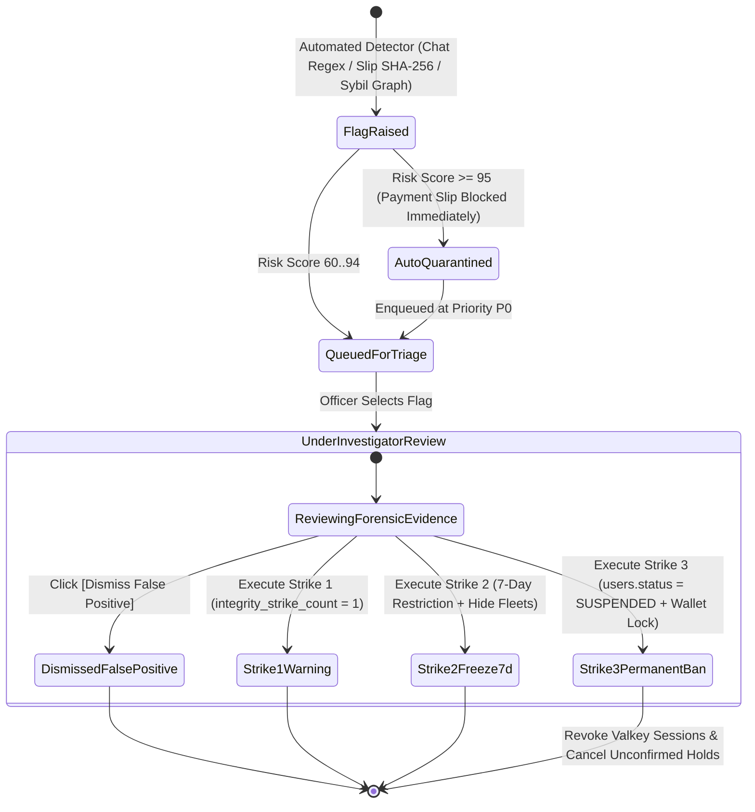
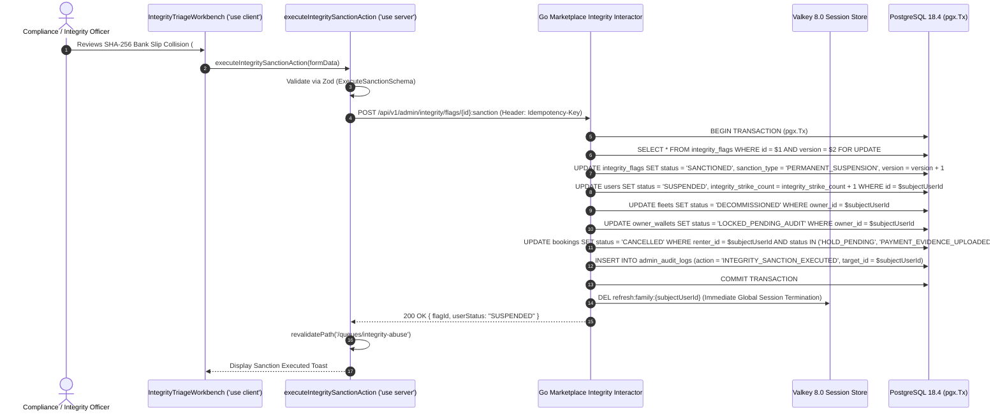

# Marketplace Integrity, Anti-Circumvention & Fraud Abuse Triage Workbench
## Admin Subsystem Specification — `docs/admin/operations-queues/06-marketplace-integrity-abuse-triage.md`

**Document Identifier:** `SPEC-ADM-OPS-06`  
**Classification:** Canonical Subsystem UI/UX & Technical Behavior Specification  
**Governing Documents:** `Dink_Machinery_UI_UX_Design_Brief.md`, `SRS-DINK-CORE-V7.0`, `docs/components/admin/DESIGN.md`, `contracts/openapi.yaml`  
**Target Subsystem:** Next.js 16 Web Admin Console (`admin/src/app/(dashboard)/queues/integrity-abuse/page.tsx`)  
**Primary Persona / Actor:** `OPS_SUPPORT` (Tier-1 Triage), `COMPLIANCE_OFFICER` & `SUPER_ADMIN` (Account Suspension & Wallet Freeze)  
**Associated Requirements:** `REQ-05-24`, `MI-01`, `MI-02`, `MI-03`, `MI-04`, `MI-05`, `MI-06`, `MI-07`, `BK-07B`  
**Associated Interaction Flows:** `FLOW-12` (Back-Office Integrity Triage), `FLOW-05` (Duplicate Bank Slip Fraud Detection)  
**Associated ADRs:** `ADR-008` (Server-Driven UI Engine), `ADR-011` (ASVS Level 3 Security & Fraud Controls)  
**Status:** Approved Technical Design Baseline

---

## 1. Domain Context, Business Rules & Architectural Invariants

The **Marketplace Integrity, Anti-Circumvention & Fraud Abuse Triage Workbench** (`SPEC-ADM-OPS-06`) operationalizes partition `REQ-05-24` (`MI-01`..`MI-07`) and `BK-07B`. Because Dink Machinery connects high-value equipment owners and contractors, bad actors attempt three primary vectors of marketplace abuse:
1. **Fee Circumvention / Off-Platform Solicitation (`MI-01`..`MI-03`):** Attempting to exchange disguised phone numbers, Telegram handles, WhatsApp links, or direct yard coordinates inside pre-confirmation chat threads (`HOLD_PENDING` or inquiry messages prior to `CONFIRMED` status) to bypass the platform commission debit (`BK-17-BE`).
2. **Duplicate or Doctored Bank Transfer Slip Fraud (`MI-04`, `BK-07B`):** Re-uploading a previously settled bank transfer receipt screenshot (detected via exact **SHA-256 binary digest** or **perceptual hash `pHash` Hamming distance $\le 4$**) or submitting a collided bank transaction reference number (`CBE FT...` / `Telebirr...`) across multiple bookings.
3. **Sybil Multi-Account & Device Fingerprint Ring Evasion (`MI-05`..`MI-07`):** Creating new accounts after a suspension or negative wallet balance lockout, detected via shared device hardware hashes, IP subnet velocity, or shared beneficiary bank account numbers.

### 1.1 Progressive 3-Strike Enforcement Policy (`MI-06`, `MI-07`)
- **Strike 1 (`ISSUE_FORMAL_WARNING`):** Sends a mandatory in-app acknowledgement banner and SMS warning; increments `users.integrity_strike_count = 1`.
- **Strike 2 (`TEMPORARY_COOLING_LOCK_7D`):** Freezes new booking creation and hides fleet listings from PostGIS search for **7 days** (`status = 'RESTRICTED_7D'`); increments `integrity_strike_count = 2`.
- **Strike 3 or Severe Fraud (`PERMANENT_ACCOUNT_SUSPENSION`):** Immediately transitions `users.status = 'SUSPENDED'`, revokes all active Valkey JWT/refresh sessions (`AUTH_ACCOUNT_SUSPENDED`), delists all owned fleets, and locks `owner_wallets` under `WALLET_LOCKED_PENDING_AUDIT`.

---

## 2. Screen Anatomy, Layout & Component Hierarchy

### 2.1 Marketplace Integrity & Anti-Circumvention Triage Workbench Wireframe

```text
+------------------------------------------------------------------------------------------------------------------------------------------+
| Operations & Compliance > Marketplace Integrity, Anti-Circumvention & Fraud Triage (`REQ-05-24`)     [High-Risk: 4] [Auto-Quarantined: 2]|
+------------------------------------------------------------------------------------------------------------------------------------------+
| FILTER BAR: [Signal Vector: All (Chat Circumvention / Duplicate Bank Slip / Sybil Cluster) v] [Risk Score: >=70 v] [🔍 Search Actor...]  |
+-------------------------------------------------------------------+----------------------------------------------------------------------+
| LEFT PANE: INTEGRITY SIGNAL QUEUE (`DynamicTable.tsx` — 44% Width)| RIGHT PANE: FORENSIC EVIDENCE & 3-STRIKE ENFORCEMENT PANEL (56% W)   |
| +---------------------------------------------------------------+ | +------------------------------------------------------------------+ |
| | Flag ID  | Vector             | Actor           | Risk |Strikes| | | #FLG-7012 — DUPLICATE_BANK_SLIP_HASH (`BK-07B` / `MI-04`)        | |
| |----------+--------------------+-----------------+------+-------| | | Subject: Kebede Tadesse (`usr_01HP4412` | Role: RENTER)          | |
| |*#FLG-7012| DUP_BANK_SLIP_SHA  | Kebede Tadesse  |  98  | 2 / 3 | | | Prior Strikes: 2 (Strike 1: Chat Phone Leak; Strike 2: 7d Lock)  | |
| | #FLG-7010| CHAT_PHONE_REGEX   | Selamawit Haile |  82  | 0 / 3 | | +------------------------------------------------------------------+ |
| | #FLG-7008| SYBIL_BANK_CLUSTER | Bereket Plant   |  94  | 1 / 3 | | | FORENSIC EVIDENCE DIFF (`SHA-256` & `pHash` Collision Analysis)  | |
| | #FLG-7004| CHAT_TELEGRAM_LINK | Dawit Mengistu  |  75  | 1 / 3 | | | +------------------------------+ +-----------------------------+ | |
| |          |                    |                 |      |       | | | | CURRENT UPLOAD (`#BK-9108`)  | | PRIOR SETTLED (`#BK-8412`)  | | |
| |          |                    |                 |      |       | | | | Uploaded: 2026-10-29 12:04   | | Settled: 2026-09-14 15:22   | | |
| |          |                    |                 |      |       | | | | Amount: 42,000.00 ETB        | | Amount: 42,000.00 ETB       | | |
| |          |                    |                 |      |       | | | | Bank Ref: FT2625799104       | | Bank Ref: FT2625799104      | | |
| |          |                    |                 |      |       | | | | SHA-256: `e3b0c442...98fc1c` | | SHA-256: `e3b0c442...98fc1c`| | |
| |          |                    |                 |      |       | | | +------------------------------+ +-----------------------------+ | |
| |          |                    |                 |      |       | | | [!] EXACT SHA-256 BINARY MATCH (100% Identical Receipt File)     | |
| |          |                    |                 |      |       | | +------------------------------------------------------------------+ |
| |          |                    |                 |      |       | | | INTERCEPTED CHAT / SYBIL TELEMETRY LOG                           | |
| |          |                    |                 |      |       | | | • 11:58 UTC [Blocked Msg]: "Call me on zero-nine-one-one-22..."  | |
| |          |                    |                 |      |       | | | • Shared Device Fingerprint: `dfp_89a1c4...` (2 linked accounts) | |
| |          |                    |                 |      |       | | +------------------------------------------------------------------+ |
| |          |                    |                 |      |       | | | ENFORCEMENT SANCTION EXECUTION (`MI-06` / `MI-07`)               | |
| |          |                    |                 |      |       | | | Select Sanction *: ( ) Dismiss False Positive                    | |
| |          |                    |                 |      |       | | |                    ( ) Strike 1: Formal In-App + SMS Warning     | |
| |          |                    |                 |      |       | | |                    ( ) Strike 2: 7-Day Booking & Listing Freeze  | |
| |          |                    |                 |      |       | | |                    (o) Strike 3: Permanent Account Suspension    | |
| |          |                    |                 |      |       | | | Audit Notes *: [ Recycled CBE receipt FT2625799104 on #BK-9108 ] | |
| |          |                    |                 |      |       | | | [ DISMISS FALSE POSITIVE ]    [ 🔨 EXECUTE SANCTION & REVOKE ]   | |
| +---------------------------------------------------------------+ | +------------------------------------------------------------------+ |
+-------------------------------------------------------------------+----------------------------------------------------------------------+
```

---

## 3. W3C DTCG Design Token Mapping Table

| Integrity Triage Element | W3C Token Path (`design-tokens.json`) | Resolved Value | Behavioral & Accessibility Constraint |
|---|---|---|---|
| **Risk Score Badge (`>= 90`)** | `color.feedback.crimson.100` + `color.feedback.crimson.700` | `#FEE2E2` fill / `#B91C1C` text | Monospace numeric score (`0–100`) paired with severity label (`CRITICAL`, `HIGH`, `MEDIUM`). |
| **SHA-256 Digest Comparison Pill** | `typography.fontFamily.mono` / `typography.fontSize.12` | `Space Mono`, `12sp`, `#450A0A` dark danger | Highlights colliding hexadecimal digests and bank reference tokens. |
| **Redacted Chat Regex Highlight** | `color.brand.amber.100` + `color.brand.amber.900` | `#FEF3C7` highlight / `#78350F` text | Marks the exact substring matched by the anti-circumvention classifier (e.g., spelled-out phone digits). |
| **Execute Sanction Destructive CTA** | `semantic.light.action.destructive.bg` / `text` | `#EF4444` (`#DC2626` hover) / `#FFFFFF` text | Requires confirmation modal when `PERMANENT_ACCOUNT_SUSPENSION` is selected. |

---

## 4. Interactive State Machine & Sequence Choreography

### 4.1 Marketplace Integrity Flag & 3-Strike Sanction State Machine



### 4.2 Duplicate Bank Slip Detection & Account Suspension Sequence



---

## 5. Concrete Next.js 16 Implementation Blueprint

### 5.1 `/api/v1/admin/ui-config?route=queues/integrity-abuse` Metadata Schema

```json
{
  "tableId": "admin_marketplace_integrity_queue",
  "title": "Marketplace Integrity, Anti-Circumvention & Fraud Triage",
  "description": "Triage off-platform fee circumvention attempts, duplicate SHA-256 bank transfer slips, and Sybil device clusters.",
  "defaultSortField": "riskScore",
  "defaultSortDirection": "desc",
  "pageSize": 25,
  "columns": [
    { "id": "flagReference", "header": "Flag ID", "accessorKey": "flagReference", "dataType": "text", "isSortable": false, "isFilterable": true },
    { "id": "vectorType", "header": "Signal Vector", "accessorKey": "vectorType", "dataType": "badge", "isSortable": true, "isFilterable": true,
      "badgeVariants": { "DUP_BANK_SLIP_SHA": "destructive", "CHAT_PHONE_REGEX": "warning", "SYBIL_BANK_CLUSTER": "destructive" }
    },
    { "id": "subjectName", "header": "Subject Actor", "accessorKey": "subjectName", "dataType": "text", "isSortable": true, "isFilterable": true },
    { "id": "riskScore", "header": "Risk Score", "accessorKey": "riskScore", "dataType": "badge", "isSortable": true, "isFilterable": true },
    { "id": "currentStrikes", "header": "Strikes", "accessorKey": "currentStrikesLabel", "dataType": "text", "isSortable": true, "isFilterable": false }
  ],
  "facets": [
    {
      "id": "vectorType",
      "label": "Abuse Vector",
      "type": "select",
      "options": [
        { "label": "Duplicate Bank Slip SHA-256 / pHash (BK-07B)", "value": "DUP_BANK_SLIP_SHA" },
        { "label": "Chat Phone / Off-Platform Solicitation (MI-01)", "value": "CHAT_PHONE_REGEX" },
        { "label": "Sybil Device / Bank Account Cluster (MI-05)", "value": "SYBIL_BANK_CLUSTER" }
      ]
    }
  ],
  "rowActions": [],
  "bulkActions": []
}
```

### 5.2 Server Action: Execute 3-Strike Integrity Sanction (`src/app/(dashboard)/queues/integrity-abuse/actions.ts`)

```typescript
// src/app/(dashboard)/queues/integrity-abuse/actions.ts
'use server';

import { cookies } from 'next/headers';
import { revalidatePath } from 'next/cache';
import { z } from 'zod';
import { ProblemDetails } from '@/types/dynamic-ui';

const ExecuteIntegritySanctionSchema = z.object({
  flagId: z.string().uuid(),
  version: z.coerce.number().int().positive(),
  sanctionDecision: z.enum([
    'DISMISS_FALSE_POSITIVE',
    'STRIKE_1_FORMAL_WARNING',
    'STRIKE_2_COOLING_LOCK_7D',
    'STRIKE_3_PERMANENT_SUSPENSION',
  ]),
  auditNotes: z
    .string()
    .trim()
    .min(10, 'Detailed forensic audit notes (min 10 chars) are required.')
    .max(1000),
});

export async function executeIntegritySanctionAction(formData: FormData): Promise<{
  success: boolean;
  problem?: ProblemDetails;
}> {
  const parsed = ExecuteIntegritySanctionSchema.safeParse({
    flagId: formData.get('flagId'),
    version: formData.get('version'),
    sanctionDecision: formData.get('sanctionDecision'),
    auditNotes: formData.get('auditNotes'),
  });

  if (!parsed.success) {
    return {
      success: false,
      problem: {
        type: 'https://api.dinkmachinery.com/errors/request-validation-failed',
        title: 'Sanction Validation Error',
        status: 400,
        detail: 'Please select a valid sanction level and enter forensic justification notes.',
        code: 'REQ_VALIDATION_FAILED',
        invalidParams: parsed.error.issues.map((i) => ({
          name: i.path.join('.'),
          reason: i.message,
        })),
      },
    };
  }

  const cookieStore = await cookies();
  const sessionToken = cookieStore.get('dink_admin_session')?.value;
  const countryCode = cookieStore.get('dink_admin_country')?.value ?? 'ET';

  const res = await fetch(
    `${process.env.INTERNAL_BACKEND_URL}/api/v1/admin/integrity/flags/${parsed.data.flagId}:sanction`,
    {
      method: 'POST',
      headers: {
        'Content-Type': 'application/json',
        'Authorization': `Bearer ${sessionToken}`,
        'Idempotency-Key': crypto.randomUUID(),
        'X-Country-Code': countryCode,
      },
      body: JSON.stringify(parsed.data),
    }
  );

  const payload = await res.json();
  if (!res.ok) {
    return { success: false, problem: payload.error as ProblemDetails };
  }

  revalidatePath('/queues/integrity-abuse');
  return { success: true };
}
```

---

## 6. OpenAPI 3.1.0 Contract Bindings & RFC 9457 Error Matrix

| HTTP Method & Route | Operation ID | Required Headers | Success Envelope | RFC 9457 Error Codes & Trigger Conditions |
|---|---|---|---|---|
| `GET /api/v1/admin/integrity/flags` | `listIntegrityAbuseFlags` | `Authorization`, `X-Country-Code` | `200 OK` (Cursor-paginated integrity flags) | `401 AUTH_INVALID_TOKEN`<br>`403 AUTH_INSUFFICIENT_PERMISSIONS` |
| `POST /api/v1/admin/integrity/flags/{id}:sanction` | `executeIntegritySanction` | `Authorization`, `Idempotency-Key`, `X-Country-Code` | `200 OK` (`IntegritySanctionDetailResponse`) | `400 REQ_VALIDATION_FAILED`<br>`403 AUTH_INSUFFICIENT_PERMISSIONS` (`OPS_SUPPORT` cannot execute `STRIKE_3_PERMANENT_SUSPENSION` without `COMPLIANCE_OFFICER` clearance)<br>`409 BOOKING_CONCURRENCY_CONFLICT` (`version` mismatch) |

---

## 7. Verification & Acceptance Criteria

1. **Duplicate Bank Slip SHA-256 Diff Presentation (Playwright E2E):**
   - Selecting a `DUP_BANK_SLIP_SHA` flag renders both the newly uploaded payment slip and the historical settled slip side-by-side with their matching SHA-256 digest and booking IDs.
2. **RBAC Gate on Permanent Suspension:**
   - An `OPS_SUPPORT` operator can execute `DISMISS_FALSE_POSITIVE` or `STRIKE_1_FORMAL_WARNING`, whereas `STRIKE_3_PERMANENT_SUSPENSION` requires `COMPLIANCE_OFFICER` or `SUPER_ADMIN` permissions.

---
*Canonical specification entry for Dink Machinery platform development. Changes require an explicit design review.*
