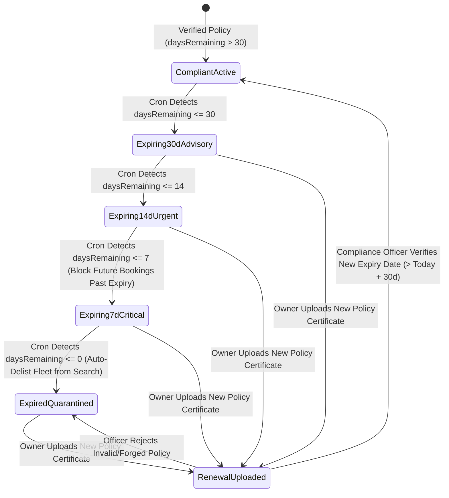
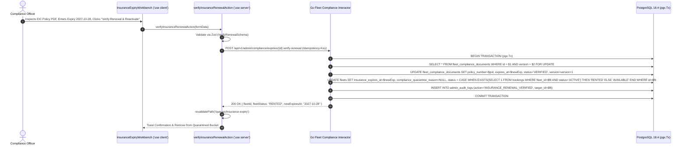

# Automated Insurance, Libre & Commercial License Expiry Compliance Monitor
## Admin Subsystem Specification — `docs/admin/operations-queues/07-insurance-document-expiry-monitor.md`

**Document Identifier:** `SPEC-ADM-OPS-07`  
**Classification:** Canonical Subsystem UI/UX & Technical Behavior Specification  
**Governing Documents:** `Dink_Machinery_UI_UX_Design_Brief.md`, `SRS-DINK-CORE-V7.0`, `docs/components/admin/DESIGN.md`, `contracts/openapi.yaml`  
**Target Subsystem:** Next.js 16 Web Admin Console (`admin/src/app/(dashboard)/queues/insurance-expiry/page.tsx`)  
**Primary Persona / Actor:** `COMPLIANCE_OFFICER`, Fleet Risk Auditor, `SUPER_ADMIN`  
**Associated Requirements:** `REQ-05-13`, `IN-01`, `IN-02`, `IN-03`, `IN-04`, `IN-05`, `IN-06`, `IN-07`, `IN-08`, `FL-26`  
**Associated Interaction Flows:** `FLOW-03` (Fleet Compliance & Insurance Verification), `FLOW-12` (Automated Expiry Quarantine & Reactivation)  
**Associated ADRs:** `ADR-008` (Server-Driven Dynamic UI Metadata)  
**Status:** Approved Technical Design Baseline

---

## 1. Domain Context, Business Rules & Architectural Invariants

The **Automated Insurance, Libre & Commercial License Expiry Compliance Monitor** (`SPEC-ADM-OPS-07`) enforces partition `REQ-05-13` (`IN-01`..`IN-08`). Operating heavy construction machinery or lowboy haulage carriers without valid third-party liability / comprehensive plant insurance or an annually inspected ownership `Libre` creates severe legal and financial exposure.

### 1.1 Automated 30 / 14 / 7 / 0-Day Expiration Lifecycle (`IN-04`..`IN-08`)
A deterministic daily background cron job (`00:05 UTC`) evaluates `insurance_expires_at`, `libre_inspection_expires_at`, `license_expires_at` (Operator), and `trade_license_expires_at` (Corporate KYB) across all active assets:
1. **T-Minus 30 Days (`EXPIRING_30D` — Advisory Tier):** Enqueues record in the Expiry Monitor (`WARNING_30D`) and dispatches automated push/SMS reminder to the Fleet Owner or Operator.
2. **T-Minus 14 Days (`EXPIRING_14D` — Urgent Tier):** Escalates badge to `WARNING_14D`; displays persistent renewal banner on the Fleet Owner's mobile dashboard.
3. **T-Minus 7 Days (`EXPIRING_7D` — Critical Pre-Quarantine Tier):** Blocks the fleet from accepting **new bookings whose requested `end_date` extends beyond `insurance_expires_at`** (`IN-06`), and alerts `COMPLIANCE_OFFICER` staff to follow up if the machine is currently on a long-term active lease.
4. **T-Minus 0 Days (`EXPIRED_QUARANTINED` — Automatic Delisting):**
   - At `00:05 UTC` on the expiration date, if no approved renewal certificate has been recorded, the backend atomically transitions `fleets.status = 'UNDER_MAINTENANCE'` with `compliance_quarantine_reason = 'INSURANCE_OR_LIBRE_EXPIRED'` (`IN-07`), immediately removing the machine from public PostGIS radius searches (`GET /api/v1/geo/fleets/radius-search`).
   - Existing `ACTIVE` on-site bookings are **never abruptly terminated mid-operation**, but trigger a high-priority `ACTIVE_LEASE_INSURANCE_LAPSE` alert on this monitor so operations staff can compel immediate policy renewal from the owner.

---

## 2. Screen Anatomy, Layout & Component Hierarchy

### 2.1 Document Expiry Compliance Monitor & Renewal Verification Drawer Wireframe

```text
+------------------------------------------------------------------------------------------------------------------------------------------+
| Operations & Compliance > Insurance, Libre & License Expiry Monitor (`REQ-05-13` / `IN-01..08`)   [Quarantined: 8] [Active Lease Lapse: 3]|
+------------------------------------------------------------------------------------------------------------------------------------------+
| HORIZON BUCKETS: *[🚨 Expired / Quarantined (8)]  [⚠ < 7 Days Critical (12)]  [⏳ 8–14 Days Urgent (19)]  [📅 15–30 Days Advisory (34)]   |
+-------------------------------------------------------------------+----------------------------------------------------------------------+
| LEFT PANE: EXPIRY MONITOR GRID (`DynamicTable.tsx` — 48% Width)   | RIGHT PANE: RENEWAL CERTIFICATE INSPECTOR & REACTIVATION (52% Width) |
| +---------------------------------------------------------------+ | +------------------------------------------------------------------+ |
| | Asset / Plate | Doc Type       | Expiry Date | Active Bk | St | | | #EXP-5510 — Komatsu PC200-8 (`AA-3-44109`) [QUARANTINED_EXPIRED] | |
| |---------------+----------------+-------------+-----------+----| | | Owner: Abyssinia Heavy Haulage PLC | Active Booking: `#BK-8994`! | |
| |*AA-3-44109    | PLANT_INSURANCE| 2026-10-28  | #BK-8994! | 🔴 | | +------------------------------------------------------------------+ |
| | ET-MACH-0921  | LIBRE_ANNUAL   | 2026-10-29  | None      | 🟠 | | | [UPLOADED RENEWAL POLICY PDF / WEBP — ClamAV Scan: CLEAN ✓]      | |
| | KBZ-412K (KE) | NTSA_INSURANCE | 2026-11-02  | #BK-9011  | 🟡 | | | +--------------------------------------------------------------+ | |
| | AA-3-88120    | PLANT_INSURANCE| 2026-11-04  | None      | 🟡 | | | | ETHIOPIAN INSURANCE CORPORATION (EIC)                        | | |
| |               |                |             |           |    | | | | Contractors' Plant & Machinery (CPM) Comprehensive Policy    | | |
| |               |                |             |           |    | | | | Policy No: EIC/CPM/AA/2026/0098412                           | | |
| |               |                |             |           |    | | | | Insured Machine: Komatsu PC200-8 | Chassis: KMTPC200C019882  | | |
| |               |                |             |           |    | | | | Coverage Period: 2026-10-29 to 2027-10-28                    | | |
| |               |                |             |           |    | | | | Sum Insured: 14,500,000.00 ETB   | Third-Party Liability: ✓  | | |
| |               |                |             |           |    | | | +--------------------------------------------------------------+ | |
| |               |                |             |           |    | | +------------------------------------------------------------------+ |
| |               |                |             |           |    | | | RENEWAL VERIFICATION & QUARANTINE RELEASE FORM                   | |
| |               |                |             |           |    | | | Insurer Name *                     Policy Reference Number *     | |
| |               |                |             |           |    | | | [ Ethiopian Insurance Corp (EIC) ] [ EIC/CPM/AA/2026/0098412   ] | |
| |               |                |             |           |    | | |                                                                  | |
| |               |                |             |           |    | | | New Verified Expiry Date *         Coverage Type *               | |
| |               |                |             |           |    | | | [ 2027-10-28                  📅 ] [ COMPREHENSIVE_PLANT_3P  v ] | |
| |               |                |             |           |    | | |                                                                  | |
| |               |                |             |           |    | | | [x] Chassis Serial & Plate match Fleet Record (`AA-3-44109`)     | |
| |               |                |             |           |    | | | [ 📩 SEND URGENT REMINDER ]   [ ✓ VERIFY RENEWAL & REACTIVATE ]  | |
| +---------------------------------------------------------------+ | +------------------------------------------------------------------+ |
+-------------------------------------------------------------------+----------------------------------------------------------------------+
```

---

## 3. W3C DTCG Design Token Mapping Table

| Expiry Monitor Element | W3C Token Path (`design-tokens.json`) | Resolved Value | Behavioral & Accessibility Constraint |
|---|---|---|---|
| **Horizon Bucket Filter Tabs** | `component.countdown.holdCriticalBg` / `holdUrgentBg` / `holdNormalBg` | `#FEF2F2` (Expired) / `#FFF7ED` (<7d) / `#FFFBEB` (15–30d) | Semantic countdown color progression with explicit icon + text count labels. |
| **Active Lease Lapse Alert Tag** | `color.feedback.crimson.600` | `#DC2626` solid pill (`#FFFFFF` text) | Flags quarantined machines that are currently deployed on an `ACTIVE` construction site lease. |
| **Policy Sum Insured Figure** | `typography.fontFamily.mono` + `typography.fontSize.14` | `Space Mono`, `14sp`, `#020617` | Formatted from integer minor units via `formatMinorUnits`. |
| **Verify Renewal & Reactivate CTA** | `color.feedback.emerald.600` | `#059669` (`dimension.space.48` height) | Atomically clears `compliance_quarantine_reason` and restores fleet status to `AVAILABLE` (or `RENTED` if currently on active lease). |

---

## 4. Interactive State Machine & Sequence Choreography

### 4.1 Automated Document Expiry, Quarantine & Renewal State Machine



### 4.2 Renewal Certificate Verification & Quarantine Release Sequence



---

## 5. Concrete Next.js 16 Implementation Blueprint

### 5.1 Server Action: Verify Insurance / Libre Renewal & Release Quarantine (`src/app/(dashboard)/queues/insurance-expiry/actions.ts`)

```typescript
// src/app/(dashboard)/queues/insurance-expiry/actions.ts
'use server';

import { cookies } from 'next/headers';
import { revalidatePath } from 'next/cache';
import { z } from 'zod';
import { ProblemDetails } from '@/types/dynamic-ui';

const VerifyRenewalSchema = z
  .object({
    complianceDocumentId: z.string().uuid(),
    fleetId: z.string().uuid(),
    version: z.coerce.number().int().positive(),
    insurerName: z.string().trim().min(3).max(160),
    policyNumber: z.string().trim().min(4).max(80),
    coverageType: z.enum(['COMPREHENSIVE_PLANT_3P', 'THIRD_PARTY_ONLY', 'CARRIER_TRANSIT_ALL_RISK']),
    newExpiresAt: z.string().date(),
    chassisMatched: z.literal(true, {
      errorMap: () => ({ message: 'You must confirm the policy chassis serial and plate match the fleet record.' }),
    }),
  })
  .refine(
    (data) => {
      const minFutureDate = new Date();
      minFutureDate.setDate(minFutureDate.getDate() + 14);
      return new Date(data.newExpiresAt) >= minFutureDate;
    },
    {
      message: 'Renewed policy expiration date must be at least 14 days in the future.',
      path: ['newExpiresAt'],
    }
  );

export async function verifyInsuranceRenewalAction(formData: FormData): Promise<{
  success: boolean;
  problem?: ProblemDetails;
}> {
  const parsed = VerifyRenewalSchema.safeParse({
    complianceDocumentId: formData.get('complianceDocumentId'),
    fleetId: formData.get('fleetId'),
    version: formData.get('version'),
    insurerName: formData.get('insurerName'),
    policyNumber: formData.get('policyNumber'),
    coverageType: formData.get('coverageType'),
    newExpiresAt: formData.get('newExpiresAt'),
    chassisMatched: formData.get('chassisMatched') === 'true',
  });

  if (!parsed.success) {
    return {
      success: false,
      problem: {
        type: 'https://api.dinkmachinery.com/errors/request-validation-failed',
        title: 'Renewal Verification Failed',
        status: 400,
        detail: 'Please verify policy details and ensure expiration date is at least 14 days in the future.',
        code: 'REQ_VALIDATION_FAILED',
        invalidParams: parsed.error.issues.map((i) => ({
          name: i.path.join('.'),
          reason: i.message,
        })),
      },
    };
  }

  const cookieStore = await cookies();
  const sessionToken = cookieStore.get('dink_admin_session')?.value;
  const countryCode = cookieStore.get('dink_admin_country')?.value ?? 'ET';

  const res = await fetch(
    `${process.env.INTERNAL_BACKEND_URL}/api/v1/admin/compliance/expiries/${parsed.data.complianceDocumentId}:verify-renewal`,
    {
      method: 'POST',
      headers: {
        'Content-Type': 'application/json',
        'Authorization': `Bearer ${sessionToken}`,
        'Idempotency-Key': crypto.randomUUID(),
        'X-Country-Code': countryCode,
      },
      body: JSON.stringify(parsed.data),
    }
  );

  const payload = await res.json();
  if (!res.ok) {
    return { success: false, problem: payload.error as ProblemDetails };
  }

  revalidatePath('/queues/insurance-expiry');
  revalidatePath('/fleets');
  return { success: true };
}
```

---

## 6. OpenAPI 3.1.0 Contract Bindings & RFC 9457 Error Matrix

| HTTP Method & Route | Operation ID | Required Headers | Success Envelope | RFC 9457 Error Codes & Trigger Conditions |
|---|---|---|---|---|
| `GET /api/v1/admin/compliance/expiries` | `listDocumentExpiries` | `Authorization`, `X-Country-Code` | `200 OK` (Cursor-paginated expiry records by horizon bucket) | `401 AUTH_INVALID_TOKEN`<br>`403 AUTH_INSUFFICIENT_PERMISSIONS` |
| `POST /api/v1/admin/compliance/expiries/{id}:verify-renewal` | `verifyComplianceRenewal` | `Authorization`, `Idempotency-Key`, `X-Country-Code` | `200 OK` (`FleetDetailSuccessResponse`) | `400 REQ_VALIDATION_FAILED` (`newExpiresAt < NOW() + 14d`)<br>`409 BOOKING_CONCURRENCY_CONFLICT` (`version` mismatch)<br>`409 FLEET_STATUS_CONFLICT` (Fleet is permanently `DECOMMISSIONED`) |

---

## 7. Verification & Acceptance Criteria

1. **30/14/7/0-Day Bucket Filtering (Playwright E2E):**
   - Switching between the `Expired / Quarantined`, `< 7 Days Critical`, `8–14 Days Urgent`, and `15–30 Days Advisory` tabs filters the virtualized grid and highlights any row linked to an `ACTIVE` booking in crimson.
2. **Quarantine Reactivation State Transition:**
   - Approving a valid renewal certificate transitions a quarantined idle fleet back to `AVAILABLE` (or `RENTED` if currently deployed on an active booking) and immediately restores its visibility in PostGIS spatial search.

---
*Canonical specification entry for Dink Machinery platform development. Changes require an explicit design review.*
