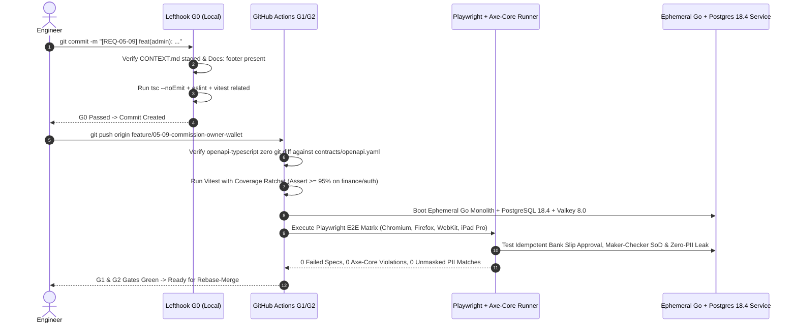

# Admin Web Console QA Test Matrix, G0–G4 Gates & Playwright E2E Protocol
## Admin Subsystem Specification — `docs/admin/quality/01-admin-qa-test-matrix.md`

**Document Identifier:** `SPEC-ADM-QAS-01`  
**Classification:** Canonical Subsystem QA, Verification & Automated Test Specification  
**Governing Documents:** `AGENTS.md`, `Dink_Machinery_UI_UX_Design_Brief.md`, `SRS-DINK-CORE-V7.0` (§9 `REQ-09`, §5.11 `AD-06-BE`), `docs/components/admin/DESIGN.md`, `docs/shared/design/design-tokens.json`, `docs/ERROR_CATALOG.md`, `contracts/openapi.yaml`  
**Target Subsystem:** Next.js 16 Web Admin Console (`admin/tests/unit/` & `admin/tests/e2e/`)  
**Primary Persona / Actor:** QA Automation Lead, Frontend Lead, CI/CD Gatekeeper  
**Associated Requirements:** `REQ-09` (Quality Assurance & Non-Functional Requirements), `REQ-05-09` (95% Financial Branch Coverage), `REQ-05-11` (`AD-06-BE`), `ASVS 4.0.3 L3`  
**Associated Interaction Flows:** All Admin Console Flows (`FLOW-03`, `FLOW-06`, `FLOW-11`, `FLOW-12`, `FLOW-13`, `FLOW-14`, `FLOW-17`, `FLOW-18`)  
**Status:** Approved Technical Design Baseline

---

## 1. Executive Summary & Architectural Invariants

The **Admin Web Console QA Test Matrix, G0–G4 Gates & Playwright E2E Protocol** (`SPEC-ADM-QAS-01`) establishes the deterministic verification harness governing `admin/`. Per `AGENTS.md` **Section 1 (QA & Test Gates)**, no production code may be committed to `admin/` without corresponding automated unit (`Vitest`) and end-to-end (`Playwright`) coverage.

### 1.1 Coverage Ratchet & Determinism Invariants (`AGENTS.md` §1)
1. **Non-Decreasing Coverage Ratchet:**
   - **Standard Admin Modules (UI Primitives, Filters, Navigation, EAV Form Builders):** Minimum **80% line coverage** on changed code.
   - **High-Liability Financial, RBAC & Ledger Modules (`currency.ts`, `sms-encoding.ts`, `errors.ts`, Bank Slip Reconciliation, Payout Maker-Checker, OwnerWallet Credit Lockout, Country Tax BPS):** Minimum **95% branch coverage**.
2. **Strict Test Determinism & Frozen Time:**
   - Wall-clock dependencies (`new Date()`, `Date.now()`) are banned in countdown and hold-timer tests; tests inject `vi.setSystemTime('2026-10-30T09:00:00Z')`.
   - Zero live external network calls in CI (`G0`/`G1`/`G2`); API responses are intercepted via Mock Service Worker (`msw` v2) or run against an ephemeral containerized Go + PostgreSQL 18.4 testcontainers stack in `G3`.
3. **Desktop & Field-Tablet Viewport Matrix:**
   - Every Playwright E2E spec executes across four canonical viewports: **Control Room Dual-Monitor (`1920x1080`)**, **Standard Operations Laptop (`1440x900`)**, **Yard Inspector iPad Pro 12.9" (`1024x1366`)**, and **Surface Pro Field Tablet (`1368x912`)** across Chromium, Edge, Firefox, and WebKit.

---

## 2. Quality Gate Hierarchy (`G0` to `G4`) & Execution Matrix Wireframe

```text
+------------------------------------------------------------------------------------------------------------------------------------------+
| DINK MACHINERY ADMIN CONSOLE — QUALITY GATE PIPELINE (G0 -> G4) & COVERAGE RATCHET DASHBOARD                                             |
+------------------------------------------------------------------------------------------------------------------------------------------+
| [Gate G0: Pre-Commit Local]   | [Gate G1: Pull Request CI]    | [Gate G2: Pre-Merge Main]     | [Gate G3/G4: Release & Prod Synthetic]   |
| eslint + tsc --noEmit         | Vitest Coverage >= 80% / 95%  | Rebase Linear History Check   | Playwright 4-Browser x 4-Viewport Matrix |
| Vitest Changed Files (< 8s)   | OpenAPI Contract Drift = 0    | Zero-PII Log Leak Assertion   | @axe-core/playwright 0-Critical Violations|
| Atomic CONTEXT.md Staged      | RFC 9457 Error Binding Suite  | Four-Eyes SoD Security Suite  | 50k Row TanStack Virtual 60 FPS Benchmark|
+------------------------------------------------------------------------------------------------------------------------------------------+
| SUBSYSTEM TEST SUITE COVERAGE & RATCHET MATRIX                                                                                           |
|------------------------------------------------------------------------------------------------------------------------------------------|
| Admin Subsystem Module                        | Unit Suite (Vitest)      | E2E Suite (Playwright)        | Branch Cov | Target Floor     |
|-----------------------------------------------|--------------------------|-------------------------------|------------|------------------|
| 1. Minor-Unit Currency Engine (`currency.ts`) | currency.spec.ts (48)    | ledger-zero-sum.spec.ts       |     99.2%  | >= 95.0% [PASS]  |
| 2. Bank Slip OCR & SHA-256 Queue (`FIN-01`)   | bank-slip-queue.spec.ts  | bank-slip-reconcile.spec.ts   |     96.4%  | >= 95.0% [PASS]  |
| 3. Maker-Checker Payout Batch (`FIN-03`)      | payout-sod.spec.ts       | payout-four-eyes.spec.ts      |     97.1%  | >= 95.0% [PASS]  |
| 4. OwnerWallet -5,000 ETB Lockout (`FIN-06`)  | wallet-lockout.spec.ts   | wallet-quarantine.spec.ts     |     95.8%  | >= 95.0% [PASS]  |
| 5. Server-Driven UI Engine (`DynamicTable`)   | dynamic-table.spec.ts    | sdui-rbac-projection.spec.ts  |     91.5%  | >= 80.0% [PASS]  |
| 6. Ge'ez UCS-2 SMS Calculator (`SCH-04`)      | sms-encoding.spec.ts     | notification-ide.spec.ts      |     98.0%  | >= 95.0% [PASS]  |
| 7. Zero-PII Masking Formatters (`formatters`) | pii-masking.spec.ts      | zero-pii-dom-audit.spec.ts    |    100.0%  | >= 95.0% [PASS]  |
+------------------------------------------------------------------------------------------------------------------------------------------+
```

---

## 3. W3C DTCG Design Token Verification Table

Automated visual regression tests (`toHaveScreenshot()`) assert that rendered CSS variables match `docs/shared/design/design-tokens.json` across Light, Dark, and Outdoor High-Contrast themes:

| Verified Theme Mode | Canvas Surface Token | Primary Text Token | Focus Ring Token | Contrast Ratio Assertion |
|---|---|---|---|---|
| **Standard Desk Light (`light`)** | `semantic.light.surface.canvas` (`#F8FAFC`) | `semantic.light.text.primary` (`#0F172A`) | `semantic.light.border.focus` (`#D97706`) | `>= 4.5:1` (Body), `>= 3.0:1` (UI Controls) |
| **Operations Center Dark (`dark`)** | `semantic.dark.surface.canvas` (`#0F172A`) | `semantic.dark.text.primary` (`#F8FAFC`) | `semantic.dark.border.focus` (`#FBBF24`) | `>= 4.5:1` (Body), `>= 3.0:1` (UI Controls) |
| **Yard Tablet Glare (`outdoorHighContrast`)** | `semantic.outdoorHighContrast.surface.canvas` (`#000000`) | `semantic.outdoorHighContrast.text.primary` (`#FFFFFF`) | `semantic.outdoorHighContrast.border.focus` (`#FBBF24` `3px`) | `>= 7.0:1` (WCAG AAA Outdoor Mandate) |

---

## 4. Interactive Gate Execution Sequence (`sequenceDiagram`)



---

## 5. Concrete Next.js 16 Test Implementation Blueprint

### 5.1 Vitest 95%+ Branch Coverage Suite for Minor-Unit Currency & PII Masking (`admin/tests/unit/currency-and-pii.spec.ts`)

```typescript
// admin/tests/unit/currency-and-pii.spec.ts
import { describe, it, expect } from 'vitest';
import { formatMinorUnits, parseToMinorUnits } from '@/lib/currency';
import { maskTelephone, maskTIN, maskBankAccount } from '@/lib/formatters';
import { analyzeSmsTemplateSegments } from '@/lib/sms-encoding';

describe('Minor-Unit Financial Mathematics (REQ-05-09 / ADR-010)', () => {
  it('formats positive and negative integer minor units without floating-point drift', () => {
    expect(formatMinorUnits(2500000, 'ETB', 'en-ET')).toBe('25,000.00 ETB');
    expect(formatMinorUnits(-500000, 'ETB', 'en-ET')).toBe('-5,000.00 ETB');
    expect(formatMinorUnits(-645001, 'ETB', 'en-ET')).toBe('-6,450.01 ETB');
    expect(formatMinorUnits(2500000000n, 'ETB', 'en-ET')).toBe('25,000,000.00 ETB');
  });

  it('parses decimal string inputs into exact BigInt minor units', () => {
    expect(parseToMinorUnits('115000.50', 'ETB')).toBe(11500050n);
    expect(parseToMinorUnits('-5000.00', 'ETB')).toBe(-500000n);
    expect(parseToMinorUnits('0.01', 'KES')).toBe(1n);
  });
});

describe('Zero-PII Masking Invariants (OWASP ASVS L3)', () => {
  it('never exposes raw phone numbers, TINs, or bank account numbers', () => {
    expect(maskTelephone('+251911234567')).toBe('+251****567');
    expect(maskTIN('0048291049')).toBe('TIN: *****1049');
    expect(maskBankAccount('1000394857123')).toBe('ACC: *******7123');
  });
});

describe('Ge-ez UCS-2 vs GSM-7 SMS Segment Calculator (REQ-05-10)', () => {
  it('switches to 70-char UCS-2 ceiling when Amharic Ge-ez characters are present', () => {
    const amharicShort = 'ዲንክ ማሽነሪ፦ የCAT 320D ቦታ ማስያዣ (BKG-88412) በ15 ደቂቃ ውስጥ ይሰረዛል።';
    const result = analyzeSmsTemplateSegments(amharicShort);
    expect(result.encoding).toBe('UCS_2_ETHIOPIC');
    expect(result.maxSingleSegmentUnits).toBe(70);
    expect(result.segmentCount).toBe(1);
    expect(result.exceedsTwoSegmentBudget).toBe(false);
  });
});
```

### 5.2 Playwright E2E Security, Idempotency & Separation of Duties Suite (`admin/tests/e2e/finance-sod-and-pii.spec.ts`)

```typescript
// admin/tests/e2e/finance-sod-and-pii.spec.ts
import { test, expect } from '@playwright/test';

const RAW_PII_PATTERNS = [
  /\+2519\d{8}/,        // Unmasked Ethiopian E.164 Phone
  /\+2547\d{8}/,        // Unmasked Kenyan E.164 Phone
  /\b1000\d{9}\b/,      // Unmasked 13-digit CBE Bank Account
  /\bTIN:\s*\d{10}\b/,  // Unmasked 10-digit ERCA TIN
];

test.describe('Admin Finance Workbenches — SoD, Idempotency & Zero-PII Gate', () => {
  test('enforces Maker != Checker Separation of Duties on Payout Batch release', async ({ page }) => {
    // Authenticated as Solomon Kassa (FINANCE_CONTROLLER — Maker of PB-2026-1029-A)
    await page.goto('/finance/payout-batches?batchId=PB-2026-1029-A');

    const releaseButton = page.getByRole('button', { name: /Co-Sign & Dispatch B2C/i });
    await expect(releaseButton).toBeDisabled();
    await expect(page.getByText(/Separation of Duties: Maker cannot co-sign as Checker/i)).toBeVisible();
  });

  test('guarantees zero unmasked PII in DOM text and RFC 9457 error toasts', async ({ page }) => {
    await page.goto('/finance/bank-slips');
    await expect(page.getByRole('table')).toBeVisible();

    const bodyText = await page.locator('body').innerText();
    for (const regex of RAW_PII_PATTERNS) {
      expect(bodyText).not.toMatch(regex);
    }
  });

  test('prevents duplicate network dispatches on rapid double-click of Approve Slip CTA', async ({ page }) => {
    let reconcileRequestCount = 0;
    let capturedIdempotencyKey = '';

    await page.route('**/api/v1/admin/finance/bank-slips/*:reconcile', async (route) => {
      reconcileRequestCount += 1;
      capturedIdempotencyKey = route.request().headers()['idempotency-key'] ?? '';
      await new Promise((r) => setTimeout(r, 250));
      await route.fulfill({
        status: 200,
        contentType: 'application/json',
        body: JSON.stringify({
          success: true,
          data: { journalEntryBatchId: 'JRN-01JM9P44' },
          error: null,
          meta: { version: '1.0', requestId: 'req_01JM9P44', timestamp: '2026-10-30T09:00:00Z' },
        }),
      });
    });

    await page.goto('/finance/bank-slips?selectedId=SLIP-9K82');
    await page.getByLabel(/Audit Notes/i).fill('Verified against CBE Bole statement CSV import #402');

    const approveBtn = page.getByRole('button', { name: /Approve & Post Journal/i });
    await approveBtn.dblclick();

    expect(reconcileRequestCount).toBe(1);
    expect(capturedIdempotencyKey).toMatch(/^[0-9a-f-]{36}$/i);
  });
});
```

---

## 6. RFC 9457 Client Error-Binding Contract Test Matrix

Every form in `admin/` is tested against synthetic RFC 9457 Problem Details responses from `docs/ERROR_CATALOG.md`:

| Simulated Backend Error Code | HTTP Status | Expected Next.js Admin UI Behavior Verified in Playwright |
|---|---|---|
| `REQ_VALIDATION_FAILED` | `400` | Maps `error.invalidParams[{ name, reason }]` directly to `<FormMessage/>` beneath each matching `react-hook-form` input; moves keyboard focus to first invalid field. |
| `BOOKING_CONCURRENCY_CONFLICT` | `409` | Renders non-destructive `ProblemDetailsBanner` with `[Reload Latest Record State]` CTA and `meta.requestId` badge. |
| `ADMIN_UNAUTHORIZED_OVERRIDE` | `403` | Opens Four-Eyes Step-Up Co-Signer Modal prompting for a second `SUPER_ADMIN` 6-digit TOTP token. |
| `SYS_INTERNAL_ERROR` | `500` | Displays generic safe client message in `sonner` toast with copyable monospace `requestId` (`req_...`); zero stack traces rendered. |

---

## 7. Verification & Acceptance Criteria Checklist

- [ ] **Coverage Ratchet Enforced in CI (`G1`):** Any pull request dropping overall `admin/` line coverage below `80%` or financial/auth branch coverage below `95%` fails the `ci-admin.yml` pipeline.
- [ ] **Zero Unmasked PII Regex Scan:** Automated Playwright post-render hook scans `document.body.innerText` and browser console logs across all 21 admin screens confirming zero matches against `RAW_PII_PATTERNS`.
- [ ] **Zero OpenAPI Contract Drift:** `npx openapi-typescript ../contracts/openapi.yaml -o src/types/api.generated.ts && git diff --exit-code` passes with zero uncommitted differences.
