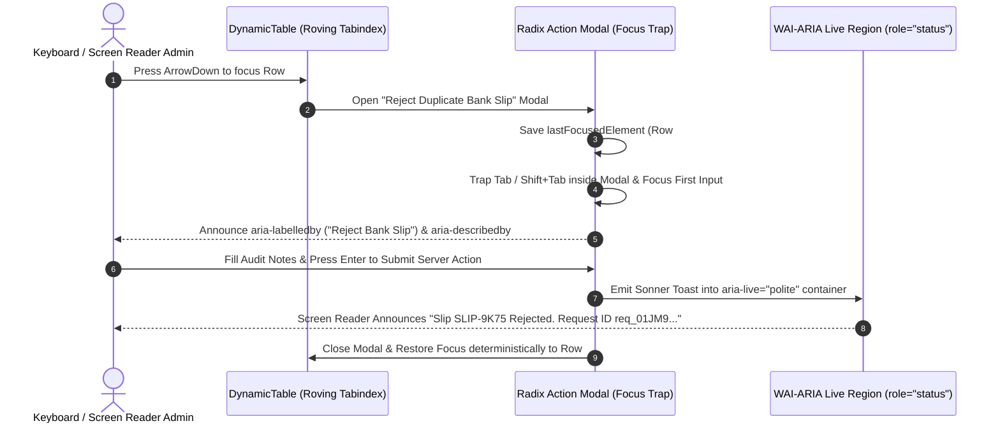

# Web Accessibility (WCAG 2.2 Level AA/AAA), Keyboard Navigation & Ge'ez Legibility Audit
## Admin Subsystem Specification — `docs/admin/quality/02-accessibility-wcag-aa-audit.md`

**Document Identifier:** `SPEC-ADM-QAS-02`  
**Classification:** Canonical Subsystem Accessibility & Ergonomic Compliance Specification  
**Governing Documents:** `AGENTS.md`, `Dink_Machinery_UI_UX_Design_Brief.md`, `SRS-DINK-CORE-V7.0` (§5.16, §9), `docs/components/admin/DESIGN.md`, `docs/shared/design/design-tokens.json`  
**Target Subsystem:** Next.js 16 Web Admin Console (`admin/src/` & `admin/tests/e2e/a11y/`)  
**Primary Persona / Actor:** Accessibility Engineering Lead, QA Automation Lead, Field Yard Inspector  
**Associated Requirements:** `REQ-05-16` (Multilingual Ge'ez Typography & Accessibility), `REQ-09` (WCAG 2.2 Level AA & Axe-Core Zero-Critical Rule)  
**Associated Interaction Flows:** All Admin Console Flows  
**Status:** Approved Technical Design Baseline

---

## 1. Executive Summary & Architectural Invariants

The **Web Accessibility (WCAG 2.2 Level AA/AAA), Keyboard Navigation & Ge'ez Legibility Audit Protocol** (`SPEC-ADM-QAS-02`) enforces universal accessibility across the Dink Machinery Admin Console. In compliance with `AGENTS.md` **Section 1 (`G3: axe-core zero-critical rule`)** and `docs/components/admin/DESIGN.md` **Section 9**, every administrative screen must be 100% operable via keyboard-only navigation, screen readers (**NVDA**, **JAWS**, **VoiceOver**), and under direct equatorial sunlight in **Outdoor High-Contrast Mode (`>= 7.0:1` WCAG AAA contrast)**.

### 1.1 Six Non-Negotiable Accessibility Invariants
1. **Zero `@axe-core/playwright` Violations Rule (`G1`/`G3`):** Automated CI scans across all 21 Admin Console routes must report `0` critical, `0` serious, and `0` moderate WCAG 2.1 / 2.2 Level A & AA violations.
2. **Ethiopic Ge'ez Vertical Line-Height & Anti-Clipping Invariant (`REQ-05-16`):** Amharic (`am`) and Tigrinya (`ti`) fidels carry upper and lower vowel diacritics that clip at standard Latin `1.20` line-heights. All Ge'ez text containers enforce `typography.fontFamily.ethiopic` (`Noto Sans Ethiopic`) with `lineHeightFactor.ethiopicGolden` (`1.38`) for headings/table cells and `ethiopicBody` (`1.45`) for multi-line paragraphs.
3. **Non-Color-Dependent Semantic Status Indicators (WCAG 1.4.1):** Financial, booking, and wallet lockout statuses (`LOCKED`, `DUPLICATE_HASH`, `ZERO-SUM VERIFIED`) never rely on color alone; every badge pairs high-contrast text with a distinct vector icon (`Lock`, `ShieldAlert`, `CheckCircle2`) and explicit prefix symbols (`+` / `-` on ledger legs).
4. **Full Keyboard-Only Operability & Non-Dragging Alternatives (WCAG 2.1.1 & 2.5.7):** Every interactive workflow—including EAV field reordering (`SPEC-ADM-SCH-02`), table column customization (`SPEC-ADM-SCH-03`), and split-screen slip inspection (`SPEC-ADM-FIN-01`)—provides deterministic keyboard shortcuts and explicit button alternatives to drag-and-drop.
5. **High-Visibility Focus Indicators (WCAG 2.4.7 & 2.4.11):** All focusable elements render an unobstructed `2dp` (`3dp` in Outdoor Mode) focus ring using `semantic.light.border.focus` (`#D97706`) or `semantic.dark.border.focus` (`#FBBF24`).
6. **Gloved Field-Tablet Target Sizing (WCAG 2.5.8):** While dense desktop table rows use `40dp` height (`component.table.rowHeightDense`), primary action actuators and tablet mode switches enforce `48dp`–`56dp` (`dimension.space.48` / `56`) minimum hit targets.

---

## 2. Keyboard Focus Order, Landmark Topology & Hotkey Wireframe

```text
+------------------------------------------------------------------------------------------------------------------------------------------+
| [Tab Stop 1: Skip to Primary Work Area (#main-workspace)]   [Tab Stop 2: Skip to Data Grid Filter Bar (#grid-filters)]                   |
+------------------------------------------------------------------------------------------------------------------------------------------+
| <header role="banner">                                                                                                                   |
|   [Tab 3: Sidebar Toggle]  [Tab 4: Global Command Palette (Ctrl+K)]  [Tab 5: Jurisdiction Switcher (ET/KE)]  [Tab 6: Glare Mode Toggle]  |
| </header>                                                                                                                                |
+------------------------------------------------------------------------------------------------------------------------------------------+
| <nav role="navigation" aria-label="Admin Workbenches"> | <main id="main-workspace" role="main" tabindex="-1">                            |
|   [ArrowUp / ArrowDown Roving Tabindex]                |   <section id="grid-filters" role="search" aria-label="Facet Filters">          |
|   - Finance & Ledger                                   |     [Tab 7: Search Input (/)] [Tab 8: Stream Select] [Tab 9: Reset Filters]     |
|     * Bank Slip Queue                                  |   </section>                                                                    |
|     * General Ledger                                   |   <div role="region" aria-label="Virtualized Data Grid" tabindex="0">           |
|     * Payout Batches                                   |     [ArrowUp / ArrowDown: Traverse Rows]                                        |
|     * Tax Compliance                                   |     [Enter / Space: Open Split-Pane Inspector for Active Row]                   |
|     * Wallet Lockouts                                  |     [Home / End: Jump to First / Last Loaded Row]                               |
|   - Corporate Governance                               |   </div>                                                                        |
|   - Schema Engine                                      |   <aside role="complementary" aria-label="Split-Screen Inspector">              |
|   - Configuration                                      |     [Focus Trapped Inside Modal When Action Dialog Opens (Esc to Close & Return)|
| </nav>                                                 |   </aside>                                                                      |
|                                                        | </main>                                                                         |
|--------------------------------------------------------+---------------------------------------------------------------------------------|
| <div role="status" aria-live="polite"> Live Toast Region (Sonner) — Announces Server Action Completion & RequestId </div>                |
+------------------------------------------------------------------------------------------------------------------------------------------+
```

---

## 3. W3C DTCG Token Contrast & Typography Compliance Matrix

| UI Surface / Text Combination | Foreground Token (`$value`) | Background Token (`$value`) | Computed Contrast Ratio | WCAG 2.2 Criterion & Level |
|---|---|---|---|---|
| **Primary Body Text (Light)** | `color.brand.slate.900` (`#0F172A`) | `color.brand.slate.50` (`#F8FAFC`) | **`17.4 : 1`** | 1.4.3 / 1.4.6 — Passes **AAA** (`>= 7.0:1`) |
| **Ledger Numeric Text (Light)** | `color.brand.slate.950` (`#020617`) | `#FFFFFF` (`surface.card`) | **`20.1 : 1`** | 1.4.3 / 1.4.6 — Passes **AAA** (`>= 7.0:1`) |
| **Secondary Metadata (Light)** | `color.brand.slate.600` (`#475569`) | `#FFFFFF` (`surface.card`) | **`7.5 : 1`** | 1.4.3 / 1.4.6 — Passes **AAA** (`>= 7.0:1`) |
| **Success Badge Text on Emerald** | `color.feedback.emerald.700` (`#047857`) | `color.feedback.emerald.100` (`#D1FAE5`) | **`5.1 : 1`** | 1.4.3 — Passes **AA** (`>= 4.5:1`) |
| **Error/Locked Text on Crimson** | `color.feedback.crimson.700` (`#B91C1C`) | `color.feedback.crimson.100` (`#FEE2E2`) | **`5.8 : 1`** | 1.4.3 — Passes **AA** (`>= 4.5:1`) |
| **Warning Text on Amber** | `color.brand.amber.900` (`#78350F`) | `color.brand.amber.100` (`#FEF3C7`) | **`8.4 : 1`** | 1.4.3 / 1.4.6 — Passes **AAA** (`>= 7.0:1`) |
| **Outdoor Glare High-Contrast** | `#FFFFFF` (`text.primary`) | `#000000` (`surface.canvas`) | **`21.0 : 1`** | Maximum Theoretical Contrast (**AAA**) |

---

## 4. Interactive Focus Management & Screen Reader Sequence (`sequenceDiagram`)



---

## 5. Concrete Next.js 16 Accessibility Implementation Blueprint

### 5.1 Accessible Bilingual Wrapper & Skip-Links (`admin/src/components/layout/AccessibleWorkspaceShell.tsx`)

```tsx
// admin/src/components/layout/AccessibleWorkspaceShell.tsx
'use client';

import React from 'react';

interface AccessibleWorkspaceShellProps {
  locale: 'en' | 'am' | 'om' | 'ti' | 'so' | 'sw';
  outdoorGlareMode: boolean;
  children: React.ReactNode;
}

export function AccessibleWorkspaceShell({
  locale,
  outdoorGlareMode,
  children,
}: AccessibleWorkspaceShellProps) {
  const isEthiopicScript = locale === 'am' || locale === 'ti';

  return (
    <div
      lang={locale}
      data-theme={outdoorGlareMode ? 'outdoor-high-contrast' : undefined}
      className={
        isEthiopicScript
          ? 'font-ethiopic leading-[1.38] tracking-normal'
          : 'font-sans leading-[1.25]'
      }
    >
      {/* WCAG 2.4.1 Bypass Blocks — Skip Navigation Links */}
      <a
        href="#main-workspace"
        className="sr-only focus:not-sr-only focus:fixed focus:left-4 focus:top-4 focus:z-50 focus:rounded-md focus:border-2 focus:border-amber-600 focus:bg-amber-500 focus:px-4 focus:py-2 focus:font-semibold focus:text-slate-950"
      >
        {locale === 'am' ? 'ወደ ዋናው የሥራ ክፍል ይዝለሉ (Skip to main workspace)' : 'Skip to main workspace'}
      </a>
      <a
        href="#grid-filters"
        className="sr-only focus:not-sr-only focus:fixed focus:left-64 focus:top-4 focus:z-50 focus:rounded-md focus:border-2 focus:border-amber-600 focus:bg-amber-500 focus:px-4 focus:py-2 focus:font-semibold focus:text-slate-950"
      >
        {locale === 'am' ? 'ወደ ማጣሪያዎች ይዝለሉ (Skip to table filters)' : 'Skip to table filters'}
      </a>

      {children}
    </div>
  );
}
```

### 5.2 Automated `@axe-core/playwright` Zero-Violation Audit Suite (`admin/tests/e2e/a11y/wcag-aa-audit.spec.ts`)

```typescript
// admin/tests/e2e/a11y/wcag-aa-audit.spec.ts
import { test, expect } from '@playwright/test';
import AxeBuilder from '@axe-core/playwright';

const CANONICAL_ADMIN_ROUTES = [
  '/finance/bank-slips',
  '/finance/ledger',
  '/finance/payout-batches',
  '/finance/tax-compliance',
  '/finance/commission-analytics',
  '/finance/wallet-lockouts',
  '/corporate/tenants',
  '/corporate/credit-ledger',
  '/corporate/bulk-fleet-import',
  '/schema-engine',
  '/schema-engine/eav-categories',
  '/schema-engine/table-customizer',
  '/schema-engine/notification-templates',
  '/settings/countries',
  '/settings/holiday-calendars',
  '/settings/feature-flags',
  '/settings/audit-logs',
  '/settings/governance-lifecycle',
];

test.describe('WCAG 2.2 Level AA & Ethiopic Ge-ez Accessibility Gate (SPEC-ADM-QAS-02)', () => {
  for (const route of CANONICAL_ADMIN_ROUTES) {
    test(`asserts 0 axe-core violations on ${route} in Light, Dark, and Amharic modes`, async ({ page }) => {
      await page.goto(route);
      await expect(page.locator('main#main-workspace')).toBeVisible();

      const axeResults = await new AxeBuilder({ page })
        .withTags(['wcag2a', 'wcag2aa', 'wcag21a', 'wcag21aa', 'wcag22aa'])
        .analyze();

      expect(axeResults.violations).toEqual([]);
    });
  }

  test('verifies keyboard skip-link, modal focus trapping, and Escape focus restoration', async ({ page }) => {
    await page.goto('/finance/wallet-lockouts');

    // First Tab activates Skip to main workspace link
    await page.keyboard.press('Tab');
    const skipLink = page.getByRole('link', { name: /Skip to main workspace/i });
    await expect(skipLink).toBeFocused();

    // Open Override Credit Modal via keyboard
    const overrideTrigger = page.getByRole('button', { name: /Grant Temp Credit Override/i }).first();
    await overrideTrigger.focus();
    await page.keyboard.press('Enter');

    const dialog = page.getByRole('dialog');
    await expect(dialog).toBeVisible();

    // Pressing Escape closes modal and restores focus to triggering button
    await page.keyboard.press('Escape');
    await expect(dialog).toBeHidden();
    await expect(overrideTrigger).toBeFocused();
  });
});
```

---

## 6. Accessibility Defect Severity & CI Gate Policy

| Violation Classification | Examples | Gate Behavior (`G1` PR / `G3` Pre-Release) |
|---|---|---|
| **Critical / Serious (`P0`)** | Missing form `<label>`, keyboard focus trap broken, contrast `< 4.5:1`, missing `aria-label` on icon-only action button, `<table>` missing `<th scope="col">`. | **Immediate CI Build Failure.** Blocks PR merge unconditionally. |
| **Ge'ez Diacritical Clipping (`P1`)** | Amharic (`am`) or Tigrinya (`ti`) text container rendered with `line-height < 1.35` or `overflow: hidden` clipping vertical vowel marks. | **Immediate CI Build Failure.** Caught by computed style assertion in Playwright. |
| **Reduced Motion Override (`P2`)** | Animations ignoring `@media (prefers-reduced-motion: reduce)` (`motion.duration.instant = 0ms`). | **Immediate CI Build Failure.** |

---

## 7. Verification & Acceptance Criteria Checklist

- [ ] **Zero Axe-Core Violations Across All 18+ Routes:** `pnpm dlx playwright test tests/e2e/a11y/wcag-aa-audit.spec.ts` completes with `0` violations across Light, Dark, and Outdoor High-Contrast modes.
- [ ] **Ge'ez Line-Height Computed Style Check:** When `lang="am"` is active, computed `line-height / font-size` ratio on all table cells and form labels is `>= 1.38`.
- [ ] **100% Keyboard Path Completion:** EveryServer Action modal in Finance, Corporate Governance, Schema Engine, and Configuration can be opened, populated, submitted, or cancelled using only `Tab`, `Shift+Tab`, `Arrow` keys, `Space`, `Enter`, and `Escape`.
