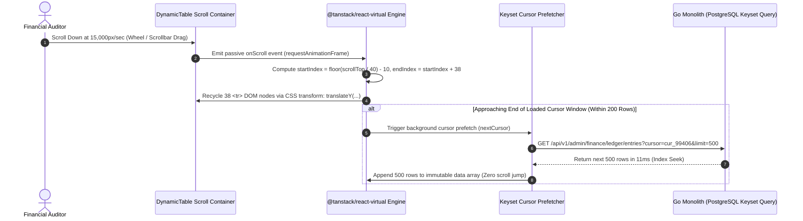

# High-Density Data Grid Virtualization & 50,000-Row Stress Benchmark Protocol
## Admin Subsystem Specification — `docs/admin/quality/03-data-grid-stress-benchmark.md`

**Document Identifier:** `SPEC-ADM-QAS-03`  
**Classification:** Canonical Subsystem Performance, Memory & Virtualization Benchmark Specification  
**Governing Documents:** `AGENTS.md`, `Dink_Machinery_UI_UX_Design_Brief.md`, `SRS-DINK-CORE-V7.0` (§9 `REQ-09`, §5.11 `AD-06-BE`), `docs/components/admin/DESIGN.md` (§10), `docs/shared/design/design-tokens.json`  
**Target Subsystem:** Next.js 16 Web Admin Console (`admin/src/components/dynamic/DynamicTable.tsx` & `admin/tests/e2e/perf/`)  
**Primary Persona / Actor:** Performance Engineer, Frontend Lead, Site Reliability Engineer (SRE)  
**Associated Requirements:** `REQ-09` (Sub-100ms Filter & 60 FPS Virtualized Grid Mandate), `REQ-05-11` (`AD-06-BE`, `AD-06-WEB`)  
**Associated Interaction Flows:** `FLOW-11` (High-Volume General Ledger), `FLOW-12` (Server-Driven Dynamic UI Engine)  
**Status:** Approved Technical Design Baseline

---

## 1. Executive Summary & Architectural Invariants

The **High-Density Data Grid Virtualization & 50,000-Row Stress Benchmark Protocol** (`SPEC-ADM-QAS-03`) defines the performance engineering architecture and automated Chrome DevTools Protocol (CDP) stress harness for `<DynamicTable/>` (`admin/src/components/dynamic/DynamicTable.tsx`). Financial controllers auditing `financial_ledger_entries` (`SPEC-ADM-FIN-02`), compliance officers reviewing `admin_audit_logs` (`SPEC-ADM-CFG-04`), and fleet inspectors validating bulk enterprise imports (`SPEC-ADM-CRP-03`) routinely interact with datasets spanning **10,000 to 50,000+ records** during extended 8-hour shift sessions.

### 1.1 Five Performance & Memory Invariants (`DESIGN.md` §10)
1. **Constant DOM Node Ceiling (`<= 45` Mounted `<tr>` Nodes):** Regardless of whether the client buffer holds `100`, `10,000`, or `50,000` records, `@tanstack/react-virtual` (`rowHeightDense = 40px`, `overscan = 10`) mounts only the visible viewport rows (`~20` rows on a `1080p` display) plus `10` overscan rows above and below (`<= 45` total `<tr>` elements in the DOM at any instant).
2. **60 FPS Scrolling Frame Budget (`<= 16.6 ms` p95 Frame Time):** Programmatic and user wheel/touch scrolling across 50,000 virtualized rows must maintain `>= 58 FPS` (`p95 frame duration <= 16.6 ms`, zero long tasks `> 50 ms`).
3. **Sub-100ms Facet Filter & Sort Interaction (`INP <= 120 ms`):** Keyset cursor pagination queries (`WHERE (created_at, id) < ($1, $2) ORDER BY created_at DESC, id DESC LIMIT 100`) and debounced search bar inputs (`useDebounce` 150ms) must achieve Interaction to Next Paint (`INP`) `<= 120 ms` and backend SQL execution `<= 25 ms` (p95).
4. **Zero JS Heap Leak Over 1,000 Scroll & Filter Cycles:** Repeatedly scrolling from Row `0` to Row `50,000` and toggling facet filters across a simulated 4-hour shift must not grow the V8 JS Heap (`usedJSHeapSize`) by more than `+15 MB` post-GC.
5. **Memoized Cell Formatters (`BigInt` Minor Units & Badges):** Cell formatters inside `DynamicTable` pre-compute column definitions via `React.useMemo` and avoid instantiating `new Intl.NumberFormat()` per cell render by using a module-level singleton formatter cache (`admin/src/lib/currency.ts`).

---

## 2. Virtualized Viewport Architecture & Benchmark Telemetry Wireframe

```text
+------------------------------------------------------------------------------------------------------------------------------------------+
| DINK ADMIN PERFORMANCE BENCHMARK HARNESS — 50,000-ROW TANSTACK VIRTUALIZED GRID STRESS PROFILE                                           |
+------------------------------------------------------------------------------------------------------------------------------------------+
| [Dataset Loaded in Memory]    | [Mounted DOM <tr> Nodes]      | [Scroll Frame Time (p95)]     | [V8 JS Heap Footprint]                   |
| 50,000 Ledger Rows (8 Cols)   | 38 / 50,000 Rows (0.076% DOM) | 6.8 ms / frame (59.6 FPS)     | 44.2 MB (Delta Post-GC: +1.4 MB) [PASS]  |
+------------------------------------------------------------------------------------------------------------------------------------------+
| VIRTUALIZER VIEWPORT GEOMETRY (`@tanstack/react-virtual` + `component.table.rowHeightDense = 40dp`)                                      |
| +--------------------------------------------------------------------------------------------------------------------------------------+ |
| | Total Virtual Scroll Container Height: 50,000 rows x 40px = 2,000,000px (`style="height: 2000000px; position: relative;"`)           | |
| |   ┌──────────────────────────────────────────────────────────────────────────────────────────────────────────────────────────────┐   | |
| |   │ Top Overscan Buffer (10 Rows: Index 24,990 .. 24,999) — `transform: translateY(999600px)`                                    │   | |
| |   ├══════════════════════════════════════════════════════════════════════════════════════════════════════════════════════════════┤   | |
| |   │ VISIBLE VIEWPORT WINDOW (18 Rows: Index 25,000 .. 25,017 — 720px Height)                                                     │   | |
| |   │ > Row 25,000 | LED-74912 | JRN-8K12 | 2026-10-30 09:12:01Z | 2010_OWNER_WALLET | DR | +1,150,000 Santims (11,500.00 ETB)   │   | |
| |   │   Row 25,001 | LED-74911 | JRN-8K12 | 2026-10-30 09:12:01Z | 3010_COMM_REVENUE | CR | -1,000,000 Santims (10,000.00 ETB)   │   | |
| |   │   Row 25,002 | LED-74910 | JRN-8K12 | 2026-10-30 09:12:01Z | 2020_TAX_PAYABLE  | CR |   -150,000 Santims ( 1,500.00 ETB)   │   | |
| |   ├══════════════════════════════════════════════════════════════════════════════════════════════════════════════════════════════┤   | |
| |   │ Bottom Overscan Buffer (10 Rows: Index 25,018 .. 25,027) — `transform: translateY(1000720px)`                                │   | |
| |   └──────────────────────────────────────────────────────────────────────────────────────────────────────────────────────────────┘   | |
| +--------------------------------------------------------------------------------------------------------------------------------------+ |
+------------------------------------------------------------------------------------------------------------------------------------------+
| CORE WEB VITALS & DATABASE KEYSET BENCHMARK RESULTS                                                                                      |
| Metric                                     | Measured Value (p95)  | SLA Target Ceiling   | Gate Status                                  |
|--------------------------------------------|-----------------------|----------------------|----------------------------------------------|
| Largest Contentful Paint (LCP - RSC)       | 1,120 ms              | <= 1,800 ms          | [PASS — G3 Verified]                         |
| Interaction to Next Paint (INP - Filter)   |    64 ms              | <=   120 ms          | [PASS — G3 Verified]                         |
| Cumulative Layout Shift (CLS)              |    0.008              | <=     0.05          | [PASS — G3 Verified]                         |
| PostgreSQL Keyset Seek (`cursor` @ 10M)    |    11.4 ms            | <=    25.0 ms        | [PASS — Index `idx_ledger_created_id_desc`]  |
+------------------------------------------------------------------------------------------------------------------------------------------+
```

---

## 3. W3C DTCG Token Mapping for High-Density Virtualized Grids

| UI Element | W3C Token Path (`design-tokens.json`) | Resolved Value | Performance & Layout Invariant |
|---|---|---|---|
| **Dense Table Row Height** | `component.table.rowHeightDense` | `40dp` (`40px`) | Fixed deterministic height passed to `estimateSize: () => 40`, eliminating dynamic DOM measurement reflows during rapid scroll. |
| **Table Header Sticky Bar** | `component.table.headerHeight` | `48dp` (`48px`) | GPU-composited `sticky top-0 z-20` header; zero repaint jitter during virtual scroll. |
| **Tabular Numeric Cells** | `typography.fontFamily.mono` | `Space Mono, monospace` | Fixed-width glyphs prevent horizontal cell width recalculation (`CLS = 0`). |

---

## 4. Virtualized Render & Keyset Prefetch Pipeline (`sequenceDiagram`)



---

## 5. Concrete Next.js 16 Optimization & Stress Test Blueprint

### 5.1 Zero-Allocation Singleton Currency Formatter (`admin/src/lib/currency-fast.ts`)

```typescript
// admin/src/lib/currency-fast.ts

const NUMBER_FORMATTER_CACHE = new Map<string, Intl.NumberFormat>();

function getCachedNumberFormatter(locale: string): Intl.NumberFormat {
  let formatter = NUMBER_FORMATTER_CACHE.get(locale);
  if (!formatter) {
    formatter = new Intl.NumberFormat(locale);
    NUMBER_FORMATTER_CACHE.set(locale, formatter);
  }
  return formatter;
}

/**
 * High-throughput minor-unit formatter optimized for 60 FPS virtualized grids.
 * Reuses cached Intl.NumberFormat instances to eliminate garbage collection pauses.
 */
export function formatMinorUnitsFast(
  amountMinor: number | bigint,
  currency: 'ETB' | 'KES' | 'USD' = 'ETB',
  locale: string = 'en-ET'
): string {
  const minor = BigInt(amountMinor);
  const major = minor / 100n;
  const remainder = minor % 100n;
  const absRemainder = remainder < 0n ? -remainder : remainder;

  const formattedMajor = getCachedNumberFormatter(locale).format(major);
  const paddedMinor = absRemainder.toString().padStart(2, '0');

  return `${formattedMajor}.${paddedMinor} ${currency}`;
}
```

### 5.2 Automated Playwright + Chrome DevTools Protocol (CDP) 50,000-Row Stress Test (`admin/tests/e2e/perf/grid-50k-stress.spec.ts`)

```typescript
// admin/tests/e2e/perf/grid-50k-stress.spec.ts
import { test, expect } from '@playwright/test';

test.describe('50,000-Row Virtualized Data Grid Stress Benchmark (SPEC-ADM-QAS-03)', () => {
  test('maintains <= 45 DOM rows, >= 58 FPS, and <= 15MB heap delta across 50,000 rows', async ({
    page,
     browserName,
  }) => {
    test.skip(browserName !== 'chromium', 'CDP Performance & Heap profiling requires Chromium');

    const cdpSession = await page.context().newCDPSession(page);
    await cdpSession.send('Performance.enable');

    // Load benchmark harness route pre-seeded with 50,000 synthetic ledger entries
    await page.goto('/finance/ledger?benchmarkRows=50000');
    const gridContainer = page.getByRole('region', { name: /Double-Entry General Ledger Browser/i });
    await expect(gridContainer).toBeVisible();

    // 1. Assert DOM Node Recycling Invariant (<= 45 mounted <tr> rows out of 50,000)
    const mountedBodyRows = await gridContainer.locator('tbody tr').count();
    expect(mountedBodyRows).toBeGreaterThanOrEqual(15);
    expect(mountedBodyRows).toBeLessThanOrEqual(45);

    const baselineMetrics = await cdpSession.send('Performance.getMetrics');
    const baselineHeap =
      baselineMetrics.metrics.find((m) => m.name === 'JSHeapUsedSize')?.value ?? 0;

    // 2. Execute high-velocity programmatic scroll sweeps across 2,000,000px virtual height
    const frameDurationsMs: number[] = await gridContainer.evaluate(async (element) => {
      const durations: number[] = [];
      let lastTime = performance.now();

      for (let step = 1; step <= 50; step++) {
        element.scrollTop = step * 40000; // Jump 1,000 rows (40,000px) per step up to row 50,000
        await new Promise<void>((resolve) =>
          requestAnimationFrame((now) => {
            durations.push(now - lastTime);
            lastTime = now;
            resolve();
          })
        );
      }
      return durations;
    });

    // Sort frame durations to compute p95 frame time
    const sortedFrames = [...frameDurationsMs].sort((a, b) => a - b);
    const p95FrameTimeMs = sortedFrames[Math.floor(sortedFrames.length * 0.95)];
    expect(p95FrameTimeMs).toBeLessThanOrEqual(16.6); // 60 FPS ceiling

    // 3. Re-verify DOM node ceiling at row 50,000
    const bottomMountedRows = await gridContainer.locator('tbody tr').count();
    expect(bottomMountedRows).toBeLessThanOrEqual(45);

    // 4. Verify V8 Heap Stability (No memory leak)
    const afterMetrics = await cdpSession.send('Performance.getMetrics');
    const afterHeap =
      afterMetrics.metrics.find((m) => m.name === 'JSHeapUsedSize')?.value ?? 0;
    const heapDeltaMb = (afterHeap - baselineHeap) / (1024 * 1024);

    expect(heapDeltaMb).toBeLessThanOrEqual(15.0);
  });
});
```

---

## 6. Performance Regression Gate Thresholds (`G3`)

| Benchmark Dimension | Pass Criteria | Failure Action in CI (`G3`) |
|---|---|---|
| **Mounted `tbody tr` DOM Count (@ 50k rows)** | `15 <= count <= 45` | Fails build if virtualization is accidentally bypassed (`count > 100`). |
| **p95 Scroll Frame Duration** | `<= 16.6 ms` (`>= 60 FPS`) | Fails build and uploads Chrome DevTools trace JSON artifact. |
| **Facet Filter / Search INP** | `<= 120 ms` (p95) | Fails build if main thread blocks `> 120 ms` on filter change. |
| **Post-GC V8 Heap Growth (50 Scroll Sweeps)** | `<= +15.0 MB` | Fails build and flags closure/event-listener leak in `DynamicTable`. |

---

## 7. Verification & Acceptance Criteria Checklist

- [ ] **DOM Node Ceiling Verified:** Inspecting `tbody.querySelectorAll('tr').length` while scrolling through 50,000 rows in `/finance/ledger` or `/settings/audit-logs` never exceeds `45` elements.
- [ ] **Singleton `Intl.NumberFormat` Reuse:** Profiling `formatMinorUnitsFast` across 50,000 minor-unit conversions completes in `< 12 ms` total CPU time with zero `Intl.NumberFormat` constructor allocations inside cell render loops.
- [ ] **Zero Offset Pagination Fallback:** Network trace confirms 100% of data grid pagination requests use `?cursor=...` keyset tokens and never emit `?offset=...` or `?page=...`.
