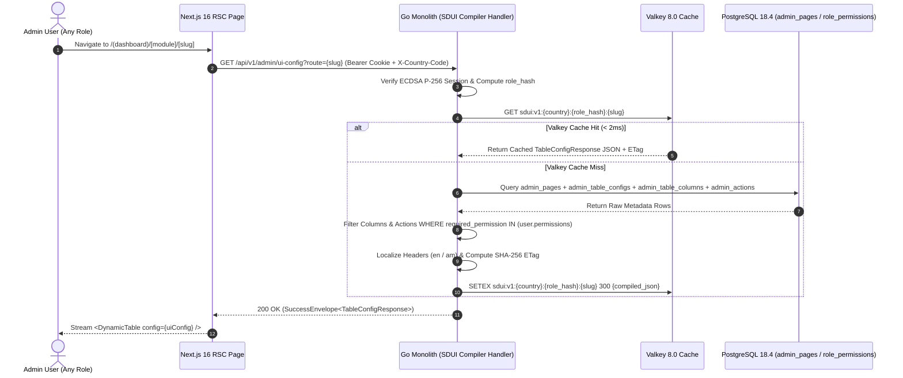

# Server-Driven Dynamic UI Engine & Metadata Synthesis Protocol
## Admin Subsystem Specification — `docs/admin/schema-engine/01-dynamic-ui-engine-overview.md`

**Document Identifier:** `SPEC-ADM-SCH-01`  
**Classification:** Canonical Subsystem UI/UX & Technical Behavior Specification  
**Governing Documents:** `Dink_Machinery_UI_UX_Design_Brief.md`, `SRS-DINK-CORE-V7.0` (§5.11 `AD-06-BE`, §11 `REQ-11`), `docs/components/admin/DESIGN.md`, `docs/shared/design/design-tokens.json`, `docs/ERROR_CATALOG.md`, `contracts/openapi.yaml`, `ADR-008`  
**Target Subsystem:** Next.js 16 Web Admin Console (`admin/src/components/dynamic/` & `admin/src/app/(dashboard)/schema-engine/`)  
**Primary Persona / Actor:** Lead Platform Architect, Super Administrator (*Rahel Tadesse*)  
**Associated Requirements:** `REQ-05-11` (`AD-06-BE`, `AD-06-WEB`), `REQ-11`, `ADR-008`  
**Associated Interaction Flows:** `FLOW-12` / `FLOW-13` (Server-Driven Dynamic UI Compilation & RBAC Projection)  
**Status:** Approved Technical Design Baseline

---

## 1. Executive Summary & Architectural Invariants

The **Server-Driven Dynamic UI Engine & Metadata Synthesis Protocol** (`SPEC-ADM-SCH-01`) defines the core architectural engine (`AD-06-BE` / `AD-06-WEB`) that powers the entire Dink Machinery Next.js 16 Admin Web Console. In compliance with `SRS-DINK-CORE-V7.0` **Section 05.11**, the Next.js frontend contains **zero hardcoded navigation trees, table column arrays, filter facets, or role-gated action triggers**. Instead, the Go 1.27.3 modular monolith dynamically synthesizes the UI configuration payload from eight PostgreSQL metadata tables, filters every element against the authenticated administrator's active RBAC permissions (`RolePermission`) and jurisdictional scope (`X-Country-Code`: `ET` | `KE`), caches the compiled projection in **Valkey 8.0**, and serves it to Next.js React Server Components via `/api/v1/admin/ui-config`.

### 1.1 Five Core SDUI Engine Invariants
1. **Zero Hardcoded Admin Layout Invariant:** Adding a new table column, changing a badge color mapping, or gating a destructive button behind Four-Eyes co-signing is executed via metadata records in `admin_table_columns` and `admin_actions`—requiring zero Next.js code changes or container rebuilds.
2. **Backend RBAC Projection Before Wire Serialization:** Unauthorized navigation links (`admin_sidebar_items`), restricted PII/financial columns (`admin_table_columns.required_permission`), and unpermitted row actions (`admin_actions.required_permission`) are stripped inside the Go interactor **before** the JSON response leaves the backend. Client-side hiding (`display: none`) is strictly forbidden as an access control mechanism (`OWASP ASVS 4.0.3 L3`).
3. **Sub-15ms Valkey Cache Hit & Pub/Sub Invalidation:** Compiled UI metadata payloads are cached in Valkey 8.0 under key `sdui:v1:{country_code}:{role_hash}:{route_slug}` with a 300-second TTL. Any mutation to `admin_pages`, `admin_table_columns`, or `role_permissions` publishes an invalidation event on Valkey channel `sdui:invalidate` and triggers Next.js `revalidateTag('ui-config')`.
4. **Deterministic Schema Versioning (`schemaVersion` & `etag`):** Every `/api/v1/admin/ui-config` payload carries an `etag` (`SHA-256` of the canonical JSON) and `schemaVersion` integer so stale client modals fail fast (`409 BOOKING_CONCURRENCY_CONFLICT`) if an admin schema changes mid-session.
5. **Headless Virtualized Rendering:** Client leaf components (`<DynamicTable/>`, `<DynamicFilterBar/>`, `<DynamicActionModal/>`) bind the server-provided JSON schema to `@tanstack/react-table`, `@tanstack/react-virtual`, and `react-hook-form` + `zod`.

---

## 2. Screen Anatomy, Layout & Bespoke Desktop Wireframe

The **SDUI Schema Registry & Cache Inspector Console** (`/schema-engine/overview`) allows `SUPER_ADMIN` (*Rahel Tadesse*) to inspect live compiled `/api/v1/admin/ui-config` payloads across any role and country persona, monitor Valkey cache hit ratios, and trigger instant global cache purges.

```text
+------------------------------------------------------------------------------------------------------------------------------------------+
| DINK ADMIN [ET: Ethiopia v]   Schema Engine > Dynamic UI Engine & Metadata Protocol Inspector   [Purge Valkey SDUI Cache] [Export Schema]|
+------------------------------------------------------------------------------------------------------------------------------------------+
| [SDUI Compilation p95 Latency] | [Valkey 8.0 Cache Hit Ratio]  | [Registered Admin Routes]     | [RBAC Role Projections Cached]         |
| 6.4 ms (Target <= 100.0 ms)    | 99.42% (Keyspace: sdui:v1:*)  | 28 Active Pages / 184 Columns | 5 Roles x 2 Countries = 10 Projections |
+------------------------------------------------------------------------------------------------------------------------------------------+
| SIMULATE PERSONA PROJECTION: [Role: COMPLIANCE_OFFICER v] [Country: ET (Ethiopia) v] [Route: /finance/bank-slips v] [Re-Compile Preview] |
+------------------------------------------------------------------------------------------------------------------------------------------+
| REGISTERED ADMIN PAGES & METADATA HEALTH (45% Width)       | COMPILED /api/v1/admin/ui-config PROJECTION & RBAC DIFF (55% Width)         |
|------------------------------------------------------------|-----------------------------------------------------------------------------|
| Route Slug             | Layout     | Cols | Actions | ETag| {                                                                           |
|------------------------|------------|------|---------|-----|   "tableId": "tbl_finance_bank_slips_v1",                                   |
| >/finance/bank-slips   | SPLIT_VIEW | 6/7  | 2/3     | 8f9a|   "schemaVersion": 14,                                                      |
|  /finance/ledger       | TABLE_DRAW | 6/6  | 0/1     | 2c1d|   "etag": "sha256:8f9a4412e90c...",                                         |
|  /finance/payout-batch | SPLIT_VIEW | 7/7  | 0/2     | 9b4e|   "compiledForRole": "COMPLIANCE_OFFICER",                                  |
|  /corporate/tenants    | SPLIT_TREE | 6/6  | 1/2     | 4d2a|   "countryCode": "ET",                                                      |
|  /fleets/approvals     | SPLIT_DIFF | 8/8  | 3/3     | 7e11|   "columns": [                                                              |
|  /disputes/arbitration | LIGHTBOX   | 7/7  | 3/3     | 1a09|     { "id": "slipId", "accessorKey": "slipCode", "dataType": "text" },      |
|  /settings/countries   | FORM_GRID  | 9/9  | 0/1     | 5c88|     { "id": "claimedAmount", "dataType": "money", "align": "right" }        |
|                        |            |      |         |     |     // STRIPPED BY RBAC: "unmaskedDepositorAccount" (Requires SUPER_ADMIN)  |
|                        |            |      |         |     |   ],                                                                        |
|                        |            |      |         |     |   "rowActions": [                                                           |
|                        |            |      |         |     |     { "id": "approve_slip", "requiresFourEyes": false }                     |
|                        |            |      |         |     |     // STRIPPED BY RBAC: "override_duplicate_hash" (Requires SUPER_ADMIN)   |
|                        |            |      |         |     |   ]                                                                         |
|                        |            |      |         |     | }                                                                           |
|------------------------------------------------------------|-----------------------------------------------------------------------------|
| Valkey Pub/Sub Channel: sdui:invalidate [CONNECTED - 0ms]  | [Validate JSON Schema Contract] [Invalidate Route Cache] [View Audit Trail] |
+------------------------------------------------------------------------------------------------------------------------------------------+
```

---

## 3. W3C DTCG Design Token Mapping Table

| UI Component / Element | W3C Token Path (`design-tokens.json`) | Resolved Value (Light / Dark / Outdoor) | Behavioral & Accessibility Invariant |
|---|---|---|---|
| **JSON Projection Code Viewport** | `typography.fontFamily.mono` + `color.brand.slate.900` | `Space Mono, monospace` on `#0F172A` surface | Read-only syntax-highlighted JSON tree with `aria-label="Compiled SDUI JSON payload"`. |
| **RBAC Stripped Annotation Line** | `color.feedback.crimson.100` + `color.feedback.crimson.700` | `#FEE2E2` highlight, `#B91C1C` text | Visually shows Super Admins which columns/actions are stripped for lower-privileged roles during simulation. |
| **Valkey Cache Connected Pill** | `color.feedback.emerald.100` + `color.feedback.emerald.700` | `#D1FAE5` fill, `#047857` text | Real-time indicator of Valkey 8.0 cluster connectivity and `< 100ms` compilation SLO compliance. |

---

## 4. Interactive State Machine & Sequence Flows

### 4.1 Server-Driven UI Metadata Compilation & Cache Invalidation (`sequenceDiagram`)



---

## 5. Concrete Next.js 16 Implementation Blueprint

### 5.1 Complete TypeScript SDUI Protocol Contract (`admin/src/types/dynamic-ui.ts`)

```typescript
// admin/src/types/dynamic-ui.ts

export type ColumnDataType =
  | 'text'
  | 'money'
  | 'badge'
  | 'date'
  | 'progress'
  | 'image_thumb'
  | 'boolean_flag'
  | 'actions';

export interface ColumnDefinition {
  id: string;
  header: string;
  headerAm?: string;
  accessorKey: string;
  dataType: ColumnDataType;
  isSortable: boolean;
  isFilterable: boolean;
  isPinnedLeft?: boolean;
  widthPx?: number;
  align?: 'left' | 'center' | 'right';
  badgeVariants?: Record<string, 'default' | 'success' | 'warning' | 'destructive' | 'outline' | 'secondary'>;
  piiMaskPattern?: 'NONE' | 'PHONE_E164' | 'TIN_10' | 'BANK_ACCOUNT';
}

export interface FilterFacetDefinition {
  id: string;
  label: string;
  type: 'select' | 'date-range' | 'text-search' | 'numeric-range';
  options?: Array<{ label: string; value: string }>;
}

export interface ModalFieldSchema {
  name: string;
  label: string;
  type: 'text' | 'textarea' | 'number_minor' | 'select' | 'totp_6';
  required: boolean;
  minLength?: number;
  maxLength?: number;
  options?: Array<{ label: string; value: string }>;
}

export interface ActionDefinition {
  id: string;
  label: string;
  variant: 'default' | 'destructive' | 'outline' | 'secondary';
  requiredPermission: string;
  endpoint: string;
  method: 'POST' | 'PUT' | 'PATCH' | 'DELETE';
  requiresFourEyes?: boolean;
  modalFields?: ModalFieldSchema[];
  confirmationPrompt?: {
    title: string;
    description: string;
    confirmText: string;
  };
}

export interface TableConfigResponse {
  tableId: string;
  schemaVersion: number;
  etag: string;
  title: string;
  description: string;
  layoutType: 'TABLE' | 'SPLIT_VIEW' | 'SPLIT_DIFF' | 'FORM_GRID';
  defaultSortField: string;
  defaultSortDirection: 'asc' | 'desc';
  pageSize: number;
  columns: ColumnDefinition[];
  facets: FilterFacetDefinition[];
  rowActions: ActionDefinition[];
  bulkActions: ActionDefinition[];
}
```

### 5.2 Server Action for Purging Valkey SDUI Cache (`admin/src/app/(dashboard)/schema-engine/actions.ts`)

```typescript
// admin/src/app/(dashboard)/schema-engine/actions.ts
'use server';

import { revalidateTag, revalidatePath } from 'next/cache';
import { cookies } from 'next/headers';
import { z } from 'zod';
import { ProblemDetails } from '@/types/dynamic-ui';

const PurgeSduiCacheSchema = z.object({
  targetRouteSlug: z.string().trim().min(1, 'Specify a route slug or ALL.'),
  reason: z.string().trim().min(5, 'Enter cache invalidation reason.').max(250),
});

export async function purgeSduiCacheAction(formData: FormData): Promise<{
  success: boolean;
  evictedKeysCount?: number;
  problem?: ProblemDetails;
}> {
  const parsed = PurgeSduiCacheSchema.safeParse({
    targetRouteSlug: formData.get('targetRouteSlug'),
    reason: formData.get('reason'),
  });

  if (!parsed.success) {
    return {
      success: false,
      problem: {
        type: 'https://api.dinkmachinery.com/errors/request-validation-failed',
        title: 'Invalid Cache Purge Request',
        status: 400,
        detail: 'Route slug and reason are required.',
        code: 'REQ_VALIDATION_FAILED',
        invalidParams: parsed.error.issues.map((i) => ({ name: i.path.join('.'), reason: i.message })),
      },
    };
  }

  const cookieStore = await cookies();
  const sessionToken = cookieStore.get('dink_admin_session')?.value;

  const res = await fetch(`${process.env.INTERNAL_BACKEND_URL}/api/v1/admin/ui-config:purge-cache`, {
    method: 'POST',
    headers: {
      'Content-Type': 'application/json',
      Authorization: `Bearer ${sessionToken}`,
      'Idempotency-Key': crypto.randomUUID(),
    },
    body: JSON.stringify(parsed.data),
  });

  const payload = await res.json();
  if (!res.ok) {
    return { success: false, problem: payload.error as ProblemDetails };
  }

  revalidateTag('ui-config');
  revalidatePath('/schema-engine');
  return {
    success: true,
    evictedKeysCount: payload.data.evictedKeysCount,
  };
}
```

---

## 6. OpenAPI 3.1.0 Contract & RFC 9457 Error Matrix

| HTTP Method & Route | Operation ID | Required RBAC Permission | Idempotency-Key | Description |
|---|---|---|---|---|
| `GET /api/v1/admin/navigation` | `getAdminNavigationTree` | Authenticated Admin | No | Returns RBAC-filtered collapsible sidebar navigation tree (`admin_sidebar_items`). |
| `GET /api/v1/admin/ui-config` | `getAdminPageUiConfig` | Route-specific permission | No | Compiles and returns `TableConfigResponse` for `?route={slug}`. |
| `POST /api/v1/admin/ui-config:purge-cache` | `purgeAdminUiConfigCache` | `system.schema.manage` | Yes (UUID v4) | Evicts Valkey `sdui:v1:*` keys and publishes `sdui:invalidate` across all edge nodes. |

| Error Code | HTTP Status | RFC 9457 Type URI | Trigger Condition |
|---|---|---|---|
| `AUTH_INSUFFICIENT_PERMISSIONS` | `403 Forbidden` | `https://api.dinkmachinery.com/errors/insufficient-permissions` | Requesting principal lacks the base `required_permission` for `admin_pages.page_slug`. |
| `SYS_SERVICE_UNAVAILABLE` | `503 Unavailable` | `https://api.dinkmachinery.com/errors/service-unavailable` | Both Valkey cache and PostgreSQL metadata fallback pool are unreachable. |

---

## 7. Verification & Acceptance Criteria Checklist

- [ ] **Zero Unauthorized Column/Action Leakage (`ASVS L3`):** Inspecting the raw HTTP response of `GET /api/v1/admin/ui-config?route=finance/bank-slips` for a `FLEET_INSPECTOR` session returns `403 AUTH_INSUFFICIENT_PERMISSIONS`, and for a `COMPLIANCE_OFFICER` session omits `SUPER_ADMIN`-only actions from the JSON array.
- [ ] **Sub-100ms Compilation Latency:** Load test confirms `/api/v1/admin/ui-config` p95 response time is `< 15 ms` on Valkey cache hit and `< 65 ms` on PostgreSQL cold compilation.
