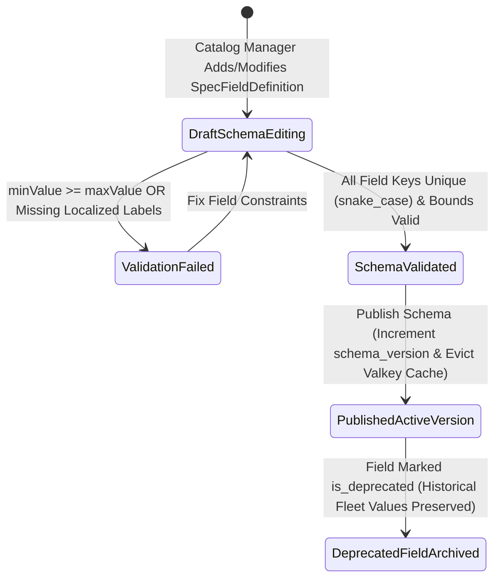

# Visual EAV Machinery Category Taxonomy & Spec Field Schema Builder
## Admin Subsystem Specification — `docs/admin/schema-engine/02-eav-category-field-builder.md`

**Document Identifier:** `SPEC-ADM-SCH-02`  
**Classification:** Canonical Subsystem UI/UX & Technical Behavior Specification  
**Governing Documents:** `Dink_Machinery_UI_UX_Design_Brief.md`, `SRS-DINK-CORE-V7.0` (§5.2 `FL-03`, `FL-13`..`FL-22`, §5.11 `AD-05`), `docs/components/admin/DESIGN.md`, `docs/shared/design/design-tokens.json`, `docs/ERROR_CATALOG.md`, `contracts/openapi.yaml`  
**Target Subsystem:** Next.js 16 Web Admin Console (`admin/src/app/(dashboard)/schema-engine/eav-categories/`)  
**Primary Persona / Actor:** Fleet Inspector & Catalog Manager (*Ato Tewodros Mengistu*), Super Administrator (*Rahel Tadesse*)  
**Associated Requirements:** `REQ-05-02` (`FL-03`, `FL-13`..`FL-22`), `REQ-05-11` (`AD-05`, `AD-06-BE`)  
**Associated Interaction Flows:** `FLOW-03` (Fleet Registration Dynamic EAV Form), `FLOW-12` (Admin Dynamic UI Engine)  
**Status:** Approved Technical Design Baseline

---

## 1. Executive Summary & Architectural Invariants

The **Visual EAV Machinery Category Taxonomy & Spec Field Schema Builder** (`SPEC-ADM-SCH-02`) implements `SRS-DINK-CORE-V7.0` **Sections 05.02 (`FL-03`, `FL-13`..`FL-22`) and 05.11 (`AD-05`)**. Heavy machinery spans vastly different mechanical engineering domains: a *Tracked Hydraulic Excavator* requires `bucket_capacity_m3`, `max_digging_depth_mm`, and `operating_weight_tons`, whereas a *Mobile Telescopic Crane* requires `max_lifting_capacity_tons`, `main_boom_length_m`, and `outrigger_spread_m`, and a *Lowbed Heavy Haulage Trailer* requires `axle_count`, `deck_length_m`, and `max_payload_tons`.

To eliminate database schema migrations (`ALTER TABLE`) and mobile app store releases whenever a new equipment class is introduced, Dink Machinery stores category-specific specifications using a hybrid **3-Level Category Hierarchy + Typed Entity-Attribute-Value (`SpecFieldGroup` / `SpecFieldDefinition` + PostgreSQL JSONB/Indexed EAV)** architecture.

### 1.1 Three-Level Taxonomy & Typed EAV Invariants (`FL-03`, `AD-05`)
1. **3-Level Category Tree (`machinery_categories`):**
   - **Level 1 (Domain):** e.g., `Earthmoving`, `Lifting & Material Handling`, `Road & Compaction`, `Heavy Haulage & Logistics`, `Power & Concrete`.
   - **Level 2 (Class):** e.g., `Excavators`, `Wheel Loaders`, `Mobile Cranes`, `Motor Graders`.
   - **Level 3 (Sub-Type):** e.g., `Tracked Hydraulic Excavators (20T–50T)`, `Mini Excavators (< 8T)`, `Rough Terrain Cranes`.
2. **Supported EAV Data Types (`SpecFieldDataType`):**
   - `NUMBER`: Bounded numeric value (`min_value`, `max_value`, `step_increment`, `unit_label` e.g., `m³`, `Tons`, `kW`, `mm`).
   - `TEXT`: Regex-validated string (e.g., Engine Make/Model `^[A-Za-z0-9 -]{2,60}$`).
   - `BOOLEAN`: Binary capability toggle (e.g., `has_hydraulic_breaker_piping`, `is_ac_cabin_equipped`).
   - `ENUM`: Single-select dropdown from localized option keys (`en`, `am`, `om`, `sw`).
   - `MULTI_SELECT`: Multi-value tag array (e.g., compatible quick-coupler attachments `FL-18`).
3. **Non-Destructive Schema Versioning:** Deprecating or modifying a `SpecFieldDefinition` increments `category_schema_version` without corrupting historical `fleet_eav_values` on already-registered machines.

---

## 2. Screen Anatomy, Layout & Bespoke Desktop Wireframe

The workbench provides a 3-pane IDE layout: Left **3-Level Category Taxonomy Tree** (`25%`), Center **SpecFieldGroup & SpecFieldDefinition Drag-and-Drop Schema Editor** (`45%`), and Right **Live Flutter Mobile Registration Form Simulator** (`30%`).

```text
+------------------------------------------------------------------------------------------------------------------------------------------+
| DINK ADMIN [ET: Ethiopia v]   Schema Engine > EAV Machinery Category & Spec Field Builder       [+ New Category Node] [Publish Schema v8]|
+------------------------------------------------------------------------------------------------------------------------------------------+
| 3-LEVEL TAXONOMY TREE (25%)       | EAV SPEC FIELD BUILDER: Tracked Excavators (45%)          | LIVE MOBILE FORM PREVIEW (30%)           |
|-----------------------------------|-----------------------------------------------------------|------------------------------------------|
| [Search Categories...          ]  | Category Slug: earthmoving/excavators/tracked-excavators  | [Preview Locale: Amharic (አማርኛ) | EN v]  |
| └── Earthmoving (142 Machines)    | Schema Version: v8 (Draft) | Inherited Fields: 4          | +--------------------------------------+ |
|     ├── >Excavators               |-----------------------------------------------------------| | 14:20                    LTE 4G 100% | |
|     │   ├── *Tracked Excavators*  | GROUP 1: CORE HYDRAULIC & DIGGING SPECS     [+ Add Field] | | <-- Register Tracked Excavator       | |
|     │   ├── Wheeled Excavators    | +-------------------------------------------------------+ | |--------------------------------------| |
|     │   └── Mini Excavators (<8T) | | :: [1] operating_weight_tons (NUMBER - Required)      | | | የክብደት መጠን / Operating Weight (Tons)* | |
|     ├── Wheel Loaders             | |    Label (EN): Operating Weight                       | | | [ 21.5                         ] Tons| |
|     ├── Bulldozers (Track-Type)   | |    Label (AM): የማሽን ክብደት (Operating Weight)           | | | Bounds: 8.0 .. 95.0 Tons             | |
|     └── Backhoe Loaders           | |    Unit: [Tons] | Min: [8.0] | Max: [95.0] | Step:0.5 | | |                                      | |
| └── Lifting & Cranes (64)         | |    [x] Search Facet Filter   [x] Show on Listing Card | | | የአካፋ መጠን / Bucket Capacity (m³)*     | |
|     ├── Mobile Telescopic Cranes  | +-------------------------------------------------------+ | | [ 1.20                         ] m³  | |
|     ├── Rough Terrain Cranes      | | :: [2] bucket_capacity_m3 (NUMBER - Required)         | | | Bounds: 0.30 .. 6.50 m³              | |
|     └── Tower Cranes              | |    Label (EN): Standard Bucket Capacity               | | |                                      | |
| └── Road & Compaction (89)        | |    Label (AM): የአካፋ መጠን                               | | | የሃይድሮሊክ ጃክሀመር መስመር / Breaker Line?   | |
|     ├── Motor Graders             | |    Unit: [m³]   | Min: [0.3] | Max: [6.5]  | Step:0.1 | | | (o) Yes (አዎ)     ( ) No (አይ)         | |
|     └── Vibratory Rollers         | +-------------------------------------------------------+ | |                                      | |
| └── Logistics & Lowbeds (118)     | | :: [3] has_breaker_auxiliary_line (BOOLEAN - Req)     | | | ተጨማሪ አባሪዎች / Compatible Attachments  | |
|     ├── 3-Axle Lowbed (40T)       | |    Label (EN): Auxiliary Hydraulic Breaker Piping     | | | [x] Hydraulic Breaker (HB20G)        | |
|     └── 4-Axle Heavy Lowbed (60T+)| +-------------------------------------------------------+ | | [ ] Ripper Tooth                     | |
|                                   | | :: [4] compatible_attachments (MULTI_SELECT)          | | | [x] Heavy Duty Rock Bucket           | |
|                                   | |    Options: [HB20G_BREAKER, RIPPER_TOOTH, ROCK_BUCKET]| | +--------------------------------------+ |
|-----------------------------------|-----------------------------------------------------------|------------------------------------------|
| Total Categories: 38 Active Nodes | [Validate Schema Bounds] [Save Draft] [Discard Changes]   | Mobile EAV Renderer: 100% Parity [OK]    |
+------------------------------------------------------------------------------------------------------------------------------------------+
```

---

## 3. W3C DTCG Design Token Mapping Table

| UI Component / Element | W3C Token Path (`design-tokens.json`) | Resolved Value (Light / Dark / Outdoor) | Behavioral & Accessibility Invariant |
|---|---|---|---|
| **Category Tree Selected Node** | `color.brand.amber.50` + `color.brand.amber.700` | `#FFFBEB` fill, `#B45309` left border (`3dp`) | Supports WAI-ARIA `aria-selected="true"` and keyboard tree navigation. |
| **EAV Field Card Surface** | `semantic.light.surface.card` + `elevation.card` | `#FFFFFF` / `#1E293B` | Includes accessible Up/Down reorder buttons alongside drag handles (WCAG 2.2 Criterion 2.5.7 Dragging Movements). |
| **Amharic Label Input (`label_am`)** | `typography.fontFamily.ethiopic` + `typography.lineHeightFactor.ethiopicGolden` | `Noto Sans Ethiopic, sans-serif`, `1.38` line-height | Prevents vertical diacritical clipping of Ge'ez characters in the form builder and mobile simulator. |
| **Numeric Bounds (`min`/`max`)** | `typography.fontFamily.mono` + `typography.fontSize.14` | `Space Mono, monospace`, `14sp` | Enforces deterministic numeric validation (`minValue < maxValue`). |

---

## 4. Interactive State Machine & Sequence Flows

### 4.1 EAV Category Schema Lifecycle (`stateDiagram-v2`)



---

## 5. Concrete Next.js 16 Implementation Blueprint

### 5.1 Dynamic UI Engine Configuration (`/api/v1/admin/ui-config?route=schema-engine/eav-categories`)

```json
{
  "tableId": "tbl_schema_eav_fields_v1",
  "title": "EAV Specification Field Definitions",
  "description": "Configure category-specific technical specification fields, validation bounds, and search facets.",
  "defaultSortField": "displayOrder",
  "defaultSortDirection": "asc",
  "pageSize": 50,
  "columns": [
    { "id": "displayOrder", "header": "Order", "accessorKey": "displayOrder", "dataType": "text", "isSortable": true, "isFilterable": false },
    { "id": "fieldKey", "header": "Field Key (snake_case)", "accessorKey": "fieldKey", "dataType": "text", "isSortable": true, "isFilterable": true },
    { "id": "labelEn", "header": "Label (EN)", "accessorKey": "labelEn", "dataType": "text", "isSortable": true, "isFilterable": true },
    { "id": "labelAm", "header": "Label (አማርኛ)", "accessorKey": "labelAm", "dataType": "text", "isSortable": false, "isFilterable": false },
    { "id": "dataType", "header": "Data Type", "accessorKey": "dataType", "dataType": "badge", "isSortable": true, "isFilterable": true },
    { "id": "unitLabel", "header": "Unit", "accessorKey": "unitLabel", "dataType": "badge", "isSortable": false, "isFilterable": false },
    { "id": "isSearchFacet", "header": "Search Facet", "accessorKey": "isSearchFacet", "dataType": "boolean_flag", "isSortable": true, "isFilterable": true }
  ],
  "facets": [
    {
      "id": "dataType",
      "label": "Field Data Type",
      "type": "select",
      "options": [
        { "label": "Bounded Number (NUMBER)", "value": "NUMBER" },
        { "label": "Single-Select Enum (ENUM)", "value": "ENUM" },
        { "label": "Multi-Select Array (MULTI_SELECT)", "value": "MULTI_SELECT" },
        { "label": "Boolean Toggle (BOOLEAN)", "value": "BOOLEAN" },
        { "label": "Validated Text (TEXT)", "value": "TEXT" }
      ]
    }
  ],
  "rowActions": [
    {
      "id": "deprecate_eav_field",
      "label": "Deprecate Field",
      "variant": "outline",
      "requiredPermission": "catalog.eav_schema.manage",
      "endpoint": "/api/v1/admin/catalog/categories/{categoryId}/fields/{fieldId}:deprecate",
      "method": "POST"
    }
  ],
  "bulkActions": []
}
```

### 5.2 Server Action for Publishing Category EAV Schema (`admin/src/app/(dashboard)/schema-engine/eav-categories/actions.ts`)

```typescript
// admin/src/app/(dashboard)/schema-engine/eav-categories/actions.ts
'use server';

import { revalidatePath, revalidateTag } from 'next/cache';
import { cookies } from 'next/headers';
import { z } from 'zod';
import { ProblemDetails } from '@/types/dynamic-ui';

const SpecFieldDefinitionSchema = z
  .object({
    fieldKey: z
      .string()
      .regex(/^[a-z][a-z0-9_]{2,48}$/, 'Field key must be snake_case (e.g., bucket_capacity_m3).'),
    groupKey: z.string().min(2).max(50),
    labelEn: z.string().trim().min(2).max(100),
    labelAm: z.string().trim().min(1, 'Amharic translation label is required.').max(120),
    labelSw: z.string().trim().min(2, 'Swahili translation label is required.').max(100),
    dataType: z.enum(['NUMBER', 'TEXT', 'BOOLEAN', 'ENUM', 'MULTI_SELECT']),
    isRequired: z.boolean(),
    isSearchFacet: z.boolean(),
    unitLabel: z.string().max(20).optional(),
    minValue: z.number().optional(),
    maxValue: z.number().optional(),
    enumOptions: z.array(z.string()).optional(),
    displayOrder: z.number().int().nonnegative(),
  })
  .refine(
    (f) => {
      if (f.dataType === 'NUMBER' && f.minValue !== undefined && f.maxValue !== undefined) {
        return f.maxValue > f.minValue;
      }
      return true;
    },
    { message: 'NUMBER field maxValue must be strictly greater than minValue.', path: ['maxValue'] }
  );

const PublishCategoryEavSchema = z.object({
  categoryId: z.string().uuid(),
  expectedSchemaVersion: z.coerce.number().int().positive(),
  fields: z.array(SpecFieldDefinitionSchema).min(1, 'Category must define at least 1 EAV specification field.'),
});

export async function publishCategoryEavSchemaAction(
  payloadInput: z.infer<typeof PublishCategoryEavSchema>
): Promise<{
  success: boolean;
  newSchemaVersion?: number;
  problem?: ProblemDetails;
}> {
  const parsed = PublishCategoryEavSchema.safeParse(payloadInput);
  if (!parsed.success) {
    return {
      success: false,
      problem: {
        type: 'https://api.dinkmachinery.com/errors/request-validation-failed',
        title: 'EAV Category Schema Validation Failed',
        status: 400,
        detail: 'One or more specification field definitions violated constraints.',
        code: 'REQ_VALIDATION_FAILED',
        invalidParams: parsed.error.issues.map((i) => ({ name: i.path.join('.'), reason: i.message })),
      },
    };
  }

  const cookieStore = await cookies();
  const sessionToken = cookieStore.get('dink_admin_session')?.value;

  const res = await fetch(
    `${process.env.INTERNAL_BACKEND_URL}/api/v1/admin/catalog/categories/${parsed.data.categoryId}/schema:publish`,
    {
      method: 'POST',
      headers: {
        'Content-Type': 'application/json',
        Authorization: `Bearer ${sessionToken}`,
        'Idempotency-Key': crypto.randomUUID(),
      },
      body: JSON.stringify(parsed.data),
    }
  );

  const payload = await res.json();
  if (!res.ok) {
    return { success: false, problem: payload.error as ProblemDetails };
  }

  revalidateTag('catalog-eav-schemas');
  revalidatePath('/schema-engine/eav-categories');
  return {
    success: true,
    newSchemaVersion: payload.data.newSchemaVersion,
  };
}
```

---

## 6. OpenAPI 3.1.0 Contract & RFC 9457 Error Matrix

| HTTP Method & Route | Operation ID | Required RBAC Permission | Idempotency-Key | Description |
|---|---|---|---|---|
| `GET /api/v1/admin/catalog/categories/tree` | `getCategoryTaxonomyTree` | `catalog.eav_schema.read` | No | Returns 3-level machinery category hierarchy and active `schemaVersion`. |
| `POST /api/v1/admin/catalog/categories/{categoryId}/schema:publish` | `publishCategoryEavSchema` | `catalog.eav_schema.manage` | Yes (UUID v4) | Atomically publishes a new EAV `SpecFieldDefinition` version and invalidates Valkey catalog caches. |
| `POST /api/v1/admin/catalog/categories/{categoryId}/fields/{fieldId}:deprecate` | `deprecateCategoryEavField` | `catalog.eav_schema.manage` | Yes (UUID v4) | Soft-deprecates an EAV attribute while preserving historical machine values. |

| Error Code | HTTP Status | RFC 9457 Type URI | Trigger Condition |
|---|---|---|---|
| `CAT_NOT_FOUND` | `404 Not Found` | `https://api.dinkmachinery.com/errors/category-not-found` | Target `categoryId` does not exist in `machinery_categories`. |
| `FLEET_ATTACHMENT_UNSUPPORTED` | `422 Unprocessable` | `https://api.dinkmachinery.com/errors/fleet-attachment-unsupported` | Default attachment compatibility code in `MULTI_SELECT` is invalid for the base category class. |
| `BOOKING_CONCURRENCY_CONFLICT` | `409 Conflict` | `https://api.dinkmachinery.com/errors/booking-concurrency-conflict` | `expectedSchemaVersion` does not match current database `schema_version`. |

---

## 7. Verification & Acceptance Criteria Checklist

- [ ] **Zero-Deployment Mobile Form Sync (`FL-03`, `AD-05`):** Adding a new `NUMBER` field `max_reach_meters` (`min: 4.0`, `max: 24.0`, `unit: m`) and clicking `Publish Schema` updates the `/api/v1/catalog/categories/{slug}/schema` response immediately without restarting Go or Next.js containers.
- [ ] **Keyboard Reordering Accessibility (WCAG 2.2 AA 2.5.7):** Every draggable EAV field card exposes explicit `Move Up` and `Move Down` keyboard-accessible buttons so administrators do not rely on pointer drag gestures.
