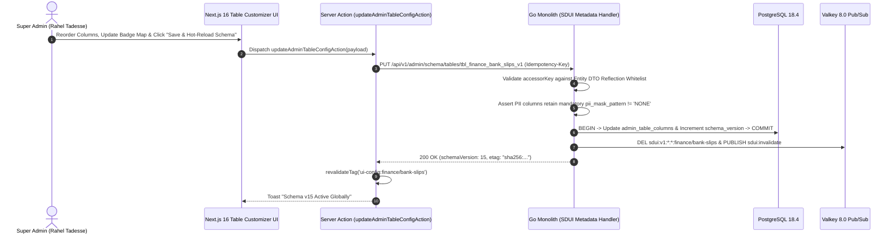

# Server-Driven Admin Table Column, Formatter & Action Permissions Customizer
## Admin Subsystem Specification — `docs/admin/schema-engine/03-admin-table-column-customizer.md`

**Document Identifier:** `SPEC-ADM-SCH-03`  
**Classification:** Canonical Subsystem UI/UX & Technical Behavior Specification  
**Governing Documents:** `Dink_Machinery_UI_UX_Design_Brief.md`, `SRS-DINK-CORE-V7.0` (§5.11 `AD-06-BE`, `AD-06-WEB`), `docs/components/admin/DESIGN.md`, `docs/shared/design/design-tokens.json`, `docs/ERROR_CATALOG.md`, `contracts/openapi.yaml`  
**Target Subsystem:** Next.js 16 Web Admin Console (`admin/src/app/(dashboard)/schema-engine/table-customizer/`)  
**Primary Persona / Actor:** Super Administrator (*Rahel Tadesse*)  
**Associated Requirements:** `REQ-05-11` (`AD-06-BE`, `AD-06-WEB`), `REQ-05-24` (`AD-09`)  
**Associated Interaction Flows:** `FLOW-12` / `FLOW-13` (Admin Dynamic UI Engine & RBAC Matrix)  
**Status:** Approved Technical Design Baseline

---

## 1. Executive Summary & Architectural Invariants

The **Server-Driven Admin Table Column, Formatter & Action Permissions Customizer** (`SPEC-ADM-SCH-03`) is the metadata authoring studio for `admin_table_configs`, `admin_table_columns`, `admin_actions`, and `admin_page_actions` (`SRS-DINK-CORE-V7.0` §5.11). Rather than requiring frontend engineers to modify TypeScript `@tanstack/react-table` column definitions when operational teams request a new column, sort key, badge status mapping, PII masking rule, or Four-Eyes confirmation gate, `SUPER_ADMIN` (*Rahel Tadesse*) modifies the table metadata directly through this workbench.

### 1.1 Metadata Security & Formatter Invariants
- **Strict Whitelisted SQL Accessor Binding:** `field_key` values in `admin_table_columns` cannot contain arbitrary SQL expressions. They are validated against a compile-time Go struct reflection whitelist for the target `entity_name` (`users`, `fleets`, `bookings`, `disputes`, `financial_ledger_entries`, `owner_wallets`) to prevent SQL injection (`OWASP ASVS L3`).
- **Mandatory PII Masking Enforcement:** Columns referencing sensitive fields (`phone_e164`, `tin_number`, `national_id_number`, `bank_account_number`) have `pii_mask_pattern` locked to `PHONE_E164`, `TIN_10`, or `BANK_ACCOUNT` and cannot be switched to `NONE` in table views.
- **Four-Eyes Floor Lock:** Actions that mutate financial balances or override security locks (`OVERRIDE_CREDIT`, `REVERSE_LEDGER_BATCH`, `AUTHORIZE_PAYOUT_BATCH`) have `requires_four_eyes = true` enforced as an immutable domain invariant.

---

## 2. Screen Anatomy, Layout & Bespoke Desktop Wireframe

```text
+------------------------------------------------------------------------------------------------------------------------------------------+
| DINK ADMIN [ET: Ethiopia v]   Schema Engine > Admin Table Column & Action Customizer           [Target Table: tbl_finance_bank_slips_v1 v]|
+------------------------------------------------------------------------------------------------------------------------------------------+
| TABLE SETTINGS: Default Sort: [uploadedAt v] [ASC v] | Page Size: [50 v] | Virtual Row Height: [40dp Dense v] | Schema Version: v14     |
+------------------------------------------------------------------------------------------------------------------------------------------+
| COLUMN DEFINITIONS & FORMATTERS (55% Width)                           | COLUMN & ROW ACTION INSPECTOR (Selected: col_ocrMatchStatus)     |
|-----------------------------------------------------------------------|------------------------------------------------------------------|
| Ord | Field Key          | Header (EN / AM)    | Formatter | RBAC     | COLUMN METADATA CONFIGURATION                                    |
|-----|--------------------|---------------------|-----------|----------| Field Key (Whitelisted): [matchStatus                         v] |
|  01 | slipCode           | Slip ID / መለያ       | TEXT_MONO | *.read   | Header Label (English):  [OCR / CSV Match                      ] |
|  02 | streamType         | Stream / ዓይነት        | BADGE     | *.read   | Header Label (Amharic):  [የባንክ ደረሰኝ ማረጋገጫ                     ] |
|  03 | bankCode           | Bank / ባንክ          | BADGE     | *.read   | Cell Renderer Type:      [BADGE (Semantic Status Pill)        v] |
|  04 | claimedReference   | FT Ref / የባንክ ቁጥር   | TEXT_MONO | *.read   | Alignment:               [(o) Left   ( ) Center   ( ) Right    ] |
|  05 | claimedAmount      | Stated Amount / መጠን | MONEY_MIN | *.read   | Sortable / Filterable:   [x] Sortable     [x] Facet Filterable   |
| >06 | matchStatus        | OCR / CSV Match     | BADGE     | *.read   | Required RBAC Scope:     [finance.bank_slip.read              v] |
|  07 | payerMaskedName    | Depositor / ከፋይ     | PII_MASK  | *.read   |------------------------------------------------------------------|
|     |                    |                     |           |          | BADGE VARIANT SEMANTIC TOKEN MAP (JSON)                          |
|-----|--------------------|---------------------|-----------|----------| Value Key            | Design Token Variant | Icon               |
| CONFIGURED ROW ACTIONS (`admin_page_actions`)                         | ---------------------|----------------------|------------------- |
| Act | Action Key         | Button Style | Required RBAC     | 4-Eyes  | EXACT_CSV_MATCH      | [success (Emerald) v]| [CheckCircle2   v] |
|-----|--------------------|--------------|-------------------|---------| FUZZY_OCR_MATCH      | [warning (Amber)   v]| [AlertTriangle  v] |
|  A1 | approve_slip       | PRIMARY      | *.reconcile       | No      | DUPLICATE_HASH       | [destructive (Red) v]| [ShieldAlert    v] |
|  A2 | reject_slip        | DESTRUCTIVE  | *.reconcile       | No      | UNMATCHED            | [outline (Slate)   v]| [HelpCircle     v] |
|  A3 | force_override_dup | DESTRUCTIVE  | admin.override    | YES [x] |                                                                  |
|-----------------------------------------------------------------------|------------------------------------------------------------------|
| [+ Add Whitelisted Column]  [+ Attach Row Action]                     | [Save & Hot-Reload Table Schema (v15)]  [Revert to v13]          |
+------------------------------------------------------------------------------------------------------------------------------------------+
```

---

## 3. W3C DTCG Design Token Mapping Table

| UI Component / Element | W3C Token Path (`design-tokens.json`) | Resolved Value (Light / Dark / Outdoor) | Behavioral & Accessibility Invariant |
|---|---|---|---|
| **Formatter Type Pill (`MONEY_MIN`)** | `color.brand.slate.800` + `color.brand.amber.400` | `#1E293B` bg, `#FBBF24` monospace text | Clearly distinguishes `MONEY_MINOR`, `BADGE`, `DATE_UTC`, and `PII_MASK` renderers. |
| **Badge Variant Preview Swatches** | `color.feedback.emerald.100` / `color.brand.amber.100` / `color.feedback.crimson.100` | `#D1FAE5` / `#FEF3C7` / `#FEE2E2` | Live visual preview verifying WCAG 2.2 AA `>= 4.5:1` text-to-badge contrast before saving. |
| **Amharic Header Input (`header_am`)** | `typography.fontFamily.ethiopic` | `Noto Sans Ethiopic, sans-serif` (`1.38` line-height) | Ensures bilingual table headers render cleanly when an admin switches UI language to Amharic. |

---

## 4. Interactive State Machine & Sequence Flows

### 4.1 Table Metadata Hot-Reload Lifecycle (`sequenceDiagram`)



---

## 5. Concrete Next.js 16 Implementation Blueprint

### 5.1 Dynamic UI Engine Configuration (`/api/v1/admin/ui-config?route=schema-engine/table-customizer`)

```json
{
  "tableId": "tbl_schema_admin_columns_v1",
  "title": "Admin Table Column & Action Metadata Registry",
  "description": "Configure server-driven table columns, formatters, sort keys, and RBAC-gated row actions.",
  "defaultSortField": "displayOrder",
  "defaultSortDirection": "asc",
  "pageSize": 50,
  "columns": [
    { "id": "displayOrder", "header": "Ord", "accessorKey": "displayOrder", "dataType": "text", "isSortable": true, "isFilterable": false },
    { "id": "accessorKey", "header": "DTO Accessor Key", "accessorKey": "accessorKey", "dataType": "text", "isSortable": true, "isFilterable": true },
    { "id": "headerEn", "header": "Header (EN)", "accessorKey": "headerEn", "dataType": "text", "isSortable": false, "isFilterable": true },
    { "id": "headerAm", "header": "Header (AM)", "accessorKey": "headerAm", "dataType": "text", "isSortable": false, "isFilterable": false },
    { "id": "dataType", "header": "Formatter", "accessorKey": "dataType", "dataType": "badge", "isSortable": true, "isFilterable": true },
    { "id": "requiredPermission", "header": "Required RBAC Permission", "accessorKey": "requiredPermission", "dataType": "badge", "isSortable": true, "isFilterable": true }
  ],
  "facets": [],
  "rowActions": [],
  "bulkActions": []
}
```

### 5.2 Server Action for Updating Table Column & Action Schema (`admin/src/app/(dashboard)/schema-engine/table-customizer/actions.ts`)

```typescript
// admin/src/app/(dashboard)/schema-engine/table-customizer/actions.ts
'use server';

import { revalidateTag, revalidatePath } from 'next/cache';
import { cookies } from 'next/headers';
import { z } from 'zod';
import { ProblemDetails } from '@/types/dynamic-ui';

const AdminColumnMetadataSchema = z.object({
  id: z.string().min(2).max(64),
  accessorKey: z.string().regex(/^[a-zA-Z][a-zA-Z0-9_]{1,60}$/, 'Accessor must match a whitelisted camelCase DTO field.'),
  header: z.string().trim().min(2).max(60),
  headerAm: z.string().trim().min(1).max(80),
  dataType: z.enum(['text', 'money', 'badge', 'date', 'progress', 'image_thumb', 'boolean_flag']),
  isSortable: z.boolean(),
  isFilterable: z.boolean(),
  align: z.enum(['left', 'center', 'right']),
  requiredPermission: z.string().regex(/^[a-z_]+\.[a-z_]+\.[a-z_]+$/),
  piiMaskPattern: z.enum(['NONE', 'PHONE_E164', 'TIN_10', 'BANK_ACCOUNT']).default('NONE'),
  badgeVariants: z.record(z.string(), z.enum(['default', 'success', 'warning', 'destructive', 'outline', 'secondary'])).optional(),
  displayOrder: z.number().int().nonnegative(),
});

const UpdateTableConfigSchema = z.object({
  tableId: z.string().min(3).max(80),
  routeSlug: z.string().min(2).max(100),
  expectedSchemaVersion: z.number().int().positive(),
  defaultSortField: z.string().min(2).max(60),
  defaultSortDirection: z.enum(['asc', 'desc']),
  pageSize: z.number().int().min(10).max(200),
  columns: z.array(AdminColumnMetadataSchema).min(1),
});

export async function updateAdminTableConfigAction(
  input: z.infer<typeof UpdateTableConfigSchema>
): Promise<{
  success: boolean;
  newSchemaVersion?: number;
  problem?: ProblemDetails;
}> {
  const parsed = UpdateTableConfigSchema.safeParse(input);
  if (!parsed.success) {
    return {
      success: false,
      problem: {
        type: 'https://api.dinkmachinery.com/errors/request-validation-failed',
        title: 'Table Schema Validation Error',
        status: 400,
        detail: 'Invalid column definition or RBAC permission format.',
        code: 'REQ_VALIDATION_FAILED',
        invalidParams: parsed.error.issues.map((i) => ({ name: i.path.join('.'), reason: i.message })),
      },
    };
  }

  const cookieStore = await cookies();
  const sessionToken = cookieStore.get('dink_admin_session')?.value;

  const res = await fetch(
    `${process.env.INTERNAL_BACKEND_URL}/api/v1/admin/schema/tables/${parsed.data.tableId}`,
    {
      method: 'PUT',
      headers: {
        'Content-Type': 'application/json',
        Authorization: `Bearer ${sessionToken}`,
        'Idempotency-Key': crypto.randomUUID(),
      },
      body: JSON.stringify(parsed.data),
    }
  );

  const payload = await res.json();
  if (!res.ok) {
    return { success: false, problem: payload.error as ProblemDetails };
  }

  revalidateTag(`ui-config:${parsed.data.routeSlug}`);
  revalidateTag('ui-config');
  revalidatePath(`/schema-engine/table-customizer`);
  return {
    success: true,
    newSchemaVersion: payload.data.newSchemaVersion,
  };
}
```

---

## 6. OpenAPI 3.1.0 Contract & RFC 9457 Error Matrix

| HTTP Method & Route | Operation ID | Required RBAC Permission | Idempotency-Key | Description |
|---|---|---|---|---|
| `GET /api/v1/admin/schema/tables/{tableId}` | `getAdminTableMetadata` | `system.schema.read` | No | Fetches raw column, facet, and action definitions plus whitelisted entity fields. |
| `PUT /api/v1/admin/schema/tables/{tableId}` | `updateAdminTableMetadata` | `system.schema.manage` | Yes (UUID v4) | Atomically updates `admin_table_columns`, increments `schemaVersion`, and invalidates Valkey SDUI caches. |

| Error Code | HTTP Status | RFC 9457 Type URI | Trigger Condition |
|---|---|---|---|
| `REQ_VALIDATION_FAILED` | `400 Bad Request` | `https://api.dinkmachinery.com/errors/request-validation-failed` | `accessorKey` is not in the backend DTO reflection whitelist or attempts to disable PII masking on a sensitive field. |
| `BOOKING_CONCURRENCY_CONFLICT` | `409 Conflict` | `https://api.dinkmachinery.com/errors/booking-concurrency-conflict` | `expectedSchemaVersion` mismatch due to concurrent schema update. |

---

## 7. Verification & Acceptance Criteria Checklist

- [ ] **PII Masking Lock Enforcement:** Attempting to save a column referencing `tinNumber` or `bankAccountNumber` with `piiMaskPattern: 'NONE'` is rejected with `400 REQ_VALIDATION_FAILED`.
- [ ] **Instant Hot-Reload Across Sessions:** Saving a column order change on `tbl_finance_bank_slips_v1` immediately updates `/finance/bank-slips` on the next page navigation without a frontend rebuild.
