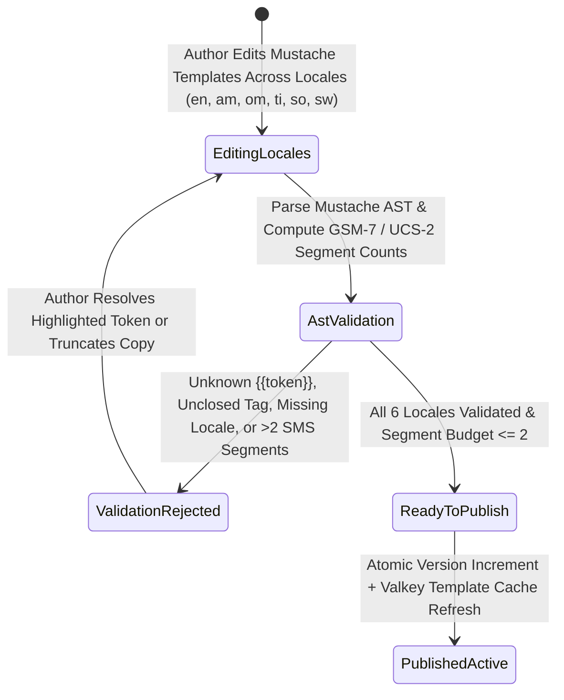

# Multilingual Mustache Notification Template IDE & SMS Segment Calculator
## Admin Subsystem Specification — `docs/admin/schema-engine/04-notification-template-editor.md`

**Document Identifier:** `SPEC-ADM-SCH-04`  
**Classification:** Canonical Subsystem UI/UX & Technical Behavior Specification  
**Governing Documents:** `Dink_Machinery_UI_UX_Design_Brief.md`, `SRS-DINK-CORE-V7.0` (§5.10 `NT-01`..`NT-09`, §5.16 `LOC-01`..`LOC-06`, §5.11), `docs/components/admin/DESIGN.md`, `docs/shared/design/design-tokens.json`, `docs/ERROR_CATALOG.md`, `contracts/openapi.yaml`, `ADR-013`  
**Target Subsystem:** Next.js 16 Web Admin Console (`admin/src/app/(dashboard)/schema-engine/notification-templates/`)  
**Primary Persona / Actor:** Communications & Localization Lead, Operations Admin, Super Administrator (*Rahel Tadesse*)  
**Associated Requirements:** `REQ-05-10` (`NT-01`..`NT-09`), `REQ-05-16` (Multilingual & Ge'ez Typography), `ADR-013`  
**Associated Interaction Flows:** `FLOW-17` (Multi-Channel Notification Dispatch & Fallback), `FLOW-12` (Admin Dynamic UI Engine)  
**Status:** Approved Technical Design Baseline

---

## 1. Executive Summary & Architectural Invariants

The **Multilingual Mustache Notification Template IDE & SMS Segment Calculator** (`SPEC-ADM-SCH-04`) governs all transactional and operational communications emitted across **SMS** (*Ethio Telecom*, *GeezSMS*, *Africa's Talking Kenya*), **FCM Push Notifications**, **Transactional Email**, and **In-App Notification Center** (`NT-01`..`NT-09`, `ADR-013`) across all six supported platform locales: **English (`en`)**, **Amharic (`am` — Ge'ez script)**, **Afaan Oromoo (`om`)**, **Tigrinya (`ti` — Ge'ez script)**, **Somali (`so`)**, and **Swahili (`sw`)**.

### 1.1 GSM-7 vs. UCS-2 (UTF-16) Ge'ez SMS Segment Economics
A critical operational constraint in Ethiopian telecommunications is SMS encoding cost:
- **Latin Locales (`en`, `om`, `so`, `sw` — GSM-7 Encoding):** Standard 7-bit GSM encoding supports **160 characters** for a single SMS segment (`153 characters` per segment in concatenated multi-part SMS).
- **Ethiopic Ge'ez Locales (`am`, `ti` — UCS-2 / UTF-16 Encoding):** A single Ge'ez character (e.g., `ዲንክ ማሽነሪ`) switches the entire SMS payload to 16-bit UCS-2 encoding, reducing the single-SMS ceiling to **70 characters** (`67 characters` per concatenated segment).
- **Live Segment Cost Guardrail:** The Template IDE computes the exact encoded byte length and worst-case interpolated variable expansion in real time, warning the editor if an Amharic SMS template exceeds `70 UCS-2 code units` (1 segment) or `134 UCS-2 code units` (2 segments max ceiling).

### 1.2 Strict Variable Whitelist & Zero-PII SMS Invariant (`NT-06`, `ASVS L3`)
- **Strict Mustache AST Validation:** Templates may only reference whitelisted variables registered for their `event_trigger_key` (e.g., `{{booking_code}}`, `{{machine_title}}`, `{{amount_formatted}}`, `{{hold_expiry_time}}`). Referencing an undeclared token (`{{renter_full_bank_account}}`) fails compilation (`400 REQ_VALIDATION_FAILED`).
- **Zero Unmasked PII Over SMS/Push:** Full bank account numbers, TINs, National IDs, and OTP secrets (outside the dedicated `AUTH_OTP_CHALLENGE` template) can never be interpolated into SMS or Push payloads.

---

## 2. Screen Anatomy, Layout & Bespoke Desktop Wireframe

```text
+------------------------------------------------------------------------------------------------------------------------------------------+
| DINK ADMIN [ET/KE Global]  Schema Engine > Multilingual Notification Template IDE          [Trigger Test Dispatch] [Publish Version v6]  |
+------------------------------------------------------------------------------------------------------------------------------------------+
| EVENT TRIGGER: [BOOKING_HOLD_EXPIRING_15M (NT-03) v] | Channel: [(*) SMS  ( ) FCM_PUSH  ( ) EMAIL  ( ) IN_APP] | Priority: CRITICAL_HIGH |
+------------------------------------------------------------------------------------------------------------------------------------------+
| LOCALE & WHITELISTED TOKENS (30% Width)      | MUSTACHE TEMPLATE EDITOR & UCS-2 SEGMENT ANALYZER (70% Width)                             |
|----------------------------------------------|-------------------------------------------------------------------------------------------|
| LOCALE COMPLETION MATRIX (6 Required)        | Active Locale Tab: [ (o) አማርኛ (am - Ge'ez) ] [ English (en) ] [ Oromoo (om) ] [ Swahili ] |
| [x] English (en)    - GSM-7  (118/160 chars) |-------------------------------------------------------------------------------------------|
| [x] Amharic (am)    - UCS-2  ( 64/70  chars) | AMHARIC (am) SMS BODY TEMPLATE (Noto Sans Ethiopic — Line-Height 1.38x)                   |
| [x] Oromoo (om)     - GSM-7  (132/160 chars) | +---------------------------------------------------------------------------------------+ |
| [x] Tigrinya (ti)   - UCS-2  ( 66/70  chars) | | ዲንክ ማሽነሪ፦ የ{{machine_title}} ቦታ ማስያዣ ({{booking_code}}) በ15 ደቂቃ ውስጥ ይሰረዛል።            | |
| [x] Somali (so)     - GSM-7  (129/160 chars) | | እባክዎ {{amount_formatted}} ክፍያ ያጠናቅቁ።                                                  | |
| [x] Swahili (sw)    - GSM-7  (124/160 chars) | +---------------------------------------------------------------------------------------+ |
|----------------------------------------------| ENCODING & SMS SEGMENT TELEMETRY                                                          |
| WHITELISTED MUSTACHE TOKENS (Click to Insert)| Encoding Detected: [UCS-2 (16-bit Ethiopic Ge'ez)]  | Static Length: 49 code units        |
| +------------------------------------------+ | Est. Max Expanded Length: [ 64 / 70 chars ]         | SMS Segments:  [1 Segment (Optimal)]|
| | {{booking_code}}      (Max 12 chars)     | | Segment Progress: [██████████████████████████░░░░] 91% of 1-SMS UCS-2 Ceiling (70 chars)  |
| | {{machine_title}}     (Truncated 18 chr) | |-------------------------------------------------------------------------------------------|
| | {{amount_formatted}}  (e.g. 25,000 ETB)  | | LIVE INTERPOLATED PREVIEW (Sample Payload: BKG-88412 / CAT 320D / 115,000.00 ETB)         |
| | {{hold_expiry_time}}  (e.g. 14:35 EAT)   | | +---------------------------------------------------------------------------------------+ |
| +------------------------------------------+ | | [SMS Gateway: Ethio Telecom / GeezSMS Shortcode 8914]                                 | |
| Forbidden in SMS: Unmasked Bank Acc / TIN    | | "ዲንክ ማሽነሪ፦ የCAT 320D Excav. ቦታ ማስያዣ (BKG-88412) በ15 ደቂቃ ውስጥ ይሰረዛል። እባክዎ 115,000 ETB   | |
|                                              | |  ክፍያ ያጠናቅቁ።" (64 UCS-2 chars — 1 SMS Unit)                                            | |
|                                              | +---------------------------------------------------------------------------------------+ |
|----------------------------------------------|-------------------------------------------------------------------------------------------|
| Fallback Chain: FCM_PUSH -> SMS -> IN_APP    | [Validate Mustache AST Across All 6 Locales]  [Save & Publish Template Version v6]        |
+------------------------------------------------------------------------------------------------------------------------------------------+
```

---

## 3. W3C DTCG Design Token Mapping Table

| UI Component / Element | W3C Token Path (`design-tokens.json`) | Resolved Value (Light / Dark / Outdoor) | Behavioral & Accessibility Invariant |
|---|---|---|---|
| **Ge'ez Editor Textarea (`am`, `ti`)** | `typography.fontFamily.ethiopic` + `typography.lineHeightFactor.ethiopicBody` | `Noto Sans Ethiopic, sans-serif`, `16sp`, `1.45` line-height | Guarantees comfortable editing of dense Ge'ez paragraphs without vertical glyph collision. |
| **Mustache Token Pill (`{{...}}`)** | `color.brand.amber.100` + `color.brand.amber.900` + `typography.fontFamily.mono` | `#FEF3C7` fill, `#78350F` text, `Space Mono` | Keyboard-insertable token chips (`Enter` or `Space` inserts token at cursor). |
| **SMS Segment Counter Badge** | `color.feedback.emerald.100` (`1 seg`) / `color.brand.amber.100` (`2 seg`) / `color.feedback.crimson.100` (`>2 seg`) | `#D1FAE5` / `#FEF3C7` / `#FEE2E2` | Hard-blocks publishing an SMS template that exceeds 2 concatenated segments (`>134` UCS-2 or `>306` GSM-7 chars). |

---

## 4. Interactive State Machine & Sequence Flows

### 4.1 Template AST Validation & Publication State Machine (`stateDiagram-v2`)



---

## 5. Concrete Next.js 16 Implementation Blueprint

### 5.1 GSM-7 & UCS-2 Ge'ez SMS Segment Calculator Utility (`admin/src/lib/sms-encoding.ts`)

```typescript
// admin/src/lib/sms-encoding.ts

const GSM7_BASIC_REGEX =
  /^[@£$¥èéùìòÇ\nØø\rÅåΔ_ΦΓΛΩΠΨΣΘΞ !"#¤%&'()*+,\-./0-9:;<=>?¡A-ZÄÖÑܧ¿a-zäöñüà^{}\\[~\]|€]*$/;

export interface SmsSegmentAnalysis {
  encoding: 'GSM_7' | 'UCS_2_ETHIOPIC';
  codeUnits: number;
  maxSingleSegmentUnits: number;
  concatenatedSegmentUnits: number;
  segmentCount: number;
  exceedsTwoSegmentBudget: boolean;
}

/**
 * Deterministically calculates SMS encoding (GSM-7 vs UCS-2 for Ge'ez Amharic/Tigrinya)
 * and segment count to prevent runaway telecom billing.
 */
export function analyzeSmsTemplateSegments(interpolatedSampleText: string): SmsSegmentAnalysis {
  const isGsm7 = GSM7_BASIC_REGEX.test(interpolatedSampleText);
  const encoding = isGsm7 ? 'GSM_7' : 'UCS_2_ETHIOPIC';
  const codeUnits = Array.from(interpolatedSampleText).length;

  const maxSingleSegmentUnits = isGsm7 ? 160 : 70;
  const concatenatedSegmentUnits = isGsm7 ? 153 : 67;

  let segmentCount = 1;
  if (codeUnits > maxSingleSegmentUnits) {
    segmentCount = Math.ceil(codeUnits / concatenatedSegmentUnits);
  }

  return {
    encoding,
    codeUnits,
    maxSingleSegmentUnits,
    concatenatedSegmentUnits,
    segmentCount,
    exceedsTwoSegmentBudget: segmentCount > 2,
  };
}
```

### 5.2 Dynamic UI Engine Configuration (`/api/v1/admin/ui-config?route=schema-engine/notification-templates`)

```json
{
  "tableId": "tbl_schema_notification_templates_v1",
  "title": "Multilingual Notification Template Registry",
  "description": "Manage Mustache templates across SMS, FCM Push, Email, and In-App channels for en, am, om, ti, so, and sw.",
  "defaultSortField": "eventTriggerKey",
  "defaultSortDirection": "asc",
  "pageSize": 50,
  "columns": [
    { "id": "eventTriggerKey", "header": "Event Trigger Key", "accessorKey": "eventTriggerKey", "dataType": "text", "isSortable": true, "isFilterable": true },
    { "id": "channel", "header": "Channel", "accessorKey": "channel", "dataType": "badge", "isSortable": true, "isFilterable": true },
    { "id": "localesComplete", "header": "Locales (6/6)", "accessorKey": "localesCompletionBadge", "dataType": "badge", "isSortable": false, "isFilterable": false },
    { "id": "amSmsSegments", "header": "Amharic UCS-2 Segments", "accessorKey": "amharicSegmentLabel", "dataType": "badge", "isSortable": true, "isFilterable": false },
    { "id": "version", "header": "Version", "accessorKey": "version", "dataType": "text", "align": "center", "isSortable": true, "isFilterable": false }
  ],
  "facets": [
    {
      "id": "channel",
      "label": "Delivery Channel",
      "type": "select",
      "options": [
        { "label": "SMS Gateway (Ethio Telecom / Africa's Talking)", "value": "SMS" },
        { "label": "FCM Mobile Push Notification", "value": "FCM_PUSH" },
        { "label": "Transactional Email", "value": "EMAIL" },
        { "label": "In-App Notification Feed", "value": "IN_APP" }
      ]
    }
  ],
  "rowActions": [
    {
      "id": "publish_template_version",
      "label": "Publish Template Version",
      "variant": "default",
      "requiredPermission": "system.notifications.manage",
      "endpoint": "/api/v1/admin/notifications/templates/{id}:publish",
      "method": "POST"
    }
  ],
  "bulkActions": []
}
```

### 5.3 Server Action for Validating & Publishing Multilingual Mustache Templates (`admin/src/app/(dashboard)/schema-engine/notification-templates/actions.ts`)

```typescript
// admin/src/app/(dashboard)/schema-engine/notification-templates/actions.ts
'use server';

import { revalidatePath } from 'next/cache';
import { cookies } from 'next/headers';
import { z } from 'zod';
import { analyzeSmsTemplateSegments } from '@/lib/sms-encoding';
import { ProblemDetails } from '@/types/dynamic-ui';

const LocaleTemplateMapSchema = z.object({
  en: z.string().trim().min(5),
  am: z.string().trim().min(5),
  om: z.string().trim().min(5),
  ti: z.string().trim().min(5),
  so: z.string().trim().min(5),
  sw: z.string().trim().min(5),
});

const PublishNotificationTemplateSchema = z.object({
  templateId: z.string().uuid(),
  expectedVersion: z.number().int().positive(),
  channel: z.enum(['SMS', 'FCM_PUSH', 'EMAIL', 'IN_APP']),
  whitelistedTokens: z.array(z.string()),
  translations: LocaleTemplateMapSchema,
});

export async function publishNotificationTemplateAction(
  input: z.infer<typeof PublishNotificationTemplateSchema>
): Promise<{
  success: boolean;
  publishedVersion?: number;
  problem?: ProblemDetails;
}> {
  const parsed = PublishNotificationTemplateSchema.safeParse(input);
  if (!parsed.success) {
    return {
      success: false,
      problem: {
        type: 'https://api.dinkmachinery.com/errors/request-validation-failed',
        title: 'Template Validation Failed',
        status: 400,
        detail: 'All 6 locales (en, am, om, ti, so, sw) must be populated.',
        code: 'REQ_VALIDATION_FAILED',
        invalidParams: parsed.error.issues.map((i) => ({ name: i.path.join('.'), reason: i.message })),
      },
    };
  }

  // Verify Mustache tokens against whitelist and check SMS segment budget
  const tokenRegex = /\{\{\s*([a-zA-Z0-9_]+)\s*\}\}/g;
  const invalidParams: Array<{ name: string; reason: string }> = [];

  for (const [locale, body] of Object.entries(parsed.data.translations)) {
    for (const match of body.matchAll(tokenRegex)) {
      const tokenName = match[1];
      if (!parsed.data.whitelistedTokens.includes(tokenName)) {
        invalidParams.push({
          name: `translations.${locale}`,
          reason: `Token {{${tokenName}}} is not in the whitelisted token set for this event.`,
        });
      }
    }

    if (parsed.data.channel === 'SMS') {
      const analysis = analyzeSmsTemplateSegments(body);
      if (analysis.exceedsTwoSegmentBudget) {
        invalidParams.push({
          name: `translations.${locale}`,
          reason: `Locale '${locale}' (${analysis.encoding}) requires ${analysis.segmentCount} SMS segments (${analysis.codeUnits} chars), exceeding the 2-segment maximum budget.`,
        });
      }
    }
  }

  if (invalidParams.length > 0) {
    return {
      success: false,
      problem: {
        type: 'https://api.dinkmachinery.com/errors/request-validation-failed',
        title: 'Mustache AST or SMS Segment Violation',
        status: 400,
        detail: 'Fix undeclared Mustache variables or excessive SMS segment length.',
        code: 'REQ_VALIDATION_FAILED',
        invalidParams,
      },
    };
  }

  const cookieStore = await cookies();
  const sessionToken = cookieStore.get('dink_admin_session')?.value;

  const res = await fetch(
    `${process.env.INTERNAL_BACKEND_URL}/api/v1/admin/notifications/templates/${parsed.data.templateId}:publish`,
    {
      method: 'POST',
      headers: {
        'Content-Type': 'application/json',
        Authorization: `Bearer ${sessionToken}`,
        'Idempotency-Key': crypto.randomUUID(),
      },
      body: JSON.stringify(parsed.data),
    }
  );

  const payload = await res.json();
  if (!res.ok) {
    return { success: false, problem: payload.error as ProblemDetails };
  }

  revalidatePath('/schema-engine/notification-templates');
  return {
    success: true,
    publishedVersion: payload.data.version,
  };
}
```

---

## 6. OpenAPI 3.1.0 Contract & RFC 9457 Error Matrix

| HTTP Method & Route | Operation ID | Required RBAC Permission | Idempotency-Key | Description |
|---|---|---|---|---|
| `GET /api/v1/admin/notifications/templates` | `listNotificationTemplates` | `system.notifications.read` | No | Lists all event notification templates and locale completion statuses. |
| `POST /api/v1/admin/notifications/templates/{id}:publish` | `publishNotificationTemplate` | `system.notifications.manage` | Yes (UUID v4) | Validates Mustache AST across `en`, `am`, `om`, `ti`, `so`, `sw` and publishes new version. |
| `POST /api/v1/admin/notifications/templates/{id}:test-send` | `sendTestNotification` | `system.notifications.manage` | Yes (UUID v4) | Dispatches a sandboxed test SMS/Push to the administrator's verified device. |

| Error Code | HTTP Status | RFC 9457 Type URI | Trigger Condition |
|---|---|---|---|
| `REQ_VALIDATION_FAILED` | `400 Bad Request` | `https://api.dinkmachinery.com/errors/request-validation-failed` | Template contains unclosed Mustache tags, non-whitelisted `{{variable}}`, missing locale translation, or `> 2` SMS segments. |
| `SYS_RATE_LIMIT_EXCEEDED` | `429 Too Many Requests` | `https://api.dinkmachinery.com/errors/rate-limit-exceeded` | Test SMS dispatch exceeded 5 messages per minute per admin session. |

---

## 7. Verification & Acceptance Criteria Checklist

- [ ] **UCS-2 Ge'ez Segment Calculation Accuracy:** Entering a 71-character Amharic (`am`) string immediately flips the segment counter from `1 Segment (70/70 max)` to `2 Segments (71/134 max)` using `analyzeSmsTemplateSegments()`.
- [ ] **Undeclared Variable Rejection:** Inserting `{{user_password}}` or `{{bank_account_raw}}` into any locale body is rejected by both the Server Action and Go backend AST validator with `400 REQ_VALIDATION_FAILED`.
