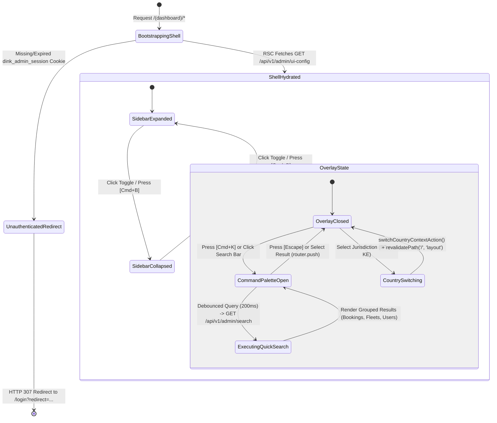
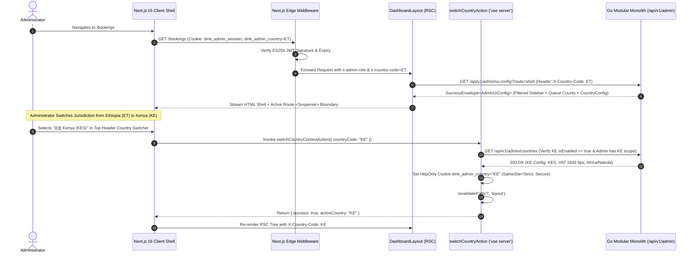

# Responsive Admin Layout, Master Navigation & Breadcrumb Engine
## Admin Subsystem Specification — `docs/admin/shell/01-admin-layout-navigation.md`

**Document Identifier:** `SPEC-ADM-SHL-01`  
**Classification:** Canonical Subsystem UI/UX & Technical Behavior Specification  
**Governing Documents:** `Dink_Machinery_UI_UX_Design_Brief.md`, `SRS-DINK-CORE-V7.0`, `docs/components/admin/DESIGN.md`, `contracts/openapi.yaml`  
**Target Subsystem:** Next.js 16 Web Admin Console (`admin/src/app/(dashboard)/layout.tsx`)  
**Primary Persona / Actor:** All Admin Roles (`SUPER_ADMIN`, `COMPLIANCE_OFFICER`, `FINANCE_CONTROLLER`, `DISPUTE_ARBITRATOR`, `OPS_SUPPORT`)  
**Associated Requirements:** `AD-01`, `AD-06`, `REQ-05-11`, `LOC-01-BE`  
**Associated Interaction Flows:** `FLOW-12` (Server-Driven Admin Console & Back-Office Operations)  
**Associated ADRs:** `ADR-008` (Server-Driven Dynamic UI Metadata), `ADR-011` (ASVS L3 Session Governance), `ADR-013` (Dynamic Multilingual Typography & OTA Fonts)  
**Status:** Approved Technical Design Baseline

---

## 1. Domain Context, Business Rules & Architectural Invariants

The **Responsive Admin Layout, Master Navigation & Breadcrumb Engine** (`SPEC-ADM-SHL-01`) forms the authenticated root workspace shell (`src/app/(dashboard)/layout.tsx`) of the Next.js 16 Administrative Web Console. It wraps all back-office operational queues, booking lifecycle monitors, financial ledgers, and dispute arbitration workbenches in a unified, keyboard-driven, multi-country operational frame.

### 1.1 Core Business Rules & Operational Mandates
1. **Server-Driven Navigation Hierarchy (`AD-06-BE`):** Sidebar navigation items, section groupings, live pending badge counters, and quick-action command triggers are never hardcoded in client bundles. The root layout React Server Component (RSC) fetches the authenticated operator's navigation tree from `GET /api/v1/admin/ui-config`, which filters links in PostgreSQL (`admin_sidebar_items`) against the operator's resolved RBAC permissions.
2. **Jurisdictional Context Switcher (`LOC-01-BE`):** Administrators with multi-country clearance can switch between **Ethiopia (`ET` — `ETB` / `+251` / `Africa/Addis_Ababa`)** and **Kenya (`KE` — `KES` / `+254` / `Africa/Nairobi`)** via the persistent top header country selector. Changing the country context executes a Server Action that updates the `dink_admin_country` `HttpOnly` cookie and triggers `revalidatePath('/', 'layout')`, ensuring all downstream RSC queries inject the appropriate `X-Country-Code` header.
3. **Global Command Palette (`Cmd+K` / `Ctrl+K`):** High-velocity operations staff can jump directly to any booking (`bk-...`), fleet asset (`flt-...`), dispute (`dsp-...`), or user profile (`+251...`), or trigger permitted administrative actions without touching the mouse.
4. **Deterministic Breadcrumb Trail & Context Banner:** Every nested route (`/bookings/[id]`, `/disputes/[id]/lightbox`, `/fleets/[id]`) automatically resolves human-readable entity identifiers (e.g., `Bookings > #BK-9042 (CAT 320D3) > Lifecycle Audit`) alongside a persistent Request ID copy badge (`req_...`) and live WebSocket telemetry connection pill.
5. **High-Glare & Multi-Script Typography (`ADR-013`):** Supports instant toggling between Standard Desk Mode (Light/Dark Slate) and **Outdoor High-Contrast Mode** (WCAG 2.2 AAA $\ge 7.0:1$ contrast for yard tablet inspections), while applying `lineHeightFactor.ethiopicGolden` ($1.38\times$) when rendering Amharic (`am`) or Tigrinya (`ti`) entity strings so Ge'ez ascenders and descenders never clip.

### 1.2 Architectural Invariants
- **RSC-First Shell Boundary:** `src/app/(dashboard)/layout.tsx` is a strict Server Component. Only leaf interactive controls (`AdminSidebarCollapseToggle`, `CommandPaletteModal`, `CountryContextSwitcher`, `SonnerToastViewport`) cross the `'use client'` boundary.
- **Zero Client-Side Token Access:** Session identity and RBAC role claims are parsed on the server from the encrypted `dink_admin_session` cookie.
- **Zero Layout Shift (`CLS <= 0.05`):** Sidebar width (`264px` expanded, `64px` collapsed) and top navigation bar height (`56px`) are fixed using CSS grid template tracks, preventing layout shift during `<Suspense>` route streaming.

---

## 2. Screen Anatomy, Layout & Component Hierarchy

### 2.1 Desktop Workspace Shell Wireframe (`1920x1080` & `1440x900` Viewports)

```text
+------------------------------------------------------------------------------------------------------------------------------------------+
| [≡] DINK ADMIN   |  Bookings > #BK-9042 (CAT 320D3)   |  [🔍 Search Booking, Plate, TIN or Command... (Cmd+K)]  | [🇪🇹 ET - ETB v] [☀/☾] [👤] |
+------------------+-----------------------------------------------------------------------------------------------------------------------+
| CONTEXT BANNER   | [● WSS LIVE: 18ms] | Active Country: Ethiopia (ETB / VAT 1500 bps) | SLA Alert: 2 Disputes < 4h remaining  [View Now] |
+------------------+-----------------------------------------------------------------------------------------------------------------------+
| OPERATIONS       |                                                                                                                       |
|  [■] Dashboard   |  PRIMARY CONTENT CANVAS (`children` RSC Slot — `min-h-[calc(100vh-112px)]`)                                           |
|  [≡] KYC Queue 14|  +-----------------------------------------------------------------------------------------------------------------+  |
|  [🏢] Corp KYB  6|  | Page Header: Title, Subtitle, Last Synced Timestamp, & Server-Driven Bulk/Context Action Bar                    |  |
|  [🚜] Fleets   23|  +-----------------------------------------------------------------------------------------------------------------+  |
|  [🪪] Operators 9|  | Dynamic Filter Bar (`DynamicFilterBar.tsx`): Facet Pills, Date Range Picker, Debounced Search Input             |  |
|  [🛡] Abuse/MI  4|  +-----------------------------------------------------------------------------------------------------------------+  |
|  [📄] Insurance 8|  |                                                                                                                 |  |
|                  |  | Virtualized Operational Viewport (`@tanstack/react-table` / Split Inspector / Telemetry Map)                    |  |
| BOOKINGS & FLEET |  |                                                                                                                 |  |
| *[📅] Bookings   |  |                                                                                                                 |  |
|  [🚛] Logistics 3|  |                                                                                                                 |  |
|                  |  +-----------------------------------------------------------------------------------------------------------------+  |
| ARBITRATION      |                                                                                                                       |
|  [⚖] Disputes  5 |  +-----------------------------------------------------------------------------------------------------------------+  |
|                  |  | Sticky Footer Bar: Keyset Pagination (`<- Prev` | `Next ->`) | Row Density (`40dp`/`56dp`) | `req_01HP8XYZ1234` |  |
| GOVERNANCE       |  +-----------------------------------------------------------------------------------------------------------------+  |
|  [⚙] Countries   |                                                                                                                       |
|  [🔐] RBAC Matrix|  +-----------------------------------------------------------------------------------------------------------------+  |
+------------------+  | COMMAND PALETTE OVERLAY (`Cmd+K` when active)                                                                   |  |
| Role: SUPER_ADMIN|  | > bk-9042                                                                                          [ESC to close]|  |
| Session: 14:22   |  |   [Booking] #BK-9042 — CAT 320D3 Crawler Excavator (Status: DISPUTED)                              [Enter ↵]    |  |
+------------------+-----------------------------------------------------------------------------------------------------------------------+
```

---

## 3. W3C DTCG Design Token Mapping Table

All visual properties bind directly to canonical tokens defined in `docs/shared/design/design-tokens.json`:

| Shell Component / Region | W3C Token Path (`design-tokens.json`) | Resolved Value (Light / Dark / Outdoor) | Behavioral & Accessibility Constraint |
|---|---|---|---|
| **Workspace Canvas Background** | `semantic.light.surface.canvas` / `semantic.dark.surface.canvas` | `#F8FAFC` / `#0F172A` / `#000000` | Root `<main>` backdrop; zero horizontal overflow (`overflow-x: hidden`). |
| **Sidebar & Top Header Surface** | `semantic.light.surface.card` / `semantic.dark.surface.card` | `#FFFFFF` / `#1E293B` / `#000000` | Persistent structural frame separated by `stroke.border.thin` (`1dp` `#E2E8F0` / `#334155`). |
| **Active Sidebar Item Accent** | `color.brand.amber.500` / `color.brand.amber.50` | `#F59E0B` left bar (`3dp`) + `#FFFBEB` tint | `aria-current="page"` indicator; meets 4.5:1 text contrast with `color.brand.amber.900` (`#78350F`). |
| **Queue Count Badge (Urgent)** | `color.feedback.crimson.100` + `color.feedback.crimson.700` | `#FEE2E2` fill / `#B91C1C` text | Displayed when queue contains items breaching SLA thresholds; `typography.fontFamily.mono` (`Space Mono`). |
| **Primary Navigation Typography** | `typography.fontFamily.latin` / `typography.fontSize.14` | `Roboto`, `14sp`, line-height `1.25` (`1.38` Ge'ez) | Automatically switches to `Noto Sans Ethiopic` (`typography.fontFamily.ethiopic`) for Ethiopic script labels. |
| **Monospace Tracking & Timers** | `typography.fontFamily.mono` / `typography.fontSize.12` | `Space Mono, monospace`, `12sp` | Used for `requestId` (`req_...`), idle countdown (`14:22`), and currency minor-unit figures. |
| **Header Height & Grid Rhythm** | `dimension.space.56` / `dimension.space.8` | `56dp` top bar height, `8dp` spatial grid | Enforces minimum `48x48dp` interactive hit area on collapse toggle, country selector, and profile button. |
| **Command Palette Modal Shadow** | `elevation.modal` / `semantic.light.surface.overlay` | `0dp 8dp 24dp rgba(15,23,42,0.16)` | Backdrop uses `rgba(15, 23, 42, 0.60)` with `motion.duration.fast` (`150ms`) transition. |
| **Focus Ring Outline** | `semantic.light.border.focus` + `stroke.border.heavy` | `#D97706` (`3dp` solid outline, `2dp` offset) | Mandatory `focus-visible` ring on all sidebar links, breadcrumb nodes, and header controls. |

---

## 4. Interactive State Machine & Sequence Choreography

### 4.1 Shell Navigation, Country Context & Command Palette State Machine



### 4.2 Server-Driven Layout Hydration & Country Context Switch Sequence



---

## 5. Concrete Next.js 16 Implementation Blueprint

### 5.1 `/api/v1/admin/ui-config` Metadata Payload Snippet (Shell Navigation)

```json
{
  "success": true,
  "data": {
    "activeCountry": {
      "countryCode": "ET",
      "countryName": "Ethiopia",
      "defaultCurrency": "ETB",
      "currencyMinorUnitExponent": 2,
      "defaultTimezone": "Africa/Addis_Ababa",
      "taxLabel": "VAT",
      "standardTaxRateBps": 1500
    },
    "navigation": [
      {
        "groupKey": "OPERATIONS_QUEUES",
        "groupLabel": "Operations & Compliance",
        "items": [
          { "key": "nav_dashboard", "label": "Executive KPI Cockpit", "route": "/", "icon": "LayoutDashboard", "badgeCount": null, "requiredPermission": "dashboard:read" },
          { "key": "nav_kyc", "label": "Individual KYC Queue", "route": "/queues/kyc", "icon": "UserCheck", "badgeCount": 14, "badgeVariant": "warning", "requiredPermission": "kyc:review" },
          { "key": "nav_kyb", "label": "Business License (KYB)", "route": "/queues/business-licenses", "icon": "Building2", "badgeCount": 6, "badgeVariant": "default", "requiredPermission": "kyb:review" },
          { "key": "nav_fleets", "label": "Fleet Compliance Queue", "route": "/fleets", "icon": "Tractor", "badgeCount": 23, "badgeVariant": "warning", "requiredPermission": "fleet:approve" },
          { "key": "nav_operators", "label": "Operator Certifications", "route": "/queues/operators", "icon": "BadgeCheck", "badgeCount": 9, "badgeVariant": "default", "requiredPermission": "operator:verify" },
          { "key": "nav_abuse", "label": "Marketplace Integrity", "route": "/queues/integrity-abuse", "icon": "ShieldAlert", "badgeCount": 4, "badgeVariant": "destructive", "requiredPermission": "integrity:triage" },
          { "key": "nav_insurance", "label": "Insurance & Expiry Monitor", "route": "/queues/insurance-expiry", "icon": "FileClock", "badgeCount": 8, "badgeVariant": "warning", "requiredPermission": "fleet:compliance" }
        ]
      },
      {
        "groupKey": "BOOKING_DISPATCH",
        "groupLabel": "Bookings & Logistics",
        "items": [
          { "key": "nav_bookings", "label": "Booking Register", "route": "/bookings", "icon": "CalendarRange", "badgeCount": null, "requiredPermission": "booking:read" },
          { "key": "nav_logistics", "label": "Lowboy Dispatch & Cascade", "route": "/bookings/logistics", "icon": "Truck", "badgeCount": 3, "badgeVariant": "destructive", "requiredPermission": "logistics:dispatch" },
          { "key": "nav_disputes", "label": "Dispute Arbitration", "route": "/disputes", "icon": "Scale", "badgeCount": 5, "badgeVariant": "destructive", "requiredPermission": "dispute:arbitrate" }
        ]
      }
    ],
    "featureToggles": {
      "enableOutdoorGlareMode": true,
      "enableGlobalCommandPalette": true,
      "enableMultiCountrySwitcher": true
    }
  },
  "error": null,
  "meta": {
    "version": "1.0",
    "requestId": "req_01J8SHL01CFG98231",
    "timestamp": "2026-10-29T13:25:00Z",
    "pagination": null,
    "warnings": []
  }
}
```

### 5.2 Root Workspace Layout RSC (`src/app/(dashboard)/layout.tsx`)

```tsx
// src/app/(dashboard)/layout.tsx
import React, { Suspense } from 'react';
import { cookies } from 'next/headers';
import { redirect } from 'next/navigation';
import { AdminSidebar } from '@/components/layout/AdminSidebar';
import { AdminNavbar } from '@/components/layout/AdminNavbar';
import { Breadcrumbs } from '@/components/layout/Breadcrumbs';
import { CommandPalette } from '@/components/layout/CommandPalette';
import { fetchAdminUiConfig } from '@/lib/api/admin-config';

export default async function DashboardLayout({
  children,
}: {
  children: React.ReactNode;
}) {
  const cookieStore = await cookies();
  const sessionToken = cookieStore.get('dink_admin_session')?.value;
  const activeCountry = cookieStore.get('dink_admin_country')?.value ?? 'ET';

  if (!sessionToken) {
    redirect('/login');
  }

  const uiConfigEnvelope = await fetchAdminUiConfig({
    sessionToken,
    countryCode: activeCountry,
  });

  if (!uiConfigEnvelope.success || !uiConfigEnvelope.data) {
    redirect('/login?reason=session_expired');
  }

  const { navigation, activeCountry: countryMeta, featureToggles } = uiConfigEnvelope.data;

  return (
    <div className="grid min-h-screen w-full grid-cols-[auto_1fr] bg-slate-50 text-slate-900 dark:bg-slate-900 dark:text-slate-50">
      <AdminSidebar
        navigationGroups={navigation}
        requestId={uiConfigEnvelope.meta.requestId}
      />
      <div className="flex min-w-0 flex-1 flex-col">
        <AdminNavbar
          activeCountry={countryMeta}
          enableCountrySwitcher={Boolean(featureToggles.enableMultiCountrySwitcher)}
          enableOutdoorMode={Boolean(featureToggles.enableOutdoorGlareMode)}
        />
        <div className="flex h-10 items-center justify-between border-b border-slate-200 bg-white px-6 text-xs dark:border-slate-700 dark:bg-slate-800">
          <Breadcrumbs />
          <div className="flex items-center gap-4 font-mono text-slate-500">
            <span>Jurisdiction: {countryMeta.countryCode} ({countryMeta.defaultCurrency})</span>
            <span>{countryMeta.taxLabel}: {(countryMeta.standardTaxRateBps / 100).toFixed(2)}%</span>
            <span className="rounded bg-slate-100 px-2 py-0.5 dark:bg-slate-700">
              {uiConfigEnvelope.meta.requestId}
            </span>
          </div>
        </div>
        <main
          id="admin-main-viewport"
          tabIndex={-1}
          className="flex-1 overflow-y-auto p-6 focus:outline-none"
        >
          <Suspense
            fallback={
              <div
                role="status"
                aria-label="Loading operational workspace"
                className="h-[calc(100vh-160px)] w-full animate-pulse rounded-lg border border-slate-200 bg-white dark:border-slate-700 dark:bg-slate-800"
              />
            }
          >
            {children}
          </Suspense>
        </main>
      </div>
      {featureToggles.enableGlobalCommandPalette && <CommandPalette />}
    </div>
  );
}
```

### 5.3 Server Action: Jurisdiction Context Switcher (`src/app/(dashboard)/actions.ts`)

```typescript
// src/app/(dashboard)/actions.ts
'use server';

import { cookies } from 'next/headers';
import { revalidatePath } from 'next/cache';
import { z } from 'zod';
import { ProblemDetails } from '@/types/dynamic-ui';

const SwitchCountrySchema = z.object({
  countryCode: z.enum(['ET', 'KE'], {
    errorMap: () => ({ message: 'Country code must be an enabled ISO 3166-1 alpha-2 jurisdiction (ET or KE).' }),
  }),
});

export interface SwitchCountryResult {
  success: boolean;
  activeCountry?: string;
  problem?: ProblemDetails;
}

export async function switchCountryContextAction(
  formData: FormData
): Promise<SwitchCountryResult> {
  const parsed = SwitchCountrySchema.safeParse({
    countryCode: formData.get('countryCode'),
  });

  if (!parsed.success) {
    return {
      success: false,
      problem: {
        type: 'https://api.dinkmachinery.com/errors/invalid-country-code',
        title: 'Invalid Jurisdiction Selection',
        status: 400,
        detail: 'Supplied country code does not match an enabled operational jurisdiction.',
        code: 'REQ_INVALID_COUNTRY_CODE',
        invalidParams: parsed.error.issues.map((i) => ({
          name: i.path.join('.'),
          reason: i.message,
        })),
      },
    };
  }

  const cookieStore = await cookies();
  const sessionToken = cookieStore.get('dink_admin_session')?.value;
  const idempotencyKey = crypto.randomUUID();

  // Audit the administrator's context switch in the backend session state
  const res = await fetch(
    `${process.env.INTERNAL_BACKEND_URL}/api/v1/admin/session:switch-country`,
    {
      method: 'POST',
      headers: {
        'Content-Type': 'application/json',
        'Authorization': `Bearer ${sessionToken}`,
        'Idempotency-Key': idempotencyKey,
        'X-Country-Code': parsed.data.countryCode,
      },
      body: JSON.stringify({ countryCode: parsed.data.countryCode }),
    }
  );

  if (!res.ok) {
    const errPayload = await res.json();
    return {
      success: false,
      problem: errPayload.error as ProblemDetails,
    };
  }

  cookieStore.set('dink_admin_country', parsed.data.countryCode, {
    httpOnly: true,
    secure: process.env.NODE_ENV === 'production',
    sameSite: 'strict',
    path: '/',
    maxAge: 60 * 60 * 12,
  });

  revalidatePath('/', 'layout');

  return {
    success: true,
    activeCountry: parsed.data.countryCode,
  };
}
```

---

## 6. OpenAPI 3.1.0 Contract Bindings & RFC 9457 Error Matrix

| HTTP Method & Route | Operation ID | Required Headers | Success Envelope | RFC 9457 Error Codes & Trigger Conditions |
|---|---|---|---|---|
| `GET /api/v1/admin/ui-config` | `getAdminUiConfig` | `Authorization: Bearer <cookie>`, `X-Country-Code: ET\|KE` | `200 OK` (`AdminUiConfigSuccessResponse`) | `401 AUTH_INVALID_TOKEN` (Expired/invalid ES256 session)<br>`403 AUTH_INSUFFICIENT_PERMISSIONS` (Non-admin role)<br>`400 REQ_INVALID_COUNTRY_CODE` (Unsupported ISO country) |
| `GET /api/v1/admin/countries` | `listCountries` | `Authorization: Bearer <cookie>` | `200 OK` (`CountryConfigListSuccessResponse`) | `401 AUTH_INVALID_TOKEN`<br>`503 SYS_SERVICE_UNAVAILABLE` |
| `POST /api/v1/admin/session:switch-country` | `switchAdminCountryContext` | `Authorization`, `Idempotency-Key`, `X-Country-Code` | `200 OK` (`CountryConfigDetailSuccessResponse`) | `400 REQ_INVALID_COUNTRY_CODE`<br>`403 AUTH_INSUFFICIENT_PERMISSIONS` (Admin restricted to single country)<br>`404 COUNTRY_CONFIG_NOT_FOUND` |

---

## 7. Verification & Acceptance Criteria

1. **Dynamic Navigation Purity (Playwright E2E):**
   - Given a `FINANCE_CONTROLLER` session vs a `COMPLIANCE_OFFICER` session, `AdminSidebar` renders only the routes returned by `GET /api/v1/admin/ui-config`; zero unauthorized links exist in the DOM.
2. **Jurisdiction Context Propagation:**
   - Selecting `KE` in `CountryContextSwitcher` updates the `dink_admin_country` `HttpOnly` cookie, updates the context banner to `Kenya (KES / VAT 16.00%)`, and re-executes child RSC queries with `X-Country-Code: KE`.
3. **Keyboard & Command Palette Ergonomics:**
   - Pressing `Cmd+K` (`Ctrl+K` on Windows/Linux) opens the command palette with focus trapped inside the search input; pressing `Escape` closes the dialog and restores focus to the previously focused element.
   - Skip-to-content link (`#admin-main-viewport`) is the first tabbable element on page load.
4. **Accessibility & Outdoor High-Contrast Gate (`@axe-core/playwright`):**
   - Zero critical or serious WCAG 2.2 AA violations in Standard Mode and zero AAA contrast violations ($\ge 7.0:1$) when Outdoor Glare Mode is toggled active.

---
*Canonical specification entry for Dink Machinery platform development. Changes require an explicit design review.*
