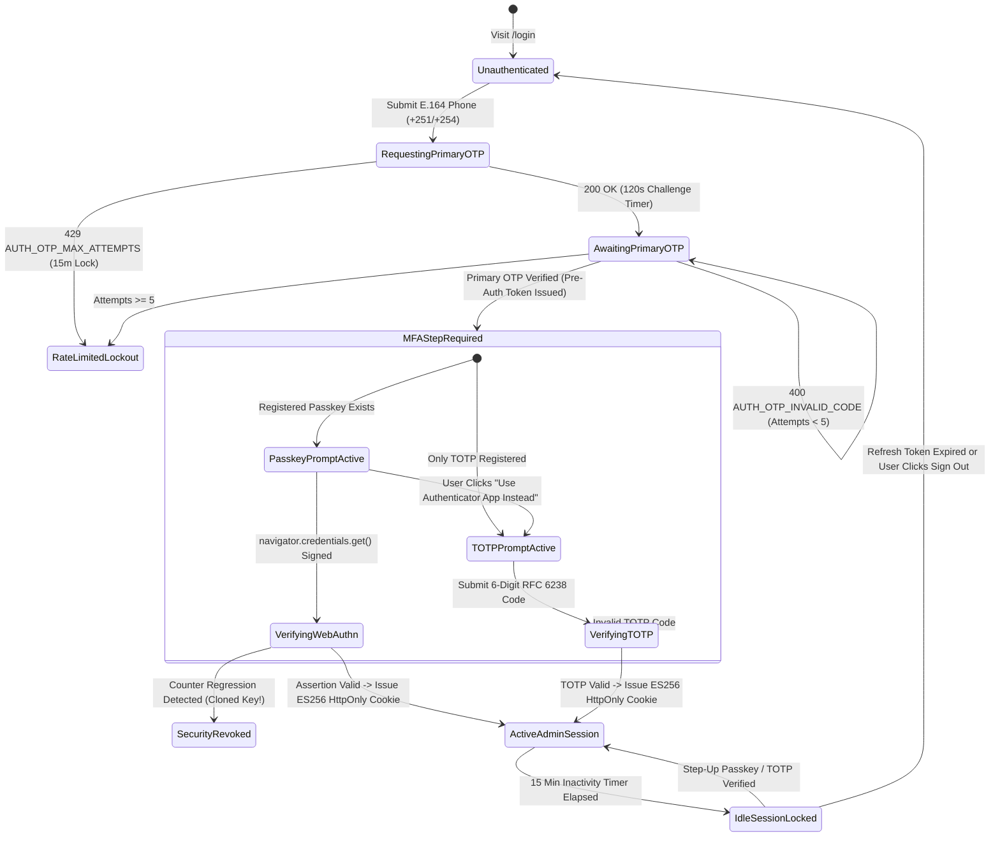
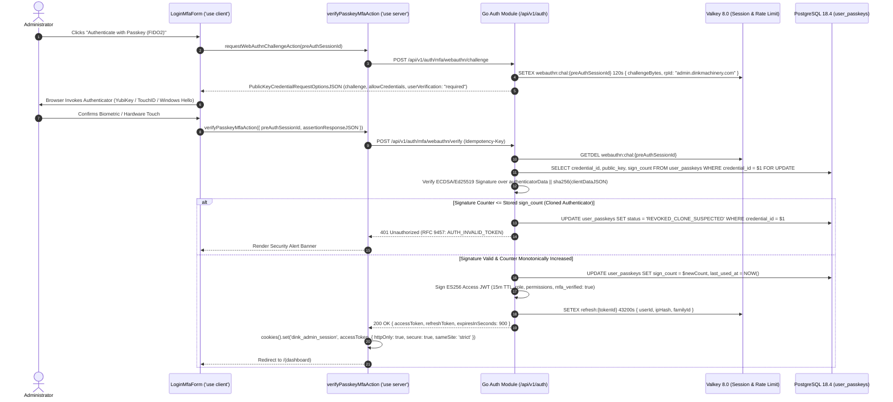

# Admin Authentication, WebAuthn Passkeys & Hardware MFA
## Admin Subsystem Specification — `docs/admin/shell/02-admin-auth-mfa-passkey.md`

**Document Identifier:** `SPEC-ADM-SHL-02`  
**Classification:** Canonical Subsystem UI/UX & Technical Behavior Specification  
**Governing Documents:** `Dink_Machinery_UI_UX_Design_Brief.md`, `SRS-DINK-CORE-V7.0`, `docs/components/admin/DESIGN.md`, `contracts/openapi.yaml`  
**Target Subsystem:** Next.js 16 Web Admin Console (`admin/src/app/(auth)/login/page.tsx` & `src/middleware.ts`)  
**Primary Persona / Actor:** All Administrative Staff (`SUPER_ADMIN`, `COMPLIANCE_OFFICER`, `FINANCE_CONTROLLER`, `DISPUTE_ARBITRATOR`, `OPS_SUPPORT`)  
**Associated Requirements:** `REG-10`, `REG-11`, `REG-12`, `REG-13`, `REG-14`, `REG-15`, `AUTH-04-WEB`, `REQ-05-01`  
**Associated Interaction Flows:** `FLOW-01`, `FLOW-APPENDIX-B` (WebAuthn Passkey & Multi-Factor Step-Up Choreography)  
**Associated ADRs:** `ADR-011` (OWASP ASVS Level 3 Authentication, Passkeys & Session Pinning)  
**Status:** Approved Technical Design Baseline

---

## 1. Domain Context, Business Rules & Architectural Invariants

The **Admin Authentication, WebAuthn Passkeys & Hardware MFA Subsystem** (`SPEC-ADM-SHL-02`) enforces **OWASP ASVS 4.0.3 Level 3** identity verification for all personnel accessing the Next.js 16 back-office console. Because administrative staff have authority to adjudicate multi-million Birr disputes, verify commercial licenses, and override booking state machines, standard single-factor authentication is strictly prohibited.

### 1.1 Core Business Rules & Security Mandates
1. **Primary Factor + Mandatory Hardware/Cryptographic MFA (`REG-10`..`REG-15`, `AUTH-04-WEB`):**
   - **Step 1 (Primary Identity Challenge):** Administrator authenticates their registered E.164 phone number (`+251...` or `+254...`) via a 6-digit cryptographic OTP (`POST /api/v1/auth/otp/request` -> `POST /api/v1/auth/otp/verify` with `purpose: "LOGIN"`), or initiates a direct discoverable **FIDO2 / WebAuthn Passkey** assertion (`navigator.credentials.get`).
   - **Step 2 (Mandatory MFA Verification):** Even after primary OTP verification, administrative roles cannot receive a full session token until completing a second cryptographic factor:
     - **Priority 1 — WebAuthn FIDO2 Passkey (`REG-11`):** Hardware security key (YubiKey 5) or platform authenticator (TouchID / Windows Hello) verified against the public key and monotonic signature counter stored in `user_passkeys`.
     - **Priority 2 — RFC 6238 TOTP Authenticator (`REG-12`):** 6-digit time-based one-time code (30-second window, $\pm 1$ drift step) validated against the encrypted TOTP seed in `user_mfa_factors`.
2. **Passkey Signature Counter Regression Detection (`REG-13`, `ADR-011`):** During WebAuthn assertion verification, if the authenticator returns a `signCount` less than or equal to the last persisted counter in PostgreSQL (`user_passkeys.sign_count`), the backend immediately aborts login with `401 AUTH_INVALID_TOKEN` (`CLONED_AUTHENTICATOR_DETECTED`), revokes the passkey credential, and alerts `SUPER_ADMIN` security channels.
3. **Zero Client-Side Token Storage (`ADR-011`):** Access JWTs (signed with `ES256`, 15-minute TTL) and single-use rotating refresh tokens (persisted in Valkey 8.0 under `refresh:{token_id}`) are never exposed to client-side JavaScript (`localStorage`, `sessionStorage`, or non-HttpOnly cookies). They are set exclusively via Next.js Server Actions as `HttpOnly; Secure; SameSite=Strict; Path=/` cookies (`dink_admin_session` and `dink_admin_refresh`).
4. **15-Minute Idle Session Lockout & Step-Up Re-Authentication (`REG-14`):**
   - An edge activity monitor tracks keyboard/pointer interaction and heartbeats against Valkey. After **15 minutes ($900\text{ seconds}$) of inactivity**, the session transitions to `LOCKED_IDLE`, mounting a non-dismissible modal requiring a fresh WebAuthn Passkey tap or TOTP code to resume without losing unsaved workspace context, or hard-redirecting to `/login` once the token expires.
   - High-risk mutations (manual booking state override `SPEC-ADM-BKG-04`, escrow arbitration ruling `SPEC-ADM-DSP-03`, RBAC role elevation `SPEC-ADM-SHL-03`) require a fresh `STEP_UP` MFA assertion within the last 5 minutes.
5. **Rate Limiting & Brute-Force Lockout (`REG-15`):** Maximum 5 OTP verification attempts per challenge session (`120s` TTL) and maximum 5 failed MFA assertions within 15 minutes before triggering `429 AUTH_OTP_MAX_ATTEMPTS` (15-minute Valkey IP + User lockout).

---

## 2. Screen Anatomy, Layout & Component Hierarchy

### 2.1 Dual-Stage Admin Login & Passkey/TOTP Challenge Wireframe

```text
+------------------------------------------------------------------------------------------------------------------------------------------+
| DINK MACHINERY — BACK-OFFICE SECURITY ENCLAVE                                                       [TLS 1.3 ENCRYPTED] [OWASP ASVS L3] |
+------------------------------------------------------------------------------------------------------------------------------------------+
|                                                                                                                                          |
|                                      +------------------------------------------------------------+                                      |
|                                      |                 [🛡] DINK ADMIN CONSOLE                     |                                      |
|                                      |          Heavy Machinery & Logistics Operations            |                                      |
|                                      +------------------------------------------------------------+                                      |
|                                      |  STEP 1 OF 2: PRIMARY IDENTITY                             |                                      |
|                                      |  Operator Phone: +251 911 **** 44           [✓ OTP Verified]|                                      |
|                                      +------------------------------------------------------------+                                      |
|                                      |  STEP 2 OF 2: HARDWARE MULTI-FACTOR VERIFICATION           |                                      |
|                                      |                                                            |                                      |
|                                      |  +------------------------------------------------------+  |                                      |
|                                      |  |       [🔑] WAITING FOR WEBAUTHN PASSKEY / KEY        |  |                                      |
|                                      |  |                                                      |  |                                      |
|                                      |  |   Touch your YubiKey or confirm Windows Hello /      |  |                                      |
|                                      |  |   TouchID prompt to sign cryptographic challenge.    |  |                                      |
|                                      |  |                                                      |  |                                      |
|                                      |  |      [ AUTHENTICATE WITH PASSKEY (FIDO2) ]           |  |                                      |
|                                      |  +------------------------------------------------------+  |                                      |
|                                      |                                                            |                                      |
|                                      |  ─── OR USE HARDWARE TOTP AUTHENTICATOR (RFC 6238) ───     |                                      |
|                                      |                                                            |                                      |
|                                      |  Enter 6-Digit Authenticator Code *                        |                                      |
|                                      |  [ 4 ] [ 9 ] [ 2 ]  -  [ 8 ] [ 1 ] [ 5 ]                   |                                      |
|                                      |                                                            |                                      |
|                                      |  [ VERIFY TOTP & UNLOCK WORKSPACE ]                        |                                      |
|                                      +------------------------------------------------------------+                                      |
|                                      |  Session Pinning: IP 196.188.xx.xx | Challenge TTL: 01:42  |                                      |
|                                      |  Request ID: req_01J8AUTH99214                             |                                      |
|                                      +------------------------------------------------------------+                                      |
|                                                                                                                                          |
+------------------------------------------------------------------------------------------------------------------------------------------+
```

### 2.2 15-Minute Idle Session Lock Overlay Wireframe (`IdleLockModal.tsx`)

```text
+------------------------------------------------------------------------------------------------------------------------------------------+
| [BLURRED WORKSPACE BACKDROP — `backdrop-blur-md bg-slate-950/85` — DOM READ-ONLY / POINTER-EVENTS BLOCKED]                               |
|                                                                                                                                          |
|                                      +------------------------------------------------------------+                                      |
|                                      |  [🔒] WORKSPACE LOCKED DUE TO 15-MIN INACTIVITY            |                                      |
|                                      +------------------------------------------------------------+                                      |
|                                      |  Operator: Dawit Mekonnen (DISPUTE_ARBITRATOR)             |                                      |
|                                      |  Locked Route: /disputes/dsp-9042                          |                                      |
|                                      |                                                            |                                      |
|                                      |  Re-verify your WebAuthn Passkey or enter a current        |                                      |
|                                      |  6-digit TOTP code to resume your active session.          |                                      |
|                                      |                                                            |                                      |
|                                      |  [ 🔑 TAP PASSKEY TO RESUME ]   [ 🚪 SIGN OUT COMPLETELY ]  |                                      |
|                                      +------------------------------------------------------------+                                      |
+------------------------------------------------------------------------------------------------------------------------------------------+
```

---

## 3. W3C DTCG Design Token Mapping Table

| Auth UI Element | W3C Token Path (`design-tokens.json`) | Resolved Value | Behavioral & Accessibility Constraint |
|---|---|---|---|
| **Enclave Canvas Background** | `color.brand.slate.950` | `#020617` | High-security dark enclave backdrop distinguishing unauthenticated screens from active workspace. |
| **Auth Card Surface** | `semantic.dark.surface.card` | `#1E293B` | `480px` max-width centered card with `elevation.modal` and `stroke.border.thin` (`#334155`). |
| **Passkey Actuator Button** | `semantic.dark.action.primary.bg` / `text` | `#F59E0B` bg / `#020617` text | `dimension.space.56` (`56dp`) height, `stroke.border.heavy` (`3dp`) bottom tactile lip (`#B45309`). |
| **6-Digit OTP / TOTP Input Slots** | `typography.fontFamily.mono` / `typography.fontSize.24` | `Space Mono`, `24sp`, `56x64dp` slots | Supports `autocomplete="one-time-code"`, paste distribution across all 6 slots, and arrow-key navigation. |
| **Challenge Countdown Badge** | `component.countdown.holdNormalBg` / `holdCriticalBg` | `#FFFBEB` (>30s) -> `#FEF2F2` (<30s) | Live `aria-live="off"` visual timer with polite screen reader announcement at 30 seconds remaining. |
| **Error Banner (RFC 9457)** | `color.feedback.crimson.950` + `color.feedback.crimson.500` | `#450A0A` surface / `#EF4444` border | Displays localized error reason (`AUTH_OTP_INVALID_CODE`, `AUTH_OTP_MAX_ATTEMPTS`) + copyable `requestId`. |
| **Idle Lock Overlay Backdrop** | `semantic.dark.surface.overlay` | `rgba(2, 6, 23, 0.85)` | Traps keyboard focus inside `DialogContent`; blocks `Escape` dismissal until re-authenticated or signed out. |

---

## 4. Interactive State Machine & Sequence Choreography

### 4.1 Admin Multi-Factor Authentication & Idle Lock State Machine



### 4.2 WebAuthn Passkey Assertion & HttpOnly Cookie Issuance Sequence



---

## 5. Concrete Next.js 16 Implementation Blueprint

### 5.1 Server Action: WebAuthn & TOTP MFA Verification (`src/app/(auth)/login/actions.ts`)

```typescript
// src/app/(auth)/login/actions.ts
'use server';

import { cookies, headers } from 'next/headers';
import { z } from 'zod';
import { ProblemDetails } from '@/types/dynamic-ui';

const VerifyTotpMfaSchema = z.object({
  verificationSessionId: z.string().uuid('Invalid verification session identifier.'),
  totpCode: z
    .string()
    .regex(/^[0-9]{6}$/, 'Authenticator code must be exactly 6 numeric digits.'),
});

const VerifyPasskeyMfaSchema = z.object({
  verificationSessionId: z.string().uuid(),
  credentialId: z.string().min(16),
  clientDataJSON: z.string().min(32),
  authenticatorData: z.string().min(32),
  signature: z.string().min(32),
});

export interface AuthActionState {
  success: boolean;
  redirectTo?: string;
  problem?: ProblemDetails;
}

export async function verifyAdminTotpMfaAction(
  prevState: AuthActionState,
  formData: FormData
): Promise<AuthActionState> {
  const parsed = VerifyTotpMfaSchema.safeParse({
    verificationSessionId: formData.get('verificationSessionId'),
    totpCode: formData.get('totpCode'),
  });

  if (!parsed.success) {
    return {
      success: false,
      problem: {
        type: 'https://api.dinkmachinery.com/errors/request-validation-failed',
        title: 'Invalid MFA Code Format',
        status: 400,
        detail: 'Please enter a valid 6-digit numeric code from your authenticator app.',
        code: 'REQ_VALIDATION_FAILED',
        invalidParams: parsed.error.issues.map((issue) => ({
          name: issue.path.join('.'),
          reason: issue.message,
        })),
      },
    };
  }

  const reqHeaders = await headers();
  const forwardedFor = reqHeaders.get('x-forwarded-for') ?? '127.0.0.1';
  const idempotencyKey = crypto.randomUUID();

  const res = await fetch(
    `${process.env.INTERNAL_BACKEND_URL}/api/v1/auth/mfa/totp/verify`,
    {
      method: 'POST',
      headers: {
        'Content-Type': 'application/json',
        'Idempotency-Key': idempotencyKey,
        'X-Forwarded-For': forwardedFor,
      },
      body: JSON.stringify({
        verificationSessionId: parsed.data.verificationSessionId,
        code: parsed.data.totpCode,
      }),
    }
  );

  const payload = await res.json();

  if (!res.ok) {
    return {
      success: false,
      problem: payload.error as ProblemDetails,
    };
  }

  const cookieStore = await cookies();
  const { accessToken, refreshToken, expiresInSeconds } = payload.data;

  // Enforce ASVS L3 Zero Client Token Storage via strict HttpOnly cookies
  cookieStore.set('dink_admin_session', accessToken, {
    httpOnly: true,
    secure: process.env.NODE_ENV === 'production',
    sameSite: 'strict',
    path: '/',
    maxAge: expiresInSeconds, // 900 seconds (15 minutes)
  });

  cookieStore.set('dink_admin_refresh', refreshToken, {
    httpOnly: true,
    secure: process.env.NODE_ENV === 'production',
    sameSite: 'strict',
    path: '/api/auth/refresh',
    maxAge: 60 * 60 * 12, // 12-hour absolute shift cap
  });

  return {
    success: true,
    redirectTo: '/',
  };
}

export async function verifyAdminPasskeyMfaAction(
  input: z.infer<typeof VerifyPasskeyMfaSchema>
): Promise<AuthActionState> {
  const parsed = VerifyPasskeyMfaSchema.safeParse(input);
  if (!parsed.success) {
    return {
      success: false,
      problem: {
        type: 'https://api.dinkmachinery.com/errors/request-validation-failed',
        title: 'Malformed WebAuthn Assertion',
        status: 400,
        detail: 'The hardware passkey assertion payload failed schema validation.',
        code: 'REQ_VALIDATION_FAILED',
      },
    };
  }

  const res = await fetch(
    `${process.env.INTERNAL_BACKEND_URL}/api/v1/auth/mfa/webauthn/verify`,
    {
      method: 'POST',
      headers: {
        'Content-Type': 'application/json',
        'Idempotency-Key': crypto.randomUUID(),
      },
      body: JSON.stringify(parsed.data),
    }
  );

  const payload = await res.json();
  if (!res.ok) {
    return {
      success: false,
      problem: payload.error as ProblemDetails,
    };
  }

  const cookieStore = await cookies();
  cookieStore.set('dink_admin_session', payload.data.accessToken, {
    httpOnly: true,
    secure: process.env.NODE_ENV === 'production',
    sameSite: 'strict',
    path: '/',
    maxAge: payload.data.expiresInSeconds,
  });

  return {
    success: true,
    redirectTo: '/',
  };
}
```

---

## 6. OpenAPI 3.1.0 Contract Bindings & RFC 9457 Error Matrix

| HTTP Method & Route | Operation ID | Required Headers | Success Envelope | RFC 9457 Error Codes & Trigger Conditions |
|---|---|---|---|---|
| `POST /api/v1/auth/otp/request` | `requestOtp` | `X-Country-Code: ET\|KE` | `200 OK` (`OtpRequestSuccessResponse`) | `400 REQ_VALIDATION_FAILED` (Invalid E.164 phone)<br>`429 SYS_RATE_LIMIT_EXCEEDED` (>5 OTP requests/hr) |
| `POST /api/v1/auth/otp/verify` | `verifyOtp` | `X-Country-Code: ET\|KE` | `200 OK` (`AuthTokenSuccessResponse` or MFA challenge) | `400 AUTH_OTP_INVALID_CODE` (Mismatch)<br>`400 AUTH_OTP_EXPIRED` (>120s elapsed)<br>`429 AUTH_OTP_MAX_ATTEMPTS` (>5 failed attempts; 15m lock) |
| `POST /api/v1/auth/mfa/webauthn/verify` | `verifyWebAuthnAssertion` | `Idempotency-Key` | `200 OK` (`AuthTokenSuccessResponse`) | `401 AUTH_INVALID_TOKEN` (Signature invalid or passkey counter regression)<br>`403 AUTH_ACCOUNT_SUSPENDED` |
| `POST /api/v1/auth/mfa/totp/verify` | `verifyTotpFactor` | `Idempotency-Key` | `200 OK` (`AuthTokenSuccessResponse`) | `400 AUTH_OTP_INVALID_CODE`<br>`429 AUTH_OTP_MAX_ATTEMPTS` |
| `POST /api/v1/auth/session/refresh` | `refreshSession` | `Cookie: dink_admin_refresh` | `200 OK` (`AuthTokenSuccessResponse`) | `401 AUTH_TOKEN_REVOKED` (Replay of rotated refresh token triggers family revocation) |

---

## 7. Verification & Acceptance Criteria

1. **Zero Client Storage Verification (Playwright Security Audit):**
   - After completing login + MFA, `window.localStorage` and `window.sessionStorage` contain zero keys matching `token`, `jwt`, `auth`, or `session`, and `document.cookie` does not expose `dink_admin_session` (`HttpOnly` verified).
2. **Passkey Counter Regression Defense:**
   - Submitting a mocked WebAuthn assertion with `signCount <= storedSignCount` returns HTTP `401` (`AUTH_INVALID_TOKEN`), blocks session creation, and renders the RFC 9457 security banner.
3. **15-Minute Idle Lockout Determinism:**
   - Using frozen clock timers (`page.clock.fastForward('15:01')`), the `IdleLockModal` mounts automatically, traps keyboard focus, and prevents background table interaction until re-authenticated.
4. **Accessibility (`@axe-core/playwright`):**
   - All 6 OTP/TOTP digit inputs carry explicit `aria-label="Digit X of 6"` attributes, announce validation errors via `aria-describedby`, and meet WCAG 2.2 AA contrast ratios.

---
*Canonical specification entry for Dink Machinery platform development. Changes require an explicit design review.*
