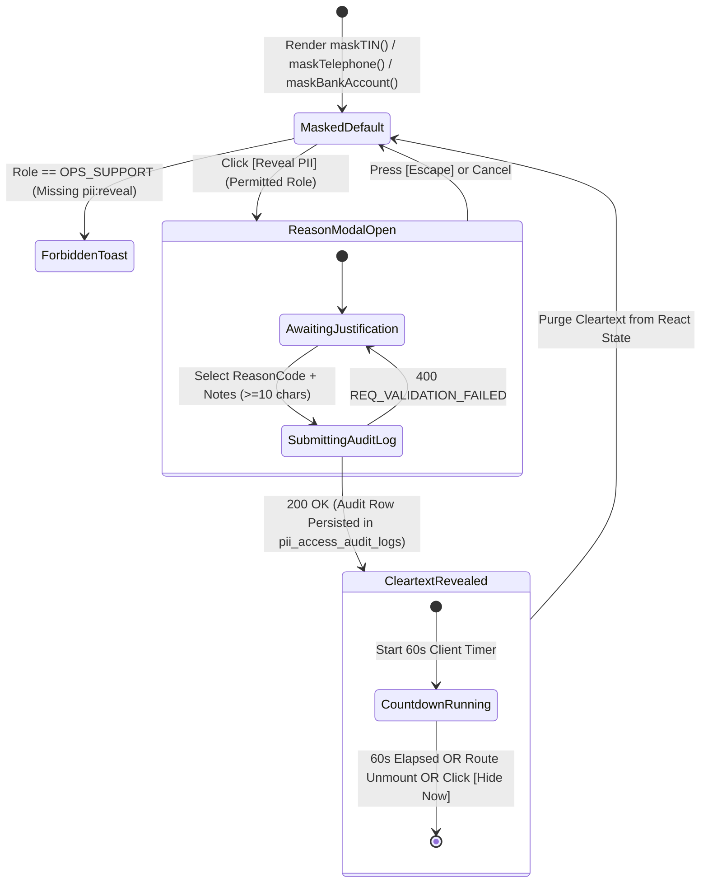
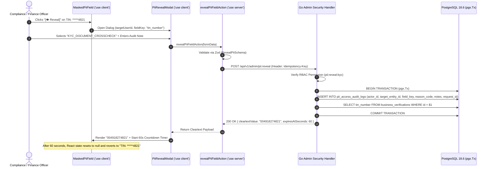

# Granular RBAC Matrix, Separation of Duties & Audited PII Unmasking
## Admin Subsystem Specification — `docs/admin/shell/03-role-based-access-control.md`

**Document Identifier:** `SPEC-ADM-SHL-03`  
**Classification:** Canonical Subsystem UI/UX & Technical Behavior Specification  
**Governing Documents:** `Dink_Machinery_UI_UX_Design_Brief.md`, `SRS-DINK-CORE-V7.0`, `docs/components/admin/DESIGN.md`, `contracts/openapi.yaml`  
**Target Subsystem:** Next.js 16 Web Admin Console (`admin/src/app/(dashboard)/settings/roles/page.tsx` & `src/components/feedback/PiiRevealModal.tsx`)  
**Primary Persona / Actor:** `SUPER_ADMIN`, Security Auditor, Compliance Lead  
**Associated Requirements:** `REQ-04`, `AD-02`, `AD-06`, `REQ-05-11`, `ASVS-L3-PII`  
**Associated Interaction Flows:** `FLOW-12` (RBAC Matrix & Audited PII Reveal Workflow)  
**Associated ADRs:** `ADR-008` (Server-Driven UI Gating), `ADR-011` (ASVS Level 3 Security & Zero PII Leakage)  
**Status:** Approved Technical Design Baseline

---

## 1. Domain Context, Business Rules & Architectural Invariants

The **Granular RBAC Matrix, Separation of Duties & Audited PII Unmasking Subsystem** (`SPEC-ADM-SHL-03`) governs administrative authorization across the five canonical back-office roles and enforces **OWASP ASVS Level 3 Zero-PII Leakage** invariants across every table cell, detail drawer, and audit log.

### 1.1 The Five Canonical Administrative Roles & Separation of Duties (SoD)
To prevent internal collusion and financial fraud, the platform enforces strict **Separation of Duties (SoD)** across five distinct administrative personas:

| Role Identifier | Operational Mandate | Permitted Capabilities | Explicit SoD Prohibitions |
|---|---|---|---|
| **`SUPER_ADMIN`** | Platform governance, tax/country config, dual-control escalation sign-off | `country:write`, `rbac:manage`, `booking:override:approve`, `spec_template:write` | Cannot unilaterally execute an un-audited ledger adjustment without a `FINANCE_CONTROLLER` co-signature or linked support ticket. |
| **`COMPLIANCE_OFFICER`** | KYC/KYB verification, fleet Libre & spec approval, operator certification, insurance monitoring | `kyc:review`, `kyb:review`, `fleet:approve`, `operator:verify`, `pii:reveal:kyc` | Prohibited from executing dispute escrow rulings (`dispute:rule`) or modifying `OwnerWallet` balances (`wallet:adjust`). |
| **`FINANCE_CONTROLLER`** | Double-entry ledger reconciliation, manual top-up verification, withholding tax & VAT reporting | `ledger:read`, `wallet:topup:verify`, `payout:audit`, `pii:reveal:financial` | Prohibited from approving fleet listings (`fleet:approve`) or altering booking inspection records (`inspection:override`). |
| **`DISPUTE_ARBITRATOR`** | Contested payment slip & post-rental damage arbitration, split-screen lightbox inspection | `dispute:read`, `dispute:message`, `dispute:rule`, `pii:reveal:dispute` | Prohibited from approving the underlying user's KYC (`kyc:review`) or modifying platform commission rates (`country:write`). |
| **`OPS_SUPPORT`** | Tier-1 booking monitoring, lowboy logistics re-dispatch coordination, marketplace abuse triage | `booking:read`, `logistics:dispatch`, `integrity:triage`, `booking:hold:extend` | Prohibited from revealing full TIN/Bank account PII (`pii:reveal:*`) or executing binding financial rulings (`dispute:rule`). |

### 1.2 Audited "Click to Reveal" PII Masking Protocol (`AD-02`, `ASVS L3`)
1. **Default Masked Wire & Render State:** All sensitive attributes are masked by default in both API list responses and UI cells:
   - Mobile Phone: `+251911****44` (`maskTelephone`)
   - Tax Identification Number (TIN): `TIN: *****4821` (`maskTIN`)
   - National / Fayda Digital ID: `FIN: ****-****-9012`
   - Commercial Bank Account: `CBE: *******7890` (`maskBankAccount`)
2. **Explicit Reason-Logged Unmasking:** When a permitted officer (`COMPLIANCE_OFFICER`, `FINANCE_CONTROLLER`, `DISPUTE_ARBITRATOR`, or `SUPER_ADMIN`) clicks `[👁 Reveal PII]` on a specific entity, a modal (`PiiRevealModal.tsx`) prompts for a mandatory structured `reasonCode` (`KYC_DOCUMENT_CROSSCHECK`, `BANK_SLIP_RECONCILIATION`, `DISPUTE_CLAIM_INVESTIGATION`, `REGULATORY_SUBPOENA`) and optional ticket reference.
3. **Immutable Access Audit Trail & 60-Second Auto-Remask:** Submitting the modal calls `POST /api/v1/admin/pii:reveal`, which writes an immutable row to `pii_access_audit_logs` (`actor_id`, `target_user_id`, `field_name`, `reason_code`, `ip_address`, `request_id`, `created_at`) before returning the cleartext value. The client automatically re-masks the value in memory after **60 seconds** or upon route navigation.

---

## 2. Screen Anatomy, Layout & Component Hierarchy

### 2.1 RBAC Permission Matrix & Audited PII Reveal Modal Wireframe

```text
+------------------------------------------------------------------------------------------------------------------------------------------+
| Settings > Role-Based Access Control (RBAC) & Separation of Duties Matrix                               [🔒 Step-Up MFA Active: 04:12]   |
+------------------------------------------------------------------------------------------------------------------------------------------+
| [!] SEPARATION OF DUTIES (SoD) ENFORCED: Role permission changes require SUPER_ADMIN clearance and emit immutable security audit events. |
+------------------------------------------------------------------------------------------------------------------------------------------+
| CAPABILITY / PERMISSION SCOPE       | SUPER_ADMIN | COMPLIANCE_OFFICER | FINANCE_CONTROLLER | DISPUTE_ARBITRATOR | OPS_SUPPORT           |
+-------------------------------------+-------------+--------------------+--------------------+--------------------+-----------------------+
| kyc:review (Fayda / National ID)    |     [✓]     |        [✓]         |        [ ]         |        [ ]         |         [ ]           |
| kyb:review (Trade License / TIN)    |     [✓]     |        [✓]         |        [ ]         |        [ ]         |         [ ]           |
| fleet:approve (Libre & EAV Specs)   |     [✓]     |        [✓]         |        [ ]         |        [ ]         |         [ ]           |
| booking:override (State Force)      |     [✓]     |        [ ]         |        [ ]         |        [ ]         |   [✓] (Dual-Control)  |
| dispute:rule (Escrow & Damage)      |     [✓]     |   [🔒 SoD Blocked] |   [🔒 SoD Blocked] |        [✓]         |         [ ]           |
| wallet:topup:verify (Ledger Credit) |     [✓]     |   [🔒 SoD Blocked] |        [✓]         |   [🔒 SoD Blocked] |         [ ]           |
| pii:reveal (Unmask TIN/Bank/Fayda)  |     [✓]     |   [✓] (Audited)    |   [✓] (Audited)    |   [✓] (Audited)    |         [ ]           |
| country:write (VAT / WHT bps)       |     [✓]     |        [ ]         |        [ ]         |        [ ]         |         [ ]           |
+-------------------------------------+-------------+--------------------+--------------------+--------------------+-----------------------+

+------------------------------------------------------------------------------------------------------------------------------------------+
| AUDITED PII REVEAL MODAL (`PiiRevealModal.tsx` — Triggered when clicking `[👁 Reveal]` on `TIN: *****4821`)                              |
| +--------------------------------------------------------------------------------------------------------------------------------------+ |
| | [🛡] AUDITED PII UNMASKING REQUEST — OWASP ASVS L3 COMPLIANCE                                                             [X Close]  | |
| +--------------------------------------------------------------------------------------------------------------------------------------+ |
| | Target Entity: Mesfin Industrial Equipment PLC (`usr_01HP89921`)                                                                     | |
| | Masked Field:  Tax Identification Number (`TIN: *****4821`)                                                                          | |
| |                                                                                                                                      | |
| | Select Mandatory Unmasking Reason Code *                                                                                             | |
| | (o) KYC_DOCUMENT_CROSSCHECK — Comparing TIN/Fayda against uploaded government certificate                                            | |
| | ( ) BANK_SLIP_RECONCILIATION — Verifying direct bank transfer sender/beneficiary account number                                      | |
| | ( ) DISPUTE_CLAIM_INVESTIGATION — Validating party identity during contested arbitration                                             | |
| |                                                                                                                                      | |
| | Audit Notes / Support Ticket Reference (Min 10 chars) *                                                                              | |
| | [ Cross-checking MoTRI renewal certificate #ET-2026-88412 against TIN registry.                                                   ]  | |
| |                                                                                                                                      | |
| | [!] Notice: Your User ID, IP address, and timestamp will be permanently recorded in `pii_access_audit_logs`. Value auto-hides in 60s.| |
| |                                                                                                                                      | |
| |                                                             [ CANCEL (ESC) ]   [ 🔓 LOG REASON & REVEAL PII (60s) ]                  | |
| +--------------------------------------------------------------------------------------------------------------------------------------+ |
+------------------------------------------------------------------------------------------------------------------------------------------+
```

---

## 3. W3C DTCG Design Token Mapping Table

| RBAC / PII Component | W3C Token Path (`design-tokens.json`) | Resolved Value | Behavioral & Accessibility Constraint |
|---|---|---|---|
| **Masked PII Pill Container** | `color.brand.slate.100` / `color.brand.slate.800` | `#F1F5F9` (Light) / `#1E293B` (Dark) | Renders monospace masked string (`TIN: *****4821`) with inline `[👁 Reveal]` button (`min-h-[32px]`). |
| **Revealed PII Active State** | `color.brand.amber.100` + `color.brand.amber.900` | `#FEF3C7` fill / `#78350F` text | Displays cleartext value alongside live `60s` countdown badge; `user-select: all` enabled during window. |
| **SoD Conflict Lock Badge** | `color.feedback.crimson.50` + `color.feedback.crimson.700` | `#FEF2F2` fill / `#B91C1C` text | Non-interactive disabled cell in RBAC matrix explaining why two permissions cannot co-exist (`aria-disabled="true"`). |
| **Modal Warning Callout** | `color.brand.amber.50` + `color.brand.amber.700` | `#FFFBEB` fill / `#B45309` border | High-visibility compliance notice alerting operator of permanent `pii_access_audit_logs` entry. |
| **Primary Unmask CTA** | `semantic.light.action.primary.bg` | `#F59E0B` (`dimension.space.48` height) | Disabled until `reasonCode` is selected and `auditNotes` length $\ge 10$ characters. |

---

## 4. Interactive State Machine & Sequence Choreography

### 4.1 Audited PII Unmasking & 60-Second Auto-Redaction Lifecycle



### 4.2 Audited PII Unmasking Sequence Diagram



---

## 5. Concrete Next.js 16 Implementation Blueprint

### 5.1 Server Action: Audited PII Unmasking (`src/app/(dashboard)/settings/roles/actions.ts`)

```typescript
// src/app/(dashboard)/settings/roles/actions.ts
'use server';

import { cookies } from 'next/headers';
import { z } from 'zod';
import { ProblemDetails } from '@/types/dynamic-ui';

const RevealPiiSchema = z.object({
  targetEntityType: z.enum(['USER', 'BUSINESS_LICENSE', 'FLEET_OWNER_WALLET', 'DISPUTE']),
  targetEntityId: z.string().uuid(),
  fieldKey: z.enum(['phone_number', 'tin_number', 'national_id_number', 'bank_account_number']),
  reasonCode: z.enum([
    'KYC_DOCUMENT_CROSSCHECK',
    'BANK_SLIP_RECONCILIATION',
    'DISPUTE_CLAIM_INVESTIGATION',
    'REGULATORY_SUBPOENA',
  ]),
  auditNotes: z
    .string()
    .trim()
    .min(10, 'Audit notes must be at least 10 characters for compliance traceability.')
    .max(500),
});

export interface RevealPiiResult {
  success: boolean;
  data?: {
    cleartextValue: string;
    ttlSeconds: number;
    auditLogId: string;
  };
  problem?: ProblemDetails;
}

export async function revealPiiFieldAction(
  formData: FormData
): Promise<RevealPiiResult> {
  const parsed = RevealPiiSchema.safeParse({
    targetEntityType: formData.get('targetEntityType'),
    targetEntityId: formData.get('targetEntityId'),
    fieldKey: formData.get('fieldKey'),
    reasonCode: formData.get('reasonCode'),
    auditNotes: formData.get('auditNotes'),
  });

  if (!parsed.success) {
    return {
      success: false,
      problem: {
        type: 'https://api.dinkmachinery.com/errors/request-validation-failed',
        title: 'Audit Justification Required',
        status: 400,
        detail: 'Unmasking sensitive PII requires a valid reason code and detailed audit note.',
        code: 'REQ_VALIDATION_FAILED',
        invalidParams: parsed.error.issues.map((i) => ({
          name: i.path.join('.'),
          reason: i.message,
        })),
      },
    };
  }

  const cookieStore = await cookies();
  const sessionToken = cookieStore.get('dink_admin_session')?.value;

  const res = await fetch(
    `${process.env.INTERNAL_BACKEND_URL}/api/v1/admin/pii:reveal`,
    {
      method: 'POST',
      headers: {
        'Content-Type': 'application/json',
        'Authorization': `Bearer ${sessionToken}`,
        'Idempotency-Key': crypto.randomUUID(),
      },
      body: JSON.stringify(parsed.data),
      cache: 'no-store',
    }
  );

  const payload = await res.json();

  if (!res.ok) {
    return {
      success: false,
      problem: payload.error as ProblemDetails,
    };
  }

  return {
    success: true,
    data: {
      cleartextValue: payload.data.cleartextValue,
      ttlSeconds: 60,
      auditLogId: payload.data.auditLogId,
    },
  };
}
```

### 5.2 Client Component: `AuditedPiiCell.tsx`

```tsx
// src/components/feedback/AuditedPiiCell.tsx
'use client';

import React, { useState, useEffect } from 'react';
import { PiiRevealModal } from './PiiRevealModal';

interface AuditedPiiCellProps {
  maskedValue: string;
  targetEntityType: 'USER' | 'BUSINESS_LICENSE' | 'FLEET_OWNER_WALLET' | 'DISPUTE';
  targetEntityId: string;
  fieldKey: 'phone_number' | 'tin_number' | 'national_id_number' | 'bank_account_number';
  canReveal: boolean;
}

export function AuditedPiiCell({
  maskedValue,
  targetEntityType,
  targetEntityId,
  fieldKey,
  canReveal,
}: AuditedPiiCellProps) {
  const [cleartext, setCleartext] = useState<string | null>(null);
  const [secondsLeft, setSecondsLeft] = useState<number>(0);
  const [isModalOpen, setIsModalOpen] = useState(false);

  useEffect(() => {
    if (!cleartext || secondsLeft <= 0) {
      setCleartext(null);
      return;
    }
    const timer = setInterval(() => {
      setSecondsLeft((prev) => prev - 1);
    }, 1000);
    return () => clearInterval(timer);
  }, [cleartext, secondsLeft]);

  return (
    <div className="inline-flex items-center gap-2 font-mono text-xs">
      {cleartext ? (
        <span className="rounded bg-amber-100 px-2 py-0.5 font-semibold text-amber-900">
          {cleartext} <span className="text-[10px]">({secondsLeft}s)</span>
        </span>
      ) : (
        <span className="rounded bg-slate-100 px-2 py-0.5 text-slate-700 dark:bg-slate-800 dark:text-slate-300">
          {maskedValue}
        </span>
      )}

      {canReveal && !cleartext && (
        <button
          type="button"
          onClick={() => setIsModalOpen(true)}
          className="rounded border border-slate-300 px-1.5 py-0.5 text-[11px] font-sans font-medium text-slate-700 hover:bg-slate-100 focus-visible:outline-none focus-visible:ring-2 focus-visible:ring-amber-600"
          aria-label={`Reveal unmasked ${fieldKey.replace(/_/g, ' ')} (requires audit reason)`}
        >
          Reveal
        </button>
      )}

      {isModalOpen && (
        <PiiRevealModal
          targetEntityType={targetEntityType}
          targetEntityId={targetEntityId}
          fieldKey={fieldKey}
          maskedValue={maskedValue}
          onClose={() => setIsModalOpen(false)}
          onRevealed={(value, ttl) => {
            setCleartext(value);
            setSecondsLeft(ttl);
            setIsModalOpen(false);
          }}
        />
      )}
    </div>
  );
}
```

---

## 6. OpenAPI 3.1.0 Contract Bindings & RFC 9457 Error Matrix

| HTTP Method & Route | Operation ID | Required Headers | Success Envelope | RFC 9457 Error Codes & Trigger Conditions |
|---|---|---|---|---|
| `POST /api/v1/admin/pii:reveal` | `revealAuditedPii` | `Authorization`, `Idempotency-Key` | `200 OK` (`{ cleartextValue, auditLogId }`) | `400 REQ_VALIDATION_FAILED` (Missing reasonCode or notes < 10 chars)<br>`403 AUTH_INSUFFICIENT_PERMISSIONS` (`OPS_SUPPORT` or unauthorized scope)<br>`429 SYS_RATE_LIMIT_EXCEEDED` (Anomalous bulk PII unmasking velocity > 20/min) |
| `GET /api/v1/admin/roles/matrix` | `getRbacMatrix` | `Authorization` | `200 OK` (`RbacMatrixSuccessResponse`) | `401 AUTH_INVALID_TOKEN`<br>`403 AUTH_INSUFFICIENT_PERMISSIONS` |
| `PUT /api/v1/admin/roles/{roleId}/permissions` | `updateRolePermissions` | `Authorization`, `Idempotency-Key` | `200 OK` (`RoleDetailSuccessResponse`) | `403 ADMIN_UNAUTHORIZED_OVERRIDE` (Requires `SUPER_ADMIN` + active Step-Up MFA)<br>`422 REQ_VALIDATION_FAILED` (SoD conflict violation) |

---

## 7. Verification & Acceptance Criteria

1. **Default Masking Enforcement (Playwright E2E):**
   - Across all data grids (`/queues/kyc`, `/queues/business-licenses`, `/bookings`, `/disputes`), zero cleartext phone numbers, TINs, or bank account numbers appear in the initial server-rendered HTML or RSC payload.
2. **Audited Reveal & 60s Auto-Redaction:**
   - Submitting `PiiRevealModal` with valid justification displays the cleartext TIN, shows a live countdown badge (`60s`), and automatically reverts the DOM text back to `TIN: *****4821` when the timer reaches `0s`.
3. **Separation of Duties (SoD) Gate:**
   - Attempting to invoke a dispute ruling as `COMPLIANCE_OFFICER` or approve a fleet listing as `FINANCE_CONTROLLER` returns HTTP `403` (`AUTH_INSUFFICIENT_PERMISSIONS`) and hides the corresponding trigger in `/api/v1/admin/ui-config`.

---
*Canonical specification entry for Dink Machinery platform development. Changes require an explicit design review.*
