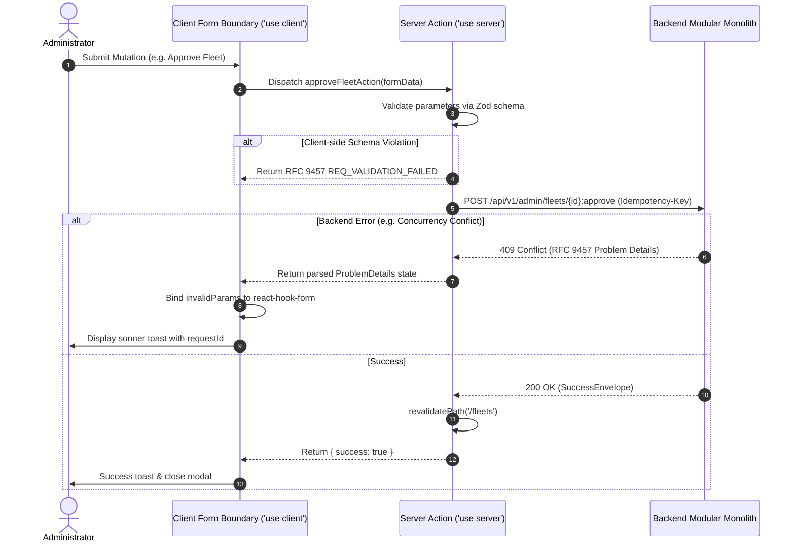

# Admin Web Console System Design & Architectural Specification (`admin/`) — Dink Machinery

**Subsystem:** Next.js 16 Administrative Web Console & Operational Back-Office  
**Specification:** System Architecture, Server-Driven UI Engine, Component Hierarchy & State Life Cycle  
**Compliance Standards:** OWASP ASVS 4.0.3 Level 3, W3C WCAG 2.1/2.2 Level AA, RFC 9457 (Problem Details), ISO/IEC 25010  
**Target Runtimes:** Next.js 16.x (React 19, App Router), TypeScript 5.7+, Tailwind CSS v4, Node.js 22.x LTS  
**Governing Documents:** `AGENTS.md`, `TECH_STACK.md`, `CODE_STANDARDS.md`, `API_CONVENTIONS.md`, `ERROR_CATALOG.md`, `DEFINITION_OF_DONE.md`, `docs/components/admin/AGENTS.md`

---

## 1. Executive Summary & Design Vision

The **Dink Machinery Admin Web Console** (`admin/`) is the central operational cockpit for platform administrators, fleet compliance inspectors, dispute resolution officers, and financial controllers operating across Ethiopia and Kenya.

Unlike conventional static administrative portals, the Dink Machinery Admin Console is engineered around a **Server-Driven Dynamic Metadata Architecture (`AD-06-BE`)**. Layout configurations, dynamic data table grids, contextual action triggers, faceted search filters, and RBAC visibility bounds are dictated dynamically at runtime by the Go 1.27.3 modular monolith backend. This decouples administrative capability rollouts from frontend build and deployment cycles.

```
                                Admin Console Core Pillars
                                             │
      ┌──────────────────────┬───────────────┴───────────────┬──────────────────────┐
      ▼                      ▼                               ▼                      ▼
[Server-Driven UI]      [Contract Conformance]          [Financial Determinism] [ASVS Level 3 Security]
 Dynamic Layouts,        OpenAPI 3.1.0 Single Source     Integer Minor Units     HttpOnly Cookie Auth,
 Grids & Forms via       of Truth; Generated TypeScript  (Santims/Cents); Zero   Zero Client Token Storage,
 /api/v1/admin/ui-config Models via openapi-typescript   Floating-Point Math     Masked PII Log Redaction
```

### Core Architectural Invariants
1. **Dynamic Metadata Rendering (`AD-06-BE`):** Table column schemas, sort keys, filter predicates, and role-gated action buttons must never be hardcoded into client views. They are fetched from `/api/v1/admin/ui-config` and rendered through headless data grids (`@tanstack/react-table`).
2. **Contract Supremacy & Zero Drift:** Manual TypeScript interfaces for network DTOs are prohibited. All models synchronize directly with `contracts/openapi.yaml` via `openapi-typescript` into `src/types/api.generated.ts`.
3. **React Server Component (RSC) Discipline:** Server Components are the default. The `'use client'` boundary is restricted strictly to leaf interactive components (modals, form inputs, dynamic dropdowns, virtualized viewports).
4. **RFC 9457 Problem Details Error Binding:** Server Action validation and business logic rejections must return standardized RFC 9457 problem payloads, mapping `invalidParams` directly to `react-hook-form` field errors.
5. **Integer Minor-Unit Currency Math:** Floating-point representations for money are banned. All monetary fields must be handled as 64-bit integers (`amountMinor` int64) paired with an ISO 4217 code (`currency` string).
6. **Zero Client-Side Token Storage (ASVS L3):** Authentication sessions are managed exclusively via encrypted, `HttpOnly`, `SameSite=Strict`, `Secure` cookies. Zero JWTs or refresh credentials are stored in `localStorage` or `sessionStorage`.
7. **Accessibility (WCAG 2.1/2.2 Level AA):** Full keyboard navigation parity, focus-visible indicators, WAI-ARIA live regions for toasts (`sonner`), and automated `@axe-core/playwright` CI compliance.

---

## 2. System Architecture & High-Level Topology

The Admin Console executes as a Next.js 16 App Router application within a secured network enclave, communicating with the backend modular monolith via an internal ingress gateway or reverse proxy.

```mermaid
flowchart TD
  Browser[Administrator Browser] -->|HTTPS / TLS 1.3| Ingress[Traefik 3.x Ingress Gateway]
  
  subgraph NextJS["Admin Subsystem (Next.js 16 / Node.js 22.x)"]
    Ingress --> Middleware[Next.js Auth & RBAC Middleware]
    Middleware --> RSCPage[React Server Component (RSC Page)]
    
    subgraph ClientLeaves["Client Interactive Boundary ('use client')"]
      DynamicGrid[TanStack Virtualized Grid]
      DynamicForm[React-Hook-Form + Zod]
      SonnerToast[Sonner Toast Notifications]
    end
    
    RSCPage --> ClientLeaves
    ClientLeaves -->|Form Submissions / Mutating RPC| ServerAction[Next.js Server Actions ('use server')]
  end

  subgraph BackendMonolith["Dink Core Backend (Go 1.27.3)"]
    ServerAction -->|REST / OpenAPI 3.1.0 + Idempotency-Key| AdminHTTP[Chi Admin HTTP Handlers]
    RSCPage -->|Fetch /api/v1/admin/ui-config| AdminHTTP
    AdminHTTP --> AdminApp[Admin Application Interactors]
    AdminApp --> Postgres[(PostgreSQL 18.4 + PostGIS)]
    AdminApp --> Valkey[(Valkey 8.0 Distributed Cache)]
  end
```

---

## 3. Directory Layout & Module Decomposition

The administrative codebase is organized strictly under `admin/src/` to isolate server logic, dynamic component engines, reusable primitives, and generated contracts:

```
admin/
├── public/                           # Static assets (favicons, platform logos)
├── src/
│   ├── app/                          # Next.js App Router (RSC by default)
│   │   ├── (auth)/                   # Authentication route group (unauthenticated shell)
│   │   │   ├── login/                # Passwordless OTP & WebAuthn login screen
│   │   │   └── layout.tsx            # Clean centered card layout
│   │   ├── (dashboard)/              # Authenticated back-office workspace shell
│   │   │   ├── layout.tsx            # Operational layout (Sidebar, Header, Breadcrumbs)
│   │   │   ├── page.tsx              # Operations Overview & Live KPI Widgets
│   │   │   ├── fleets/               # Fleet approval queue & asset inspections
│   │   │   │   ├── page.tsx          # Dynamic table view
│   │   │   │   ├── [id]/page.tsx     # Fleet specification & document inspection detail
│   │   │   │   └── actions.ts        # Server Actions (approve, reject, flag)
│   │   │   ├── bookings/             # Booking state machine & timeline tracker
│   │   │   │   ├── page.tsx          # Keyset-paginated booking register
│   │   │   │   ├── [id]/page.tsx     # 20-state lifecycle inspection & audit trail
│   │   │   │   └── actions.ts        # Override & manual state intervention actions
│   │   │   ├── disputes/             # Escrow dispute resolution & evidence lightbox
│   │   │   │   ├── page.tsx          # Contested bookings list
│   │   │   │   ├── [id]/page.tsx     # Dual-party inspection diff & meter comparison
│   │   │   │   └── actions.ts        # Ruling execution (forfeit, release, split escrow)
│   │   │   ├── users/                # Customer & Operator KYC management
│   │   │   ├── settings/             # Multi-Country configs & tax matrices
│   │   │   │   ├── countries/page.tsx# Country config editor (ET/KE bps rates)
│   │   │   │   └── roles/page.tsx    # Role-Permission assignment matrix
│   │   │   └── error.tsx             # Scoped dashboard error boundary
│   │   ├── api/                      # Edge proxy routes for client-side blob streaming
│   │   ├── global-error.tsx          # Root fallback boundary for fatal runtime exceptions
│   │   └── layout.tsx                # HTML root wrapper, font declarations, Sonner provider
│   ├── components/                   # UI building blocks
│   │   ├── dynamic/                  # The Server-Driven UI Engine
│   │   │   ├── DynamicTable.tsx      # Headless virtualized data grid renderer
│   │   │   ├── DynamicFilterBar.tsx  # Dynamic search, date range & facet filters
│   │   │   ├── DynamicActionGroup.tsx# Context-aware action trigger buttons
│   │   │   └── DynamicDetailView.tsx # Dynamic key-value and EAV spec field renderer
│   │   ├── layout/                   # Structural layout components
│   │   │   ├── AdminSidebar.tsx      # Role-filtered dynamic navigation sidebar
│   │   │   ├── AdminNavbar.tsx       # Search bar, country switcher, user avatar
│   │   │   └── Breadcrumbs.tsx       # Dynamic breadcrumb generator
│   │   ├── feedback/                 # Telemetry & status indicators
│   │   │   ├── ProblemDetailsBanner.tsx # RFC 9457 error visualizer
│   │   │   ├── RequestIdBadge.tsx    # Monospace tracking token badge
│   │   │   └── MediaLightbox.tsx     # Inspection photo evidence zoom/pan modal
│   │   └── ui/                       # Accessible Radix UI design system primitives
│   │       ├── button.tsx
│   │       ├── dialog.tsx
│   │       ├── dropdown-menu.tsx
│   │       ├── input.tsx
│   │       ├── select.tsx
│   │       ├── badge.tsx
│   │       └── sheet.tsx
│   ├── hooks/                        # Custom React hooks
│   │   ├── useDynamicTable.ts        # TanStack Table initialization hook
│   │   └── useDebounce.ts            # Search input rate-limiting hook
│   ├── lib/                          # Framework and business utilities
│   │   ├── api/                      # Typed backend HTTP client wrappers
│   │   ├── currency.ts               # Integer minor-unit formatting utilities
│   │   ├── errors.ts                 # RFC 9457 parsing & react-hook-form bindings
│   │   └── session.ts                # Edge-compatible cookie inspection
│   └── types/
│       ├── api.generated.ts          # Compiled OpenAPI TypeScript contracts (Auto-generated)
│       └── dynamic-ui.ts             # Metadata schemas for Dynamic UI engine
├── tests/                            # Quality test suites
│   ├── unit/                         # Vitest component & utility tests
│   └── e2e/                          # Playwright browser integration tests
├── next.config.ts                    # Next.js 16 compiler configuration
├── tailwind.config.ts                # Tailwind CSS v4 design system tokens
└── package.json                      # Dependency manifests & pinned toolchains
```

---

## 4. Server-Driven Dynamic UI Engine (`AD-06-BE`)

The primary design innovation in the Admin Console is the dynamic rendering pipeline. Rather than authoring rigid tables and forms for each bounded context, the UI is assembled from backend metadata specifications.

```
                    Server-Driven Dynamic UI Flow
                                  │
    [Client Navigates]            ▼
    e.g., /fleets ──► [Page RSC Fetches UI Config]
                           │ GET /api/v1/admin/ui-config?route=fleets
                           ▼
                      [Metadata Payload Returned]
                      - Columns (accessor, type, sortable)
                      - Facets (status, category, country)
                      - Actions (approve, reject, suspend)
                           │
                           ▼
                      [RSC Fetches Dataset]
                           │ GET /api/v1/admin/fleets?cursor=...
                           ▼
                      [Pass to <DynamicTable/>]
                           │
                           ▼
                      [Headless TanStack Table Compiles Grid]
                           │
                           ▼
                      [Virtualizer Mounts Visible Rows]
```

### 4.1. The UI Configuration Metadata Schema

The backend provides the structural configuration for each view through a unified schema:

```typescript
// src/types/dynamic-ui.ts

export type ColumnDataType = 'text' | 'money' | 'badge' | 'date' | 'progress' | 'actions';

export interface ColumnDefinition {
  id: string;
  header: string;
  accessorKey: string;
  dataType: ColumnDataType;
  isSortable: boolean;
  isFilterable: boolean;
  align?: 'left' | 'center' | 'right';
  badgeVariants?: Record<string, 'default' | 'success' | 'warning' | 'destructive' | 'outline'>;
}

export interface FilterFacetDefinition {
  id: string;
  label: string;
  type: 'select' | 'date-range' | 'text-search' | 'numeric-range';
  options?: { label: string; value: string }[];
}

export interface ActionDefinition {
  id: string;
  label: string;
  variant: 'default' | 'destructive' | 'outline' | 'secondary';
  requiredPermission: string;
  endpoint: string;
  method: 'POST' | 'PUT' | 'PATCH' | 'DELETE';
  confirmationPrompt?: {
    title: string;
    description: string;
    confirmText: string;
  };
}

export interface TableConfigResponse {
  tableId: string;
  title: string;
  description: string;
  defaultSortField: string;
  defaultSortDirection: 'asc' | 'desc';
  pageSize: number;
  columns: ColumnDefinition[];
  facets: FilterFacetDefinition[];
  rowActions: ActionDefinition[];
  bulkActions: ActionDefinition[];
}
```

### 4.2. Headless Dynamic Grid Architecture (`DynamicTable.tsx`)

`DynamicTable` takes the dynamic metadata schema, wraps it in `@tanstack/react-table`, and virtualizes the rows using `@tanstack/react-virtual` to ensure smooth rendering across tens of thousands of records.

```tsx
// src/components/dynamic/DynamicTable.tsx
'use client';

import React, { useRef } from 'react';
import {
  useReactTable,
  getCoreRowModel,
  flexRender,
  ColumnDef,
} from '@tanstack/react-table';
import { useVirtualizer } from '@tanstack/react-virtual';
import { TableConfigResponse, ColumnDefinition } from '@/types/dynamic-ui';
import { formatMinorUnits } from '@/lib/currency';
import { Badge } from '@/components/ui/badge';
import { DynamicActionGroup } from './DynamicActionGroup';

interface DynamicTableProps<TData Record<string, any extends>> {
  config: TableConfigResponse;
  data: TData[];
  onActionTrigger: (actionId: string, row: TData) => Promise<void>;
}

export function DynamicTable<TData Record<string, any extends>>({
  config,
  data,
  onActionTrigger,
}: DynamicTableProps<TData>) {
  const tableContainerRef = useRef<HTMLDivElement>(null);

  // Transform backend dynamic columns into TanStack ColumnDef instances
  const columns = React.useMemo<ColumnDef<TData>[]>(() => {
    const cols: ColumnDef<TData>[] = config.columns.map((col: ColumnDefinition) => ({
      id: col.id,
      header: col.header,
      accessorKey: col.accessorKey,
      cell: ({ getValue }) => {
        const val = getValue();
        if (val === null || val === undefined) return <span className="text-muted-foreground">—</span>;

        switch (col.dataType) {
          case 'money':
            // Assert MoneyAmount invariant: amountMinor (int64) + currency (ISO 4217)
            return (
              <span className="font-mono font-medium">
                {formatMinorUnits(val.amountMinor, val.currency)}
              </span>
            );
          case 'date':
            return <span>{new Date(val).toLocaleString()}</span>;
          case 'badge':
            const variant = col.badgeVariants?.[String(val)] || 'default';
            return <Badge variant="{variant}">{String(val)}</Badge>;
          default:
            return <span>{String(val)}</span>;
        }
      },
    }));

    // Attach row actions column if configured
    if (config.rowActions && config.rowActions.length > 0) {
      cols.push({
        id: '_actions',
        header: 'Actions',
        cell: ({ row }) => (
          <DynamicActionGroup actions="{config.rowActions}" onTrigger="{(actionId)" rowData="{row.original}"> onActionTrigger(actionId, row.original)}
          />
        ),
      });
    }

    return cols;
  }, [config, onActionTrigger]);

  const table = useReactTable({
    data,
    columns,
    getCoreRowModel: getCoreRowModel(),
  });

  const { rows } = table.getRowModel();

  // Virtualizer configuration for stable 60 FPS viewport rendering
  const rowVirtualizer = useVirtualizer({
    count: rows.length,
    getScrollElement: () => tableContainerRef.current,
    estimateSize: () => 48,
    overscan: 10,
  });

  return (
    <div
      ref={tableContainerRef}
      className="relative h-[calc(100vh-280px)] w-full overflow-auto rounded-lg border border-border bg-card shadow-sm"
      tabIndex={0}
      aria-label={`${config.title} dynamic data grid`}
    >
      <table className="w-full border-collapse text-left text-sm">
        <thead className="sticky top-0 z-20 bg-muted/90 text-xs font-semibold uppercase tracking-wider text-muted-foreground backdrop-blur-sm">
          {table.getHeaderGroups().map((headerGroup) => (
            <tr key={headerGroup.id}>
              {headerGroup.headers.map((header) => (
                <th
                  key={header.id}
                  scope="col"
                  className="px-4 py-3 border-b border-border"
                  style={{ width: header.getSize() }}
                >
                  {flexRender(header.column.columnDef.header, header.getContext())}
                </th>
              ))}
            </tr>
          ))}
        </thead>
        <tbody
          className="divide-y divide-border bg-card"
          style={{ height: `${rowVirtualizer.getTotalSize()}px`, position: 'relative' }}
        >
          {rowVirtualizer.getVirtualItems().map((virtualRow) => {
            const row = rows[virtualRow.index];
            return (
              <tr
                key={row.id}
                className="absolute left-0 top-0 flex w-full items-center hover:bg-muted/40 transition-colors focus-within:bg-muted/50"
                style={{
                  transform: `translateY(${virtualRow.start}px)`,
                  height: `${virtualRow.size}px`,
                }}
              >
                {row.getVisibleCells().map((cell) => (
                  <td
                    key={cell.id}
                    className="flex-1 px-4 py-2 truncate text-sm"
                    style={{ width: cell.column.getSize() }}
                  >
                    {flexRender(cell.column.columnDef.cell, cell.getContext())}
                  </td>
                ))}
              </tr>
            );
          })}
        </tbody>
      </table>
    </div>
  );
}
```

---

## 5. Server Actions, Form Mutation & RFC 9457 Error Integration

State mutations in the Admin Console (e.g., verifying machinery, settling an escrow dispute, updating tax configurations) flow through **React Server Actions (`'use server'`)**.

### 5.1. The RFC 9457 Server Action Protocol
When a server action fails, it intercepts the RFC 9457 Problem Details payload emitted by the Go backend and normalizes it into a strongly typed state object for client presentation:



### 5.2. Server Action Implementation (`fleets/actions.ts`)

```typescript
// src/app/(dashboard)/fleets/actions.ts
'use server';

import { revalidatePath } from 'next/cache';
import { z } from 'zod';
import { cookies } from 'next/headers';
import { ProblemDetails } from '@/types/dynamic-ui';

const ApproveFleetSchema = z.object({
  fleetId: z.string().uuid(),
  version: z.number().int().positive(),
  inspectionNotes: z.string().max(1000).optional(),
});

export type ServerActionResult<T any> = {
  success: boolean;
  data?: T;
  problem?: ProblemDetails;
};

export async function approveFleetAction(
  prevState: ServerActionResult,
  formData: FormData
): Promise<ServerActionResult> {
  // 1. Zod schema validation
  const validation = ApproveFleetSchema.safeParse({
    fleetId: formData.get('fleetId'),
    version: Number(formData.get('version')),
    inspectionNotes: formData.get('inspectionNotes'),
  });

  if (!validation.success) {
    return {
      success: false,
      problem: {
        type: '[https://api.dinkmachinery.com/errors/request-validation-failed](https://api.dinkmachinery.com/errors/request-validation-failed)',
        title: 'Form Validation Error',
        status: 400,
        detail: 'The submitted approval data is invalid.',
        code: 'REQ_VALIDATION_FAILED',
        invalidParams: validation.error.issues.map((issue) => ({
          name: issue.path.join('.'),
          reason: issue.message,
        })),
      },
    };
  }

  // 2. Resolve session cookies
  const cookieStore = await cookies();
  const sessionToken = cookieStore.get('dink_admin_session')?.value;

  // 3. Mutate backend with Idempotency-Key
  const idempotencyKey = crypto.randomUUID();
  const res = await fetch(
    `${process.env.INTERNAL_BACKEND_URL}/api/v1/admin/fleets/${validation.data.fleetId}:approve`,
    {
      method: 'POST',
      headers: {
        'Content-Type': 'application/json',
        'Authorization': `Bearer ${sessionToken}`,
        'Idempotency-Key': idempotencyKey,
      },
      body: JSON.stringify({
        version: validation.data.version,
        notes: validation.data.inspectionNotes,
      }),
    }
  );

  const payload = await res.json();

  if (!res.ok) {
    return {
      success: false,
      problem: payload.error as ProblemDetails,
    };
  }

  revalidatePath('/fleets');
  return {
    success: true,
    data: payload.data,
  };
}
```

### 5.3. Dynamic Form Error Binding (`bindProblemDetailsErrors`)
When `invalidParams` are received from a failed Server Action, they automatically bind to form input elements:

```typescript
// src/lib/errors.ts
import { FieldValues, UseFormSetError } from 'react-hook-form';
import { ProblemDetails } from '@/types/dynamic-ui';

export function bindProblemDetailsErrors<T FieldValues extends>(
  problem: ProblemDetails,
  setError: UseFormSetError<T>
): void {
  if (!problem.invalidParams || problem.invalidParams.length === 0) return;

  problem.invalidParams.forEach((param) => {
    setError(param.name as any, {
      type: 'server',
      message: param.reason,
    });
  });
}
```

---

## 6. Currency Minor-Unit Mathematics & Formatting Engine

Per platform invariants, floating-point numbers are strictly forbidden in administrative financial views. All calculations and transformations must handle minor units deterministically.

```typescript
// src/lib/currency.ts

/**
 * Currency Minor Unit Exponent Mapping (ISO 4217)
 */
const CURRENCY_EXPONENTS: Record<string, number> = {
  ETB: 2, // 1 ETB = 100 Santims
  KES: 2, // 1 KES = 100 Cents
  USD: 2, // 1 USD = 100 Cents
};

/**
 * Formats integer minor units into localized financial strings.
 * Zero floating-point drift: uses BigInt division and modulo.
 */
export function formatMinorUnits(
  amountMinor: number | bigint | string,
  currency: string = 'ETB',
  locale: string = 'en-ET'
): string {
  const minor = BigInt(amountMinor);
  const exponent = CURRENCY_EXPONENTS[currency.toUpperCase()] ?? 2;
  const factor = BigInt(10 ** exponent);

  const major = minor / factor;
  const remainder = minor % factor;
  const positiveRemainder = remainder < 0n ? -remainder : remainder;

  const paddedRemainder = positiveRemainder.toString().padStart(exponent, '0');
  const formattedMajor = new Intl.NumberFormat(locale).format(major);

  return `${formattedMajor}.${paddedRemainder} ${currency.toUpperCase()}`;
}

/**
 * Converts a string decimal input (e.g., from an admin form input "1500.50")
 * into exact integer minor units without float multiplication errors.
 */
export function parseToMinorUnits(value: string, currency: string = 'ETB'): bigint {
  const parts = value.trim().split('.');
  const exponent = CURRENCY_EXPONENTS[currency.toUpperCase()] ?? 2;

  const majorPart = BigInt(parts[0] || '0');
  let minorPartStr = (parts[1] || '').slice(0, exponent);
  minorPartStr = minorPartStr.padEnd(exponent, '0');

  const minorPart = BigInt(minorPartStr);
  const isNegative = value.startsWith('-');

  const totalMinor = majorPart * BigInt(10 ** exponent) + minorPart;
  return isNegative ? -totalMinor : totalMinor;
}
```

---

## 7. Operational Pages & Back-Office Workflows

The MVP Admin Console implements seven mission-critical operational surfaces:

| Admin Surface | Operational Workflow | Key Components & Modals | Guarded RBAC Role |
|---|---|---|---|
| **1. Fleet Approval Queue** | Review pending equipment registrations; verify chassis numbers, ownership certificates, and spec sheets. | `DynamicTable`, `SpecDiffViewer`, `DocumentVerificationDrawer` | `COMPLIANCE_OFFICER`, `SUPER_ADMIN` |
| **2. Owner KYC Queue** | Verify government-issued business licenses, TIN certificates, and Ethiopian Trade Registry documents. | `DynamicTable`, `TINMaskedField`, `DocumentViewer` | `COMPLIANCE_OFFICER`, `SUPER_ADMIN` |
| **3. Booking Lifecycle Monitor** | Track active rentals across the 20-state lifecycle; view GPS telematics and override deadlocked holds. | `DynamicTable`, `BookingTimelineTracker`, `TelemetryMap` | `OPERATIONS_ADMIN`, `SUPER_ADMIN` |
| **4. Escrow Dispute Resolution** | Triage contested check-in/check-out inspections; compare meter readings, review ClamAV-inspected damage media. | `MediaLightbox`, `InspectionDiffViewer`, `EscrowRulingModal` | `DISPUTE_OFFICER`, `SUPER_ADMIN` |
| **5. Commission & Ledger Tracker** | Audit immutable platform fee collections; track withholding tax deductions and payment rail settlement status. | `DynamicTable`, `LedgerBalanceAuditBadge`, `VirtualGrid` | `FINANCE_CONTROLLER`, `SUPER_ADMIN` |
| **6. Spec Template Manager** | Define dynamic EAV spec field groups and category taxonomies (e.g., mini-excavator bucket capacities). | `SpecTemplateTreeEditor`, `FieldRuleBuilder` | `SUPER_ADMIN` |
| **7. Multi-Country Configuration** | Manage jurisdictional parameters (`country_configs`), setting VAT and withholding tax basis points (`bps`). | `CountryConfigForm`, `BasisPointsInput` | `SUPER_ADMIN` |

---

## 8. Security, Session Governance & Zero-PII Compliance

### 8.1. Cookie-Only Session Governance (OWASP ASVS L3)
Client-side scripts are barred from touching authentication tokens. Authentication operates through edge-verified cookies:

```typescript
// src/middleware.ts
import { NextResponse } from 'next/server';
import type { NextRequest } from 'next/request';

export function middleware(request: NextRequest) {
  const sessionToken = request.cookies.get('dink_admin_session')?.value;
  const isAuthPage = request.nextUrl.pathname.startsWith('/login');

  if (!sessionToken && !isAuthPage) {
    const loginUrl = new URL('/login', request.url);
    loginUrl.searchParams.set('redirect', request.nextUrl.pathname);
    return NextResponse.redirect(loginUrl);
  }

  if (sessionToken && isAuthPage) {
    return NextResponse.redirect(new URL('/', request.url));
  }

  return NextResponse.next();
}

export const config = {
  matcher: ['/((?!_next/static|_next/image|favicon.ico|api/healthz).*)'],
};
```

### 8.2. Zero-PII Masking Invariant
Customer PII (telephone numbers, TINs, Kebele IDs, bank routing credentials) must be masked in all table columns and log streams:

```typescript
// src/lib/formatters.ts

export function maskTelephone(phone: string): string {
  if (!phone || phone.length < 8) return '****';
  return `${phone.slice(0, 4)}****${phone.slice(-3)}`;
}

export function maskTIN(tin: string): string {
  if (!tin || tin.length < 4) return 'TIN: *****';
  return `TIN: *****${tin.slice(-4)}`;
}

export function maskBankAccount(account: string): string {
  if (!account || account.length < 4) return 'ACC: *******';
  return `ACC: *******${account.slice(-4)}`;
}
```

---

## 9. Accessibility & High-Glare Outdoor Design System

The Admin Console must remain fully legible under industrial field conditions (direct equatorial sunlight on site inspections) and fully operable using assistive technologies.

```
                           Admin Design Tokens (Tailwind v4)
                                          │
        ┌─────────────────────────────────┴─────────────────────────────────┐
        ▼                                                                   ▼
[Standard Desk Mode]                                             [Outdoor Glare Mode]
 - Contrast Ratio: >= 4.5:1 (WCAG AA)                             - Contrast Ratio: >= 7.0:1 (WCAG AAA)
 - Neutral Slate Card Backgrounds                                 - Pure Black Borders & High-Saturation Badges
 - Subtle Focus Offsets                                           - 3px Solid High-Visibility Focus Outline
```

### 9.1. Accessible Focus Rings & Keyboard Trapping
All actionable controls must declare visible focus rings conforming to WCAG 2.1 Criterion 2.4.7:

```css
/* Focus Ring Standard across all Admin Inputs & Buttons */
@layer utilities {
  .focus-ring-standard {
    @apply focus-visible:outline-none focus-visible:ring-2 focus-visible:ring-primary focus-visible:ring-offset-2 focus-visible:ring-offset-background;
  }
}
```

### 9.2. Modal Focus Management (`Esc` & Trapping)
All interactive dialogs (dispute ruling, fleet rejection prompt) utilize Radix UI primitives (`@radix-ui/react-dialog`) that guarantee:
1. Keyboard focus is trapped within the active dialog container.
2. Background scroll is frozen.
3. Pressing `Escape` cancels the action and restores focus to the triggering element.
4. Screen readers announce the dialog title and description via `aria-labelledby` and `aria-describedby`.

---

## 10. Performance Budgets & Optimization Directives

To guarantee rapid operational responsiveness, the Admin Console must satisfy the following performance constraints:

| Metric | Target Ceiling | Engineering Implementation Strategy |
|---|---|---|
| **Largest Contentful Paint (LCP)** | $\le 1.8\text{ s}$ | RSC data streaming via `React.Suspense`; fast database connection pooling. |
| **Interaction to Next Paint (INP)** | $\le 120\text{ ms}$ | Headless virtualized tables; offloading complex sort/filter to backend SQL queries. |
| **Cumulative Layout Shift (CLS)** | $\le 0.05$ | Explicit skeleton loading containers; fixed layout shell dimensions. |
| **Virtual Table Rendering Frame** | $\le 16.6\text{ ms}$ (60 FPS) | DOM node recycling via `@tanstack/react-virtual` ($10\text{ row}$ overscan). |
| **Initial JS Bundle Transfer** | $\le 180\text{ kB}$ gzip | RSC minimization; tree-shaking `lucide-react` icons and unneeded Radix modules. |

---

## 11. Verification Checklist & Gate Sign-Off Criteria

Before merging changes into `admin/`, affirm compliance with every checkpoint:

- [ ] **Dynamic Layout Purity:** No hardcoded table columns or action buttons; configuration loaded from `/api/v1/admin/ui-config`.
- [ ] **Contract Type Synchronization:** `src/types/api.generated.ts` compiled directly from `contracts/openapi.yaml`; zero uncommitted git drift.
- [ ] **Server Component Discipline:** All pages in `src/app/` are React Server Components; `'use client'` confined to interactive leaves.
- [ ] **Integer Minor-Unit Math:** All currency values formatted from integer minor units (`amountMinor` int64); zero floating-point math.
- [ ] **RFC 9457 Error Handling:** Server Action failures map `invalidParams` directly to `react-hook-form` field errors.
- [ ] **Zero-PII Compliance:** Phone numbers, TINs, and bank accounts are masked in UI grids and server logs.
- [ ] **Accessibility Verification:** Automated `@axe-core/playwright` CI audit passes with 0 violations; visible focus rings active.
- [ ] **Session Isolation:** Authentication operates via `HttpOnly` cookies; zero credentials stored in client storage.
- [ ] **Production Build Clean:** `npm run lint` and `npm run build` execute with 0 TypeScript or RSC compiler warnings.