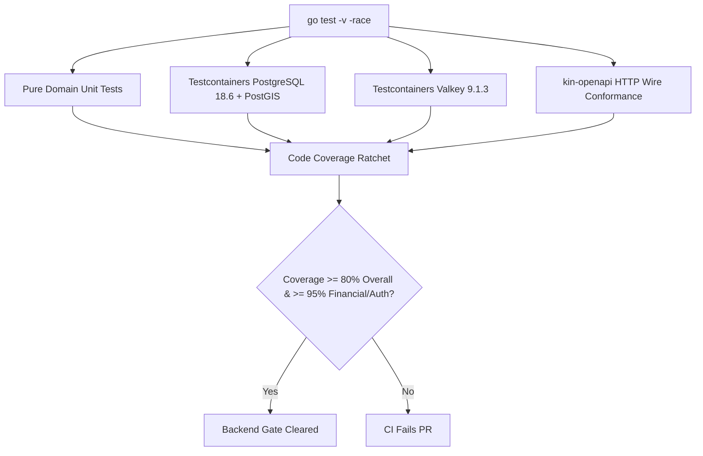

# Backend Modular Monolith Agent Instructions & Engineering Protocols (`backend/`) — Dink Machinery

**Subsystem:** Go 1.27.3 Modular Monolith Backend Core (`backend/`)  
**Target:** AI Agents, Backend Systems Engineers & Distributed Infrastructure Architects  
**Scope:** Architectural rules, Clean Architecture module boundaries, persistence patterns, contract generation, transactional invariants, zero-PII security, and automated testing gates for `backend/`.  
**Governing Documents:** `AGENTS.md`, `TECH_STACK.md`, `CODE_STANDARDS.md`, `API_CONVENTIONS.md`, `ERROR_CATALOG.md`, `DEFINITION_OF_DONE.md`  
**Compliance Standards:** OWASP ASVS 4.0.3 Level 3, RFC 9457 (Problem Details), ISO/IEC/IEEE 29119, ISO/IEC 25010

---

## 1. Subsystem Mission & Non-Negotiable Architectural Invariants

The **Go 1.27.3 Modular Monolith** (`backend/`) is the central transactional engine of Dink Machinery. It coordinates equipment discovery across PostGIS spatial indexes, enforces the 20-state rental lifecycle machine, manages Valkey distributed locking, and guarantees atomic double-entry financial settlements across national payment rails (Telebirr, CBEBirr, MPESA).

Any agent or engineer modifying, refactoring, or authoring code within `backend/` must strictly adhere to these non-negotiable platform invariants:

1. **Contract Supremacy & Code Generation:** The backend router stubs, request DTOs, parameter decoders, and response models must be generated directly from `contracts/openapi.yaml` using `oapi-codegen`. Hand-written HTTP transport structs or uncoordinated route mutations are strictly prohibited.
2. **Deterministic Minor-Unit Currency Math:** Floating-point types (`float32`, `float64`) are banned in financial logic, structs, database columns, and API schemas. All amounts are stored, computed, and transmitted as 64-bit signed integers (`int64` / `BIGINT`) representing minor currency units (Santims for `ETB`, Cents for `KES` and `USD`) coupled with ISO 4217 currency identifiers (`MoneyAmount`).
3. **In-Transaction Ledger Atomicity (`BK-17-BE`):** Every booking state transition involving funds (holds, releases, forfeiture, commissions, disbursements) must execute state changes, `financial_ledger_entries` writes, and `owner_wallet_transactions` inside a single atomic database transaction (`pgx.Tx`). Debit and credit legs must sum exactly to zero minor units. Asynchronous eventual consistency for ledger mutations is banned.
4. **Optimistic Concurrency Control (OCC):** Mutable stateful tables (`bookings`, `fleets`, `owner_wallets`, `inspections`) must maintain a `version INT NOT NULL DEFAULT 1` column. Mutations must assert `WHERE id = $1 AND version = $2` and increment `version = version + 1`. Zero rows affected must immediately abort and return HTTP 409 (`BOOKING_CONCURRENCY_CONFLICT`).
5. **Universal Envelopes & RFC 9457 Error Modeling:** All 2xx endpoints emit `SuccessEnvelope` (`success: true`, `data: {}`, `meta: {}`); all 4xx/5xx errors emit `ErrorEnvelope` conforming to RFC 9457 Problem Details (`success: false`, `error: {}`, `meta: {}`). Naked entities, raw strings, or unhandled 500 panics leaking database states or stack traces are forbidden.
6. **Multi-Country Parameterization (`LOC-01-BE`):** Jurisdictional rules (tax basis points, withholding rates, dialing prefixes, currency codes, hold timeouts) must never be hardcoded into Go code. They must be resolved dynamically from the `country_configs` table based on the `X-Country-Code` header.
7. **Soft-Delete Standard (`SD-01-BE`):** Domain entities must define `deleted_at TIMESTAMPTZ NULL`. Application queries must explicitly filter `WHERE deleted_at IS NULL` or query active views (`v_active_*`). Direct hard `DELETE` queries on core domain entities are prohibited.
8. **OWASP ASVS Level 3 Zero-PII Logging:** Phone numbers, National IDs, TINs, and financial accounts must pass through masking interceptors (`+251911****44`, `TIN: *****1234`). Sensitive columns must be encrypted at rest with AES-256-GCM.

---

## 2. Technology Stack & Pinned Toolchain

```
                              Backend Technology Stack
                                         │
     ┌───────────────────┬───────────────┴───────────────┬───────────────────┐
     ▼                   ▼                               ▼                   ▼
[Runtime & Routing] [Persistence & Spatial]         [Cache & Concurrency] [Security & Code-Gen]
 - Go 1.27.3         - PostgreSQL 18.6               - Valkey 9.1.3-alpine   - oapi-codegen v2.4+
 - Chi Router v5     - PostGIS 3.6.4 (SRID 4326)       - Distributed Locks   - sqlc v1.27+
 - pgx/v5 Driver     - sqlc Type-Safe SQL (No ORM)   - Rate-Limiting       - ClamAV Daemon
 - zap Telemetry     - golang-migrate v4.18+         - Token Revocation    - AES-256-GCM
```

| Layer / Concern | Technology & Version | Purpose & Architectural Rules |
|---|---|---|
| **Core Language** | Go `1.27.3` | Standard toolchain; strict formatting (`gofmt -s`, `goimports`). |
| **HTTP Routing** | `go-chi/chi/v5` (`v5.1.0`) | Lightweight, idiomatic HTTP middleware and routing tree. |
| **Contract Code-Gen** | `oapi-codegen/v2` (`v2.4.1`) | Generates Chi server interfaces, request decoders, and DTO types from `contracts/openapi.yaml`. |
| **Database Driver** | `jackc/pgx/v5` (`v5.7.1`) | High-performance PostgreSQL driver with native binary format encoding and `pgxpool`. |
| **SQL Compiler** | `sqlc` (`v1.27.0`) | Generates type-safe Go structs and queries from plain SQL; heavy ORMs (GORM, Ent) are banned. |
| **Spatial Engine** | PostGIS `3.6.4` (PostgreSQL 18.6) | Spheroidal distance calculations (`ST_DWithin`, `ST_Distance`) with GiST spatial indexing (`SRID 4326`). |
| **Migrations** | `golang-migrate/v4` (`v4.18.1`)| Deterministic sequential SQL migrations (`.up.sql` and `.down.sql`). |
| **Cache & Locks** | Valkey `9.1.3-alpine` (`go-redis/v9`)| Distributed locking (`SET NX EX`), idempotency caching, session token blacklists. |
| **Structured Logging** | `go.uber.org/zap` (`v1.27.0`) | High-throughput structured JSON logging with custom PII masking core. |
| **Distributed Tracing** | `go.opentelemetry.io/otel` (`v1.32.0`) | OpenTelemetry tracing and span propagation via `traceparent` headers. |
| **Malware Ingress** | ClamAV `clamd` (TCP 3310) | Synchronous antivirus stream scanning for uploaded inspection photographs and PDFs. |

---

## 3. Directory Structure & Modular Monolith Layout

The backend modular monolith strictly separates foundational platform concerns from bounded context business domains:

```
backend/
├── cmd/
│   └── api/
│       └── main.go                   # Server bootstrap, DI composition & lifecycle listener
├── internal/
│   ├── platform/                     # Shared horizontal infrastructure (no business logic)
│   │   ├── config/                   # Environment variable parsing and validation
│   │   ├── database/                 # pgxpool connection pool and TxManager closure
│   │   │   ├── db/                   # sqlc auto-generated repository models & interfaces
│   │   │   └── queries.sql           # Canonical SQL queries compiled by sqlc
│   │   ├── cache/                    # Valkey client wrapper and distributed lock manager
│   │   ├── crypto/                   # AES-256-GCM column encryption and hashing helpers
│   │   ├── malware/                  # ClamAV daemon TCP client and stream validator
│   │   ├── telemetry/                # Zap logger with PII masking and OpenTelemetry tracers
│   │   └── clock/                    # Abstract Clock interface for deterministic testing
│   ├── transport/
│   │   └── http/                     # Edge HTTP transport layer
│   │       ├── generated/            # oapi-codegen generated Chi server & DTOs (DO NOT EDIT)
│   │       ├── middleware/           # RequestID, RealIP, Auth, CountryCode, Idempotency
│   │       ├── response.go           # Universal SuccessEnvelope & RFC 9457 Problem Details
│   │       └── router.go             # Chi route mount definitions
│   └── modules/                      # Bounded context modules (Clean Architecture)
│       ├── auth/                     # Identity, phone OTP challenges, JWT verification, RBAC
│       ├── machinery/                # Fleet asset catalog, attachments, EAV spec templates
│       ├── booking/                  # 20-state reservation machine, hold locks, disputes
│       ├── payment/                  # Financial ledger, owner wallets, webhooks, disbursements
│       ├── inspection/               # Site check-in/check-out, hour meters, ClamAV media ingress
│       ├── geo/                      # PostGIS radius search, corridor bounding boxes
│       └── admin/                    # Dynamic UI metadata (/ui-config), audit logs, KYC approvals
│           ├── domain/               # Pure business entities, state machines, value objects, errors
│           ├── application/          # Use cases, command/query handlers, outbound repository ports
│           └── infrastructure/       # sqlc adapters, external gateways, payment rail clients
├── migrations/                       # Sequential SQL migrations (YYYYMMDDHHMMSS_name.up/down.sql)
├── tests/                            # Testcontainer integration tests & test utils
├── sqlc.yaml                         # sqlc PostgreSQL code-gen configuration
├── go.mod                            # Module definitions
└── go.sum                            # Cryptographic dependency lockfile
```

---

## 4. Package Boundary Rules & Clean Architecture Discipline

Each bounded context module under `internal/modules/<context>/` enforces strict unidirectional dependency boundaries:

```
    [ transport/http ] ────────► [ application ] ────────► [ domain ]
                                      │                        ▲
                                      │ (implements ports)     │
                                      ▼                        │
                              [ infrastructure ] ──────────────┘
```

### Boundary Enforcement Rules
1. **Domain Isolation (`domain/`):** The `domain` package must have zero external dependencies. It must not import `net/http`, `jackc/pgx`, `database/sql`, `sqlc`, or any external third-party library. Domain logic operates strictly on Go native types and pure domain errors.
2. **Application Ports (`application/`):** The application layer defines use-case interactors (Command and Query handlers) and declares outbound secondary ports (interfaces) for persistence and external payment services:
   ```go
   // internal/modules/booking/application/ports.go
   type BookingRepository interface {
       GetByID(ctx context.Context, id uuid.UUID) (*domain.Booking, error)
       Save(ctx context.Context, txQueries *db.Queries, booking *domain.Booking) error
   }
   ```
3. **Infrastructure Adapters (`infrastructure/`):** Adapters implement the application interfaces using `sqlc`-generated queries, `pgx`, and Valkey.
4. **Zero Circular Package Imports:** Modules must never import sibling modules directly. Inter-module communication occurs via published Go interfaces, application queries, or decoupled domain events.

---

## 5. Contract Code Generation & HTTP Transport Layer

### 5.1. Generating Router Interfaces via `oapi-codegen`
The canonical contract `contracts/openapi.yaml` compiles directly into type-safe Chi server interfaces:

```bash
# Executed from backend/ directory
oapi-codegen -generate types,chi-server,spec \
  -package generated \
  -o internal/transport/http/generated/api.gen.go \
  ../contracts/openapi.yaml
```

The generated interface `generated.ServerInterface` defines the handler contracts:
```go
type ServerInterface interface {
    GetApiV1FleetsId(w http.ResponseWriter, r *http.Request, id openapi_types.UUID)
    PostApiV1Bookings(w http.ResponseWriter, r *http.Request)
    PostApiV1BookingsIdConfirmPayment(w http.ResponseWriter, r *http.Request, id openapi_types.UUID)
}
```

### 5.2. Universal Response Envelopes & RFC 9457 Error Mapper

Responses must be rendered using standardized platform helpers. Handlers must never serialize unadorned structs or raw JSON arrays.

```go
// internal/transport/http/response.go
package http

import (
	"encoding/json"
	"net/http"
	"time"

	"[github.com/dinkmachinery/dink-core/internal/transport/http/middleware](https://github.com/dinkmachinery/dink-core/internal/transport/http/middleware)"
)

type SuccessEnvelope struct {
	Success bool        `json:"success"`
	Data    interface{} `json:"data"`
	Error   interface{} `json:"error"`
	Meta    Meta        `json:"meta"`
}

type ErrorEnvelope struct {
	Success bool           `json:"success"`
	Data    interface{}    `json:"data"`
	Error   ProblemDetails `json:"error"`
	Meta    Meta           `json:"meta"`
}

type ProblemDetails struct {
	Type          string          `json:"type"`
	Title         string          `json:"title"`
	Status        int             `json:"status"`
	Detail        string          `json:"detail"`
	Code          string          `json:"code"`
	InvalidParams []InvalidParam  `json:"invalidParams,omitempty"`
}

type InvalidParam struct {
	Name   string `json:"name"`
	Reason string `json:"reason"`
}

type Meta struct {
	Version    string      `json:"version"`
	RequestID  string      `json:"requestId"`
	Timestamp  string      `json:"timestamp"`
	Pagination interface{} `json:"pagination,omitempty"`
}

func RenderSuccess(w http.ResponseWriter, r *http.Request, status int, data interface{}, pagination interface{}) {
	reqID := middleware.GetRequestID(r.Context())
	resp := SuccessEnvelope{
		Success: true,
		Data:    data,
		Error:   nil,
		Meta: Meta{
			Version:    "1.0",
			RequestID:  reqID,
			Timestamp:  time.Now().UTC().Format(time.RFC3339),
			Pagination: pagination,
		},
	}
	w.Header().Set("Content-Type", "application/json")
	w.WriteHeader(status)
	_ = json.NewEncoder(w).Encode(resp)
}

func RenderProblem(w http.ResponseWriter, r *http.Request, problem ProblemDetails) {
	reqID := middleware.GetRequestID(r.Context())
	resp := ErrorEnvelope{
		Success: false,
		Data:    nil,
		Error:   problem,
		Meta: Meta{
			Version:   "1.0",
			RequestID: reqID,
			Timestamp: time.Now().UTC().Format(time.RFC3339),
		},
	}
	w.Header().Set("Content-Type", "application/problem+json")
	w.WriteHeader(problem.Status)
	_ = json.NewEncoder(w).Encode(resp)
}
```

---

## 6. Persistence Architecture & Database Invariants (`sqlc` + `pgxpool`)

### 6.1. Transaction Manager Pattern (`TxManager`)
To guarantee the **`BK-17-BE`** invariant (financial ledger atomicity and booking state consistency), all in-transaction mutations must execute through the platform `TxManager`:

```go
// internal/platform/database/tx_manager.go
package database

import (
	"context"
	"fmt"

	"[github.com/jackc/pgx/v5](https://github.com/jackc/pgx/v5)"
	"[github.com/jackc/pgx/v5/pgxpool](https://github.com/jackc/pgx/v5/pgxpool)"
	"[github.com/dinkmachinery/dink-core/internal/platform/database/db](https://github.com/dinkmachinery/dink-core/internal/platform/database/db)"
)

type TxManager struct {
	pool *pgxpool.Pool
}

func NewTxManager(pool *pgxpool.Pool) *TxManager {
	return &TxManager{pool: pool}
}

// Execute wraps operations inside a single database transaction with automatic rollback
func (tm *TxManager) Execute(ctx context.Context, fn func(queries *db.Queries) error) error {
	tx, err := tm.pool.BeginTx(ctx, pgx.TxOptions{
		IsoLevel: pgx.ReadCommitted,
	})
	if err != nil {
		return fmt.Errorf("failed to begin transaction: %w", err)
	}

	q := db.New(tx)
	if err := fn(q); err != nil {
		if rbErr := tx.Rollback(ctx); rbErr != nil {
			return fmt.Errorf("tx failed: %v, rollback failed: %w", err, rbErr)
		}
		return err
	}

	if err := tx.Commit(ctx); err != nil {
		return fmt.Errorf("failed to commit transaction: %w", err)
	}
	return nil
}
```

### 6.2. PostGIS Spatial Radius Querying
Spatial discovery queries compiled by `sqlc` enforce Generalized Search Tree (`GiST`) index usage and distance spheroidal math (`SRID 4326`):

```sql
-- internal/platform/database/queries.sql

-- name: SearchFleetsWithinRadius :many
SELECT 
    f.id,
    f.owner_id,
    f.category_id,
    f.make,
    f.model,
    f.manufacturing_year,
    f.daily_rate_amount_minor,
    f.daily_rate_currency,
    f.status,
    f.version,
    ST_Distance(f.location_point::geography, ST_SetSRID(ST_MakePoint(@longitude, @latitude), 4326)::geography) AS distance_meters
FROM fleets f
WHERE f.deleted_at IS NULL
  AND f.status = 'AVAILABLE'
  AND ST_DWithin(
      f.location_point::geography,
      ST_SetSRID(ST_MakePoint(@longitude, @latitude), 4326)::geography,
      @radius_meters::float8
  )
ORDER BY distance_meters ASC
LIMIT @page_limit OFFSET @page_offset;
```

### 6.3. Optimistic Concurrency Control (OCC) Updates
Every stateful record update must assert the current version and increment it:

```sql
-- name: UpdateBookingStatusWithOCC :execrows
UPDATE bookings
SET status = @new_status,
    version = version + 1,
    updated_at = NOW()
WHERE id = @booking_id
  AND version = @expected_version
  AND deleted_at IS NULL;
```
In Go interactors:
```go
rowsAffected, err := queries.UpdateBookingStatusWithOCC(ctx, params)
if err != nil {
    return fmt.Errorf("failed executing OCC update: %w", err)
}
if rowsAffected == 0 {
    return domain.ErrConcurrencyConflict // Maps to HTTP 409
}
```

---

## 7. Financial Ledger & Double-Entry Invariants (`BK-17-BE`)

The platform implements an immutable, double-entry financial ledger in `financial_ledger_entries`.

```
                    Double-Entry Hold Escrow Creation
                                   │
      ┌────────────────────────────┴────────────────────────────┐
      ▼                                                         ▼
[DEBIT: Renter Escrow Account]            [CREDIT: Holding Escrow Account]
 +150,000 Santims (1,500.00 ETB)           -150,000 Santims (-1,500.00 ETB)
                  \                                     /
                   \───► NET BALANCE EQUALS ZERO ◄─────/
```

### Invariant Rules
1. **Zero-Sum Balance:** Every ledger transaction must record matching credit and debit entries where $\sum \text{amountMinor} = 0$.
2. **Integer Minor-Unit Basis Point Math:** All intermediate fee, tax, and commission calculations must use integer basis points ($1\text{ bps} = 0.01\%$) with explicit floor rounding:
   $$\text{platformCommissionMinor} = \frac{\text{totalRentalMinor} \times \text{commissionBps}}{10000}$$
3. **Database Ledger Immutability:** The table `financial_ledger_entries` does not permit `UPDATE` or `DELETE` statements. Trigger `trg_prevent_ledger_mutation` blocks any DML operation altering historic ledger records.

---

## 8. Security, OWASP ASVS Level 3 & Zero-PII Invariant

### 8.1. Zero-PII Structured Logging Core (Zap Interceptor)
Customer telephone numbers, National IDs, TINs, and financial accounts must never appear in plaintext log files. A custom Zap `Core` interceptor automatically scrubs log fields:

```go
// internal/platform/telemetry/masking_core.go
package telemetry

import (
	"regexp"
	"strings"

	"go.uber.org/zap/zapcore"
)

var (
	phoneRegex = regexp.MustCompile(`\+?[0-9]{10,13}`)
	tinRegex   = regexp.MustCompile(`\b\d{10}\b`)
)

type MaskingCore struct {
	zapcore.Core
}

func (mc *MaskingCore) Write(entry zapcore.Entry, fields []zapcore.Field) error {
	maskedFields := make([]zapcore.Field, len(fields))
	for i, f := range fields {
		if strings.Contains(strings.ToLower(f.Key), "phone") && f.String != "" {
			maskedFields[i] = zapcore.Field{
				Key:    f.Key,
				Type:   zapcore.StringType,
				String: maskPhone(f.String),
			}
		} else {
			maskedFields[i] = f
		}
	}
	return mc.Core.Write(entry, maskedFields)
}

func maskPhone(phone string) string {
	if len(phone) < 8 {
		return "****"
	}
	return phone[:4] + "****" + phone[len(phone)-3:]
}
```

### 8.2. AES-256-GCM Column Encryption
Sensitive identity columns (TIN documents, National ID numbers, bank routing tokens) must be encrypted prior to database insertion:

```go
// internal/platform/crypto/encryption.go
package crypto

import (
	"crypto/aes"
	"crypto/cipher"
	"crypto/rand"
	"fmt"
	"io"
)

func EncryptAESGCM(plaintext []byte, key []byte) ([]byte, error) {
	block, err := aes.NewCipher(key)
	if err != nil {
		return nil, fmt.Errorf("failed creating cipher: %w", err)
	}

	gcm, err := cipher.NewGCM(block)
	if err != nil {
		return nil, fmt.Errorf("failed creating GCM block: %w", err)
	}

	nonce := make([]byte, gcm.NonceSize())
	if _, err := io.ReadFull(rand.Reader, nonce); err != nil {
		return nil, fmt.Errorf("failed generating nonce: %w", err)
	}

	ciphertext := gcm.Seal(nonce, nonce, plaintext, nil)
	return ciphertext, nil
}
```

### 8.3. ClamAV Antivirus Media Streaming Ingress
Media uploaded through `/api/v1/inspections/media/upload` must be streamed synchronously through the ClamAV daemon:

```go
// internal/platform/malware/scanner.go
package malware

import (
	"fmt"
	"io"
	"net"

	"[github.com/dinkmachinery/dink-core/internal/modules/inspection/domain](https://github.com/dinkmachinery/dink-core/internal/modules/inspection/domain)"
)

type ClamAVScanner struct {
	daemonAddress string
}

func (s *ClamAVScanner) ScanStream(r io.Reader) error {
	conn, err := net.Dial("tcp", s.daemonAddress)
	if err != nil {
		return fmt.Errorf("failed connecting to clamav daemon: %w", err)
	}
	defer conn.Close()

	// Send zINSTREAM protocol chunk to ClamAV
	if _, err := conn.Write([]byte("zINSTREAM\000")); err != nil {
		return fmt.Errorf("failed initializing instream: %w", err)
	}

	// Buffer streaming logic ...
	// Read response: "stream: OK" vs "stream: FOUND"
	response := make([]byte, 1024)
	n, _ := conn.Read(response)
	resStr := string(response[:n])

	if strings.Contains(resStr, "FOUND") {
		return domain.ErrMalwareDetected // Maps to RFC 9457 INSPECT_MEDIA_SCAN_FAILED (HTTP 422)
	}
	return nil
}
```

---

## 9. Concurrency, Distributed Locking & Worker Pools

### 9.1. Distributed Mutual Exclusion via Valkey (`SET NX EX`)
To prevent race conditions during booking hold creation or payment webhook ingestion, acquire a short-lived Valkey lock:

```go
// internal/platform/cache/lock.go
package cache

import (
	"context"
	"fmt"
	"time"

	"[github.com/redis/go-redis/v9](https://github.com/redis/go-redis/v9)"
)

type DistributedLockManager struct {
	client *redis.Client
}

func (m *DistributedLockManager) AcquireLock(ctx context.Context, resource string, ttl time.Duration) (func(), error) {
	key := fmt.Sprintf("lock:%s", resource)
	token := crypto.RandomUUID()

	ok, err := m.client.SetNX(ctx, key, token, ttl).Result()
	if err != nil {
		return nil, fmt.Errorf("failed acquiring distributed lock: %w", err)
	}
	if !ok {
		return nil, domain.ErrConcurrentRequestInFlight // Maps to HTTP 409
	}

	release := func() {
		// Use lua script to release lock only if token matches
		releaseScript := `
			if redis.call("get", KEYS[1]) == ARGV[1] then
				return redis.call("del", KEYS[1])
			else
				return 0
			end
		`
		_ = m.client.Eval(context.Background(), releaseScript, []string{key}, token).Err()
	}

	return release, nil
}
```

### 9.2. Managed Worker Pools & Panic Recovery
Unmanaged `go func() { ... }()` calls in HTTP handlers are prohibited. Background asynchronous tasks (e.g., dispatching SMS OTPs, archiving expired booking holds) must execute through a managed worker pool:
- Workers must recover from runtime panics, log the stack trace with correlating `requestId`, and continue processing.
- Workers must listen to `ctx.Done()` signals during graceful shutdown.

---

## 10. Automated Testing & Verification Gates

Backend code must achieve full test coverage verified against real infrastructure using `testcontainers-go`.



### Test Execution Commands
```bash
# 1. Static code analysis and linting
golangci-lint run ./...

# 2. Security vulnerability scan
govulncheck ./...

# 3. Unit, integration & wire tests with race detection
go test -v -race -coverprofile=coverage.out ./...

# 4. Enforce financial and payment domain coverage (>= 95%)
FIN_COV=$(go tool cover -func=coverage.out | grep "internal/modules/payment" | awk '{print $3}' | tr -d '%')
echo "Financial Ledger Coverage: ${FIN_COV}%"
awk -v cov="$FIN_COV" 'BEGIN { if (cov < 95.0) exit 1 }'
```

---

## 11. Backend PR Review & Gate Sign-Off Checklist

Before submitting a pull request affecting `backend/`, verify compliance with every checkpoint:

- [ ] **Contract Conformance:** Transport interfaces generated via `oapi-codegen`; zero uncommitted drift from `contracts/openapi.yaml`.
- [ ] **Integer Minor-Unit Money:** All monetary attributes use `int64` minor units (`MoneyAmount`); zero floating-point arithmetic.
- [ ] **In-Transaction Ledger Atomicity:** State changes and double-entry ledger balancing execute inside a single `pgx.Tx` block (`BK-17-BE`).
- [ ] **Optimistic Concurrency Control:** Updates assert and increment `version INT NOT NULL DEFAULT 1` (`WHERE id = $1 AND version = $2`).
- [ ] **Soft-Delete Filtering:** Queries filter `deleted_at IS NULL` or query active views (`SD-01-BE`).
- [ ] **Multi-Country Parameterization:** No hardcoded country constants; parameters dynamically loaded from `country_configs` (`LOC-01-BE`).
- [ ] **SQL Query Compilation:** All queries written in SQL files and compiled via `sqlc`; raw string SQL interpolation is absent.
- [ ] **Zero-PII Logging:** Phone numbers, TINs, and accounts pass through Zap masking formatters; regex check confirms zero unmasked logging.
- [ ] **Thread Safety & Race Conditions:** All tests pass cleanly with race detection enabled (`go test -race ./...`).
- [ ] **Coverage Ratchet Satisfied:** Total backend coverage $\ge 80.0\%$; payment/auth/booking coverage $\ge 95.0\%$; $\Delta\text{Coverage} \ge 0.0\%$.
- [ ] **Atomic Context Tracking:** `CONTEXT.md` updated and staged in the exact same commit.