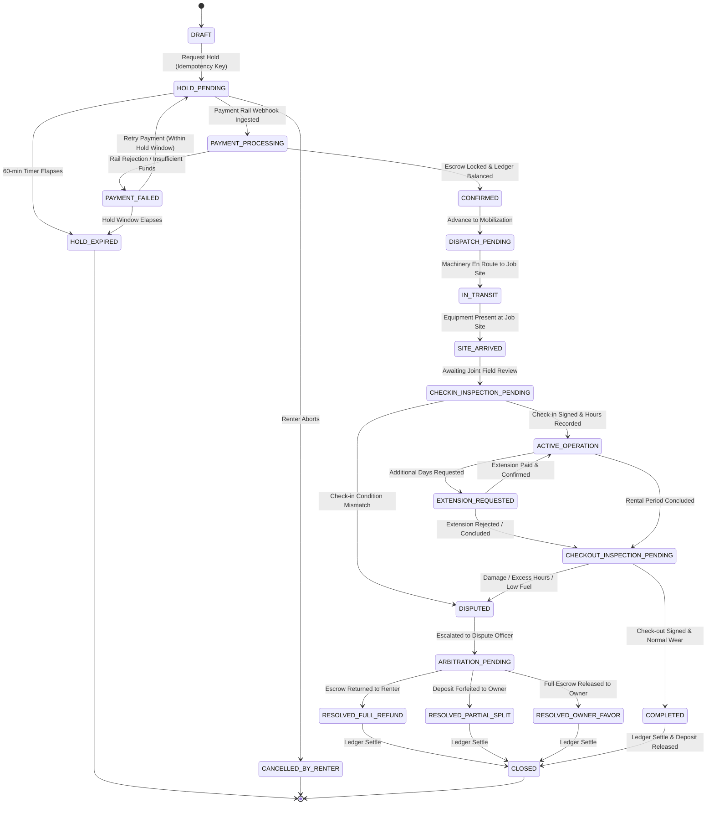
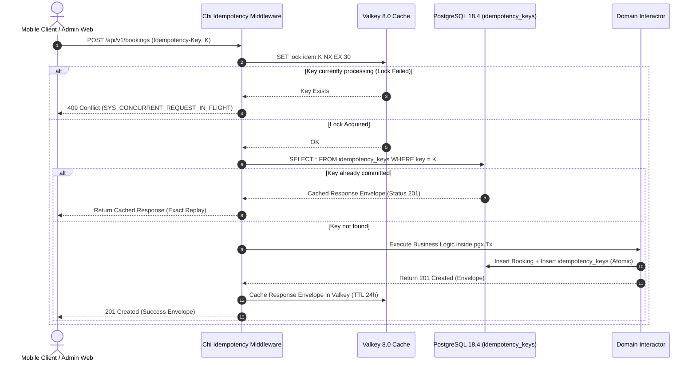

# Backend Modular Monolith System Design & Architectural Specification (`backend/`) — Dink Machinery

**Subsystem:** Go 1.27.3 Modular Monolith Backend Core (`backend/`)  
**Specification:** System Architecture, Domain Decomposition, State Machine Engine & Persistence Lifecycle  
**Compliance Standards:** OWASP ASVS 4.0.3 Level 3, RFC 9457 (Problem Details), ISO/IEC/IEEE 29119, ISO/IEC 25010, ISO 4217, ISO 3166-1 alpha-2  
**Target Runtimes:** Go 1.27.3, Chi v5, PostgreSQL 18.4 + PostGIS 3.4, Valkey 8.0-alpine, ClamAV Daemon, SeaweedFS S3  
**Governing Documents:** `AGENTS.md`, `TECH_STACK.md`, `CODE_STANDARDS.md`, `API_CONVENTIONS.md`, `ERROR_CATALOG.md`, `DEFINITION_OF_DONE.md`, `docs/components/backend/AGENTS.md`

---

## 1. Executive Summary & Architectural Invariants

The **Dink Machinery Backend Core** (`backend/`) is the central transactional engine of the marketplace. It coordinates heavy equipment discovery across East African transport corridors, enforces an inviolable 20-state rental lifecycle machine, manages distributed mutual exclusion locks, and guarantees atomic double-entry financial settlements across national payment rails (Telebirr, CBEBirr, MPESA).

To maintain physical equipment safety, regulatory compliance across Ethiopia (`ET`) and Kenya (`KE`), and strict financial auditability, the backend architecture adheres to eight non-negotiable invariants:

```
                            Backend Core Architectural Invariants
                                              │
       ┌──────────────────────┬───────────────┴───────────────┬──────────────────────┐
       ▼                      ▼                               ▼                      ▼
[Contract Supremacy]    [Minor-Unit Money]              [Ledger Atomicity]      [OCC & State Locks]
 oapi-codegen stubs;     int64 minor units (Santims/     In-transaction double-  version column OCC;
 strict openapi.yaml     Cents); zero floating-point     entry ledger (BK-17-BE); Valkey SET NX EX
 single source of truth  calculations or storage         pgx.Tx zero-sum balance  distributed hold locks
       │                      │                               │                      │
       ▼                      ▼                               ▼                      ▼
[Universal Envelopes]   [Multi-Country Config]          [Soft-Delete Policy]    [ASVS L3 Zero-PII]
 SuccessEnvelope or      Zero hardcoded tax or rules;    deleted_at TIMESTAMPTZ  Zap masking filters;
 RFC 9457 Problem        dynamic resolution from         with partial indexes;   AES-256-GCM columns;
 Details ErrorEnvelope   country_configs (LOC-01-BE)     no hard SQL DELETEs     zero stack trace leaks
```

### Invariant Definitions
1. **Contract Supremacy & Generation:** All HTTP router stubs, parameter decoders, and request/response DTOs are generated directly from `contracts/openapi.yaml` via `oapi-codegen`. Hand-written HTTP transport structs or uncoordinated route mutations trigger CI failure.
2. **Deterministic Minor-Unit Money:** Floating-point types (`float32`, `float64`) are banned in financial logic, structs, database columns, and API schemas. All amounts are stored, computed, and transmitted as 64-bit signed integers (`int64` / `BIGINT`) representing minor currency units (Santims for `ETB`, Cents for `KES` and `USD`) coupled with ISO 4217 currency identifiers (`MoneyAmount`).
3. **In-Transaction Ledger Atomicity (`BK-17-BE`):** Every booking state transition involving funds (escrow holds, confirmation captures, cancellation refunds, commission deductions, dispute rulings) must execute state changes, `financial_ledger_entries` writes, and `owner_wallet_transactions` inside a single atomic database transaction (`pgx.Tx`). Debit and credit legs must sum exactly to zero minor units.
4. **Optimistic Concurrency Control (OCC):** Mutable stateful tables (`bookings`, `fleets`, `owner_wallets`, `inspections`) must maintain a `version INT NOT NULL DEFAULT 1` column. Mutations assert `WHERE id = $1 AND version = $2` and increment `version = version + 1`. If zero rows are affected, the interactor aborts and returns HTTP 409 (`BOOKING_CONCURRENCY_CONFLICT`).
5. **Universal Envelopes & RFC 9457 Error Modeling:** All 2xx endpoints emit `SuccessEnvelope` (`success: true`, `data: {}`, `meta: {}`); all 4xx/5xx errors emit `ErrorEnvelope` conforming to RFC 9457 Problem Details (`success: false`, `error: {}`, `meta: {}`). Naked entities, raw strings, or unhandled 500 panics leaking database states or stack traces are forbidden.
6. **Multi-Country Parameterization (`LOC-01-BE`):** Jurisdictional rules (tax basis points, withholding rates, dialing prefixes, currency codes, hold timeouts) must never be hardcoded into Go code. They must be resolved dynamically from the `country_configs` table based on the `X-Country-Code` header or caller context.
7. **Soft-Delete Standard (`SD-01-BE`):** Domain entities must define `deleted_at TIMESTAMPTZ NULL`. Application queries must filter `WHERE deleted_at IS NULL` or query active views (`v_active_*`). Direct hard `DELETE` statements on core domain entities are prohibited.
8. **OWASP ASVS Level 3 Zero-PII Logging:** Phone numbers, National IDs, TINs, and financial accounts must pass through masking interceptors (`+251911****44`, `TIN: *****1234`). Sensitive columns must be encrypted at rest with AES-256-GCM.

---

## 2. High-Level Modular Monolith Topology

The backend runs as a single deployable binary partitioned into decoupled bounded contexts following **Clean Architecture** and **Ports & Adapters (Hexagonal)** patterns.

```mermaid
flowchart TD
  Client[Mobile Client / Admin Web / Webhooks] -->|HTTPS / TLS 1.3| Ingress[Traefik 3.x Gateway]
  
  subgraph MonolithCore["Go 1.27.3 Modular Monolith (cmd/api/main.go)"]
    Ingress --> MiddlewareStack[Middleware: RequestID | RealIP | CORS | OpenTelemetry | Auth | CountryCode | Idempotency]
    MiddlewareStack --> GeneratedRouter[oapi-codegen Chi Router]
    
    subgraph BoundedContexts["Bounded Context Modules (internal/modules/)"]
      AuthMod[Auth & Identity Module]
      MachineryMod[Machinery Fleet Module]
      BookingMod[Booking & State Machine Module]
      PaymentMod[Payment, Ledger & Wallet Module]
      InspectMod[Site Inspection & Media Module]
      GeoMod[Geospatial PostGIS Module]
      AdminMod[Admin & Metadata UI Engine]
    end

    GeneratedRouter --> BoundedContexts

    subgraph PlatformLayer["Platform Infrastructure (internal/platform/)"]
      TxMgr[TxManager Atomic Transaction Block]
      LockMgr[Valkey Distributed Lock Manager]
      CryptoPkg[AES-256-GCM Column Encryption]
      MalwarePkg[ClamAV Stream Scanner]
      ZapLog[Zap Zero-PII Masking Logger]
      ClockPkg[Deterministic Time Clock]
    end

    BoundedContexts --> PlatformLayer
  end

  PlatformLayer -->|pgxpool TCP:5432| Postgres[(PostgreSQL 18.4 + PostGIS 3.4)]
  PlatformLayer -->|redis-cli TCP:6379| Valkey[(Valkey 8.0-alpine Distributed Cache)]
  PlatformLayer -->|S3 API HTTP:9000| SeaweedFS[(SeaweedFS Encrypted Object Storage)]
  PlatformLayer -->|TCP:3310 zINSTREAM| ClamAV[(ClamAV Daemon Antivirus)]
```

---

## 3. Directory Layout & Module Decomposition

The backend source code strictly decouples platform infrastructure from bounded context implementations under `internal/`:

```
backend/
├── cmd/
│   └── api/
│       └── main.go                   # Composition root, dependency injection & signal shutdown
├── internal/
│   ├── platform/                     # Shared cross-cutting technical infrastructure
│   │   ├── config/                   # Strongly typed environment configuration
│   │   ├── database/                 # pgxpool connection pool, TxManager & sqlc output
│   │   │   ├── db/                   # sqlc auto-generated persistence models (DO NOT EDIT)
│   │   │   └── queries.sql           # Canonical SQL queries compiled by sqlc
│   │   ├── cache/                    # Valkey client wrapper and distributed lock manager
│   │   ├── crypto/                   # AES-256-GCM envelope encryption helpers
│   │   ├── malware/                  # ClamAV daemon TCP client and stream validator
│   │   ├── telemetry/                # Zap logger with PII masking and OpenTelemetry tracers
│   │   └── clock/                    # Abstract Clock interface for deterministic testing
│   ├── transport/
│   │   └── http/                     # Edge HTTP transport layer
│   │       ├── generated/            # oapi-codegen generated Chi server & DTOs (DO NOT EDIT)
│   │       ├── middleware/           # RequestID, Auth, CountryCode, Idempotency, RateLimit
│   │       ├── response.go           # Universal SuccessEnvelope & RFC 9457 Problem Details
│   │       └── router.go             # Chi route mount definitions
│   └── modules/                      # Bounded context modules (Clean Architecture)
│       ├── auth/                     # OTP challenges, JWT verification, RBAC gates
│       ├── machinery/                # Fleet asset catalog, attachments, EAV spec templates
│       ├── booking/                  # 20-state reservation machine, hold locks, disputes
│       ├── payment/                  # Financial ledger, owner wallets, webhooks, disbursements
│       ├── inspection/               # Site check-in/check-out, hour meters, ClamAV media ingress
│       ├── geo/                      # PostGIS radius search, corridor bounding boxes
│       └── admin/                    # Dynamic UI metadata (/ui-config), audit logs, KYC approvals
│           ├── domain/               # Pure business entities, state machines, value objects, errors
│           ├── application/          # Use cases, command/query handlers, outbound repository ports
│           └── infrastructure/       # sqlc adapters, external gateways, payment rail clients
├── migrations/                       # Sequential SQL migrations (YYYYMMDDHHMMSS_name.up/down.sql)
├── tests/                            # Testcontainers integration suites & wire mocks
├── sqlc.yaml                         # sqlc PostgreSQL compiler configuration
├── go.mod                            # Go module dependencies
└── go.sum                            # Cryptographic dependency checksums
```

---

## 4. Bounded Context Specifications & Domain Responsibilities

```
                                      The 7 Core Bounded Contexts
                                                    │
     ┌──────────────────┬───────────────────────────┼───────────────────────────┬──────────────────┐
     ▼                  ▼                           ▼                           ▼                  ▼
[1. Auth & Identity] [2. Machinery Fleet]   [3. Booking Engine]         [4. Payment & Ledger] [5. Site Inspection]
 OTP Auth, JWT,       Catalog, Attachments,  20-State Machine,           Double-entry ledger,   Check-in/out, hours
 RBAC claims, token   EAV specs, pricing,    Hold expiration, OCC,       Escrow holds, fees,    meters, ClamAV scan,
 revocation checks    soft-deletable assets  Dispute arbitration         disbursement wallets   SeaweedFS uploads
                                                    │
                         ┌──────────────────────────┴──────────────────────────┐
                         ▼                                                     ▼
                  [6. Geospatial Engine]                                [7. Admin Operations]
                   PostGIS radius discovery,                             Dynamic UI (/ui-config),
                   WGS 84 (SRID 4326), GiST                              Tax bps configs, KYC queues,
                   spatial corridor indexes                              System audit trails
```

### 4.1. Auth & Identity Module (`modules/auth`)
- **Domain Responsibilities:** User aggregate identity, telephone OTP challenge sessions, multi-persona RBAC claims (`RENTER`, `OWNER`, `OPERATOR`, `DISPUTE_ADMIN`, `SUPER_ADMIN`), asymmetric JWT signing/validation, refresh token rotation.
- **State Invariants:**
  - OTP challenge lifespan is strictly 120 seconds with a maximum of 5 attempts. Exceeding 5 attempts destroys the challenge and applies a 15-minute cool-down (`AUTH_OTP_MAX_ATTEMPTS`).
  - Access JWTs have a maximum TTL of 900 seconds (15 minutes).
  - Refresh tokens are single-use high-entropy tokens stored in Valkey. Attempted replay of an invalidated refresh token revokes the entire token family.

### 4.2. Machinery Fleet Module (`modules/machinery`)
- **Domain Responsibilities:** Heavy equipment taxonomy, mechanical asset catalog, equipment attachments compatibility matrix, dynamic EAV specification attributes (e.g., operating weight, bucket capacity, boom length), daily base rental rates.
- **State Invariants:**
  - Asset pricing stored as `daily_rate_amount_minor int64` paired with `daily_rate_currency varchar(3)`.
  - Registration license numbers and chassis serial numbers enforce active uniqueness via partial indexes:
    ```sql
    CREATE UNIQUE INDEX uq_fleets_reg_active ON fleets (registration_number) WHERE deleted_at IS NULL;
    ```
  - Assets flagged as `UNDER_MAINTENANCE` or `DECOMMISSIONED` cannot accept booking holds.

### 4.3. Booking Engine Module (`modules/booking`)
- **Domain Responsibilities:** Complete 20-state rental lifecycle execution, temporal reservation scheduling, overlapping booking conflict prevention, automated 60-minute payment hold expirations, dispute escalation.
- **State Invariants:**
  - Every status mutation requires verification of valid transitions defined in the state transition matrix.
  - State transitions assert optimistic locking: `WHERE id = $1 AND version = $2`.
  - Holds require a distributed lock in Valkey (`lock:hold:fleet:{id}`) to guarantee that zero concurrent users can lock the same machine for overlapping date windows.

### 4.4. Payment, Ledger & Wallet Module (`modules/payment`)
- **Domain Responsibilities:** Immutable double-entry financial accounting, multi-rail webhook ingestion (Telebirr, CBEBirr, MPESA), owner wallet balance management, withholding tax calculations, platform commission deductions, automated escrow releases.
- **State Invariants:**
  - Invariant **`BK-17-BE`**: All financial operations execute inside a single atomic `pgx.Tx` transaction block.
  - Zero-sum balance: Every financial transaction creates balanced debit and credit entries in `financial_ledger_entries` summing to 0 minor units.
  - Direct updates or deletions on `financial_ledger_entries` are blocked via database trigger.

### 4.5. Site Inspection & Antivirus Media Module (`modules/inspection`)
- **Domain Responsibilities:** Field operator check-in and check-out verification, operating hours meter logging, fuel level tracking, physical damage photo capture, synchronous ClamAV antivirus inspection, SeaweedFS object persistence.
- **State Invariants:**
  - Monotonic Hour Meter Invariant: Operating hour meter readings on check-out cannot be lower than the initial check-in reading (`INSPECT_METER_REGRESSION`).
  - Media uploads must stream through ClamAV (`zINSTREAM`). Any stream flagged as malicious is aborted immediately and rejected with HTTP 422 (`INSPECT_MEDIA_SCAN_FAILED`).

### 4.6. Geospatial Engine (`modules/geo`)
- **Domain Responsibilities:** Coordinate projection in WGS 84 (`SRID 4326`), PostGIS spatial indexing (`GiST`), radius-bounded fleet search, distance sorting, transport corridor boundary calculation.
- **State Invariants:**
  - Spatial coordinates must validate: $-90.0 \le \text{latitude} \le 90.0$ and $-180.0 \le \text{longitude} \le 180.0$.
  - Search radii must remain within bounded limits: $1\text{ km} \le \text{radiusKm} \le 500\text{ km}$.
  - Spatial queries must execute via indexed GiST bitmap scans; sequential scans (`Seq Scan`) are prohibited.

### 4.7. Admin & Metadata UI Engine (`modules/admin`)
- **Domain Responsibilities:** Server-driven UI configuration generation (`/api/v1/admin/ui-config`), jurisdictional country parameter management (`country_configs`), operator verification queues, dispute arbitration, system-wide audit logging.
- **State Invariants:**
  - UI metadata describes data grid columns, sorting parameters, and RBAC-gated action buttons dynamically (`AD-06-BE`).
  - Modifying jurisdictional tax rates (`standard_tax_rate_bps`, `withholding_tax_bps`) requires `SUPER_ADMIN` RBAC privileges and records before/after snapshots in `admin_audit_logs`.

---

## 5. The 20-State Booking Machine & Concurrency Engine

The rental lifecycle enforces an explicit 20-state deterministic finite state machine (FSM). Arbitrary state jumps are strictly rejected.



### 5.1. State Transition Matrix & Access Control Rules

| Source State | Target State | Triggering RPC Action | Allowed Personas | Pre-Conditions & Invariants |
|---|---|---|---|---|
| `DRAFT` | `HOLD_PENDING` | `POST /bookings` | `RENTER` | Valkey distributed lock acquired; zero overlapping holds. |
| `HOLD_PENDING` | `CONFIRMED` | `POST /bookings/{id}:confirm-payment` | `SYSTEM` (Webhook) | Payment rail transaction settled; atomic ledger hold entry created. |
| `HOLD_PENDING` | `HOLD_EXPIRED` | Automated Expiration Worker | `SYSTEM` | 60-minute window elapsed; hold lock released in Valkey. |
| `CONFIRMED` | `IN_TRANSIT` | `POST /bookings/{id}:dispatch` | `OWNER`, `OPERATOR` | Mobilization confirmed by transport logistics driver. |
| `IN_TRANSIT` | `SITE_ARRIVED` | `POST /bookings/{id}:arrive` | `OPERATOR`, `RENTER` | GPS geofence match within $500\text{m}$ of site location. |
| `SITE_ARRIVED` | `ACTIVE_OPERATION` | `POST /bookings/{id}/inspections` | `RENTER` + `OPERATOR` | Both parties sign check-in inspection; initial meter hours logged. |
| `ACTIVE_OPERATION` | `CHECKOUT_INSPECTION_PENDING`| `POST /bookings/{id}:end-operation` | `RENTER`, `OPERATOR` | Scheduled rental period elapsed or early return triggered. |
| `CHECKOUT_INSPECTION_PENDING`| `COMPLETED` | `POST /bookings/{id}/inspections` | `RENTER` + `OPERATOR` | Check-out inspection clean; operating hours $\ge$ check-in hours. |
| Any Inspection | `DISPUTED` | `POST /bookings/{id}:open-dispute` | `RENTER`, `OWNER` | Discrepancy flagged; escrow deposit frozen pending arbitration. |
| `ARBITRATION_PENDING` | `RESOLVED_*` | `POST /api/v1/admin/disputes/{id}:rule` | `DISPUTE_ADMIN`, `SUPER_ADMIN` | Dispute ruling executed; single `pgx.Tx` ledger rebalance. |
| `COMPLETED` / `RESOLVED_*` | `CLOSED` | Automated Settle Worker | `SYSTEM` | Final disbursement released to owner wallet; ledger settled. |

### 5.2. Concurrency Control & Race Prevention
To prevent double-booking under high concurrency:
1. **Valkey Mutual Exclusion Lock:** Prior to checking availability, the booking service acquires a 30-second lease:
   ```go
   lockKey := fmt.Sprintf("lock:booking:fleet:%s", req.FleetID)
   acquired, err := valkeyClient.SetNX(ctx, lockKey, reqID, 30*time.Second).Result()
   if !acquired || err != nil {
       return domain.ErrConcurrentRequestInFlight // HTTP 409
   }
   defer releaseValkeyLock(ctx, valkeyClient, lockKey, reqID)
   ```
2. **PostgreSQL Optimistic Locking:** When updating status:
   ```sql
   UPDATE bookings
   SET status = $1, version = version + 1, updated_at = NOW()
   WHERE id = $2 AND version = $3 AND deleted_at IS NULL;
   ```

---

## 6. Financial Ledger & Double-Entry Accounting Engine (`BK-17-BE`)

The platform implements an immutable double-entry ledger conforming to GAAP/IFRS principles. Every monetary shift balances to zero minor units.

```
                  Double-Entry Booking Confirmation Ledger Entry
                                        │
     ┌──────────────────────────────────┼──────────────────────────────────┐
     ▼                                  ▼                                  ▼
[DEBIT: Renter Payment Rail]   [CREDIT: Holding Escrow Account]   [CREDIT: Platform Commission]
 +35,000,000 Santims (350,000 ETB)   -31,500,000 Santims (315,000 ETB)   -3,500,000 Santims (35,000 ETB)
                  \                                                     /
                   \───────────► NET SUM EQUALS EXACTLY 0 ◄────────────/
```

### 6.1. Platform Account Topology
- `0100_RENTER_PAYMENT_CLEARING`: Ingress clearing account for mobile payment rails (Telebirr/MPESA).
- `0200_HOLDING_ESCROW`: Inactive holding vault for active rentals; holds rental fees and damage deposits.
- `0300_PLATFORM_COMMISSION_REVENUE`: Platform marketplace service fees (e.g., $10.00\%$ commission).
- `0400_WITHHOLDING_TAX_ESCROW`: Statutory government withholding tax (e.g., $2.00\%$ Ethiopia, $5.00\%$ Kenya).
- `0500_OWNER_WALLET_PAYABLE`: Verified available balance ready for owner withdrawal disbursement.

### 6.2. Integer Minor-Unit Math & Basis Points Calculations
All percentages are calculated using integer basis points ($1\text{ bps} = 0.01\% = 0.0001$). Floating-point division is prohibited. Division operations use integer division with explicit floor rounding:

$$\text{commissionMinor} = \frac{\text{rentalFeeMinor} \times \text{commissionBps}}{10000}$$
$$\text{withholdingTaxMinor} = \frac{\text{rentalFeeMinor} \times \text{withholdingTaxBps}}{10000}$$
$$\text{ownerDisbursementMinor} = \text{rentalFeeMinor} - \text{commissionMinor} - \text{withholdingTaxMinor}$$

#### Example Calculation (Ethiopian Jurisdiction)
- Daily Rental Rate: $350,000.00\text{ ETB} = 35,000,000\text{ Santims}$
- Platform Commission: $1,000\text{ bps} (10.00\%)$ $\rightarrow 3,500,000\text{ Santims}$
- Withholding Tax: $200\text{ bps} (2.00\%)$ $\rightarrow 700,000\text{ Santims}$
- Owner Net Available: $35,000,000 - 3,500,000 - 700,000 = 30,800,000\text{ Santims} (308,000.00\text{ ETB})$
- Sum of Debits ($+35,000,000$) and Credits ($-3,500,000 - 700,000 - 30,800,000$) $= 0$.

### 6.3. Ledger Immutability Enforcement
The `financial_ledger_entries` table blocks mutation via a PostgreSQL trigger:

```sql
CREATE OR REPLACE FUNCTION prevent_ledger_modification()
RETURNS TRIGGER AS $$ BEGIN RAISE EXCEPTION 'CRITICAL: financial_ledger_entries records are immutable. Updates and deletes are prohibited.'; END; $$ LANGUAGE plpgsql;

CREATE TRIGGER trg_financial_ledger_immutable
BEFORE UPDATE OR DELETE ON financial_ledger_entries
FOR EACH ROW EXECUTE FUNCTION prevent_ledger_modification();
```

---

## 7. Data Persistence & PostGIS Spatial Architecture

### 7.1. PostgreSQL 18.4 + PostGIS 3.4 Configuration
The persistence layer is managed through `jackc/pgx/v5` with connection pooling via `pgxpool`.

#### Connection Pool Configuration (`internal/platform/database/pool.go`)
```go
package database

import (
	"context"
	"time"

	"[github.com/jackc/pgx/v5/pgxpool](https://github.com/jackc/pgx/v5/pgxpool)"
)

func NewPool(ctx context.Context, dsn string) (*pgxpool.Pool, error) {
	cfg, err := pgxpool.ParseConfig(dsn)
	if err != nil {
		return nil, err
	}

	cfg.MaxConns = 30
	cfg.MinConns = 5
	cfg.MaxConnLifetime = 30 * time.Minute
	cfg.MaxConnIdleTime = 5 * time.Minute
	cfg.HealthCheckPeriod = 15 * time.Second

	return pgxpool.NewWithConfig(ctx, cfg)
}
```

### 7.2. Spatial Radius Indexing & Distance Profiling
Equipment coordinates are stored in WGS 84 (`SRID 4326`) as `GEOMETRY(Point, 4326)`. Spatial queries use Generalized Search Trees (`GiST`) and cast coordinates to `geography` for spherical meter calculations.

```sql
-- Compile-time query managed via sqlc
-- name: FindAvailableFleetsInRadius :many
SELECT 
    f.id,
    f.owner_id,
    f.category_id,
    f.make,
    f.model,
    f.daily_rate_amount_minor,
    f.daily_rate_currency,
    f.status,
    f.version,
    ST_Distance(
        f.location_point::geography,
        ST_SetSRID(ST_MakePoint(@longitude, @latitude), 4326)::geography
    ) AS distance_meters
FROM fleets f
WHERE f.deleted_at IS NULL
  AND f.status = 'AVAILABLE'
  AND ST_DWithin(
      f.location_point::geography,
      ST_SetSRID(ST_MakePoint(@longitude, @latitude), 4326)::geography,
      @radius_meters::float8
  )
ORDER BY distance_meters ASC
LIMIT @page_limit OFFSET @page_offset;
```

#### Indexing Strategy
```sql
CREATE INDEX idx_fleets_location_point ON fleets USING GIST (location_point);
CREATE INDEX idx_fleets_status_active ON fleets (status) WHERE deleted_at IS NULL;
CREATE INDEX idx_fleets_category_active ON fleets (category_id) WHERE deleted_at IS NULL;
```

---

## 8. Idempotency Protocol & Edge Middleware

State-mutating endpoints (`POST`, `PUT`, `PATCH`) must guarantee replay invariance via the `Idempotency-Key` header.



---

## 9. Telemetry, Observability & Zero-PII Log Redaction

Structured logs and traces must never expose sensitive customer data.

### 9.1. Zap Zero-PII Core Redaction Filter
Logging calls pass through a custom `zapcore.Core` wrapper that redacts telephone numbers, National IDs, TINs, and financial accounts:

```go
// internal/platform/telemetry/logger.go
package telemetry

import (
	"strings"

	"go.uber.org/zap"
	"go.uber.org/zap/zapcore"
)

type MaskingCore struct {
	zapcore.Core
}

func NewMaskingLogger(core zapcore.Core) *zap.Logger {
	return zap.New(&MaskingCore{Core: core})
}

func (mc *MaskingCore) Write(entry zapcore.Entry, fields []zapcore.Field) error {
	sanitized := make([]zapcore.Field, len(fields))
	for i, f := range fields {
		keyLower := strings.ToLower(f.Key)
		if strings.Contains(keyLower, "phone") || strings.Contains(keyLower, "tin") || strings.Contains(keyLower, "account") {
			sanitized[i] = zap.String(f.Key, maskSensitive(f.String))
		} else {
			sanitized[i] = f
		}
	}
	return mc.Core.Write(entry, sanitized)
}

func maskSensitive(input string) string {
	if len(input) <= 4 {
		return "****"
	}
	return input[:2] + "****" + input[len(input)-2:]
}
```

### 9.2. OpenTelemetry Tracing Architecture
Traces correlate requests from the Traefik ingress gateway through Chi middleware and into database queries via the `traceparent` (W3C Trace Context) header. Spans are labeled with:
- `http.route`: e.g., `/api/v1/bookings/{id}:confirm-payment`
- `db.query`: e.g., `UpdateBookingStatusWithOCC`
- `account.country_code`: e.g., `ET`
- `booking.id`: UUID string

---

## 10. Automated Testing & Verification Architecture

Testing adheres to ISO/IEC/IEEE 29119, combining unit tests, real infrastructure integration tests, and wire conformance tests.

```
                              Testing Verification Stack
                                           │
       ┌───────────────────────────────────┼───────────────────────────────────┐
       ▼                                   ▼                                   ▼
[Domain Unit Tests]                [Integration Tests]                 [Wire Conformance Tests]
 Pure business invariants;         Real PostgreSQL 18.4 + PostGIS      kin-openapi router validates
 zero external dependencies;       & Valkey via testcontainers-go;     live Chi HTTP outputs against
 table-driven state transitions    verifies atomic pgx.Tx & GiST       contracts/openapi.yaml
```

### 10.1. Integration Testing via Testcontainers (`testcontainers-go`)
Database integration tests execute against real, containerized PostgreSQL instances:

```go
// internal/modules/booking/infrastructure/booking_test.go
package infrastructure_test

import (
	"context"
	"testing"
	"time"

	"[github.com/google/uuid](https://github.com/google/uuid)"
	"[github.com/stretchr/testify/require](https://github.com/stretchr/testify/require)"
	"[github.com/dinkmachinery/dink-core/internal/modules/booking/domain](https://github.com/dinkmachinery/dink-core/internal/modules/booking/domain)"
	"[github.com/dinkmachinery/dink-core/internal/platform/database](https://github.com/dinkmachinery/dink-core/internal/platform/database)"
	"[github.com/dinkmachinery/dink-core/internal/testutils](https://github.com/dinkmachinery/dink-core/internal/testutils)"
)

func TestBookingState_OptimisticLocking_Conflict(t *testing.T) {
	ctx := context.Background()
	pgContainer := testutils.SetupPostgresContainer(t)
	defer pgContainer.Terminate(ctx)

	pool := testutils.NewTestPool(t, pgContainer.ConnectionString())
	txManager := database.NewTxManager(pool)
	bookingRepo := testutils.NewBookingRepository(pool)

	bookingID := uuid.New()
	renterID := uuid.New()
	fleetID := uuid.New()

	// 1. Seed initial booking in CONFIRMED state at version 1
	err := bookingRepo.CreateBooking(ctx, domain.Booking{
		ID:        bookingID,
		RenterID:  renterID,
		FleetID:   fleetID,
		Status:    domain.BookingStatusConfirmed,
		Version:   1,
		CreatedAt: time.Now().UTC(),
	})
	require.NoError(t, err)

	// 2. First transaction successfully advances version 1 -> 2
	err = txManager.Execute(ctx, func(q *db.Queries) error {
		rows, err := q.UpdateBookingStatusWithOCC(ctx, db.UpdateBookingStatusWithOCCParams{
			BookingID:       bookingID,
			ExpectedVersion: 1,
			NewStatus:       string(domain.BookingStatusInTransit),
		})
		require.NoError(t, err)
		require.Equal(t, int64(1), rows)
		return nil
	})
	require.NoError(t, err)

	// 3. Stale transaction attempting to update version 1 must affect 0 rows
	err = txManager.Execute(ctx, func(q *db.Queries) error {
		rows, err := q.UpdateBookingStatusWithOCC(ctx, db.UpdateBookingStatusWithOCCParams{
			BookingID:       bookingID,
			ExpectedVersion: 1, // Stale version
			NewStatus:       string(domain.BookingStatusCancelled),
		})
		require.NoError(t, err)
		require.Equal(t, int64(0), rows, "Stale update must affect 0 rows")
		return nil
	})
	require.NoError(t, err)
}
```

---

## 11. Backend PR Review & Gate Sign-Off Checklist

Before any backend pull request is merged into `main`:

- [ ] **Contract Conformance:** Transport interfaces generated via `oapi-codegen`; zero uncommitted drift from `contracts/openapi.yaml`.
- [ ] **Integer Minor-Unit Money:** All monetary values use `int64` minor units (`MoneyAmount`); zero floating-point arithmetic.
- [ ] **In-Transaction Ledger Atomicity:** State changes and double-entry ledger balancing execute inside a single `pgx.Tx` block (`BK-17-BE`).
- [ ] **Optimistic Concurrency Control:** Updates assert and increment `version INT NOT NULL DEFAULT 1` (`WHERE id = $1 AND version = $2`).
- [ ] **Soft-Delete Filtering:** Queries filter `deleted_at IS NULL` or query active views (`SD-01-BE`).
- [ ] **Multi-Country Parameterization:** No hardcoded country constants; parameters dynamically loaded from `country_configs` (`LOC-01-BE`).
- [ ] **SQL Query Compilation:** All queries written in SQL files and compiled via `sqlc`; raw string SQL interpolation is absent.
- [ ] **Zero-PII Logging:** Phone numbers, TINs, and accounts pass through Zap masking formatters; regex check confirms zero unmasked logging.
- [ ] **Thread Safety & Race Conditions:** All tests pass cleanly with race detection enabled (`go test -race ./...`).
- [ ] **Coverage Ratchet Satisfied:** Total backend coverage $\ge 80.0\%$; payment/auth/booking coverage $\ge 95.0\%$; $\Delta\text{Coverage} \ge 0.0\%$.
- [ ] **Atomic Context Tracking:** `CONTEXT.md` updated and staged in the exact same commit.