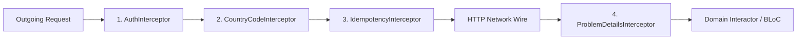
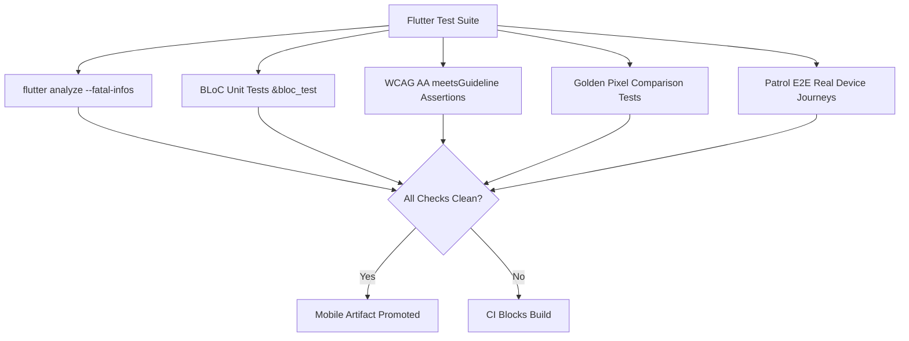

# Mobile Client Agent Instructions & Engineering Protocols (`mobile/`) — Dink Machinery

**Subsystem:** Flutter 3.44 Cross-Platform Mobile Client (`mobile/`)  
**Target:** AI Agents, Mobile Systems Engineers & Flutter Architects  
**Scope:** Architectural rules, Feature-First Clean Architecture, BLoC state management, API client generation, offline persistence, dynamic font delivery, and testing gates for `mobile/`.  
**Governing Documents:** `AGENTS.md`, `TECH_STACK.md`, `CODE_STANDARDS.md`, `API_CONVENTIONS.md`, `ERROR_CATALOG.md`, `DEFINITION_OF_DONE.md`  
**Compliance Standards:** OWASP ASVS 4.0.3 Level 3 (Mobile Verification), W3C WCAG 2.1/2.2 AA, RFC 9457 (Problem Details), ISO/IEC 25010

---

## 1. Subsystem Mission & Non-Negotiable Architectural Invariants

The **Flutter 3.44 Mobile Client** (`mobile/`) serves as the primary operational edge for Dink Machinery across Ethiopia and Kenya. It provides role-tailored interfaces for three distinct personas:
1. **Equipment Renters:** Machinery catalog search, PostGIS radius discovery, 60-minute reservation holds, and Telebirr/CBEBirr/MPESA mobile checkout.
2. **Fleet Owners:** Asset management, utilization telemetry, escrow disbursement tracking, and digital maintenance logging.
3. **Field Operators:** Joint check-in/check-out site inspections, monotonic operating hours meter logging, ClamAV-scanned condition photo capture, and offline signature synchronization.

Any agent modifying or authoring code within `mobile/` must strictly adhere to these non-negotiable platform invariants:

1. **Contract Supremacy & Code-Gen Pipeline:** Manual HTTP transport models or hand-written DTOs are prohibited. All network models, request parameters, and API interfaces must be generated directly from `contracts/openapi.yaml` into `packages/dink_api_client` via `openapi-generator-cli`.
2. **Deterministic Minor-Unit Currency Formatting:** Floating-point numbers (`double`) are strictly banned for monetary representation or calculations. All monetary values use 64-bit integers (`int` in Dart) representing minor units (`amountMinor` + `currency` string). Formatting into human-readable strings (e.g., Santims $\rightarrow$ ETB, Cents $\rightarrow$ KES) occurs exclusively at the presentation layer using integer division and modulo math.
3. **BLoC Unidirectional Data Flow:** UI components never mutate domain state directly. Presentation widgets emit discrete events to BLoCs; BLoCs yield immutable `freezed` state unions. Business logic is banned inside widget build methods.
4. **RFC 9457 Problem Details Interception:** Network errors must not be exposed as generic runtime exceptions. The Dio networking pipeline interceptor maps RFC 9457 payloads (`ProblemDetails`) into strongly typed domain failures, binding `invalidParams` to form controllers.
5. **Offline-First Persistence & Queue Synchronization (`isar`):** In low-connectivity field areas, inspections and status checks must persist locally in `isar`. Operations must queue with UUID idempotency keys and synchronize automatically upon network restoration without duplicate executions.
6. **Hardware-Backed Secure Storage (ASVS L3):** Authentication credentials, asymmetric session tokens, and refresh tokens must never be written to `SharedPreferences` or plaintext SQLite. They reside exclusively in `flutter_secure_storage` (iOS Keychain / Android EncryptedSharedPreferences).
7. **Accessibility & Outdoor Glare Standards (WCAG 2.1 AA):** All interactive targets must satisfy a minimum touch bounding box of $48 \times 48\text{ dp}$ (`androidTapTargetGuideline` and `iOSTapTargetGuideline`). Screen layouts must scale cleanly up to $200\%$ system text scaling without overflow clipping.
8. **Dynamic Non-Latin Typography (`ADR-013`):** Ethiopic (`Noto Sans Ethiopic`) and Arabic (`Noto Sans Arabic`) font subsets must render without clipped ascenders or descenders, dynamically streamed OTA from S3 with SHA-256 integrity verification.

---

## 2. Technology Stack & Pinned Toolchain

```
                               Mobile Client Technology Stack
                                              │
     ┌───────────────────┬────────────────────┴───────────────────┬───────────────────┐
     ▼                   ▼                                        ▼                   ▼
[Runtime & SDK]     [State & UI Architecture]                [Persistence & I/O] [Security & Hardware]
 - Flutter 3.44.x    - flutter_bloc v8.1+                     - Dio v5.7+         - flutter_secure_storage
 - Dart 3.9.x        - freezed & freezed_annotation v2.4+     - Isar v3.1+        - Local Auth (Biometrics)
 - Material 3 Theme  - dynamic font loader (ADR-013)          - geolocator        - image_picker / camera
```

| Layer / Concern | Technology & Version | Purpose & Architectural Rules |
|---|---|---|
| **Core Framework** | Flutter `3.44.x` (Dart `3.9.x`) | Multi-platform compilation for Android (API 26+) and iOS (15.0+). |
| **State Management** | `flutter_bloc` (`^8.1.6`) | Unidirectional reactive state machines, event-to-state mapping. |
| **Data Immutability** | `freezed` (`^2.5.7`) | Union states, pattern matching, value equality, and copy-with semantics. |
| **HTTP Networking** | `dio` (`^5.7.0`) | Pluggable interceptor pipeline (Auth, Country, Idempotency, RFC 9457). |
| **Contract Client** | `openapi-generator-cli` (`v7.8.0`)| Auto-compiled Dart Dio package (`packages/dink_api_client`). |
| **Local Persistence** | `isar` (`^3.1.0+1`) / `isar_flutter_libs` | High-performance NoSQL database for offline inspection drafts and catalogs. |
| **Secure Key Store** | `flutter_secure_storage` (`^9.2.2`)| Encrypted hardware-backed storage for session JWTs and refresh tokens. |
| **Geolocation** | `geolocator` (`^13.0.1`) | High-accuracy GPS site check-in verification ($500\text{m}$ geofencing). |
| **Camera & Media** | `camera` (`^0.11.0`) / `image` | Field inspection capture, background EXIF stripping, and WebP compression. |
| **Logging & Tracing** | `logger` (`^2.4.0`) | Structured JSON logging with automated Zero-PII sanitization regex. |

---

## 3. Directory Layout & Feature-First Clean Architecture

The mobile workspace is structured into a multi-package repository separating generated contract bindings from the application core and feature slices:

```
mobile/
├── packages/
│   └── dink_api_client/              # Generated Dart Dio client from contracts/openapi.yaml
│       ├── lib/
│       │   ├── api/                  # Generated API endpoints
│       │   └── model/                # Generated request/response DTOs
│       └── pubspec.yaml
├── lib/
│   ├── main.go                       # Production entrypoint (Global DI, Sentry, Blocs)
│   ├── app.dart                      # MaterialApp, theme configuration, router delegate
│   ├── core/                         # Cross-cutting foundational services
│   │   ├── config/                   # Country-specific dynamic settings (ET/KE)
│   │   ├── constants/                # Dimensions, animation durations, invariant limits
│   │   ├── errors/                   # ProblemDetails models, domain exceptions, failure mappers
│   │   ├── network/                  # Dio instance, interceptor pipeline, connectivity stream
│   │   ├── storage/                  # Isar schemas, SecureStorage facade, cache drivers
│   │   ├── theme/                    # High-glare outdoor theme, typography, color palettes
│   │   └── utils/                    # Integer minor-unit currency formatters, date formatters
│   └── features/                     # Domain feature slices (Feature-First Clean Architecture)
│       ├── auth/                     # OTP challenge, biometrics, role routing
│       ├── fleet_catalog/            # Spatial radius search, filters, fleet detail views
│       ├── booking/                  # 20-state reservation tracker, 60-min hold countdown
│       ├── payment/                  # Telebirr, CBEBirr, MPESA checkout, escrow receipts
│       ├── inspection/               # Photo capture, hour meter logging, offline sync queue
│       └── profile/                  # KYC document status, wallet balance, language picker
│           ├── data/                 # Repositories, remote data sources, local Isar sources
│           ├── domain/               # Pure business entities, value objects, repository interfaces
│           └── presentation/         # BLoCs, screen widgets, bottom sheets, reusable cards
├── test/                             # Unit tests, BLoC tests, golden widget tests
│   ├── core/
│   ├── features/
│   └── testutils/                    # Mocks, fixture factories, test wrappers
├── pubspec.yaml                      # Root dependency manifest and asset declarations
└── analysis_options.yaml             # Strict linting rules (flutter_lints + custom analyzer)
```

---

## 4. BLoC State Management & Unidirectional Data Flow

All interactive user journeys implement the BLoC pattern using `freezed` unions. Widgets never hold mutable business state.

```
       [ User Action ] ────────► [ BLoC Event ]
                                      │
                                      ▼
                             [ BLoC Event Handler ]
                                      │
                        (Executes Domain Interactor)
                                      ▼
       [ UI Rebuild ]  ◄──────── [ BLoC State ]
```

### 4.1. Contract-Bound Booking State Machine BLoC

```dart
// lib/features/booking/presentation/bloc/booking_bloc.dart
import 'package:flutter_bloc/flutter_bloc.dart';
import 'package:freezed_annotation/freezed_annotation.dart';
import 'package:dink_mobile/core/errors/problem_details.dart';
import 'package:dink_mobile/features/booking/domain/entities/booking.dart';
import 'package:dink_mobile/features/booking/domain/repositories/booking_repository.dart';

part 'booking_event.dart';
part 'booking_state.dart';
part 'booking_bloc.freezed.dart';

class BookingBloc extends Bloc<BookingEvent, BookingState> {
  final BookingRepository _repository;

  BookingBloc(this._repository) : super(const BookingState.initial()) {
    on<_AcquireHold>(_onAcquireHold);
    on<_ConfirmPayment>(_onConfirmPayment);
  }

  Future<void> _onAcquireHold(_AcquireHold event, Emitter<BookingState> emit) async {
    emit(const BookingState.loading());
    final result = await _repository.acquireHold(
      fleetId: event.fleetId,
      startDate: event.startDate,
      endDate: event.endDate,
      siteAddress: event.siteAddress,
    );

    result.fold(
      (failure) => emit(BookingState.failure(failure)),
      (booking) => emit(BookingState.holdActive(booking: booking, remainingSeconds: 3600)),
    );
  }

  Future<void> _onConfirmPayment(_ConfirmPayment event, Emitter<BookingState> emit) async {
    emit(const BookingState.loading());
    final result = await _repository.confirmPayment(
      bookingId: event.bookingId,
      paymentTransactionId: event.paymentTransactionId,
      version: event.version,
    );

    result.fold(
      (failure) => emit(BookingState.failure(failure)),
      (booking) => emit(BookingState.confirmed(booking)),
    );
  }
}
```

### 4.2. Freezed Events & States Specification

```dart
// lib/features/booking/presentation/bloc/booking_event.dart
part of 'booking_bloc.dart';

@freezed
class BookingEvent with _$BookingEvent {
  const factory BookingEvent.acquireHold({
    required String fleetId,
    required DateTime startDate,
    required DateTime endDate,
    required String siteAddress,
  }) = _AcquireHold;

  const factory BookingEvent.confirmPayment({
    required String bookingId,
    required String paymentTransactionId,
    required int version,
  }) = _ConfirmPayment;
}

// lib/features/booking/presentation/bloc/booking_state.dart
part of 'booking_bloc.dart';

@freezed
class BookingState with _$BookingState {
  const factory BookingState.initial() = _Initial;
  const factory BookingState.loading() = _Loading;
  const factory BookingState.holdActive({
    required Booking booking,
    required int remainingSeconds,
  }) = _HoldActive;
  const factory BookingState.confirmed(Booking booking) = _Confirmed;
  const factory BookingState.failure(ProblemDetails problem) = _Failure;
}
```

---

## 5. API Client Generation, Networking & Interceptor Pipeline

All remote HTTP traffic is processed through an orchestrated `Dio` client configured with four mandatory interceptors executed in strict sequence:



### 5.1. The 4 Mandatory Dio Interceptors

1. **`AuthInterceptor`:** Extracts the access token from `flutter_secure_storage`. If expired ($> 900\text{s}$), acquires a lock, invokes the refresh endpoint using the single-use Valkey refresh token, updates storage, and replays the original request.
2. **`CountryCodeInterceptor` (`LOC-01-BE`):** Resolves the active jurisdictional context (`ET` or `KE`) and injects the header:
   ```text
   X-Country-Code: ET
   ```
3. **`IdempotencyInterceptor`:** For mutating requests (`POST`, `PUT`, `PATCH`), verifies or generates a UUIDv4 idempotency key, attaching:
   ```text
   Idempotency-Key: 9b1deb4d-3b7d-4bad-9bdd-2b0d7b3dcb6d
   ```
4. **`ProblemDetailsInterceptor`:** Intercepts 4xx and 5xx responses, deserializes the JSON body into an RFC 9457 `ProblemDetails` domain model, logs the correlation `requestId`, and throws a typed `ProblemDetailsException`.

```dart
// lib/core/network/problem_details_interceptor.dart
import 'package:dio/dio.dart';
import 'package:dink_mobile/core/errors/problem_details.dart';

class ProblemDetailsInterceptor extends Interceptor {
  @override
  void onError(DioException err, ErrorInterceptorHandler handler) {
    if (err.response?.data != null && err.response?.data is Map<String, dynamic>) {
      final json = err.response!.data as Map<String, dynamic>;
      if (json.containsKey('error') && json['error'] is Map<String, dynamic>) {
        final problem = ProblemDetails.fromJson(json['error'] as Map<String, dynamic>);
        return handler.reject(
          DioException(
            requestOptions: err.requestOptions,
            response: err.response,
            type: err.type,
            error: problem,
          ),
        );
      }
    }
    handler.next(err);
  }
}
```

---

## 6. Offline-First Resilience & Local Persistence (`isar`)

In field construction corridors with intermittent or missing cellular connectivity, the mobile client must maintain local operation.

### 6.1. Isar Collection Architecture
Local offline entities are annotated for `isar` compilation, maintaining parity with backend schemas:

```dart
// lib/core/storage/schemas/offline_inspection.dart
import 'package:isar/isar.dart';

part 'offline_inspection.g.dart';

@collection
class OfflineInspection {
  Id id = Isar.autoIncrement;

  @Index(unique: true, replace: true)
  late String localDraftId;

  late String bookingId;
  late String operatorId;
  late int operatingHours;
  late int fuelLevelPercent;
  late List<String> localMediaFilePaths;
  late DateTime capturedAt;

  @Enumerated(EnumType.name)
  late SyncStatus syncStatus;

  String? serverInspectionId;
  int retryAttempts = 0;
}

enum SyncStatus { draft, queued, syncing, synced, failed }
```

### 6.2. Background Synchronization Protocol
1. **Local Enqueue:** When an inspector records machine check-out data in the field, the record writes to `OfflineInspection` with `syncStatus = SyncStatus.queued`.
2. **Connectivity Stream Listener:** When connectivity is restored, the `SyncEngine` reads queued inspections sequentially.
3. **Media Antivirus Pre-Flight:** Photos are resized to WebP ($1600\text{px}$ max dimension) in a background isolate via `compute()` and streamed to `/api/v1/inspections/media/upload`.
4. **OCC Reconciliation:** If the backend returns HTTP 409 (`BOOKING_CONCURRENCY_CONFLICT`), the record transitions to `SyncStatus.failed`, triggering a manual reconciliation prompt for the operator.

---

## 7. Deterministic Currency Minor-Unit Mathematics

Floating-point types (`double`) cause precision drift. All money values in the mobile client use integer minor units:

```dart
// lib/core/utils/currency_formatter.dart

class CurrencyFormatter {
  static const Map<String, int> _minorExponents = {
    'ETB': 2, // 1 ETB = 100 Santims
    'KES': 2, // 1 KES = 100 Cents
    'USD': 2, // 1 USD = 100 Cents
  };

  /// Formats integer minor units into localized financial strings without doubles.
  static String format(int amountMinor, String currency) {
    final exponent = _minorExponents[currency.toUpperCase()] ?? 2;
    final factor = _pow10(exponent);

    final major = amountMinor ~/ factor;
    final remainder = (amountMinor % factor).abs();
    final paddedRemainder = remainder.toString().padLeft(exponent, '0');

    final formattedMajor = _addThousandSeparators(major);
    return '$formattedMajor.$paddedRemainder ${currency.toUpperCase()}';
  }

  static int _pow10(int exp) {
    int res = 1;
    for (int i = 0; i < exp; i++) {
      res *= 10;
    }
    return res;
  }

  static String _addThousandSeparators(int value) {
    return value.toString().replaceAllMapped(
      RegExp(r'(\d{1,3})(?=(\d{3})+(?!\d))'),
      (Match m) => '${m[1]},',
    );
  }
}
```

---

## 8. Multilingual Typography & Dynamic Font Pipeline (`ADR-013`)

To optimize the initial app binary size while providing crisp readability across Ethiopia and Kenya, non-Latin font families are delivered dynamically:

```
[ App Bootstrap ] ──► [ Check Local Font Cache ]
                             │
            ┌────────────────┴────────────────┐
            ▼ Cached                          ▼ Missing
  [ Load Font via FontLoader ]      [ Fetch OTA Subset from S3 ]
                                              │
                                    [ Verify SHA-256 Checksum ]
                                              │
                                    [ Persist to App Storage ]
                                              │
                                    [ Register in FontLoader ]
```

### Font Delivery Rules
1. **Ethiopic Script Support:** Amharic, Tigrinya, and Oromo render via `Noto Sans Ethiopic`. Ascenders, descenders, and complex consonant gemination diacritics must never be clipped.
2. **Arabic Script Support:** Somali and border regions render via `Noto Sans Arabic`.
3. **Integrity Pinning:** OTA font blobs downloaded from SeaweedFS S3 must match the SHA-256 hash baked into the app configuration. Corrupted or mismatched blobs are deleted immediately.

---

## 9. Accessibility (WCAG 2.1 AA) & Outdoor Glare Standards

Dink Machinery is operated under challenging site conditions: full equatorial sunlight, heavy vibration, and operators wearing industrial protective gloves.

### 9.1. Minimum Touch Targets & Spacing
- Every interactive element (buttons, dropdowns, icon toggles) must provide a minimum touch bounding box of $48 \times 48\text{ dp}$ with minimum $8\text{ dp}$ physical spacing.
- Compact icons ($24\text{ dp}$) must be wrapped inside `ConstrainedBox`:
  ```dart
  ConstrainedBox(
    constraints: const BoxConstraints(minWidth: 48.0, minHeight: 48.0),
    child: IconButton(
      icon: const Icon(Icons.location_on, size: 24.0),
      tooltip: 'Center on machine coordinates',
      onPressed: _recenterMap,
    ),
  )
  ```

### 9.2. Dynamic Text Scaling ($200\%$)
- Hardcoded `Container(height: 50, child: Text(...))` wrappers are strictly banned.
- All text presentation containers must use flexible layouts (`Wrap`, unbounded vertical expansion) to scale seamlessly when `MediaQuery.textScalerOf(context)` scales up to $2.0\times$.

### 9.3. High-Glare Outdoor Contrast Mode
- Text and critical iconography must maintain a minimum contrast ratio of $4.5:1$ in standard mode and $7.0:1$ in high-glare mode.
- Status indicators must not rely solely on color; they must pair color with distinct geometric icons:
  - `AVAILABLE`: Emerald Green + Checkmark Circle Icon
  - `HOLD_PENDING`: Amber Orange + Hourglass Icon
  - `ACTIVE_OPERATION`: Industrial Blue + Wrench Icon
  - `DISPUTED`: Crimson Red + Warning Triangle Icon

---

## 10. Security, Secure Storage & OWASP ASVS L3 Mobile Controls

1. **Token Storage Separation:**
   - Plaintext shared preferences (`SharedPreferences`) must only store non-sensitive user preferences (e.g., active language, outdoor glare mode toggle).
   - JWT access tokens, rotating Valkey refresh tokens, and biometric authorization keys reside strictly in `FlutterSecureStorage`:
     ```dart
     final secureStorage = const FlutterSecureStorage(
       aOptions: AndroidOptions(encryptedSharedPreferences: true),
       iOptions: IOSOptions(accessibility: KeychainAccessibility.first_unlock),
     );
     ```
2. **Zero-PII Telemetry:**
   - Application loggers must not output unmasked telephone numbers, Kebele card IDs, or bank account strings.
   - Crash report payloads sent to external telemetry must scrub regex matches for sensitive credentials.
3. **Biometric Re-Authentication:**
   - Mutating escrow disbursements or releasing held assets requires biometric verification via `local_auth`.

---

## 11. Automated Testing, Verification Gates & Device Profiling

Mobile testing adheres to ISO/IEC/IEEE 29119 across unit, widget, golden, and integration tiers.



### 11.1. Automated Accessibility & Touch Boundary Test Example
```dart
import 'package:flutter_test/flutter_test.dart';
import 'package:dink_mobile/features/fleet_catalog/presentation/widgets/fleet_card.dart';

void main() {
  testWidgets('FleetCard satisfies touch target and contrast guidelines', (tester) async {
    final handle = tester.ensureSemantics();

    await tester.pumpWidget(
      const TestAppWrapper(
        child: FleetCard(
          make: 'Caterpillar',
          model: '320D3',
          formattedDailyRate: '25,000.00 ETB',
          isAvailable: true,
        ),
      ),
    );

    // Verify 48x48 dp touch target boundary
    await expectLater(tester, meetsGuideline(androidTapTargetGuideline));
    await expectLater(tester, meetsGuideline(iOSTapTargetGuideline));

    // Verify text contrast ratio (WCAG AA 4.5:1)
    await expectLater(tester, meetsGuideline(textContrastGuideline));

    // Verify semantic labels
    await expectLater(tester, meetsGuideline(labeledTapTargetGuideline));

    handle.dispose();
  });
}
```

### 11.2. Performance Budgets on Low-Tier Hardware
- **Launch Time:** Cold startup to interactive catalog $\le 1,200\text{ ms}$; warm start $\le 400\text{ ms}$.
- **Rendering Performance:** 60 FPS ($< 16.6\text{ ms}$ per frame) during continuous catalog fling scrolling on 3GB RAM Android devices.
- **Heap Memory Footprint:** $\le 110\text{ MB}$ RSS baseline heap on Android listing views.

---

## 12. Mobile PR Review & Quality Gate Sign-Off Checklist

Before any pull request modifying `mobile/` is merged into `main`, verify compliance with every checkpoint:

- [ ] **Contract Client Generation:** Generated client in `packages/dink_api_client` compiles cleanly from `contracts/openapi.yaml`; zero uncommitted drift.
- [ ] **Integer Minor-Unit Math:** All currency displays use `CurrencyFormatter` with integer minor units (`amountMinor` int); zero floating-point arithmetic.
- [ ] **BLoC Architecture:** Presentation widgets emit events; state changes managed via immutable `freezed` classes.
- [ ] **RFC 9457 Handling:** Network failures parse into `ProblemDetails`; form errors bind directly to input validation states.
- [ ] **Offline Resilience:** Field inspection drafts persist in `isar`; queued synchronizations resume automatically upon network recovery.
- [ ] **Hardware Secure Storage:** Session tokens, refresh credentials, and biometric flags reside in `FlutterSecureStorage`.
- [ ] **Touch Target Invariant:** All buttons and interactive controls satisfy minimum $48 \times 48\text{ dp}$ bounding box.
- [ ] **Text Scaling Resilience:** Views scale cleanly to $200\%$ system font size without layout overflow or text truncation.
- [ ] **Static Analysis & Tests:** `flutter analyze` reports 0 issues; `flutter test --coverage` passes with 100% success rate.
- [ ] **Atomic Context Tracking:** `CONTEXT.md` updated and staged in the exact same commit.