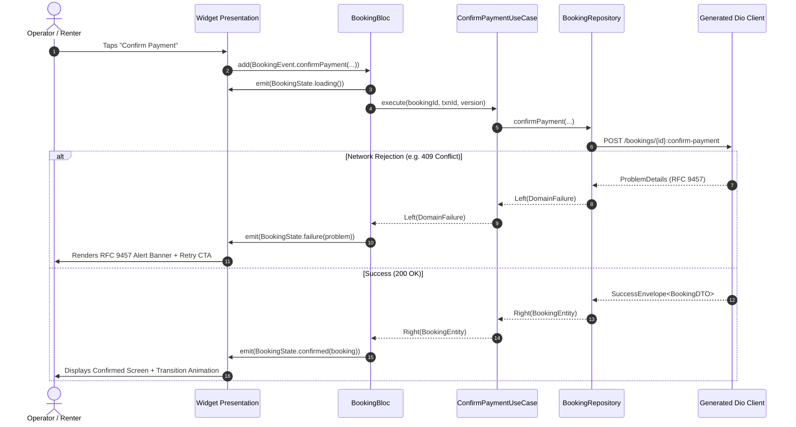
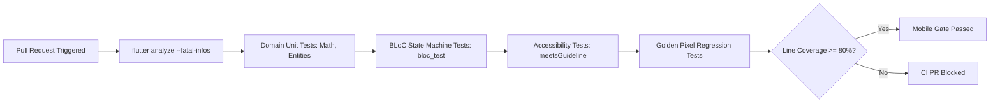

# Mobile Client System Design & Architectural Specification (`mobile/`) — Dink Machinery

**Subsystem:** Flutter 3.44 Cross-Platform Mobile Client (`mobile/`)  
**Specification:** System Architecture, Feature-First Clean Architecture, BLoC State Topology & Offline Data Lifecycle  
**Compliance Standards:** OWASP ASVS 4.0.3 Level 3 (Mobile Verification), W3C WCAG 2.1/2.2 Level AA, RFC 9457 (Problem Details), ISO/IEC 25010  
**Target Runtimes:** Flutter 3.44.x (Dart 3.9.x), Android 8.0+ (API 26+), iOS 15.0+  
**Governing Documents:** `AGENTS.md`, `TECH_STACK.md`, `CODE_STANDARDS.md`, `API_CONVENTIONS.md`, `ERROR_CATALOG.md`, `DEFINITION_OF_DONE.md`, `docs/components/mobile/AGENTS.md`

---

## 1. Executive Summary & Mobile Design Vision

The **Dink Machinery Mobile Client** (`mobile/`) serves as the primary operational field interface across Ethiopia and Kenya. Designed to bridge heavy machinery logistics with digital contract execution, the client supports three distinct operational personas within a unified, role-parameterized application:

1. **Equipment Renters:** Discover machinery via PostGIS spatial radius queries, inspect technical EAV specifications and attachments, lock 60-minute payment reservation holds, and settle escrow payments via Telebirr, CBEBirr, or MPESA.
2. **Fleet Owners:** Register industrial assets, manage multi-machine availability schedules, track telematics and escrow disbursements, and triage maintenance intervals.
3. **Field Operators:** Perform physical site check-in and check-out inspections, log monotonic engine hour meters and fuel levels, capture ClamAV-streamed photographic evidence, and stream GPS coordinates during active lease dispatches.

```
                                Mobile Core Architectural Pillars
                                                │
      ┌──────────────────────┬──────────────────┴──────────────────┬──────────────────────┐
      ▼                      ▼                                     ▼                      ▼
[Contract-First SDK]    [BLoC State Machine]                  [Offline Resilience]   [Industrial Ergonomics]
 Generated Dart Dio      Predictable unidirectional            Isar local storage;    48x48 dp touch targets;
 client synchronized     flow; immutable Freezed               idempotent sync queue; 200% text scaling;
 with openapi.yaml       state unions; zero UI logic           local draft recovery   high-glare outdoor mode
      │                      │                                     │                      │
      ▼                      ▼                                     ▼                      ▼
[Minor-Unit Math]       [RFC 9457 Binding]                    [ASVS L3 Security]     [Dynamic Typography]
 int minor units         ProblemDetails mapped                 Hardware keystore;     ADR-013 OTA Ethiopic &
 (Santims/Cents); zero   to field errors;                      zero tokens in         Arabic font delivery;
 floating-point drift    requestId correlation                 SharedPreferences      SHA-256 integrity check
```

---

## 2. High-Level Mobile Topology & Boundary Architecture

The mobile application is designed around **Feature-First Clean Architecture**, ensuring decoupling between presentation components, domain business logic, and data sources.

```mermaid
flowchart TD
  subgraph PresentationLayer["Presentation Layer (Flutter 3.44)"]
    UI[Screens & Widgets] -->|Dispatch Events| Bloc[Feature BLoCs]
    Bloc -->|Emit Immutable States| UI
  end

  subgraph DomainLayer["Domain Layer (Pure Dart)"]
    Bloc -->|Invoke Use Cases| UseCase[Domain Interactors / Use Cases]
    UseCase -->|Call Contracts| RepoInterface[Repository Interfaces / Ports]
    Entity[Domain Entities & Value Objects] <--> UseCase
  end

  subgraph DataLayer["Data Layer (Infrastructure & Persistence)"]
    RepoInterface -->|Implemented by| RepoImpl[Repository Implementations]
    RepoImpl -->|Remote I/O| RemoteSource[Remote Data Source]
    RepoImpl -->|Offline I/O| LocalSource[Isar Local Storage]
    
    RemoteSource -->|Dio Pipeline| DioInterceptors[Interceptor Stack: Auth | Country | Idempotency | RFC 9457]
    DioInterceptors -->|HTTPS / TLS 1.3| Gateway[Traefik 3.x Ingress Gateway]
    
    LocalSource -->|Encrypted Schema| IsarDB[(Isar NoSQL Database)]
    RepoImpl -->|Hardware Keystore| SecureStorage[(FlutterSecureStorage)]
  end
```

---

## 3. Directory Structure & Modular Layout

The mobile repository isolates generated API bindings, core shared modules, and bounded feature slices:

```
mobile/
├── packages/
│   └── dink_api_client/              # Compiled OpenAPI Dart Dio Client (Auto-generated)
│       ├── lib/
│       │   ├── api/                  # Generated endpoint contracts
│       │   └── model/                # Generated wire DTOs and serializers
│       └── pubspec.yaml
├── lib/
│   ├── main.dart                     # Production initialization: Sentry, DI, runApp
│   ├── app.dart                      # MaterialApp configuration, dynamic theming, router
│   ├── core/                         # Cross-cutting foundational infrastructure
│   │   ├── config/                   # Country config cache (ET/KE), remote feature flags
│   │   ├── constants/                # UI metrics, touch targets, cache timeouts
│   │   ├── errors/                   # ProblemDetails models, domain exceptions, failure mappers
│   │   ├── network/                  # Dio singleton, 4-tier interceptor stack, network monitor
│   │   ├── storage/                  # Isar schemas, SecureStorage wrapper, file caches
│   │   ├── theme/                    # Outdoor glare theme, high-contrast palettes, typography
│   │   └── utils/                    # Minor-unit currency math, date formatters, GPS math
│   └── features/                     # Bounded context feature slices (Feature-First)
│       ├── auth/                     # OTP challenge, biometrics, token rotation, persona router
│       ├── fleet_catalog/            # Spatial radius search, EAV spec inspection, filter facets
│       ├── booking/                  # 20-state machine tracker, 60-min hold countdown, disputes
│       ├── payment/                  # Telebirr, CBEBirr, MPESA checkout, escrow receipts
│       ├── inspection/               # Photo capture, monotonic hour meter, offline sync queue
│       ├── tracking/                 # Operator GPS background location streamer (30s interval)
│       └── profile/                  # KYC status, wallet balance, language and theme switcher
│           ├── data/                 # Repository implementations, remote/local data sources
│           ├── domain/               # Pure business entities, value objects, repository ports
│           └── presentation/         # BLoCs, screen widgets, modals, responsive cards
├── assets/                           # Static offline icons, branding, fallback vectors
├── test/                             # Automated testing suites
│   ├── unit/                         # Pure domain logic and currency math tests
│   ├── bloc/                         # BLoC state transition tests (bloc_test)
│   ├── widget/                       # Golden UI tests and accessibility checks
│   └── testutils/                    # Mocks, fixture factories, simulated network servers
├── pubspec.yaml                      # Root dependency manifest
└── analysis_options.yaml             # Strict linting configuration
```

---

## 4. Persona Workflows & Screen Navigation Topology

The application routes users into tailored experiences based on their authenticated persona claims while allowing multi-role switching:

```
                                Root Authentication Router
                                             │
      ┌──────────────────────────────────────┼──────────────────────────────────────┐
      ▼                                      ▼                                      ▼
[Renter Journey]                       [Fleet Owner Journey]                  [Operator Journey]
 - Spatial Fleet Discovery              - Asset Registry & Telematics          - Dispatch Route & Navigation
 - Technical Specs & Attachments        - Calendar Availability Engine         - Joint Check-in Inspection
 - 60-Minute Payment Hold               - Escrow Settlement Monitor            - Operating Hours Meter Entry
 - Mobile Money Escrow Checkout         - Maintenance Work Orders              - ClamAV Photo Evidence Upload
 - Dispute Arbitration Submission       - Dispute Resolution Review            - Continuous GPS Telematics
```

### 4.1. The Renter Flow
- **Discovery Screen:** Interactive map displaying PostGIS radius results, category filters (Excavator, Crane, Bulldozer), and minor-unit daily rates.
- **Asset Detail Screen:** Dynamic EAV specification sheets (operating weight, bucket capacity, boom reach), bundled attachments, owner compliance badge, and insurance verification status.
- **Reservation Hold Screen:** Live countdown timer for the 60-minute payment hold, breakdown of daily rate, transport mobilization surcharge, standard VAT basis points (`standard_tax_rate_bps`), and damage deposit.
- **Checkout Sheet:** Native integration triggers for Telebirr, CBEBirr, and MPESA with immediate polling for backend confirmation webhooks.

### 4.2. The Field Operator Flow
- **Assigned Job Board:** Queue of active dispatches with turn-by-turn navigation coordinates to the job site.
- **Inspection Stepper:** Digital inspection wizard enforcing:
  1. Monotonic operating hours meter reading (validated against check-in baseline).
  2. Fuel level percentage selector ($0\%$ to $100\%$).
  3. Minimum 4 photographic angles (Front, Rear, Left Track/Tire, Right Track/Tire) with camera-enforced EXIF capture.
  4. Dual digital sign-off (Renter and Operator signatures on glass).

---

## 5. BLoC State Management & Immutable Unions

State transitions follow strict unidirectional data flow. All state containers are generated using `freezed` to enforce exhaustive compile-time pattern matching.



### 5.1. BLoC Implementation Pattern (`BookingBloc`)

```dart
// lib/features/booking/presentation/bloc/booking_bloc.dart
import 'package:flutter_bloc/flutter_bloc.dart';
import 'package:freezed_annotation/freezed_annotation.dart';
import 'package:dink_mobile/core/errors/problem_details.dart';
import 'package:dink_mobile/features/booking/domain/entities/booking.dart';
import 'package:dink_mobile/features/booking/domain/usecases/confirm_payment_usecase.dart';

part 'booking_event.dart';
part 'booking_state.dart';
part 'booking_bloc.freezed.dart';

class BookingBloc extends Bloc<BookingEvent, BookingState> {
  final ConfirmPaymentUseCase _confirmPaymentUseCase;

  BookingBloc(this._confirmPaymentUseCase) : super(const BookingState.initial()) {
    on<_ConfirmPayment>(_onConfirmPayment);
  }

  Future<void> _onConfirmPayment(
    _ConfirmPayment event,
    Emitter<BookingState> emit,
  ) async {
    emit(const BookingState.loading());

    final result = await _confirmPaymentUseCase(
      bookingId: event.bookingId,
      paymentTransactionId: event.paymentTransactionId,
      version: event.version,
    );

    result.fold(
      (failure) => emit(BookingState.failure(failure)),
      (booking) => emit(BookingState.confirmed(booking)),
    );
  }
}
```

---

## 6. Networking & Resilient Interceptor Pipeline

All remote communications flow through a configured `Dio` client implementing a sequential 4-tier interceptor stack:

```
[ Outgoing Request ]
        │
        ▼
[ 1. AuthInterceptor ] ────────► Injects Bearer JWT; handles refresh rotation via Valkey
        │
        ▼
[ 2. CountryCodeInterceptor ] ──► Injects X-Country-Code: ET | KE (LOC-01-BE)
        │
        ▼
[ 3. IdempotencyInterceptor ] ──► Injects Idempotency-Key: UUIDv4 on mutating methods
        │
        ▼
[ Physical Network Wire ]
        │
        ▼
[ 4. ProblemDetailsInterceptor ] ► Deserializes RFC 9457 error bodies; binds correlation requestId
        │
        ▼
[ Domain Application Result ]
```

### 6.1. The RFC 9457 Problem Details Interceptor

```dart
// lib/core/network/problem_details_interceptor.dart
import 'package:dio/dio.dart';
import 'package:dink_mobile/core/errors/problem_details.dart';

class ProblemDetailsInterceptor extends Interceptor {
  @override
  void onError(DioException err, ErrorInterceptorHandler handler) {
    if (err.response?.data != null && err.response?.data is Map<String, dynamic>) {
      final json = err.response!.data as Map<String, dynamic>;
      
      // Enforce Universal ErrorEnvelope check
      if (json.containsKey('error') && json['error'] is Map<String, dynamic>) {
        final problem = ProblemDetails.fromJson(json['error'] as Map<String, dynamic>);
        return handler.reject(
          DioException(
            requestOptions: err.requestOptions,
            response: err.response,
            type: err.type,
            error: problem,
          ),
        );
      }
    }
    handler.next(err);
  }
}
```

---

## 7. Offline Persistence & Background Synchronization Engine (`isar`)

In construction zones lacking reliable cellular connectivity, the application must cache operational records and queue mutations locally.

```
                    Offline Mutation & Background Sync Loop
                                       │
     [Field Inspection Submitted]      ▼
                 │             [Connectivity Check]
                 │                      │
                 ├──────────────────────┴──────────────────────┐
                 ▼ Online                                      ▼ Offline
     [Immediate S3 & REST Dispatch]                [Write to Isar NoSQL Queue]
                 │                                 (syncStatus = SyncStatus.queued)
                 │                                             │
                 │                                 [ConnectivityStream Restored]
                 │                                             │
                 │                                 [SyncEngine Dequeues Tasks]
                 │                                             │
                 │                                 [Resize Media in Background Isolate]
                 │                                             │
                 │                                 [Stream Media through ClamAV]
                 │                                             │
                 │                                 [Execute Mutating RPC with Idempotency]
                 │                                             │
                 └──────────────────────┬──────────────────────┘
                                        ▼
                         [Mark Record as Synced in Isar]
```

### 7.1. Isar Schema Architecture (`offline_inspection.dart`)

```dart
// lib/core/storage/schemas/offline_inspection.dart
import 'package:isar/isar.dart';

part 'offline_inspection.g.dart';

@collection
class OfflineInspection {
  Id id = Isar.autoIncrement;

  @Index(unique: true, replace: true)
  late String localDraftId;

  @Index()
  late String bookingId;

  late String operatorId;
  late int operatingHours;
  late int fuelLevelPercent;
  late List<String> localMediaFilePaths;
  late DateTime capturedAt;

  @Enumerated(EnumType.name)
  late SyncStatus syncStatus;

  String? serverInspectionId;
  String? failureReason;
  int retryAttempts = 0;
}

enum SyncStatus { draft, queued, syncing, synced, failed }
```

### 7.2. Heavy Compute Offloading via Background Isolates
Inspection photographs ($12\text{MP}+$ raw camera captures) cannot be processed on the main UI isolate without causing frame drops ($> 16.6\text{ms}$). Image resizing, EXIF sanitization, and WebP compression execute in dedicated worker isolates via Flutter's `compute()`:

```dart
// lib/features/inspection/data/datasources/inspection_media_processor.dart
import 'dart:io';
import 'dart:typed_data';
import 'package:flutter/foundation.dart';
import 'package:image/image.dart' as img;

class InspectionMediaProcessor {
  static Future<Uint8List> compressAndSanitize(String sourceFilePath) async {
    return await compute(_processImageIsolate, sourceFilePath);
  }

  static Uint8List _processImageIsolate(String filePath) {
    final rawBytes = File(filePath).readAsBytesSync();
    final decoded = img.decodeImage(rawBytes);
    if (decoded == null) throw Exception('Corrupt image payload');

    // Resize bounding box to max 1600px width/height while preserving aspect ratio
    final resized = img.copyResize(
      decoded,
      width: decoded.width > decoded.height ? 1600 : null,
      height: decoded.height >= decoded.width ? 1600 : null,
      interpolation: img.Interpolation.linear,
    );

    // Strip EXIF metadata and encode as WebP at 82% quality factor
    return Uint8List.fromList(img.encodeJpg(resized, quality: 82));
  }
}
```

---

## 8. Real-Time Operator GPS Tracking (`GPS-01` to `GPS-04`)

When an operator begins machinery transit or operational dispatch, the mobile client streams high-precision GPS telematics to the backend.

```dart
// lib/features/tracking/data/datasources/location_tracker.dart
import 'dart:async';
import 'package:geolocator/geolocator.dart';

class OperatorLocationTracker {
  StreamSubscription<Position>? _positionStream;

  void startTracking({
    required String bookingId,
    required Function(double lat, double lng, double speed) onPing,
  }) {
    const locationSettings = LocationSettings(
      accuracy: LocationAccuracy.high,
      distanceFilter: 25, // Minimum meters moved before ping
    );

    _positionStream = Geolocator.getPositionStream(locationSettings: locationSettings)
        .listen((Position pos) {
      onPing(pos.latitude, pos.longitude, pos.speed);
    });
  }

  void stopTracking() {
    _positionStream?.cancel();
    _positionStream = null;
  }
}
```

- **Interval & Constraints:** Dispatches location coordinates every 30 seconds when rental state is `ACTIVE_OPERATION` or `IN_TRANSIT`.
- **Privacy Controls:** Location streaming automatically terminates when the booking advances to `COMPLETED` or `CLOSED`.

---

## 9. Currency Formatting Engine & Integer Minor-Unit Math

Floating-point precision errors in financial calculations are prevented by enforcing 64-bit signed integer math throughout all data and presentation layers.

```dart
// lib/core/utils/currency_formatter.dart

class CurrencyFormatter {
  static const Map<String, int> _exponents = {
    'ETB': 2, // 1 ETB = 100 Santims
    'KES': 2, // 1 KES = 100 Cents
    'USD': 2, // 1 USD = 100 Cents
  };

  /// Formats integer minor units into human-readable currency strings.
  /// Example: 2500000 Santims, ETB -> "25,000.00 ETB"
  static String format(int amountMinor, String currency) {
    final exp = _exponents[currency.toUpperCase()] ?? 2;
    final factor = _pow10(exp);

    final major = amountMinor ~/ factor;
    final remainder = (amountMinor % factor).abs();
    final paddedRemainder = remainder.toString().padLeft(exp, '0');

    final formattedMajor = _formatThousandSeparators(major);
    return '$formattedMajor.$paddedRemainder${currency.toUpperCase()}';
  }

  static int _pow10(int exponent) {
    int value = 1;
    for (int i = 0; i < exponent; i++) {
      value *= 10;
    }
    return value;
  }

  static String _formatThousandSeparators(int number) {
    return number.toString().replaceAllMapped(
      RegExp(r'(\d{1,3})(?=(\d{3})+(?!\d))'),
      (Match m) => '${m[1]},',
    );
  }
}
```

---

## 10. Multilingual Non-Latin Typography Pipeline (`ADR-013`)

To guarantee crisp legibility of Amharic, Oromo, Tigrinya, and Somali scripts without increasing the initial app bundle size, non-Latin typography is delivered dynamically over-the-air (OTA).

```
[ Dynamic Font Initialization ]
               │
               ▼
[ Check Local Directory: /data/user/0/.../app_fonts/ ]
               │
      ┌────────┴────────┐
      ▼ Exists          ▼ Missing
[ Load Binary ]   [ Download from SeaweedFS S3 ]
      │                 │
      │           [ Validate SHA-256 Hash ]
      │                 │
      │           [ Save to Secure Directory ]
      │                 │
      └────────►┬───────┘
                ▼
  [ FontLoader.addFont(...) ]
                │
                ▼
  [ FontLoader.load() ]
```

### 10.1. Font Pipeline Specifications
- **Ethiopic Script:** Rendered using `Noto Sans Ethiopic`. Layouts must provide adequate line height ($1.4\times$ to $1.6\times$) to prevent vertical clipping of vowel diacritics and gemination marks.
- **Arabic Script:** Rendered using `Noto Sans Arabic` with full right-to-left (RTL) text direction handling.
- **Integrity Validation:** Fonts fetched OTA are verified against hardcoded SHA-256 digests. Mismatched files are discarded immediately.

---

## 11. Industrial Accessibility & High-Glare Ergonomics

The mobile client is engineered for construction environments with high dust, equatorial sunlight, and protective equipment usage.

```
                           Industrial Design Tokens
                                      │
     ┌────────────────────────────────┴────────────────────────────────┐
     ▼                                                                 ▼
[High-Glare Outdoor Mode]                                    [Standard Mode]
 - Text Contrast: >= 7.0:1 (WCAG AAA)                         - Text Contrast: >= 4.5:1 (WCAG AA)
 - Solid 2px Black Component Borders                          - Subtle Shadow Elevation
 - High-Saturation Status Badges                              - Standard Material 3 Surfaces
 - Dual Shape + Color Indicators                              - Standard Icons
```

### 11.1. Physical Touch Bounding Box ($48\times 48\text{ dp}$)
Every actionable element provides a minimum physical touch target of $48 \times 48\text{ dp}$, adhering to `androidTapTargetGuideline` and `iOSTapTargetGuideline`:

```dart
// Wrapped touch target helper
Widget wrapTouchTarget({required Widget child, required VoidCallback onTap}) {
  return ConstrainedBox(
    constraints: const BoxConstraints(minWidth: 48.0, minHeight: 48.0),
    child: InkWell(
      onTap: onTap,
      borderRadius: BorderRadius.circular(8.0),
      child: Center(child: child),
    ),
  );
}
```

### 11.2. Dynamic Text Scalability ($200\%$)
Layouts are designed to prevent text truncation or visual clipping when users enlarge device fonts up to $2.0\times$:
- Fixed height containers containing text elements are prohibited.
- Screen sections use flexible wrapping (`Wrap`, `Flex`, auto-expanding scroll views).
- Status indicators combine text labels with distinct geometric iconography to remain accessible to color-blind operators.

---

## 12. Security Architecture & OWASP ASVS Level 3 Mobile Controls

### 12.1. Hardware Keystore Isolation
Authentication tokens, asymmetric keys, and biometric credentials are stored exclusively in hardware-backed storage (`flutter_secure_storage`), utilizing the Android Keystore System and iOS Keychain Services:

```dart
// lib/core/storage/secure_storage_facade.dart
import 'package:flutter_secure_storage/flutter_secure_storage.dart';

class SecureStorageFacade {
  final FlutterSecureStorage _storage = const FlutterSecureStorage(
    aOptions: AndroidOptions(
      encryptedSharedPreferences: true,
      resetOnError: true,
    ),
    iOptions: IOSOptions(
      accessibility: KeychainAccessibility.first_unlock,
      synchronizable: false,
    ),
  );

  Future<void> writeToken(String key, String value) => _storage.write(key: key, value: value);
  Future<String?> readToken(String key) => _storage.read(key: key);
  Future<void> deleteToken(String key) => _storage.delete(key: key);
  Future<void> wipeAll() => _storage.deleteAll();
}
```

### 12.2. Zero-PII Structured Logging
Client logs emitted via `logger` pass through regex sanitizers that redact customer telephone numbers, Kebele card IDs, and bank account details prior to local storage or console output.

---

## 13. Automated Testing Strategy & CI Ratchet

Testing adheres to ISO/IEC/IEEE 29119 across unit, widget, golden, and integration tiers.



### 13.1. BLoC Unit Test Specification (`bloc_test`)

```dart
// test/features/booking/presentation/bloc/booking_bloc_test.dart
import 'package:bloc_test/bloc_test.dart';
import 'package:dartz/dartz.dart';
import 'package:flutter_test/flutter_test.dart';
import 'package:mocktail/mocktail.dart';
import 'package:dink_mobile/features/booking/presentation/bloc/booking_bloc.dart';
import 'package:dink_mobile/features/booking/domain/usecases/confirm_payment_usecase.dart';
import 'package:dink_mobile/features/booking/domain/entities/booking.dart';

class MockConfirmPaymentUseCase extends Mock implements ConfirmPaymentUseCase {}

void main() {
  late MockConfirmPaymentUseCase mockUseCase;

  setUp(() {
    mockUseCase = MockConfirmPaymentUseCase();
  });

  final tBooking = Booking(
    id: 'b7f00001-8b22-1d54-818b-22b0f4910001',
    status: 'CONFIRMED',
    version: 2,
  );

  blocTest<BookingBloc, BookingState>(
    'emits [loading, confirmed] when payment confirmation succeeds',
    build: () {
      when(() => mockUseCase(
            bookingId: any(named: 'bookingId'),
            paymentTransactionId: any(named: 'paymentTransactionId'),
            version: any(named: 'version'),
          )).thenAnswer((_) async => Right(tBooking));
      return BookingBloc(mockUseCase);
    },
    act: (bloc) => bloc.add(const BookingEvent.confirmPayment(
      bookingId: 'b7f00001-8b22-1d54-818b-22b0f4910001',
      paymentTransactionId: 'txn_telebirr_12345',
      version: 1,
    )),
    expect: () => [
      const BookingState.loading(),
      BookingState.confirmed(tBooking),
    ],
  );
}
```

---

## 14. Verification Checklist & Gate Sign-Off Criteria

Before merging pull requests affecting `mobile/`, verify compliance with every checkpoint:

- [ ] **Contract Client Generation:** Generated client in `packages/dink_api_client` compiles cleanly from `contracts/openapi.yaml`; zero uncommitted drift.
- [ ] **Integer Minor-Unit Math:** All currency displays use `CurrencyFormatter` with integer minor units (`amountMinor` int); zero floating-point arithmetic.
- [ ] **BLoC Architecture:** Presentation widgets emit events; state changes managed via immutable `freezed` classes.
- [ ] **RFC 9457 Handling:** Network failures parse into `ProblemDetails`; form errors bind directly to input validation states.
- [ ] **Offline Resilience:** Field inspection drafts persist in `isar`; queued synchronizations resume automatically upon network recovery.
- [ ] **Hardware Secure Storage:** Session tokens, refresh credentials, and biometric flags reside in `FlutterSecureStorage`.
- [ ] **Touch Target Invariant:** All buttons and interactive controls satisfy minimum $48 \times 48\text{ dp}$ bounding box.
- [ ] **Text Scaling Resilience:** Views scale cleanly to $200\%$ system font size without layout overflow or text truncation.
- [ ] **Static Analysis & Tests:** `flutter analyze` reports 0 issues; `flutter test --coverage` passes with 100% success rate.
- [ ] **Atomic Context Tracking:** `CONTEXT.md` updated and staged in the exact same commit.