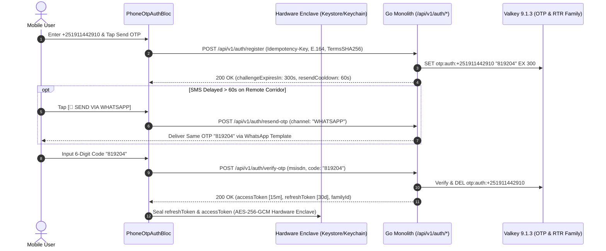

# Passwordless Phone OTP Authentication & Refresh Rotation
## Mobile Subsystem Specification — `docs/mobile/auth-kyc/02-passwordless-phone-otp.md`

**Document Identifier:** `SPEC-MOB-AUTH-02`  
**Classification:** Canonical Subsystem UI/UX & Technical Behavior Specification  
**Governing Documents:** `docs/source/Dink_Machinery_UI_UX_Design_Brief.md`, `docs/shared/design/00-design-system.md`, `docs/shared/design/design-tokens.json`, `docs/shared/requirements/05-01-registration-authentication.md`, `docs/ERROR_CATALOG.md`, `contracts/openapi.yaml`  
**Target Subsystem:** Flutter 3.47.8 / Dart 3.9 Mobile Client (iOS & Android)  
**Primary Persona / Actor:** Unauthenticated New or Returning User  
**Requirement Traceability:** `REQ-05-01` (`REG-01`..`REG-07`, `AUT-01`..`AUT-09`), `REQ-05-16` (`AC-02`), `REQ-05-18` (`ER-01`..`ER-04`)  
**Associated Interaction Flows:** `FLOW-01`, `FLOW-RENTER-AUTH`, `FLOW-APPENDIX-B`  
**Architectural Decision Records:** `ADR-005` (Asymmetric ECDSA P-256 JWT), `ADR-008` (Hardware Keystore & RTR Family Revocation), `ADR-011` (Auth & OTP Rate Limits)  
**Status:** Approved Technical Design Baseline

---

## 1. Domain Context & Non-Negotiable Auth Invariants

In Ethiopia and Kenya, the sovereign E.164 MSISDN (`+251` / `+254`) is the anchor of commercial identity and mobile money settlement (Telebirr, CBE Birr, M-PESA). Because regional SMS SMPP gateways along remote highway corridors occasionally suffer congestion, the OTP screen must pair domestic SMPP dispatch with an **automated 60-second WhatsApp Business API fallback**, enforce strict brute-force attempt caps, and seal rotating refresh tokens inside the hardware enclave.

### 1.1 Non-Negotiable System Invariants
1. **Strict E.164 Normalization & Dynamic Telco Prefix Badge (`REG-01`, `REG-02`):**
   - Phone inputs automatically strip leading trunk zeros (`0911...` $\rightarrow$ `+251911...`; `0722...` $\rightarrow$ `+254722...`) and validate carrier prefixes in real time:
     - **Ethiopia (`+251`):** `9XXXXXXXX` (Ethio Telecom), `7XXXXXXXX` (Safaricom Ethiopia).
     - **Kenya (`+254`):** `7XXXXXXXX` / `1XXXXXXXX` (Safaricom / Airtel Kenya).
2. **CSPRNG 6-Digit OTP Lifecycle (`300s` TTL & Max Attempts Cap):**
   - OTP challenges expire strictly after $300\text{ seconds}$ (`AUTH_OTP_EXPIRED`) and allow a maximum of 3–5 failed verification attempts (`AUTH_OTP_MAX_ATTEMPTS`) before invalidating the Valkey challenge key (`otp:auth:{msisdn}`) and enforcing a **15-minute leaky-bucket cooldown** (`429 Too Many Requests`).
3. **60-Second Radial Cooldown & WhatsApp Business Fallback (`AUT-04`):**
   - Upon OTP dispatch via primary SMPP v3.4, a `Space Mono` 60-second countdown locks re-dispatch. Once $60\text{s}$ elapses, the user can tap `[ 💬 RESEND VIA WHATSAPP ]` (`POST /api/v1/auth/resend-otp` with `channel: WHATSAPP`), transmitting the identical active Valkey OTP token to avoid race conditions.
4. **Refresh Token Rotation (RTR) & Immediate Replay Family Revocation (`AUT-07`, `ADR-008`):**
   - Verified OTP login issues a short-lived **15-minute ($900\text{s}$) ECDSA P-256 Access Token** and a single-use **30-day Refresh Token** sealed in `flutter_secure_storage` (Android Keystore `EncryptedSharedPreferences` / iOS Secure Enclave).
   - If a stolen or stale refresh token is replayed (`AUTH_TOKEN_REVOKED`), the backend revokes the entire token family, increments `users.token_version`, and forces immediate local keystore wipe and re-authentication.
5. **Zero PII Leakage in Telemetry & Error Payloads (`ASVS L3`):**
   - Phone numbers are masked in client analytics and Crashlytics/Sentry breadcrumbs as `+25191****910`.

---

## 2. Bespoke ASCII Wireframes: E.164 Input, 6-Digit Reticle & WhatsApp Fallback

```text
+-----------------------------------------------------------------------+
| [<- 56x56dp]  VERIFY SOVEREIGN PHONE IDENTITY   [☀️ AAA 81k LUX] [4G] |
+=======================================================================+
|  STEP 1: E.164 MSISDN & CARRIER ATTESTATION                           |
|  +---------------+ +-----------------------------------------------+  |
|  | 🇪🇹 +251 [v]  | | 911 442 910               [🟢 ETHIO TELECOM] |  |
|  | (56dp Height) | | (Space Mono 20sp Bold)                        |  |
|  +---------------+ +-----------------------------------------------+  |
|  Normalized E.164: +251911442910 | Country Lock: ETHIOPIA (ETB)       |
+-----------------------------------------------------------------------+
|  STEP 2: ENTER 6-DIGIT CRYPTOGRAPHIC OTP CODE                         |
|  Sent via Ethio Telecom SMPP (Shortcode 8190) | Challenge TTL: 04:12  |
|                                                                       |
|   +--------+  +--------+  +--------+  +--------+  +--------+  +-----+ |
|   |   8    |  |   1    |  |   9    |  |   2    |  |  [ | ] |  |     | |
|   | (56x64)|  | (56x64)|  | (56x64)|  | (56x64)|  | FOCUS  |  |     | |
|   +========+  +========+  +========+  +========+  +========+  +=====+ |
|   [📲 SMS Auto-Fill Consent Active | Paste 6-Digit Code From Clipboard]|
|                                                                       |
|  +--[ MULTI-CHANNEL FALLBACK & RATE-LIMIT GUARD ]------------------+  |
|  |  Didn't receive the SMS at your quarry or job site?             |  |
|  |                                                                 |  |
|  |  +---------------------------+  +----------------------------+  |  |
|  |  | [🔄 RESEND SMS (READY)]   |  | [💬 SEND VIA WHATSAPP]     |  |  |
|  |  |  (56dp Height | 2dp Bdr)  |  |  (56dp Height | Emerald)   |  |  |
|  |  +---------------------------+  +----------------------------+  |  |
|  |  Remaining Dispatches in 15m Window: 2 of 3                     |  |
|  +-----------------------------------------------------------------+  |
|                                                                       |
|  [🔄 LOST SIM CARD? MIGRATE ACCOUNT TO NEW PHONE NUMBER ->] (56dp)    |
+=======================================================================+
|  +-----------------------------------------------------------------+  |
|  |  [🔐 VERIFY OTP & MINT HARDWARE SESSION]           (64dp Height)|  |
|  +=================================================================+  |
+-----------------------------------------------------------------------+
```

---

## 3. W3C DTCG Design Token Mapping Table

| Auth UI Component | W3C Token Path (`design-tokens.json`) | Standard Dark (`Cast Iron`) | Outdoor High-Contrast (`>80k lux`) | Behavioral & Ergonomic Rule |
|---|---|---|---|---|
| **E.164 Dial Prefix Box** | `{semantic.*.surface.card}` | `{color.brand.slate.800}` (`56dp` height) | `#000000` + `2dp` `#FFFFFF` border | Locked to `+251` (`ET`) or `+254` (`KE`). |
| **6-Digit OTP Cell** | `{dimension.space.56}` x `{dimension.space.64}` | `56dp x 64dp`, `{stroke.border.medium}` | `56dp x 64dp`, `3dp` `#FFFFFF` border | Active cell uses `3dp` `{color.brand.amber.400}` focus outline. |
| **OTP Digit Typography** | `{typography.fontFamily.mono}` | `Space Mono` `24sp` Bold | `Space Mono` `28sp` Weight 900 | Tabular numerals; shakes horizontally on `AUTH_OTP_INVALID_CODE`. |
| **Carrier Trust Badge** | `{color.feedback.emerald.500}` | Fill `#064E3B`, Text `#10B981` | `#000000` + `2dp` `#10B981` border | Dynamically shows `ETHIO TELECOM`, `SAFARICOM ET/KE`, `AIRTEL`. |
| **Cooldown / Lockout Box**| `{component.countdown.holdCriticalBg}` | `#450A0A` fill, `#EF4444` border | `#000000` + `3dp` `#EF4444` border | Displayed on `AUTH_OTP_MAX_ATTEMPTS` (`15m` countdown). |
| **Primary Verify Actuator**| `{component.actuator.button.heightField}` | `{dimension.space.64}` (`64dp`) | `{dimension.space.64}` (`64dp`) | Auto-triggers when 6th digit is entered or pasted. |

---

## 4. State Machine & Refresh Token Rotation (RTR) Sequence



---

## 5. Concrete Flutter Implementation Blueprint

### 5.1 Phone OTP & Token Rotation BLoC (`phone_otp_auth_bloc.dart`)
```dart
// lib/features/auth/bloc/phone_otp_auth_bloc.dart
import 'dart:async';
import 'package:dio/dio.dart';
import 'package:flutter/services.dart';
import 'package:flutter_bloc/flutter_bloc.dart';
import 'package:flutter_secure_storage/flutter_secure_storage.dart';
import 'package:freezed_annotation/freezed_annotation.dart';
import 'package:uuid/uuid.dart';

part 'phone_otp_auth_bloc.freezed.dart';

enum OtpDeliveryChannel { smsSmpp, whatsappBusiness }
enum AuthFlowStage { inputPhone, awaitingOtp, cooldownLocked, authenticated }

@freezed
class PhoneOtpAuthEvent with _$PhoneOtpAuthEvent {
  const factory PhoneOtpAuthEvent.phoneChanged(String rawInput, String dialCode) = _PhoneChanged;
  const factory PhoneOtpAuthEvent.requestOtpSubmitted() = _RequestOtpSubmitted;
  const factory PhoneOtpAuthEvent.resendOtpRequested(OtpDeliveryChannel channel) = _ResendOtpRequested;
  const factory PhoneOtpAuthEvent.otpCodeSubmitted(String sixDigitCode) = _OtpCodeSubmitted;
  const factory PhoneOtpAuthEvent.timerTicked() = _TimerTicked;
}

@freezed
class PhoneOtpAuthState with _$PhoneOtpAuthState {
  const factory PhoneOtpAuthState({
    @Default(AuthFlowStage.inputPhone) AuthFlowStage stage,
    @Default('+251') String dialCode,
    @Default('') String normalizedE164,
    @Default('') String detectedCarrierName,
    @Default(false) bool isValidE164,
    @Default(false) bool isSubmitting,
    @Default(0) int resendCooldownSeconds,
    @Default(300) int challengeTtlSeconds,
    @Default(0) int failedAttempts,
    String? rfc9457ErrorCode,
    String? errorDetail,
  }) = _PhoneOtpAuthState;
}

class PhoneOtpAuthBloc extends Bloc<PhoneOtpAuthEvent, PhoneOtpAuthState> {
  final Dio _dio;
  final FlutterSecureStorage _secureStorage;
  Timer? _countdownTimer;

  PhoneOtpAuthBloc(this._dio, this._secureStorage) : super(const PhoneOtpAuthState()) {
    on<_PhoneChanged>(_onPhoneChanged);
    on<_RequestOtpSubmitted>(_onRequestOtpSubmitted);
    on<_ResendOtpRequested>(_onResendOtpRequested);
    on<_OtpCodeSubmitted>(_onOtpCodeSubmitted);
    on<_TimerTicked>(_onTimerTicked);
  }

  void _onPhoneChanged(_PhoneChanged event, Emitter<PhoneOtpAuthState> emit) {
    String digits = event.rawInput.replaceAll(RegExp(r'[^0-9]'), '');
    if (digits.startsWith('0')) digits = digits.substring(1);

    final String e164 = '${event.dialCode}$digits';
    final bool validEt = event.dialCode == '+251' && RegExp(r'^\+251[79]\d{8}$').hasMatch(e164);
    final bool validKe = event.dialCode == '+254' && RegExp(r'^\+254[17]\d{8}$').hasMatch(e164);

    String carrier = '';
    if (validEt) {
      carrier = digits.startsWith('9') ? 'ETHIO TELECOM' : 'SAFARICOM ETHIOPIA';
    } else if (validKe) {
      carrier = 'SAFARICOM / AIRTEL KE';
    }

    emit(state.copyWith(
      dialCode: event.dialCode,
      normalizedE164: e164,
      detectedCarrierName: carrier,
      isValidE164: validEt || validKe,
      rfc9457ErrorCode: null,
    ));
  }

  Future<void> _onRequestOtpSubmitted(
    _RequestOtpSubmitted event,
    Emitter<PhoneOtpAuthState> emit,
  ) async {
    if (!state.isValidE164 || state.isSubmitting) return;
    emit(state.copyWith(isSubmitting: true, rfc9457ErrorCode: null));

    try {
      await _dio.post<Map<String, dynamic>>(
        '/api/v1/auth/register',
        data: {'phoneNumber': state.normalizedE164},
        options: Options(headers: {'Idempotency-Key': const Uuid().v4()}),
      );
      _startTimers();
      emit(state.copyWith(
        isSubmitting: false,
        stage: AuthFlowStage.awaitingOtp,
        resendCooldownSeconds: 60,
        challengeTtlSeconds: 300,
        failedAttempts: 0,
      ));
    } on DioException catch (e) {
      _handleDioError(e, emit);
    }
  }

  Future<void> _onResendOtpRequested(
    _ResendOtpRequested event,
    Emitter<PhoneOtpAuthState> emit,
  ) async {
    if (state.resendCooldownSeconds > 0 || state.isSubmitting) return;
    emit(state.copyWith(isSubmitting: true, rfc9457ErrorCode: null));

    try {
      await _dio.post<Map<String, dynamic>>(
        '/api/v1/auth/resend-otp',
        data: {
          'phoneNumber': state.normalizedE164,
          'channel': event.channel == OtpDeliveryChannel.whatsappBusiness ? 'WHATSAPP' : 'SMS',
        },
        options: Options(headers: {'Idempotency-Key': const Uuid().v4()}),
      );
      emit(state.copyWith(isSubmitting: false, resendCooldownSeconds: 60));
    } on DioException catch (e) {
      _handleDioError(e, emit);
    }
  }

  Future<void> _onOtpCodeSubmitted(
    _OtpCodeSubmitted event,
    Emitter<PhoneOtpAuthState> emit,
  ) async {
    if (event.sixDigitCode.length != 6 || state.isSubmitting) return;
    emit(state.copyWith(isSubmitting: true, rfc9457ErrorCode: null));

    try {
      final response = await _dio.post<Map<String, dynamic>>(
        '/api/v1/auth/verify-otp',
        data: {
          'phoneNumber': state.normalizedE164,
          'otpCode': event.sixDigitCode,
        },
        options: Options(headers: {'Idempotency-Key': const Uuid().v4()}),
      );

      final data = response.data!['data'] as Map<String, dynamic>;
      await _secureStorage.write(key: 'jwt_access_token', value: data['accessToken'] as String);
      await _secureStorage.write(key: 'jwt_refresh_token', value: data['refreshToken'] as String);

      await HapticFeedback.mediumImpact();
      _countdownTimer?.cancel();
      emit(state.copyWith(isSubmitting: false, stage: AuthFlowStage.authenticated));
    } on DioException catch (e) {
      await HapticFeedback.vibrate();
      _handleDioError(e, emit);
    }
  }

  void _startTimers() {
    _countdownTimer?.cancel();
    _countdownTimer = Timer.periodic(const Duration(seconds: 1), (_) {
      add(const PhoneOtpAuthEvent.timerTicked());
    });
  }

  void _onTimerTicked(_TimerTicked event, Emitter<PhoneOtpAuthState> emit) {
    final nextResend = state.resendCooldownSeconds > 0 ? state.resendCooldownSeconds - 1 : 0;
    final nextTtl = state.challengeTtlSeconds > 0 ? state.challengeTtlSeconds - 1 : 0;
    emit(state.copyWith(
      resendCooldownSeconds: nextResend,
      challengeTtlSeconds: nextTtl,
      rfc9457ErrorCode: nextTtl == 0 ? 'AUTH_OTP_EXPIRED' : state.rfc9457ErrorCode,
    ));
  }

  void _handleDioError(DioException e, Emitter<PhoneOtpAuthState> emit) {
    final errorObj = e.response?.data?['error'] as Map<String, dynamic>?;
    final code = errorObj?['code'] as String? ?? 'SYS_SERVICE_UNAVAILABLE';
    final detail = errorObj?['detail'] as String?;

    if (code == 'AUTH_OTP_MAX_ATTEMPTS') {
      emit(state.copyWith(
        isSubmitting: false,
        stage: AuthFlowStage.cooldownLocked,
        rfc9457ErrorCode: code,
        errorDetail: detail,
      ));
    } else {
      emit(state.copyWith(
        isSubmitting: false,
        failedAttempts: code == 'AUTH_OTP_INVALID_CODE' ? state.failedAttempts + 1 : state.failedAttempts,
        rfc9457ErrorCode: code,
        errorDetail: detail,
      ));
    }
  }

  @override
  Future<void> close() {
    _countdownTimer?.cancel();
    return super.close();
  }
}
```

---

## 6. OpenAPI 3.1.0 Contract & RFC 9457 Error Recovery Matrix

| Endpoint / Operation | Method & Path | Request / Header Invariants | RFC 9457 Error Code & Status | UI Recovery Behavior |
|---|---|---|---|---|
| **Verify 6-Digit OTP** | `POST /api/v1/auth/verify-otp` | `Idempotency-Key` + `phoneNumber` + `otpCode` | `AUTH_OTP_INVALID_CODE` (`400`) | Shake 6-digit input boxes (`250ms`), fire warning buzz, clear cells, and show remaining attempts (`3 - failedAttempts`). |
| **OTP Window Elapsed** | `POST /api/v1/auth/verify-otp` | Valkey `otp:auth:{msisdn}` TTL (`300s`) expired | `AUTH_OTP_EXPIRED` (`400`) | Highlight `[🔄 RESEND SMS]` and `[💬 SEND VIA WHATSAPP]` buttons in `{color.brand.amber.400}` (`56dp`). |
| **Brute-Force Attempt Cap** | `POST /api/v1/auth/verify-otp` | Exceeded max attempts per challenge | `AUTH_OTP_MAX_ATTEMPTS` (`429`) | Transition to `AuthFlowStage.cooldownLocked`; render 15-minute `Space Mono` lockout timer and support link. |
| **Refresh Token Replay** | `POST /api/v1/auth/refresh` | Single-use rotating refresh token | `AUTH_TOKEN_REVOKED` (`401`) | Wipe `flutter_secure_storage` enclave keys immediately and route to `PhoneOtpAuthScreen` with security notice. |

---

## 7. Verification & Acceptance Criteria

### 7.1 Automated Unit & BLoC Test Cases (`bloc_test`)
1. **E.164 Trunk Zero Stripping & Carrier Detection:**
   - *Given* `dialCode: '+251'` and user inputs `'0911442910'`,
   - *When* `PhoneOtpAuthEvent.phoneChanged('0911442910', '+251')` is processed,
   - *Then* `normalizedE164` equals `'+251911442910'`, `isValidE164` is `true`, and `detectedCarrierName` equals `'ETHIO TELECOM'`.
2. **`AUTH_OTP_MAX_ATTEMPTS` (`429`) Lockout Transition:**
   - *Given* `PhoneOtpAuthBloc` in `AuthFlowStage.awaitingOtp`,
   - *When* `/api/v1/auth/verify-otp` returns `HTTP 429` with `code: 'AUTH_OTP_MAX_ATTEMPTS'`,
   - *Then* state transitions to `AuthFlowStage.cooldownLocked` and disables the 6-digit keypad.

### 7.2 Security & Accessibility Test Gates
1. **Zero PII Logging Assertion:**
   - Automated test intercepts Dio logger output during `requestOtpSubmitted` and verifies `+251911442910` is redacted to `+25191****910` in all log sinks.
