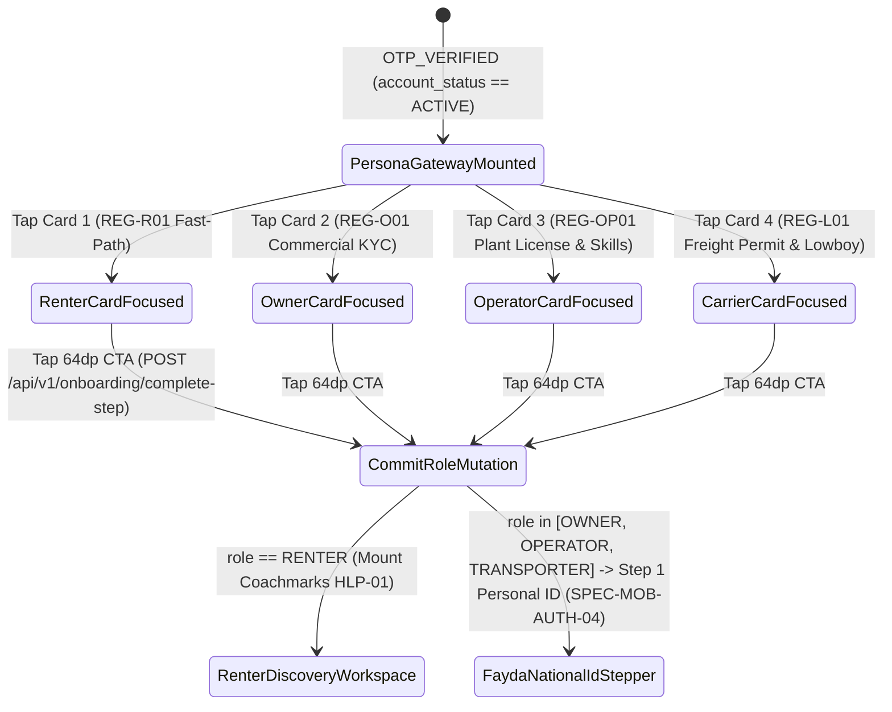

# Persona Role Selection & Industrial Onboarding Cards
## Mobile Subsystem Specification — `docs/mobile/auth-kyc/03-persona-role-selection.md`

**Document Identifier:** `SPEC-MOB-AUTH-03`  
**Classification:** Canonical Subsystem UI/UX & Technical Behavior Specification  
**Governing Documents:** `docs/source/Dink_Machinery_UI_UX_Design_Brief.md`, `docs/shared/design/00-design-system.md`, `docs/shared/design/design-tokens.json`, `docs/shared/requirements/04-user-roles.md`, `docs/shared/requirements/05-01-registration-authentication.md`, `docs/shared/requirements/05-14-user-onboarding-help.md`, `docs/ERROR_CATALOG.md`, `contracts/openapi.yaml`  
**Target Subsystem:** Flutter 3.44 / Dart 3.9 Mobile Client (iOS & Android)  
**Primary Persona / Actor:** Newly Verified MSISDN User (`account_status == ACTIVE`)  
**Requirement Traceability:** `REQ-04` (`ROL-01`..`ROL-04`), `REQ-05-01` (`KYC-01`..`KYC-10`), `REQ-05-14` (`ONB-02`, `REG-R01`, `REG-O01`, `REG-OP01`, `REG-L01`), `REQ-05-16` (`AC-02`)  
**Associated Interaction Flows:** `FLOW-01`, `FLOW-02`, `FLOW-03`, `FLOW-04`  
**Architectural Decision Records:** `ADR-005` (Role Scopes), `ADR-010` (Isar Onboarding State), `ADR-014` (Design Tokens)  
**Status:** Approved Technical Design Baseline

---

## 1. Domain Context & Non-Negotiable Persona Onboarding Invariants

Immediately after OTP verification (`OTP_VERIFIED`), the user selects their primary operational intent on the **Persona Selection Gateway (`ONB-02`)**. Because each market participant has vastly different regulatory and KYC obligations—from a Civil Contractor wanting immediate catalog browsing (`REG-R01` Fast-Path) to an Equipment Fleet Owner registering commercial trade licenses, 10-digit tax TINs, and settlement bank coordinates (`REG-O01`)—this screen applies **Progressive Disclosure** so no actor is burdened with irrelevant compliance forms.

### 1.1 Non-Negotiable System Invariants
1. **Four Canonical Industrial Persona Cards (`ONB-02`):**
   - Renders four high-contrast selectable role cards with custom machinery SVG iconography (`machinery.excavator`, `machinery.crane`, `machinery.lowboy`, operator helmet) and minimum `88dp` vertical height (`>= 56x56dp` hit target floor):
     1. **Civil Contractor (`RENTER` — `REG-R01`):** Fast-path immediate catalog access; Fayda/Kebele/National ID required only prior to locking a 60-minute booking hold.
     2. **Equipment Fleet Owner (`OWNER` — `REG-O01`):** Requires MoTRI/Registrar Trade License, 10-digit TIN, Insurance Policy (`IN-01`), and Commercial Bank Account coordinates.
     3. **Certified Field Operator (`OPERATOR` — `REG-OP01`):** Requires National ID, Heavy Plant Operator License (Class IV / Grade A), and multi-select Machinery Skill Tags.
     4. **Lowboy Logistics Carrier (`TRANSPORTER` — `REG-L01`):** Requires Commercial Freight Carrier Permit (FTA/NTSA), Lowboy Axle/Payload specs, and $2.5\%$ pass-through fee agreement.
2. **Dynamic Prerequisite Checklist Preview:**
   - Selecting any of the four persona cards dynamically expands an inline **Required Verification Dossier Checklist** before the user taps the `64dp` primary actuator, setting clear expectations on which physical documents (Kebele/Fayda ID, Trade License, TIN certificate) they need in hand.
3. **Server-Driven Role Metadata & Offline Resilience (`ADR-010`):**
   - Role descriptions, commission disclosures ($10.0\%$ standard plant / $2.5\%$ logistics pass-through), and checklist items are hydrated from `GET /api/v1/onboarding/config` and cached in Isar (`OnboardingState`).
4. **Multi-Role Extensibility Assurance:**
   - The screen explicitly informs the user that additional roles can be unlocked anytime from the App Bar Role Switcher (`SPEC-MOB-NAV-01`) under the same `+251`/`+254` phone identity.

---

## 2. Bespoke ASCII Wireframes: Persona Gateway & Dynamic Dossier Checklist

```text
+-----------------------------------------------------------------------+
| [<- 56x56dp]  SELECT YOUR PRIMARY WORKSPACE     [☀️ AAA 82k LUX] [ET] |
+=======================================================================+
|  HOW WILL YOU OPERATE ON DINK MACHINERY?                              |
|  You can unlock additional roles later from the top Role Switcher.    |
|                                                                       |
|  +-----------------------------------------------------------------+  |
|  | [🏗️] 1. RENT HEAVY MACHINERY                 (Civil Contractor) |  |
|  |      Source excavators, cranes & dozers within 50km radius.     |  |
|  |      [⚡ FAST-PATH: Instant Catalog Access | Fayda ID on Book]   |  |
|  +-----------------------------------------------------------------+  |
|  |                      <- 8dp Vertical Gap ->                     |  |
|  +=================================================================+  |
|  | [🚜] 2. LIST MY MACHINERY FLEET             [● SELECTED ROLE]   |  |
|  |      Rent out excavators, loaders & graders. Direct P2P bank    |  |
|  |      settlements, 8.0 hr/day shift protection & wallet ledger.  |  |
|  |  -------------------------------------------------------------  |  |
|  |  📋 REQUIRED COMMERCIAL KYC DOSSIER (24-Hour Audit SLA):        |  |
|  |   • Owner National ID / Fayda FIN or Passport (Front + Back)    |  |
|  |   • MoTRI Commercial Trade License & 10-Digit Tax TIN           |  |
|  |   • Verified Bank Account (CBE, Awash, Dashen, KCB, Equity)     |  |
|  |   • Active CPAR / Comprehensive Insurance Certificate (IN-01)   |  |
|  |======[ 3dp Solid Amber Lip: {color.brand.amber.500} ]===========|  |
|  +=================================================================+  |
|  |                      <- 8dp Vertical Gap ->                     |  |
|  +-----------------------------------------------------------------+  |
|  | [👷] 3. I OPERATE HEAVY MACHINERY          (Certified Operator) |  |
|  |      Join verified yard rosters, log shift meters &reticles.    |  |
|  |      [Requires: Grade-A / Class IV Plant License + Skill Tags]  |  |
|  +-----------------------------------------------------------------+  |
|  |                      <- 8dp Vertical Gap ->                     |  |
|  +-----------------------------------------------------------------+  |
|  | [🚛] 4. LOWBOY FREIGHT HAULAGE              (Logistics Carrier) |  |
|  |      Haul heavy equipment across corridors (2.5% pass-through). |  |
|  |      [Requires: FTA/NTSA Freight Permit + Lowboy Payload Specs] |  |
|  +-----------------------------------------------------------------+  |
+=======================================================================+
|  +-----------------------------------------------------------------+  |
|  |  [  INITIALIZE FLEET OWNER ONBOARDING  ->  ]       (64dp Height)|  |
|  +=================================================================+  |
+-----------------------------------------------------------------------+
```

---

## 3. W3C DTCG Design Token Mapping Table

| Persona Card Element | W3C Token Path (`design-tokens.json`) | Standard Dark (`Cast Iron`) | Outdoor High-Contrast (`>80k lux`) | Behavioral & Ergonomic Rule |
|---|---|---|---|---|
| **Selected Persona Card** | `{semantic.*.surface.cardElevated}` | `{color.brand.slate.800}` + `2dp` `{color.brand.amber.500}` | `#000000` + `3dp` `{color.brand.amber.400}` | Expands inline checklist (`250ms` `industrialDecelerate`). |
| **Unselected Persona Card**| `{semantic.*.surface.card}` | `{color.brand.slate.800}` + `1dp` `{color.brand.slate.700}` | `#000000` + `2dp` `#FFFFFF` | Minimum `88dp` collapsed height; `8dp` vertical spacing. |
| **Fast-Path Badge (`RENTER`)**| `{color.feedback.emerald.500}` | Fill `#064E3B`, Text `#10B981` | `#000000` + `2dp` `#10B981` border | Indicates immediate search feed access upon selection. |
| **Checklist Bullet Box** | `{color.brand.slate.900}` | `#0F172A` inset container | `#000000` + `1dp` `#FFFFFF` divider | Lists exact statutory documents for `ET` or `KE`. |
| **Primary Commit Actuator**| `{component.actuator.button.heightField}` | `{dimension.space.64}` (`64dp`) | `{dimension.space.64}` (`64dp`) | Dynamically updates label to match selected persona. |

---

## 4. State Machine: Persona Selection & Onboarding Pathway Routing



---

## 5. Concrete Flutter Implementation Blueprint

### 5.1 Persona Selection BLoC (`persona_selection_bloc.dart`)
```dart
// lib/features/auth/bloc/persona_selection_bloc.dart
import 'package:dio/dio.dart';
import 'package:flutter/services.dart';
import 'package:flutter_bloc/flutter_bloc.dart';
import 'package:freezed_annotation/freezed_annotation.dart';
import 'package:uuid/uuid.dart';
import '../../navigation/bloc/role_switcher_bloc.dart';

part 'persona_selection_bloc.freezed.dart';

@freezed
class PersonaSelectionEvent with _$PersonaSelectionEvent {
  const factory PersonaSelectionEvent.cardSelected(AppPersona persona) = _CardSelected;
  const factory PersonaSelectionEvent.operatorSkillToggled(String categorySlug) = _OperatorSkillToggled;
  const factory PersonaSelectionEvent.confirmPersonaSubmitted() = _ConfirmPersonaSubmitted;
}

@freezed
class PersonaSelectionState with _$PersonaSelectionState {
  const factory PersonaSelectionState({
    @Default(AppPersona.renter) AppPersona selectedPersona,
    @Default(<String>['excavator']) List<String> selectedOperatorSkills,
    @Default(false) bool isSubmitting,
    String? nextRouteDestination,
    String? rfc9457ErrorCode,
  }) = _PersonaSelectionState;
}

class PersonaSelectionBloc extends Bloc<PersonaSelectionEvent, PersonaSelectionState> {
  final Dio _dio;

  PersonaSelectionBloc(this._dio) : super(const PersonaSelectionState()) {
    on<_CardSelected>(_onCardSelected);
    on<_OperatorSkillToggled>(_onOperatorSkillToggled);
    on<_ConfirmPersonaSubmitted>(_onConfirmPersonaSubmitted);
  }

  void _onCardSelected(_CardSelected event, Emitter<PersonaSelectionState> emit) {
    HapticFeedback.lightImpact();
    emit(state.copyWith(selectedPersona: event.persona, rfc9457ErrorCode: null));
  }

  void _onOperatorSkillToggled(
    _OperatorSkillToggled event,
    Emitter<PersonaSelectionState> emit,
  ) {
    HapticFeedback.selectionClick();
    final current = List<String>.from(state.selectedOperatorSkills);
    if (current.contains(event.categorySlug)) {
      if (current.length > 1) current.remove(event.categorySlug);
    } else {
      current.add(event.categorySlug);
    }
    emit(state.copyWith(selectedOperatorSkills: current));
  }

  Future<void> _onConfirmPersonaSubmitted(
    _ConfirmPersonaSubmitted event,
    Emitter<PersonaSelectionState> emit,
  ) async {
    if (state.isSubmitting) return;
    emit(state.copyWith(isSubmitting: true, rfc9457ErrorCode: null));

    try {
      await _dio.post<Map<String, dynamic>>(
        '/api/v1/onboarding/complete-step',
        data: {
          'stepKey': 'ROLE_SELECTED',
          'selectedRole': state.selectedPersona.name.toUpperCase(),
          if (state.selectedPersona == AppPersona.operatorRole)
            'operatorSkillTags': state.selectedOperatorSkills,
        },
        options: Options(headers: {'Idempotency-Key': const Uuid().v4()}),
      );

      await HapticFeedback.mediumImpact();
      final nextRoute = state.selectedPersona == AppPersona.renter
          ? '/renter/discover'
          : '/auth/kyc/fayda-national-id';

      emit(state.copyWith(isSubmitting: false, nextRouteDestination: nextRoute));
    } on DioException catch (e) {
      final code = e.response?.data?['error']?['code'] as String? ?? 'SYS_SERVICE_UNAVAILABLE';
      emit(state.copyWith(isSubmitting: false, rfc9457ErrorCode: code));
    }
  }
}
```

---

## 6. OpenAPI 3.1.0 Contract & RFC 9457 Error Recovery Matrix

| Endpoint / Operation | Method & Path | Request / Header Invariants | RFC 9457 Error Code & Status | UI Recovery Behavior |
|---|---|---|---|---|
| **Fetch Persona Config** | `GET /api/v1/onboarding/config` | `X-Country-Code: ET \| KE` | `SYS_SERVICE_UNAVAILABLE` (`503`) | Hydrate persona cards and statutory checklists from local Isar cache. |
| **Commit Selected Role** | `POST /api/v1/onboarding/complete-step` | `Idempotency-Key` + `selectedRole` | `REQ_VALIDATION_FAILED` (`400`) | Highlight missing operator skill tags (`selectedOperatorSkills` must be non-empty for `OPERATOR`). |
| **Expired Session Token** | `POST /api/v1/onboarding/complete-step` | `Authorization: Bearer <jwt>` | `AUTH_INVALID_TOKEN` (`401`) | Execute background RTR token refresh and replay `complete-step` with identical `Idempotency-Key`. |

---

## 7. Verification & Acceptance Criteria

### 7.1 Automated Unit & BLoC Test Cases (`bloc_test`)
1. **Renter Fast-Path vs. Commercial KYC Routing:**
   - *Given* `PersonaSelectionBloc` with `selectedPersona: AppPersona.renter`,
   - *When* `confirmPersonaSubmitted` succeeds,
   - *Then* `nextRouteDestination` emits `'/renter/discover'`.
   - *Given* `selectedPersona: AppPersona.owner`,
   - *When* `confirmPersonaSubmitted` succeeds,
   - *Then* `nextRouteDestination` emits `'/auth/kyc/fayda-national-id'`.

### 7.2 Widget & Accessibility Test Gates
1. **Glove-Friendly Persona Card & Semantics Gate:**
   - Widget test verifies all 4 persona cards expose `Semantics(button: true, selected: ...)` and maintain a minimum touch height of `>= 88.0dp` with `>= 8.0dp` vertical spacing.
